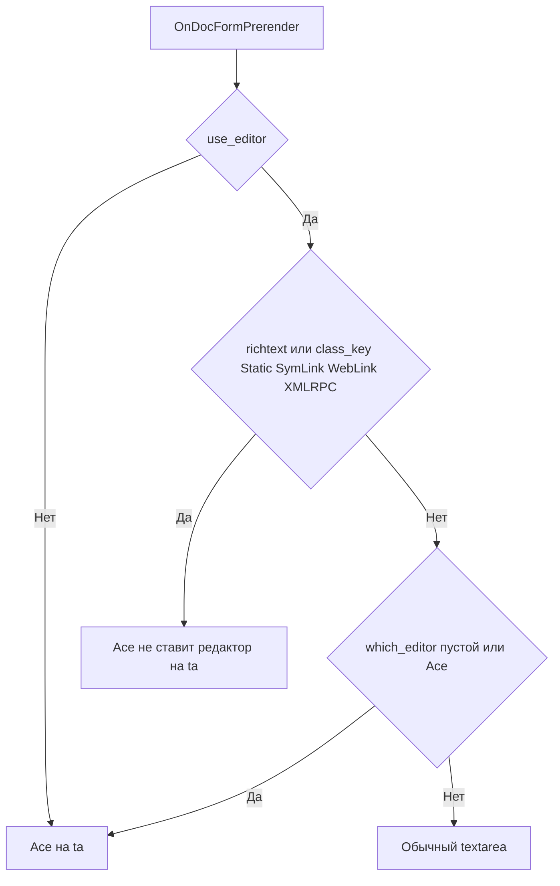

# Интеграция

Плагин **Ace** слушает события менеджера: формы элементов, файлов, ресурса, вкладка кэша обзора ресурса, регистрация RTE и список TV input.

## Где работает редактор

| Контекст | Событие / поле | Mime по умолчанию |
| --- | --- | --- |
| Сниппет | `OnSnipFormPrerender` → `modx-snippet-snippet` | PHP |
| Плагин | `OnPluginFormPrerender` | PHP |
| Шаблон | `OnTempFormPrerender` | `ace.html_elements_mime` или авто |
| Чанк | `OnChunkFormPrerender` | HTML/Fenom/Twig. У static сначала расширение имени чанка, иначе расширение файла источника, иначе `text/plain` |
| Новый файл | `OnFileCreateFormPrerender` | `text/plain`, теги MODX выключены |
| Существующий файл | `OnFileEditFormPrerender` | по расширению. Неизвестное расширение: режим Ace по имени файла, теги MODX выключены |
| Ресурс (content) | `OnDocFormPrerender` → `#ta` | content type. Для `text/html` подставляется `ace.html_elements_mime` |
| Обзор ресурса → кэш | `OnManagerPageBeforeRender` → `modx-rdata-buffer` | html mime |
| TV | тип ввода **Ace** | всегда `text/html`, теги MODX включены |

Если `which_element_editor` не равен `Ace`, плагин выходит сразу. Плагин не инициализирует элементы, файлы, ресурс, кэш `resource/data` и список TV. `OnRichTextEditorRegister` отрабатывает раньше и по-прежнему отдаёт имя `Ace`. Пустая или отсутствующая настройка считается `Ace`.

## Ресурсы и RTE



1. `use_editor` и `which_editor` читаются с учётом контекста ресурса.
2. `use_editor = Нет`: Ace заменяет `#ta` и все textarea с классом `modx-richtext` (`text/html`, теги MODX включены).
3. `use_editor = Да` и richtext или class_key `modStaticResource`, `modSymLink`, `modWebLink`, `modXMLRPCResource`. Ace `#ta` не трогает. Своего обработчика `OnRichTextEditorInit` у плагина нет.
4. `use_editor = Да`, richtext выключен, `which_editor` пустой или `Ace` (без учёта регистра): Ace на `#ta`.
5. `use_editor = Да` и `which_editor` не `Ace`: `#ta` остаётся обычным textarea.

| Схема | Настройки |
| --- | --- |
| Ace в content у всех ресурсов | `use_editor = Нет` |
| Ace только у ресурсов без richtext | `use_editor = Да`, `which_editor` пустой или `Ace`, richtext выключен |
| RTE для статей, textarea для кодовых страниц | `use_editor = Да`, другой `which_editor`, richtext только у нужных ресурсов |

## Mime и подсветка MODX / Fenom

Подсветка тегов MODX включается только для HTML-подобных mime:

- `text/html`
- `text/x-smarty` (Fenom / Smarty)
- `text/x-twig`

Для CSS/SCSS/LESS/static-чанков с расширением `.css` mixed-mode MODX **не** включается: комментарии `//` и `/* */` подсвечиваются как CSS.

Автовыбор `ace.html_elements_mime`, если настройка пуста:

| Условие | Mime |
| --- | --- |
| Есть `twiggy_class` | `text/x-twig` |
| Включён `pdotools_fenom_parser` | `text/x-smarty` |
| Иначе | `text/html` |

Явно задайте `ace.html_elements_mime = text/x-smarty`, если Fenom в чанках нужен всегда.

Расширение существующего файла:

| Расширение | Mime |
| --- | --- |
| `tpl` | `text/x-smarty` |
| `htm`, `html` | `text/html` |
| `css` | `text/css` |
| `scss` | `text/x-scss` |
| `less` | `text/x-less` |
| `svg` | `image/svg+xml` |
| `xml`, `xsl` | `application/xml` |
| `js` | `application/javascript` |
| `json` | `application/json` |
| `php` | `application/x-php` |
| `sql` | `text/x-sql` |
| `md` | `text/x-markdown` |
| `txt` | `text/plain` |
| `twig` | `text/x-twig` |

Новый файл всегда `text/plain`. У static-чанка сначала смотрится расширение имени (`header.css` остаётся CSS, даже если файл источника другой).

## Сохранение PHP

Для mime `application/x-php` и `text/x-php` редактор не перезаписывает буфер после сохранения сниппета или плагина. Условие: отличие только в обёртке `<?php` / `?>`. История undo не сбрасывается. MODX хранит в базе код без этой обёртки. После перезагрузки страницы показывается текст из базы, уже без обёртки. На HTML-чанки это не распространяется.

## Tab-сниппеты

Формат настройки `ace.snippets` (Ace snippets):

```text
snippet getr
    [[!getResources? &parents=`${1}` &limit=`${2:10}` &tpl=`${3}`]]
```

В определении Ace нужна настоящая табуляция после имени сниппета (**Alt+09** в настройке), не пробелы. В примере выше отступ показан пробелами из‑за markdown. Развёртывание в редакторе: имя + **Tab**.

Набор по умолчанию (если `ace.snippets` пуст при установке или обновлении): `getr`, `getResources`, `pdoResources`, `pdoMenu`, `chunk`, `snippet`, `tv`, `formit` и др. Эталон файла: `assets/components/ace/snippets/modx.default.snippets`.

Свои сокращения добавляйте в системную настройку. Файл в assets не правьте: при обновлении пакета он может перезаписаться.

## Автодополнение

**Ctrl+Space**, **Ctrl+Shift+Space** или **Alt+Space**. Запрос на `assets/components/ace/completions.php`. Action: `getFunctions`, `getProperties`, `getFilters`, `getObjects`, `getResourceFields`. `getFilters` дополняется сниппетами. `getObjects` отдаёт чанки, сниппеты, TV и системные настройки. Для TV рядом запрашиваются поля ресурса.

## TV типа Ace

1. Создайте TV и выберите тип ввода **Ace**
2. Выведите TV на шаблон ресурса

Свойства mime у этого типа нет. Поле всегда `text/html` с подсветкой тегов MODX. Высота из style textarea или 200. `ace.height` на TV не действует.

## Черновики

При `ace.draft_restore = Да` Ace пишет текст поля в localStorage. После перезагрузки Ace предлагает восстановить или отменить. Баннер не показывается, если черновик пустой или совпадает с уже открытым текстом. Ace сбрасывает черновик в `MODx.onSaveEditor`, когда поле уже заменено Ace. Срок хранения: 7 дней.

## Связанные разделы

- [Системные настройки](settings)
- [Горячие клавиши](hotkeys)
- [Решение проблем](troubleshooting)
