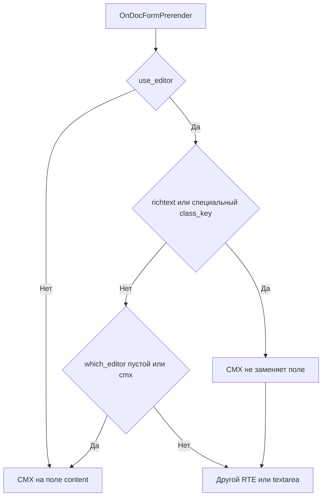

# Интеграция

Плагин **CMX** заменяет поля на формах менеджера, регистрирует тип ввода TV, создаёт снимки при сохранении и удаляет историю удалённых объектов. Редактор загружается только на страницах, где есть поддерживаемое поле.

## Где работает редактор

| Контекст | Событие / поле | Язык по умолчанию |
| --- | --- | --- |
| Сниппет | `OnSnipFormPrerender` → `modx-snippet-snippet` | PHP без открывающего `<?php` |
| Плагин | `OnPluginFormPrerender` → `modx-plugin-plugincode` | PHP без открывающего `<?php` |
| Шаблон | `OnTempFormPrerender` → `modx-template-content` | HTML, Fenom или Twig |
| Чанк | `OnChunkFormPrerender` → `modx-chunk-snippet` | HTML/Fenom/Twig; у static язык определяется по расширению |
| Новый файл | `OnFileCreateFormPrerender` → `modx-file-content` | `text/plain`, MODX-теги выключены |
| Существующий файл | `OnFileEditFormPrerender` → `modx-file-content` | По расширению |
| Ресурс (content) | `OnDocFormPrerender` → `ta` | MIME типа содержимого; HTML заменяется выбранным шаблонным режимом |
| Обзор ресурса → кэш | `OnManagerPageBeforeRender` → `modx-rdata-buffer` | HTML/Fenom/Twig |
| TV | Тип ввода **cmx** | Свойство TV `language`, по умолчанию HTML |

Основная замена форм выполняется при `which_element_editor = cmx`. Регистрация имени `cmx` в списке RTE, тип ввода TV и события истории обрабатываются отдельно.

## Ресурсы и RTE



1. `use_editor` и `which_editor` читаются с учётом контекста ресурса.
2. `use_editor = Нет`: CMX заменяет поле content и textarea с классом `modx-richtext`.
3. `use_editor = Да` и включён richtext: CMX поле не перехватывает.
4. Для `modStaticResource`, `modSymLink`, `modWebLink` и `modXMLRPCResource` в ветке RTE поле также не заменяется.
5. `use_editor = Да`, richtext выключен, `which_editor` пустой или `cmx`: используется CMX.
6. `use_editor = Да` и выбран другой `which_editor`: остаётся другой RTE или обычная textarea.

| Схема | Настройки |
| --- | --- |
| CMX в content у всех ресурсов | `use_editor = Нет` |
| CMX только у ресурсов без richtext | `use_editor = Да`, `which_editor` пустой или `cmx`, richtext выключен |
| RTE для статей, CMX для элементов | `use_editor = Да`, другой `which_editor`, richtext у нужных ресурсов |

## MIME и язык

Подсветка и автодополнение MODX-тегов включаются для:

- `text/html`;
- `text/x-smarty` - Fenom;
- `text/x-twig` - Twig.

Для CSS, SCSS и Less эти возможности не включаются: код остаётся CSS, а не смешанным HTML-документом.

Необязательная настройка `cmx.html_elements_mime` задаёт режим шаблонов, обычных чанков и HTML-ресурсов. Если её нет, CMX выбирает:

| Условие | MIME |
| --- | --- |
| Заполнен `twiggy_class` | `text/x-twig` |
| Включён `pdotools_fenom_parser` | `text/x-smarty` |
| Иначе | `text/html` |

Расширения файлов и static-чанков:

| Расширение | MIME |
| --- | --- |
| `tpl` | `text/x-smarty` |
| `htm`, `html` | Выбранный HTML/Fenom/Twig-режим для файлов; `text/html` в карте static |
| `css` | `text/css` |
| `scss` | `text/x-scss` |
| `less` | `text/x-less` |
| `svg` | `image/svg+xml` |
| `xml`, `xsl` | `application/xml` |
| `js` | `application/javascript` |
| `json` | `application/json` |
| `php` | `text/x-php` для файлов |
| `sql` | `text/x-sql` |
| `md` | `text/x-markdown` |
| `twig` | `text/x-twig` |
| `txt` | `text/plain` |

У static-чанка сначала проверяется расширение имени чанка, затем расширение исходного файла. Новый файл начинается как `text/plain`.

## Автодополнение

Подсказки появляются автоматически или по **Ctrl+Space**.

| Контекст | Данные |
| --- | --- |
| `[[`, `[[!` | Сниппеты и префиксы типов MODX-тегов |
| `[[$` | Чанки |
| `[[*` | TV и поля ресурса; на форме ресурса - TV текущего шаблона |
| `[[+` | Поля ресурса и плейсхолдеры из документа |
| `[[~` | Ресурсы с ID и заголовком |
| `[[++` | Системные настройки и текущие значения |
| `[[%` | Записи лексиконов на языке менеджера |
| `&property` | Параметры сниппета/чанка, описания и значения по умолчанию |
| `:filter` | Фильтры вывода MODX |
| `@set` | Наборы свойств |
| Fenom / Twig | Теги, блоки, модификаторы, фильтры и объекты |
| `$modx->`, `$xpdo->` | Методы MODX/xPDO API |
| Обычное слово в PHP | PHP-функции и пользовательские фрагменты |

Повторные подсказки скрывают уже использованные параметры. Настройки `cmx.autocomplete.*` управляют значениями по умолчанию, закрытием тегов и каркасами блоков.

Пользовательские фрагменты задаются в `cmx.snippets`:

```text
Название :: вставляемый текст
```

## Переход и hover-подсказки

При `cmx.goto_definition = Да` **Ctrl/Cmd + клик** открывает сниппет, чанк, TV или ресурс в новой вкладке браузера.

При `cmx.hovers = Да` наведение показывает:

- заголовок и URI ресурса;
- описание сниппета, чанка или TV;
- описание поля ресурса;
- справку по фильтрам вывода MODX;
- справку по модификаторам Fenom.

## Проверка кода

- **PHP:** браузерный сканер скобок, строк, комментариев и `heredoc`/`nowdoc`; дополнительно серверный `php -l`.
- **CSS:** неизвестные свойства, вероятные опечатки и фигурные скобки в CSS-файлах и `<style>`.
- **Fenom/MODX:** незакрытые и несоответствующие блоки, кавычки, апострофы и скобки.

Серверная проверка использует `cmx.php_path`. Если PHP CLI или `exec()` недоступны, остаётся браузерная диагностика. `cmx.warn_on_save` включает подтверждение перед сохранением кода с критическими ошибками, но не запрещает сохранение окончательно.

## TV типа CMX

1. Создайте TV и выберите тип ввода **cmx**
2. Добавьте TV к шаблону ресурса
3. При необходимости задайте свойства ввода:

| Свойство | По умолчанию | Описание |
| --- | --- | --- |
| `language` | `text/html` | `text/html`, `text/css`, `application/javascript`, `application/json`, `text/x-sql`, `application/xml`, `text/x-markdown` или `application/x-php` |
| `height` | `260` | Высота редактора в px, минимум 100 |

Значение сохраняется как обычное TV и остаётся в редакторе после сохранения ресурса. Тип ввода отключается настройкой `cmx.tv`.

## Черновики

При `cmx.autosave = Да` CMX сохраняет рабочую копию в `localStorage` текущего браузера. После повторного открытия можно:

- сравнить сохранённый документ и черновик в side-by-side diff;
- восстановить черновик;
- удалить его.

Срок хранения задаётся `cmx.autosave_lifetime` в минутах. Черновики не отправляются на сервер и не синхронизируются между браузерами.

## История версий

При `cmx.versions = Да` снимки сниппетов, чанков, шаблонов, плагинов и ресурсов сохраняются в таблицу `cmx_revision`.

Панель истории поддерживает просмотр, загрузку в редактор, копирование, сравнение двух версий и экспорт JSON. Загрузка версии сама по себе не сохраняет элемент: нужно нажать обычную кнопку сохранения MODX.

`cmx.versions_max` ограничивает количество снимков. Повторные одинаковые сохранения в течение короткого интервала не создают новую версию. При удалении элемента его история удаляется; при окончательной очистке корзины удаляется история ресурсов. Для файлов файлового менеджера история версий не ведётся.

## CMX Scratchpad

Виджет добавляется через **Дашборд → Редактировать → Виджеты → CMX Scratchpad**. Текст хранится только в `localStorage` браузера менеджера и не отправляется на сервер.

## Связанные разделы

- [Системные настройки](settings)
- [Горячие клавиши](hotkeys)
- [Решение проблем](troubleshooting)
