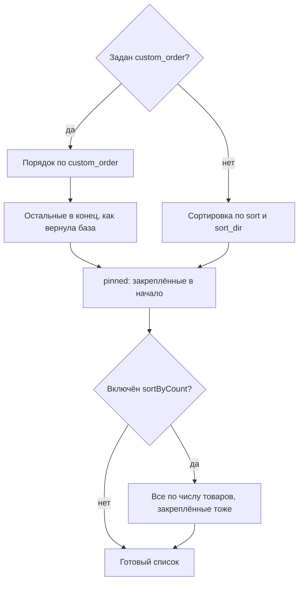

# Сортировка значений фильтра

Порядок значений задаётся в JSON набора фильтров параметрами `sort`, `sort_dir`, `pinned` и `custom_order`. Параметр `sortByCount` сниппета `mFilterForm` пересортировывает значения по числу товаров поверх этих настроек.

## Порядок по умолчанию

Без `sort` значения идут по числу товаров, от большего к меньшему. Исключения:

- производители — по имени;
- фильтр «да/нет» не сортируется: всегда «Да», затем «Нет».

Порядок считается при загрузке страницы. После фильтрации скрипт обновляет числа, но значения не переставляет — даже при `sort: count`.

## Где задать порядок

Параметры сортировки пишутся в JSON набора — колонка `filters` таблицы `mfl_filter_sets`. В редакторе набора полей для них нет, но при сохранении он их не стирает:

```json
{
    "color": {
        "type": "default",
        "source": "option",
        "field": "color",
        "label": "Цвет",
        "sort": "value",
        "sort_dir": "asc"
    }
}
```

| Параметр | Описание | Значения |
|----------|----------|----------|
| `sort` | Поле сортировки | `count` (по умолчанию), `value`, `label`; у производителей ещё три — см. ниже |
| `sort_dir` | Направление | `desc` (по умолчанию), `asc` |
| `pinned` | Закреплённые значения | Массив значений или подписей |
| `custom_order` | Свой порядок всех значений | Массив значений или подписей |

Значения `sort`:

| Значение | Для каких фильтров | Как сортирует |
|---|---|---|
| `count` | Все, кроме «да/нет» | По числу товаров |
| `value` | Все, кроме «да/нет» | По значению. У производителей, разделов и категорий товаров значение — id, поэтому по названию, как `label` |
| `label` | Все, кроме «да/нет» | По подписи, которую видит посетитель. Значение без подписи — по самому значению |
| `position` | Производители | В порядке, заданном в MiniShop3 |
| `name` | Производители | Как `label`, но по умолчанию по возрастанию |
| `product_count` | Производители | Как `count`, но по умолчанию по возрастанию |

`pinned` и `custom_order` ищут значение сначала среди значений, затем среди подписей: у производителя можно писать название, а не id. Если подпись повторяется — например, два раздела «Аксессуары», — сработает первый.

## Примеры

### По алфавиту и по числу товаров

| Порядок | `sort` | `sort_dir` |
|---|---|---|
| По числу товаров, больше → меньше | `count` | `desc` |
| По числу товаров, меньше → больше | `count` | `asc` |
| По алфавиту, А → Я | `value` | `asc` |
| По алфавиту, Я → А | `value` | `desc` |

### Закреплённые значения

Значения из `pinned` всегда вверху, остальные сортируются по `sort`:

```json
{
    "brand": {
        "type": "default",
        "source": "option",
        "label": "Бренд",
        "pinned": ["Apple", "Samsung", "Xiaomi"],
        "sort": "count",
        "sort_dir": "desc"
    }
}
```

Результат:

1. Apple
2. Samsung
3. Xiaomi
4. (остальные по убыванию числа товаров)

### Производители: три закреплены, остальные по алфавиту

```json
{
    "vendor": {
        "type": "vendors",
        "label": "Производитель",
        "pinned": ["Apple", "Samsung", "Sony"],
        "sort": "value",
        "sort_dir": "asc"
    }
}
```

### Свой порядок всех значений

```json
{
    "size": {
        "type": "default",
        "source": "option",
        "label": "Размер",
        "custom_order": ["XS", "S", "M", "L", "XL", "XXL"]
    }
}
```

Значения, не указанные в `custom_order`, добавляются в конец в том порядке, в каком их вернула база: `sort` вместе с `custom_order` не действует.

### Годы — от новых к старым

```json
{
    "year": {
        "type": "year",
        "source": "resource",
        "field": "publishedon",
        "label": "Год",
        "sort": "value",
        "sort_dir": "desc"
    }
}
```

## Параметр `sortByCount`

`sortByCount` сниппета `mFilterForm` ставит выше значения с большим числом товаров:

```fenom
{'!mFilterForm' | snippet : [
    'resourceId' => $_modx->resource.id,
    'sortByCount' => 1
]}
```

::: warning Приоритет
Параметр `sortByCount` в сниппете применяется **после** сортировки из конфигурации фильтра и переопределяет её.
:::

## Порядок применения

1. **`custom_order`** — если указан, полностью определяет порядок.
2. **`sort` и `sort_dir`** — если `custom_order` нет.
3. **`pinned`** — закреплённые значения перемещаются в начало.
4. **`sortByCount`** сниппета — финальная пересортировка по числу товаров. Закреплённые значения она тоже переставляет.



## Натуральная сортировка

При `value` и `label` текст сравнивается **натурально** — числа внутри строк идут по величине:

- обычная: `1, 10, 2, 20, 3`;
- натуральная: `1, 2, 3, 10, 20`.

Регистр не учитывается для любого алфавита: «абрикос» встанет перед «Яблоко». Размеры `S, M, L, XL` натуральная сортировка не упорядочит — она расставит их по алфавиту. Для них задайте `custom_order`.
