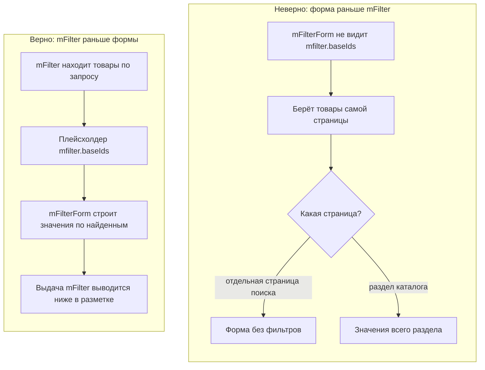

# Фильтры на странице поиска

Фильтры по результатам поиска mSearch работают, если `mFilter` вызван раньше `mFilterForm`: `mFilter` находит товары по запросу, а форма строит по ним значения фильтров.

## Задача

На странице с результатами поиска вывести форму фильтров: значения и числа — только по найденным товарам, выбор фильтра — без потери поискового запроса.

## Решение

```fenom
{'!mSearchForm' | snippet}

{* Сначала mFilter — вывод в переменную *}
{set $mfilterOutput = '!mFilter' | snippet : [
    'element' => 'msProducts',
    'parents' => 0,
]}

<aside>
    {'!mFilterForm' | snippet}
</aside>

<main>
    {$mfilterOutput}
</main>
```

Странице поиска нужен набор фильтров: привяжите её к набору в админке mFilter, как раздел каталога.

`mFilter` берёт поисковый запрос из параметра `mse_query` — так его называет `mSearchForm`. Если в форме поиска параметр другой, укажите его: `'searchVar' => 'query'`. Запрос можно передать и прямо в вызове: `'search' => '…'`.

Для строки «Найдено N по запросу …» `mFilter` ставит плейсхолдеры — см. [mSearch](../integration/msearch#pleysholdery).

## Почему так

### Порядок вызова

`mFilter` находит товары по запросу и передаёт их форме плейсхолдером `mfilter.baseIds`. `mFilterForm`, вызванный раньше, плейсхолдера не видит и берёт товары самой страницы:

- у отдельной страницы поиска товаров нет — форма останется без фильтров;
- на разделе каталога форма покажет значения всего раздела, а не найденных товаров.

Вызов `{set $mfilterOutput = … }` выполняет `mFilter` сразу, а его вывод ставится ниже, в нужном месте разметки.



### Где искать

Поиск работает только с `&element`. Найденные товары пересекаются с теми, что отбирает элемент:

| `parents` | Где ищет |
|---|---|
| `0` или корень каталога | Во всём каталоге |
| Раздел каталога | Только в разделе |

`parents` указывайте всегда. Без него элемент берёт потомков самой страницы поиска, а товаров среди них нет. Если в области нет товаров, mFilter сейчас берёт всё, что mSearch нашёл по сайту, вместе со статьями и страницами: «Найдено» и число страниц считаются по ним, а в выдаче остаются только товары, и последние страницы пустые.

### Фильтрация после поиска

Поисковый запрос сохраняется вместе с параметрами вызова `mFilter`. После выбора фильтра сервер снова ищет по нему, а `mse_query` остаётся в адресе.

## Если не работает

| Симптом | Причина |
|---------|---------|
| На странице поиска форма пустая | `mFilterForm` вызван раньше `mFilter` или страница не привязана к набору фильтров |
| Числа у фильтров — по всему разделу, а не по найденному | `mFilterForm` вызван раньше `mFilter` |
| Выдача не меняется от запроса | Параметр запроса в форме поиска не `mse_query`, а `searchVar` не указан. Или `mFilter` вызван без `&element`. Или не установлен mSearch |
| Ничего не найдено — страница пустая, без фильтров и без сообщения | Не задан `tplEmpty`: при пустом результате сниппет выводит только его |
| Выбор фильтра не обновляет выдачу | В своём `tplOuter` нет обёртки `data-mfilter-results` с вложенным `.mfilter-results` — см. [Контракт разметки](../frontend/templates#kontrakt-razmetki) |
