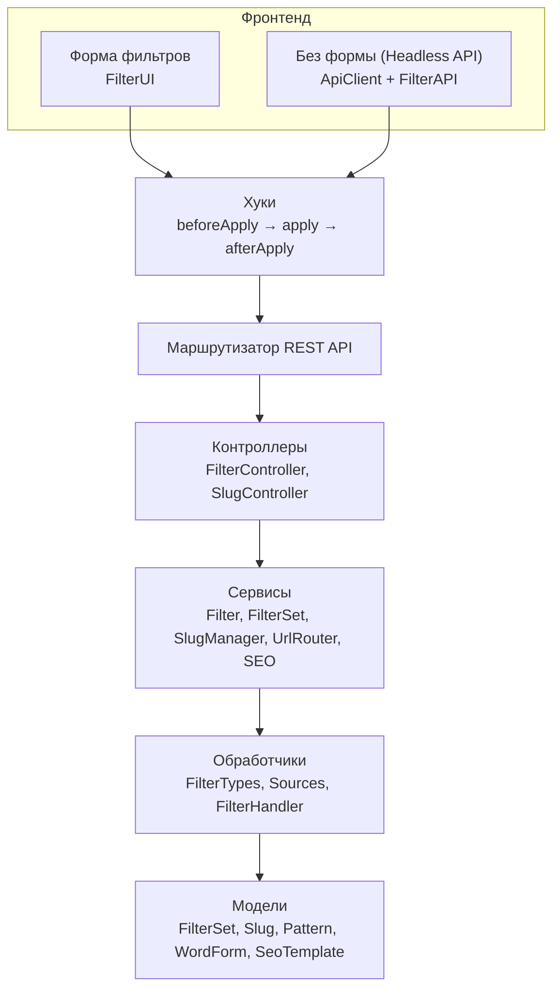

# Разработка

## Разделы

| Раздел | Описание |
|--------|----------|
| [JavaScript](javascript) | Подключение скриптов, настройки формы, слайдер диапазона |
| [JS API](js-api) | Управление фильтром из своего кода |
| [Headless API](headless) | Запросы к серверу без формы, из своего приложения |
| [Сервисы](services) | PHP-сервисы фасада `MFilter` |
| [Типы фильтров](filter-types) | Встроенные типы и свой тип фильтра |
| [События](events) | События MODX, на которые подписан плагин, и `OnMFilterInit` |
| [Модели и БД](models) | Таблицы базы данных |

## Архитектура



## Точки расширения

| Где | Что | Подробнее |
|---|---|---|
| JavaScript | Хуки — перехват запросов фильтрации | [Headless API → Хуки](headless#huki) |
| JavaScript | События формы в браузере | [JS API → События](js-api#sobytiya) |
| PHP | Свои типы фильтров, в том числе по своим таблицам | [Типы фильтров](filter-types) |
| PHP | Событие `OnMFilterInit` — регистрация своих типов | [События](events#onmfilterinit) |
| Чанки | Своя разметка формы и результатов | [Чанки и разметка](../frontend/templates) |

## Быстрые примеры

### Программное управление фильтром

```javascript
mfilterGet().setFilter('color', ['red', 'blue']);   // запрос уйдёт сам
```

### Хук на применение фильтров

```javascript
mfilterHooks.add('beforeApply', (ctx) => {
    console.log('Фильтры:', ctx.params.filters);
    // Можно модифицировать ctx.params
});
```

### Регистрация своего типа фильтра

```php
// В плагине на OnMFilterInit
$mfilter->getFilterTypesRegistry()->register('mytype', new MyFilterType($modx, $mfilter));
```
