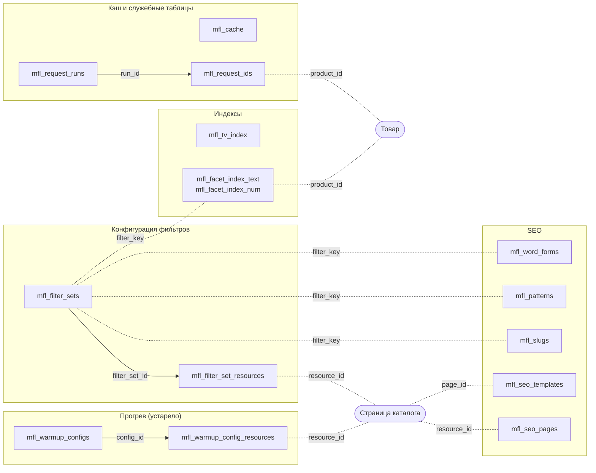

# Модели и база данных

Схема актуальна для версий 1.5.0+.

::: tip Соглашения

- Префикс таблиц — `mfl_`. Полное имя зависит от `table_prefix` MODX (`{prefix}_mfl_*`).
- Поля даты-времени называются `created_at` / `updated_at`, как правило, типа `datetime`. У служебных таблиц запросов (`mfl_request_runs`, `mfl_request_ids`) `created_at` — число секунд UNIX.
- Поля сортировки — `sort_order` или `priority`: слово `rank` в MySQL 8 зарезервировано.
- JSON хранится в полях типа `text` с phptype `json` — xPDO сериализует его сам.
:::

## Полный список таблиц

| Таблица | Модель | Назначение |
|---------|--------|------------|
| `mfl_filter_sets` | MflFilterSet | Наборы фильтров |
| `mfl_filter_set_resources` | MflFilterSetResource | Привязки наборов к ресурсам |
| `mfl_slugs` | MflSlug | SEO-алиасы значений фильтров |
| `mfl_patterns` | MflPattern | Паттерны URL-сегментов |
| `mfl_seo_templates` | MflSeoTemplate | Шаблоны title/h1/description и SEO-текста |
| `mfl_seo_pages` | MflSeoPage | Индивидуальные SEO подборок (1.5.0+) |
| `mfl_word_forms` | MflWordForm | Словоформы для склонения значений |
| `mfl_tv_index` | MflTvIndex | Денормализованный индекс TV-значений |
| `mfl_facet_index_text` | MflFacetIndexText | Индекс текстовых значений фильтров (1.4.0+) |
| `mfl_facet_index_num` | MflFacetIndexNum | Индекс числовых значений фильтров (1.4.0+) |
| `mfl_cache` | MflCache | Кэш промежуточных результатов и служебные записи |
| `mfl_request_runs` | MflRequestRun | Запросы с большими списками ID (1.4.0+) |
| `mfl_request_ids` | MflRequestIds | Списки ID: `JOIN` вместо `IN(...)` (1.4.0+) |
| `mfl_warmup_configs` | MflWarmupConfig | Конфигурации прогрева кэша *(устарела с 1.4.0)* |
| `mfl_warmup_config_resources` | MflWarmupConfigResource | Привязки конфигураций прогрева к страницам *(устарела)* |

Сплошная линия — ссылка на ID записи, пунктир — одно и то же значение в полях:



---

## Конфигурация фильтров

### MflFilterSet

Набор фильтров. К ресурсам привязывается через `MflFilterSetResource`.

| Поле | Тип | Описание |
|------|-----|----------|
| `id` | int unsigned PK | ID набора |
| `name` | varchar(255) | Название |
| `description` | text NULL | Описание |
| `filters` | text (JSON) | Конфигурация фильтров |
| `inherit` | tinyint(1) default 1 | Наследовать привязку на дочерние ресурсы |
| `sort_order` | int default 0 | Порядок сортировки в админке |
| `active` | tinyint(1) default 1 | Активен |
| `created_at` | datetime NULL | — |
| `updated_at` | datetime NULL | — |

**Индексы:** PRIMARY(`id`), `idx_active`(`active`), `idx_sort_order`(`sort_order`).

**Структура `filters` (JSON):**

```json
{
  "vendor_id": {
    "type": "vendors",
    "source": "product",
    "label": "Производитель",
    "enabled": true
  },
  "color": {
    "type": "default",
    "source": "option",
    "field": "color",
    "label": "Цвет",
    "enabled": true
  },
  "price": {
    "type": "number",
    "source": "product",
    "field": "price",
    "label": "Цена",
    "enabled": true
  }
}
```

Значения `type`: `default`, `number`, `boolean`, `vendors`, `colors`, `parents`, `ms3_categories`, `date`, `month`, `year`, `day` и любые типы, зарегистрированные на [`OnMFilterInit`](events). Описание типов — в разделе [Типы фильтров](filter-types).

Значения `source`: `product` (msProductData), `option` (msProductOption), `tv`, `resource` (поле modResource). См. [Свой тип фильтра](/components/mfilter/cookbook/custom-filter-type).

**Пример:**

```php
use MFilter\Model\MflFilterSet;

// Получить набор
$filterSet = $modx->getObject(MflFilterSet::class, 1);
$filters = $filterSet->get('filters'); // уже массив (xPDO json)

// Создать набор и привязать его к ресурсу 5
$result = $mfilter->getFilterSetManager()->save([
    'name' => 'Каталог',
    'filters' => ['color' => ['type' => 'default', 'source' => 'option', 'field' => 'color']],
    'resource_ids' => [5],
]);
// ['success' => true, 'id' => 2, 'message' => 'Filter set created']
```

`save()` принимает ключи `id` (для обновления), `name`, `description`, `filters`, `inherit`, `sort_order`, `active`, `resource_ids`.

::: warning Сохранение набора из кода

- **Передавайте набор целиком.** При обновлении отсутствующий ключ получает значение по умолчанию: `filters` станет пустым, `name` — пустой строкой.
- **Для новых ключей перестройте индекс фасетов.** `save()` сбрасывает карту наборов и кэш значений страниц набора, но не индекс фасетов: админка перестраивает его отдельно. Вызовите `$mfilter->getFacetIndexBuilder()->rebuildKeys(['color'])`. Иначе ключ попадёт в индекс только с товарами, сохранёнными позже. До полной пересборки индекса фильтры `default`, `colors` и `number` покажут значения лишь этих товаров.
- **Пишете моделями напрямую** (`newObject()->save()`) — сразу вызовите `$mfilter->getFilterSetManager()->clearCache()`. Без этого новые привязки и смена `inherit` не видны ни `getForResource()`, ни сайту. Кэш значений страниц `clearCache()` не трогает — его сбрасывает `$mfilter->invalidatePageCache($resourceId)`.

:::

### MflFilterSetResource

Привязка набора к ресурсу. Один ресурс может быть привязан только к одному набору (uk_resource).

| Поле | Тип | Описание |
|------|-----|----------|
| `id` | int unsigned PK | ID привязки |
| `filter_set_id` | int unsigned | ID набора |
| `resource_id` | int unsigned | ID ресурса |
| `created_at` | datetime NULL | — |

**Индексы:** PRIMARY(`id`), UNIQUE `uk_resource`(`resource_id`), `idx_filter_set`(`filter_set_id`).

::: tip
Наследование на дочерние ресурсы задаёт флаг `inherit` самого набора, а не отдельная таблица. Заранее оно раскладывается в карту `core/cache/mfilter/filter_sets.cache.php` (ресурс → набор); карту сбрасывают сохранение и удаление набора. Новые и перенесённые разделы карта не видит до сброса — см. [Пересобрать кэш](../interface/filter-sets#knopka-peresobrat-kesh).
:::

```php
$manager = $mfilter->getFilterSetManager();

// Привязать набор 1 ещё и к ресурсу 5
$set = $manager->getById(1); // вместе с resource_ids
$set['resource_ids'][] = 5;
$manager->save($set);

// Найти набор для ресурса — с учётом наследования
$filterSet = $manager->getForResource($resourceId); // массив или null
```

`resource_ids` заменяет все привязки набора. Ресурс из списка, привязанный к другому набору, переходит к этому. Без `resource_ids` привязки не меняются.

---

## SEO

### MflSlug

SEO-алиас значения фильтра.

| Поле | Тип | Описание |
|------|-----|----------|
| `id` | int unsigned PK | — |
| `filter_key` | varchar(100) | Ключ фильтра (`color`, `vendor_id`, ...) |
| `value` | varchar(255) | Оригинальное значение |
| `slug` | varchar(255) | SEO-алиас |
| `source` | varchar(50) | Источник: `option`, `product`, `tv`, `resource` — значения опций, полей и TV; `vendor`, `parent`, `ms3_category` — производители и разделы; `url_builder` — алиас, созданный при сборке адреса; `manual` — добавлен вручную во вкладке «Алиасы» |
| `culture_key` | varchar(20) NULL | Языковой ключ |
| `is_custom` | tinyint(1) default 0 | Алиас отредактирован вручную: автоматически не пересоздаётся |
| `active` | tinyint(1) default 1 | — |
| `created_at` | datetime NULL | — |
| `updated_at` | datetime NULL | — |

**Индексы:** PRIMARY(`id`), UNIQUE `uk_filter_value_culture`(`filter_key, value, culture_key`), UNIQUE `uk_filter_slug_culture`(`filter_key, slug, culture_key`), `idx_slug`(`slug`), `idx_source`(`source`), `idx_culture`(`culture_key`).

```php
// Найти активный slug; нет записи для 'ru' — берётся запись без языка
$slug = $mfilter->getSlugManager()->findSlug('color', 'Красный', 'ru'); // 'krasnyj' или null

// Создать (используйте SlugManager — он гарантирует уникальность)
$slug = $mfilter->getSlugManager()->getOrCreate('color', 'Красный', 'option', 'ru');
```

У производителей и разделов в `value` хранится id, а не название: `findSlug('vendor_id', '3', 'ru')`.

### MflPattern

Паттерн URL-сегмента одного фильтра: вид сегмента в адресе вместо стандартного `ключ--значение` — см. [Паттерны URL](../interface/patterns).

| Поле | Тип | Описание |
|------|-----|----------|
| `id` | int unsigned PK | — |
| `filter_key` | varchar(100) | Ключ фильтра |
| `url_pattern` | varchar(255) | Шаблон URL-сегмента (`dvigatel--{value}`, `{value}`...) |
| `hide_key` | tinyint(1) default 0 | Сегмент содержит только значение, без префикса ключа |
| `parse_regex` | varchar(255) NULL | Регулярное выражение для разбора. Пустое — строится автоматически из `url_pattern` |
| `parse_type` | varchar(50) default `default` | Тип парсинга (`default`, `range`...) |
| `priority` | int default 100 | Приоритет применения паттерна (меньше = раньше) |
| `active` | tinyint(1) default 1 | — |

**Индексы:** PRIMARY(`id`), UNIQUE `uk_filter_key`(`filter_key`), `idx_priority`(`priority`).

::: tip
Обычно `parse_regex` оставляют пустым: с версии 1.3.3 выражение строится из `url_pattern`. Для паттернов со скрытым ключом оно не строится. Вручную заполняйте поле только для нестандартных адресов.
:::

### MflSeoTemplate

SEO-шаблоны title, H1, description и SEO-текста для страниц с выбранными фильтрами.

| Поле | Тип | Описание |
|------|-----|----------|
| `id` | int unsigned PK | — |
| `name` | varchar(255) | Название (для админа) |
| `page_id` | int unsigned NULL | ID конкретного ресурса, без дочерних. NULL = шаблон применяется ко всем |
| `filter_keys` | text (JSON) | Массив ключей фильтров, к которым применим шаблон |
| `h1_template` | varchar(500) NULL | Шаблон H1 |
| `title_template` | varchar(500) NULL | Шаблон title |
| `description_template` | text NULL | Шаблон meta description |
| `text_template` | text NULL | Шаблон SEO-текста (1.5.0+) |
| `sort_order` | int default 0 | Приоритет (меньше = раньше) |
| `active` | tinyint(1) default 1 | — |
| `culture_key` | varchar(20) NULL | Языковой ключ |
| `created_at` | datetime NULL | — |
| `updated_at` | datetime NULL | — |

**Индексы:** PRIMARY(`id`), `idx_page`(`page_id`), `idx_sort_order`(`sort_order`), `idx_culture`(`culture_key`).

**Структура `filter_keys`:**

```json
["vendor_id", "color"]
```

Порядок выбора шаблона: сначала точное совпадение ключей, затем частичное — хотя бы один общий ключ. Шаблон конкретной страницы важнее общего. Подробнее: [SEO шаблоны](/components/mfilter/interface/seo-templates).

### MflSeoPage

Индивидуальные SEO: title, H1, description и текст для одной подборки. С версии 1.5.0. Строка появляется, когда запись впервые сохраняют в админке. Подробнее: [Индивидуальные SEO](../interface/seo-pages).

| Поле | Тип | Описание |
|------|-----|----------|
| `id` | int unsigned PK | — |
| `resource_id` | int unsigned | ID страницы каталога |
| `filter_signature` | varchar(40) | SHA-1 от отсортированных значений фильтров подборки, а не от адреса |
| `filter_data` | text (JSON) | Те же фильтры в читаемом виде: `{"color": ["Красный"]}` |
| `h1` | varchar(500) NULL | H1 |
| `title` | varchar(500) NULL | Title |
| `description` | text NULL | Meta description |
| `text` | text NULL | SEO-текст |
| `active` | tinyint(1) default 1 | — |
| `culture_key` | varchar(20) default `''` | Языковой ключ. Админка пишет, а сайт читает только пустую строку — запись без языка |
| `created_at` | datetime NULL | — |
| `updated_at` | datetime NULL | — |

**Индексы:** PRIMARY(`id`), UNIQUE `uk_resource_signature_culture`(`resource_id, filter_signature, culture_key`), `idx_resource`(`resource_id`).

`filter_signature` для своей записи считает `$mfilter->getSeoPageManager()->signature($filters)`.

### MflWordForm

Словоформы для склонения значений в SEO-текстах: 12 падежных форм и формы «где», «куда», «откуда».

| Поле | Тип | Описание |
|------|-----|----------|
| `id` | int unsigned PK | — |
| `filter_key` | varchar(100) | Ключ фильтра |
| `value` | varchar(255) | Оригинальное значение |
| `nom` | varchar(255) NULL | Именительный (кто? что?) |
| `gen` | varchar(255) NULL | Родительный (кого? чего?) |
| `dat` | varchar(255) NULL | Дательный (кому? чему?) |
| `acc` | varchar(255) NULL | Винительный (кого? что?) |
| `ins` | varchar(255) NULL | Творительный (кем? чем?) |
| `pre` | varchar(255) NULL | Предложный (о ком? о чём?) |
| `nom_pl` ... `pre_pl` | varchar(255) NULL | Те же 6 форм во множественном числе |
| `where_form` | varchar(255) NULL | Форма «где?» (в Москве) |
| `to_form` | varchar(255) NULL | Форма «куда?» (в Москву) |
| `from_form` | varchar(255) NULL | Форма «откуда?» (из Москвы) |
| `culture_key` | varchar(20) NULL | Языковой ключ |
| `is_auto` | tinyint(1) default 0 | Сгенерировано автоматически (через morpher.ru) |
| `created_at` | datetime NULL | — |
| `updated_at` | datetime NULL | — |

`WordFormsManager::save()` принимает формы множественного числа под ключами `nom_plural` … `pre_plural` и сам раскладывает их по колонкам `*_pl`.

**Индексы:** PRIMARY(`id`), UNIQUE `uk_filter_value_culture`(`filter_key, value, culture_key`), `idx_filter`(`filter_key`), `idx_culture`(`culture_key`).

Подробнее: [Словоформы](/components/mfilter/interface/word-forms).

---

## Индексы

### MflTvIndex

Денормализованный индекс TV-значений. По нему считаются счётчики значений TV-фильтров — без JOIN к `modTemplateVarResource`.

| Поле | Тип | Описание |
|------|-----|----------|
| `id` | int unsigned PK | — |
| `resource_id` | int unsigned | ID ресурса |
| `tv_id` | int unsigned | ID TV |
| `tv_name` | varchar(100) | Имя TV (денормализовано для скорости) |
| `value` | varchar(255) | Значение TV |
| `label` | varchar(255) NULL | Подпись значения (для TV типа listbox) |
| `created_at` | datetime NULL | — |

**Индексы:** PRIMARY(`id`), UNIQUE `uk_resource_tv_value`(`resource_id, tv_id, value`), `idx_tv_value`(`tv_id, value`), `idx_tv_name_value`(`tv_name, value`), `idx_resource`(`resource_id`).

Заполняется автоматически на `OnDocFormSave` (если `mfilter.tv_index_on_save = true`) и при ручной переиндексации.

### MflFacetIndexText

Денормализованный индекс текстовых значений фильтров: производители, цвета, размеры, `made_in` и т. п. С версии 1.4.0.

| Поле | Тип | Описание |
|------|-----|----------|
| `filter_key` | varchar(64) | Ключ фильтра (`color`, `made_in`, ...) |
| `filter_value` | varchar(255) | Значение фильтра (как в источнике) |
| `product_id` | int unsigned | ID товара |

**Индексы:**

- PRIMARY(`filter_key, filter_value, product_id`) — покрывающий: обеспечивает уникальность и быстрое чтение по ключу фильтра или по ключу со значением;
- `idx_product`(`product_id`) — для удаления строк при пересборке отдельных товаров.

::: warning
Строки двух товаров — по строке на каждое значение фильтра:

| filter_key | filter_value | product_id |
|---|---|---|
| `f_style` | `klassika` | 8 |
| `f_style` | `modern` | 9 |

Не используйте `getCollection`/`getObject` напрямую — таблица может содержать миллионы строк. Только через [`FacetIndexReader`](services#facetindexreader).
:::

### MflFacetIndexNum

Аналогично `MflFacetIndexText`, но для числовых фильтров (price, weight, height...).

| filter_key | filter_value | product_id |
|---|---|---|
| `price` | `65217.0000` | 8 |
| `price` | `38323.0000` | 9 |

| Поле | Тип | Описание |
|------|-----|----------|
| `filter_key` | varchar(64) | Ключ фильтра |
| `filter_value` | decimal(20,4) | Числовое значение |
| `product_id` | int unsigned | ID товара |

**Индексы:** PRIMARY(`filter_key, filter_value, product_id`), `idx_product`(`product_id`).

```php
$range = $mfilter->getFacetIndexReader()->getNumRange('price', $productIds);
// ['min' => 1990.0, 'max' => 89990.0, 'count' => 1234]
```

---

## Кэш и служебные таблицы

### MflCache

Кэш промежуточных результатов фильтрации: счётчики значений, ID отфильтрованных товаров, baseIds прогрева. Кроме кэша в таблице лежат служебные записи: параметры вызова сниппетов (`snippet_config_*`, срок 30 дней, продлевается при обращении) и метки индекса фасетов (`facet_index.*`).

| Поле | Тип | Описание |
|------|-----|----------|
| `id` | int unsigned PK | — |
| `cache_key` | varchar(255) | Ключ (формат: `{prefix}_{resourceId}_{hash}`; служебные — `snippet_config_{hash}`, `facet_index.*`) |
| `cache_value` | mediumtext | Сериализованные данные (JSON); у меток `facet_index.*` — число секунд UNIX |
| `created_at` | datetime NULL | — |
| `expires_at` | datetime | Время истечения |

**Индексы:** PRIMARY(`id`), UNIQUE `uk_cache_key`(`cache_key`), `idx_expires`(`expires_at`).

::: warning Не очищайте таблицу целиком
`TRUNCATE` или `DELETE` без условия стирают служебные записи. После этого фильтрация без перезагрузки на страницах из кэша MODX получает отказ, а синхронизация индекса фасетов пропускает правки товаров, сделанные с прошлого запуска, — до полной пересборки. Очищайте кнопкой «Очистить кэш» на вкладке «Обслуживание» или `$mfilter->clearCache()`: они служебные записи не трогают, кроме давно не запрошенных параметров вызова.
:::

Подробнее: [Кэширование](/components/mfilter/cache).

### MflRequestRun

Один запрос с большим списком ID. Через эту таблицу `RequestIdsRegistry` делает `JOIN` вместо `WHERE id IN (...)` с десятками тысяч ID.

| Поле | Тип | Описание |
|------|-----|----------|
| `id` | bigint unsigned PK auto_increment | `run_id`, выдаётся атомарно |
| `created_at` | int unsigned default 0 | Время создания, секунды UNIX |

**Индексы:** PRIMARY(`id`), `idx_created_at`(`created_at`).

### MflRequestIds

Сами списки ID, привязанные к `run_id` из `MflRequestRun`. Первичный ключ составной, отдельного `id` нет.

| Поле | Тип | Описание |
|------|-----|----------|
| `run_id` | bigint unsigned PK | FK на `MflRequestRun.id` |
| `product_id` | int unsigned PK | ID товара |
| `created_at` | int unsigned default 0 | Секунды UNIX (для задачи очистки) |

**Индексы:** PRIMARY(`run_id, product_id`), `idx_created_at`(`created_at`).

**Кто удаляет строки:**

1. Деструктор `RequestIdsRegistry` — `run_id` и его строки в конце запроса.
2. Обработчик завершения PHP (shutdown handler) — на случай фатальной ошибки.
3. Scheduler-задача `mfl_cleanup_request_ids` каждые 10 минут — страховка от `kill -9`.

См. [`RequestIdsRegistry`](services#requestidsregistry).

---

## Прогрев (устарело)

::: warning Устарело с версии 1.4.0
Эти таблицы используются только для прогрева baseIds на страницах, где `mFilter` вызван с `&element`. После полной стабилизации индекса фасетов они будут удалены.
:::

### MflWarmupConfig

Конфигурация прогрева — один вызов сниппета (`element` и `params`), результат которого сохраняется в кэш.

| Поле | Тип | Описание |
|------|-----|----------|
| `id` | int unsigned PK | — |
| `name` | varchar(255) | Название |
| `element` | varchar(100) | Имя сниппета (`msProducts`, `pdoResources`...) |
| `snippet_call` | text NULL | Полный вызов сниппета (для отладки) |
| `params` | text (JSON) | Параметры вызова |
| `cache_key_hash` | varchar(32) | MD5 от элемента и параметров отбора, отличных от значений по умолчанию (уникальность) |
| `active` | tinyint(1) default 1 | — |
| `auto_created` | tinyint(1) default 0 | Создан автоматически из реального вызова mFilter |
| `last_warmup_at` | datetime NULL | Время последнего прогрева |
| `last_duration_ms` | int NULL | Длительность последнего прогрева |
| `last_product_count` | int NULL | Количество найденных товаров |
| `created_at` | datetime NULL | — |
| `updated_at` | datetime NULL | — |

**Индексы:** PRIMARY(`id`), UNIQUE `uk_cache_key_hash`(`cache_key_hash`), `idx_active`(`active`).

### MflWarmupConfigResource

Привязка конфигурации прогрева к страницам каталога.

| Поле | Тип | Описание |
|------|-----|----------|
| `id` | int unsigned PK | — |
| `config_id` | int unsigned | FK на `MflWarmupConfig.id` |
| `resource_id` | int unsigned | ID ресурса |
| `created_at` | datetime NULL | — |

**Индексы:** PRIMARY(`id`), UNIQUE `uk_config_resource`(`config_id, resource_id`), `idx_config`(`config_id`).

---

## Миграции

Таблицы создаются сами при установке и обновлении пакета — резолвером `_build/resolvers/resolve.tables.php`. `createObjectContainer()` создаёт только недостающие таблицы, поэтому колонки в существующие добавляет `_build/resolvers/resolve.migrations.php`. При удалении пакета таблицы остаются.

### Программное создание таблиц

```php
$manager = $modx->getManager();

// Создать конкретную таблицу
$manager->createObjectContainer(\MFilter\Model\MflFilterSet::class);

// Добавить индекс вручную (если меняли metaMap)
$manager->addIndex(\MFilter\Model\MflSlug::class, 'idx_slug');
```

### Изменения схемы между версиями

| Версия | Что изменилось |
|--------|----------------|
| **1.5.0** | Добавлены `mfl_seo_pages` и колонка `mfl_seo_templates.text_template` |
| **1.4.0** | Добавлены `mfl_facet_index_text`, `mfl_facet_index_num`, `mfl_request_runs`, `mfl_request_ids` |
| **1.2.0** | Добавлены `mfl_warmup_configs`, `mfl_warmup_config_resources` |
| **1.1.0** | Удалена `mfl_page_configs` (заменена на `mfl_filter_sets` + `mfl_filter_set_resources`); поля `rank/createdon` переименованы в `sort_order/created_at` для совместимости с MySQL 8 |
