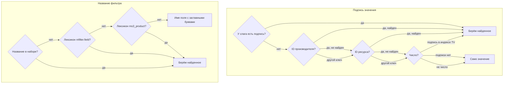

# mFilterSelected

Сниппет выводит блок «Выбрано» — значения фильтров, которые выбрал посетитель. Нажатие на значение снимает его. Кнопка «Сбросить всё» снимает все фильтры и возвращает сортировку по умолчанию.

## Что попадает в блок

- **Фильтры из набора страницы.** Метки `utm_*`, сортировка и номер страницы в блок не попадают.
- **У диапазона нет своего значения в блоке.** Снять его можно кнопкой «Сбросить всё» или в форме. Если выбран только диапазон, в блоке одна кнопка сброса.
- **Подписи вместо значений из адреса** — см. [Откуда подписи](#otkuda-podpisi).


Адрес страницы на снимке — `/bytovaya-tehnika/sinij-or-krasnyj/vendor_id--acer/price--5000--40000/?utm_source=test`: диапазон цены и метка в нём есть, а в блоке их нет.

## Где вызывать

На той же странице, что и `mFilterForm`: без формы значения не снимаются, а после фильтрации блок не обновляется.

```fenom
{set $results = '!mFilter' | snippet : [
    'element' => 'msProducts',
    'parents' => $_modx->resource.id
]}

<aside>{'!mFilterForm' | snippet}</aside>
<main>
    {'!mFilterSelected' | snippet}
    {$results}
</main>
```

`mFilter` вызван первым и выведен через переменную — почему так, см. [mFilterForm](mfilterform#gde-vyzyvat).

::: tip Два блока на странице
Два блока с разными параметрами не работают: после фильтрации все блоки «Выбрано» получают одну разметку — по хешу первого блока на странице. Один блок можно вывести дважды через плейсхолдер:

```fenom
{'!mFilterSelected' | snippet : ['toPlaceholder' => 'selected']}

{* Ниже по странице — строго после вызова *}
{$_modx->getPlaceholder('selected')}
{$_modx->getPlaceholder('selected')}
```

:::

## Параметры

### Основные

| Параметр | По умолчанию | Описание |
|----------|--------------|----------|
| `resourceId` | текущий ресурс | ID ресурса, чей набор фильтров использовать |

### Чанки

| Параметр | По умолчанию | Описание |
|----------|--------------|----------|
| `tplOuter` | `mfilter.selected.outer` | Контейнер блока |
| `tplGroup` | `mfilter.selected.group` | Группа значений одного фильтра — при `grouped` |
| `tplItem` | `mfilter.selected.item` | Одно значение |
| `tplReset` | `mfilter.selected.reset` | Кнопка «Сбросить всё» |

### Поведение

| Параметр | По умолчанию | Описание |
|----------|--------------|----------|
| `grouped` | `true` | Группировать значения по фильтрам. При `false` значения идут подряд, и стандартный `tplItem` выводит только значение, без названия фильтра |
| `showLabels` | `true` | Выводить название фильтра перед группой. Действует только при `grouped` |
| `showReset` | `true` | Выводить кнопку «Сбросить всё» |
| `hideWhenEmpty` | `true` | Скрывать блок, пока ничего не выбрано |
| `resetText` | лексикон `mfl_reset_all` | Текст кнопки сброса |

### Вывод

| Параметр | По умолчанию | Описание |
|----------|--------------|----------|
| `toPlaceholder` | — | Имя плейсхолдера. Блок попадёт в него, а сниппет ничего не выведет |

## Примеры

### Базовый вызов

```fenom
{'!mFilterSelected' | snippet}
```

### Без названий фильтров и кнопки сброса

```fenom
{'!mFilterSelected' | snippet : [
    'showLabels' => false,
    'showReset' => false
]}
```

### Свой текст кнопки сброса

```fenom
{'!mFilterSelected' | snippet : [
    'resetText' => 'Очистить фильтры'
]}
```

## Переменные чанков

### tplOuter

| Переменная | Описание |
|------------|----------|
| `{$items}` | Разметка значений или групп |
| `{$reset}` | Разметка кнопки сброса |
| `{$count}` | Сколько фильтров выбрано. Фильтр с несколькими значениями и диапазон считаются за один |
| `{$total}` | То же число, что `{$count}` |
| `{$empty}` | Ничего не выбрано |
| `{$hidden}` | Ничего не выбрано и включён `hideWhenEmpty` |
| `{$filterLabels}` | Названия фильтров в JSON: `{"color":"Цвет","vendor_id":"Производитель"}` |
| `{$hash}` | Хеш вызова — выводите в `data-mfilter-selected-hash`. Он же — в плейсхолдере `mfilter.selected.hash` |

### tplGroup

| Переменная | Описание |
|------------|----------|
| `{$key}` | Ключ фильтра |
| `{$label}` | Название фильтра |
| `{$items}` | Разметка значений фильтра |
| `{$count}` | Сколько значений выбрано |
| `{$showLabel}` | Значение параметра `showLabels` |

### tplItem

| Переменная | Описание |
|------------|----------|
| `{$key}` | Ключ фильтра |
| `{$value}` | Значение, как в запросе |
| `{$filterLabel}` | Название фильтра |
| `{$valueLabel}` | Подпись значения |
| `{$label}` | То же, что `{$valueLabel}` |

### tplReset

| Переменная | Описание |
|------------|----------|
| `{$text}` | Текст кнопки |
| `{$url}` | Адрес страницы без фильтров |

Стандартный чанк выводит кнопку `<button>` — её обрабатывает скрипт. Сброс ссылкой на `{$url}` работает и без JS:

```fenom
<a href="{$url}" class="mfilter-selected-reset" data-mfilter-reset-selected>{$text}</a>
```

## Откуда подписи

Название фильтра — первое найденное:

1. название из [набора фильтров](../interface/filter-sets);
2. лексикон `mfilter.field.<поле>`, у полей дат — без суффиксов `_date`, `_day`, `_month`, `_year`;
3. лексикон MiniShop3 `ms3_product_<поле>`;
4. имя поля, каждое слово с заглавной буквы.

Подпись значения — первое найденное:

1. подпись [слага](../interface/slugs) значения;
2. для ID производителя в `vendor_id`, `vendor`, `vendors` — имя производителя;
3. для ID ресурса в `parent`, `parents`, `category`, `categories`, `ms3_category`, `ms3_categories` — `pagetitle` ресурса;
4. для числа, которому подпись не нашлась раньше, — подпись из индекса TV;
5. само значение.



## Свои чанки

Начните с копии стандартных чанков `mfilter.selected.*` из `core/components/mfilter/elements/chunks/`. После каждой фильтрации сервер отрисовывает блок заново теми же чанками. Без разметки из таблицы блок ломается:

| Чанк | Разметка | Без неё |
|------|----------|---------|
| `tplOuter` | `data-mfilter-selected` | Скрипт не находит блок |
| `tplOuter` | `data-mfilter-selected-hash="{$hash}"` | После фильтрации блок рисует скрипт — см. предупреждение ниже |
| `tplOuter` | класс `mfilter-selected-hidden` при `{$hidden}`, `mfilter-selected-empty` при `{$empty}` | Пустой блок не скрывается |
| `tplItem` | класс `mfilter-selected-item`, `data-key="{$key}"`, `data-value="{$value}"` | Нажатие на значение ничего не снимает |
| `tplReset` | `data-mfilter-reset-selected` | Кнопка не сбрасывает фильтры |

```fenom
{'!mFilterSelected' | snippet : [
    'grouped' => false,
    'tplOuter' => '@INLINE <div class="selected{if $hidden} mfilter-selected-hidden{/if}{if $empty} mfilter-selected-empty{/if}"
        data-mfilter-selected data-mfilter-selected-hash="{$hash}">
        {$items}
        {$reset}
    </div>',
    'tplItem' => '@INLINE <button type="button" class="mfilter-selected-item"
        data-key="{$key | esc}" data-value="{$value | esc}">
        {$filterLabel | esc}: {$valueLabel | esc} &times;
    </button>',
    'tplReset' => '@INLINE <button type="button" data-mfilter-reset-selected>{$text}</button>'
]}
```

После фильтрации заменяется только содержимое блока. Классы и атрибуты самого контейнера остаются как при загрузке — кроме `mfilter-selected-hidden`, `mfilter-selected-empty` и `data-filter-labels`.

::: warning Без хеша чанки и параметры не действуют
По хешу сервер находит сохранённые параметры вызова. Если в `tplOuter` нет `data-mfilter-selected-hash`, после первой фильтрации блок рисует скрипт своей разметкой. Ваши чанки и параметры `grouped`, `showLabels`, `showReset`, `hideWhenEmpty`, `resetText` перестают действовать, кнопка сброса — всегда «Сбросить всё». Если вдобавок в значениях нет `data-key`, при выбранных фильтрах скрипт заменит разметку уже при загрузке страницы.

То же бывает со стандартным чанком. [Очистка кэша mFilter](../interface/maintenance) стирает параметры вызовов, которые не запрашивали от двух недель до месяца. Если страница осталась в кэше MODX со старым хешем, очистите кэш сайта.
:::

## Стандартная разметка

Стандартные чанки выводят блок так — один фильтр, группировка включена:

```html
<div class="mfilter-selected" data-mfilter-selected data-mfilter-selected-hash="…" data-filter-labels="…">
    <div class="mfilter-selected-items">
        <div class="mfilter-selected-group" data-group="color" data-label="Цвет">
            <span class="mfilter-selected-group-label">Цвет:</span>
            <button type="button" class="mfilter-selected-item" data-key="color" data-value="red" data-label="Красный" title="Убрать фильтр">
                <span class="mfilter-selected-item-label">Красный</span>
                <span class="mfilter-selected-remove">&times;</span>
            </button>
        </div>
    </div>
    <button type="button" class="mfilter-selected-reset" data-mfilter-reset-selected>Сбросить всё</button>
</div>
```

Контурный вид значений — класс `mfilter-selected--outline` на контейнере, стили — в `mfilter.css`.


