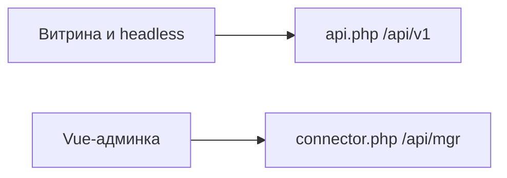

# REST API

Web API MiniShop3 (`api.php`) обслуживает фронтенд и headless-клиенты: корзина, checkout, личный кабинет, публичный каталог. Manager API (`connector.php`) работает под сессией MODX для Vue-админки и здесь не описан.

```text
/assets/components/minishop3/api.php?route=/api/v1/...
```

| Файл | Что внутри |
| --- | --- |
| `core/components/minishop3/config/routes/web.php` | Роуты Web API |
| `core/config/ms3_routes_web.custom.php` | Свои роуты. В поставке нет, создаёте сами |
| `core/config/ms3.routes.d/web/*.php` | Фрагменты роутов аддонов. Каталог создаёт установка, файлы кладут аддоны |

## Документация



| Раздел | Содержание |
| --- | --- |
| [Обзор](web-api/) | Формат ответа, middleware, базовый URL |
| [Авторизация](web-api/auth) | Токен, cookie, Bearer, login, `me`, refresh |
| [Карта эндпоинтов](web-api/endpoints) | Полная таблица путей из `web.php` |
| [Каталог](web-api/catalog) | product, category, filters, ACL |
| [Корзина](web-api/cart) | Мутации и формат `cart/get` |
| [Checkout](web-api/checkout) | delivery/payment list, order, cost, submit |
| [Клиент](web-api/customer) | Профиль, адреса, заказы, email |
| [Ошибки](web-api/errors) | `code`, `errors`, `error_code`, HTTP |
| [CORS и rate limit](web-api/cors) | Origins, credentials, 429 |
| [Примеры](web-api/examples) | curl и TypeScript/`$fetch` |

- Маршрутизация и свои роуты — [API Router](routing)
- JS фронтенда на том же домене — [Frontend JavaScript](frontend-js)
