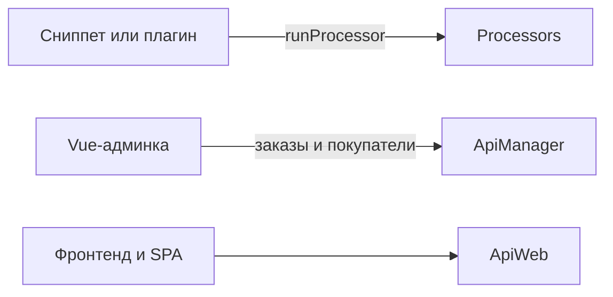

# Backend API

Работайте с товарами, заказами, опциями и покупателями из PHP: в плагинах, сниппетах, консольных скриптах, сторонних компонентах.

## Процессоры

Процессоры лежат в `core/components/minishop3/src/Processors/`, namespace `MiniShop3\Processors\`. Вызывайте **полным именем класса**. В PHP это `$modx->runProcessor()`. В connector и запросах Vue-админки то же имя кладите в параметр `action`.

```php
$response = $modx->runProcessor('MiniShop3\\Processors\\Gallery\\Upload', [
    'id' => $productId,
    'file' => $path,
]);

$response->isError();
$response->getMessage();
$response->getObject();
```

Без товара (`id` = 0) `isError()` истинно, `getMessage()` возвращает «Товар не найден.», `getObject()` пуст. При успехе `isError()` ложно, `getMessage()` пуст, а `getObject()` — сохранённый `msProductFile`.

::: warning Процессор проверяет право независимо от того, откуда его позвали
Почти у каждого процессора MS3 задано `$permission` (у `Gallery\Upload` — `msproductfile_save`), а `ModelProcessor::checkPermissions()` сводится к `$modx->hasPermission($this->permission)`. Проверка срабатывает в `run()` **до** `process()`, то есть и при вызове из PHP.

Поэтому сниппет на фронтенде, где у посетителя нет прав админки, получит не результат, а отказ: `isError()` истинно, в сообщении — `permission_denied_processor` с именем права. Если операцию нужно выполнять от имени посетителя, вызывайте не процессор, а сервис (`$ms3->product`, `ProductImageService` и прочие). Права они не проверяют — проверка остаётся на вас.

Права процессоров перечислены на страницах разделов: [товары](./product#processors), [заказы](./order), [покупатели](./customer).
:::

Короткое имя вроде `Gallery\Upload` не работает. Не распознав полное имя класса, MODX переходит к старой схеме поиска: склеивает `processors_path` с действием и ждёт файл `<processors_path>/gallery/upload.class.php`. Процессоры MS3 — автозагружаемые классы PSR-4, таких файлов в поставке нет. Вызов отвечает «Requested processor not found», а ожидаемый путь уходит в журнал MODX. `RunsMs3Processors` передаёт `processors_path` рядом с полным именем, не вместо него.

## Manager API vs процессоры



| Слой | Когда использовать |
| --- | --- |
| `Controllers\Api\Manager\*` | Vue-админка (заказы, покупатели, настройки) |
| `Controllers\Api\Web\*` | Фронтенд, SPA, мобильные приложения |
| `MiniShop3\Processors\*` | `runProcessor()` из PHP, прежний connector, утилиты с `RunsMs3Processors` |

Группы процессоров:

| Группа | Что внутри |
| --- | --- |
| `Product/*`, `Product/ProductLink/*` | Товары и связи между ними |
| `Category/*` | Категории товаров |
| `Gallery/*`, `Utilities/Gallery/*` | Изображения товара и утилиты галереи |
| `Customer/*`, `Customer/Address/*` | Покупатели и их адреса |
| `Api/Customer/*` | Вход, регистрация, сброс пароля, верификация email. Сюда Web API делегирует аутентификацию |
| `Settings/Vendor/*`, `Settings/Delivery/*`, `Settings/Payment/*`, `Settings/Status/*`, `Settings/Link/*` | Справочники: производители, способы доставки, способы оплаты, статусы, типы связей |
| `Utilities/Import/*` | Импорт товаров из CSV |
| `System/*`, `System/Element/*`, `System/User/*` | Служебные операции |
| `Resource/*` | Ресурсы MODX |

Исключение: Vue-CRUD настроек **не** вызывает `Processors/Settings/Vendor/*`. См. [События производителей](../events/vendor).

## Содержание

- [API товара](product): создание, обновление, опции, изображения, категории, связи, производители
- [API заказа](order): оформление, статусы, стоимость, адреса, позиции, журнал
- [API опций](options): создание опций, назначение категориям, чтение и запись значений
- [API покупателя](customer): аутентификация, регистрация, верификация, адреса, токены
