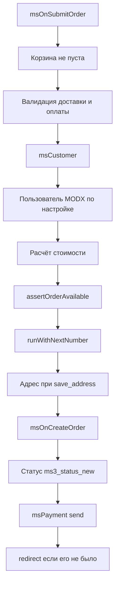

# API заказа

Заказ собирается из четырёх моделей:

- **msOrder**: стоимость, статус, доставка, оплата
- **msOrderAddress**: адрес и контакты
- **msOrderProduct**: позиции
- **msOrderLog**: журнал изменений

Жизненный цикл: **черновик** (draft) → **оформление** (submit) → **смена статусов**.

## Контроллер Order (фасад)


`add`, `set` и `submit` отдают конверт `success` и `data`. `initialize` и `initDraft` возвращают `bool`.

Контроллер `Order` (`$ms3->order`): точка входа к сервисам заказа из PHP.

::: warning Результат приходит в конверте
Методы контроллера, которые возвращают `array`, отдают конверт `['success' => bool, 'message' => string, 'data' => array]`. Это тот же `Utils::success()` / `Utils::error()`, что и в Web API. Нужные значения лежат в `data`. У `get()` поля заказа вложены ещё на уровень: `data['order']`.

Значение напрямую отдают только: `initialize()`, `initDraft()`, `remove()` и `hasPayment()` (`bool`); `getDraft()` (объект `msOrder` или `null`); `getUserId()` (`int`).
:::

```php
$ms3 = $modx->services->get('ms3');

// Получить данные текущего заказа
$response = $ms3->order->get();
$order = $response['data']['order'];

// Добавить поле
$result = $ms3->order->add('email', 'user@example.com');

// Установить несколько полей
$result = $ms3->order->set([
    'email' => 'user@example.com',
    'phone' => '+79991234567',
    'first_name' => 'Иван',
    'delivery_id' => 1,
    'payment_id' => 1,
    'order_comment' => 'Позвоните перед доставкой',
]);

// Оформить заказ
$result = $ms3->order->submit();
// Ответ оплаты. У DefaultPayment в data есть order_id, order_num, payment_link.
// Ключ редиректа — redirect, в query msorder лежит uuid заказа.

// Очистить черновик
$ms3->order->clean();

```

::: info Инициализация
До первого вызова контроллеру нужен токен покупателя:

```php
$ms3->order->initialize($token);
$ms3->order->initDraft();

```

В REST API и сниппетах это происходит автоматически.
:::

### Методы контроллера

| Метод | Описание |
| --- | --- |
| `initialize($token, $config)` | Инициализация с токеном покупателя |
| `initDraft()` | Загрузка существующего черновика |
| `get()` | Данные заказа (поля + адрес) |
| `add($key, $value)` | Добавить/обновить поле |
| `set($fields)` | Установить несколько полей |
| `remove($key)` | Удалить поле (сбросить в null) |
| `validate($key, $value)` | Валидация значения поля |
| `submit($data)` | Оформить заказ |
| `clean()` | Очистить черновик |
| `getCost($onlyCost)` | Полная стоимость (корзина + доставка + оплата) |
| `getCartCost()` | Стоимость корзины |
| `getDeliveryCost()` | Стоимость доставки |
| `getPaymentCost()` | Комиссия оплаты |
| `setCustomerAddress($hash)` | Применить сохранённый адрес покупателя |
| `cleanCustomerAddress()` | Очистить адресные поля |
| `getDeliveryValidationRules($deliveryId)` | Правила валидации доставки |
| `getDeliveryRequiresFields($deliveryId)` | Обязательные поля доставки |
| `getDraft()` | Объект черновика `msOrder` |
| `hasPayment($deliveryId, $paymentId)` | Допустима ли пара «доставка и оплата» |
| `getUserId()` | ID пользователя MODX для текущего заказа. Если его нет, регистрирует |
| `getNewOrderNum()` | Следующий номер, не занимая его. Устарел: номер при оформлении выдаёт `OrderNumberGenerator::runWithNextNumber()` |
| `restrictDraft($draft)` | Пересчитать стоимость черновика через `OrderDraftManager::recalculate()` |

## Черновики (OrderDraftManager)

Черновик: объект `msOrder` в статусе `draft`. Появляется при первом обращении покупателя к корзине и хранит данные до оформления.

```php
$draftManager = $modx->services->get('ms3_order_draft_manager');

// Получить или создать черновик
$draft = $draftManager->getOrCreateDraft($token, 'web');

// Получить существующий черновик (без создания)
$draft = $draftManager->getDraft($token, 'web');

// Получить черновик по ID клиента (для восстановления после логина)
$draft = $draftManager->getDraftByCustomer($customerId, 'web');

// Данные черновика как массив (заказ + адрес)
$data = $draftManager->toArray($draft);
// Адресные поля возвращаются с префиксом address_:
// ['email' => '...', 'address_city' => 'Москва', 'address_street' => '...']

// Обновить одно поле
$draftManager->updateField($draft, 'order_comment', 'Позвоните перед доставкой');

// Привязать клиента к черновику
$draftManager->attachCustomer($draft, $customerId);

// Пересчитать стоимость
$draftManager->recalculate($draft);

// Установить стоимость доставки
$draftManager->setDeliveryCost($draft, 350.00);

// Проверить, пуста ли корзина
if ($draftManager->isEmpty($draft)) {
    // Нет товаров
}

// Очистить все поля
$draftManager->clean($draft);

// Удалить черновик полностью (с товарами и адресом)
$draftManager->deleteDraft($draft);

```

Остальные публичные методы:

| Метод | Описание |
| --- | --- |
| `findDraftByToken($token, $ctx)` | Черновик по токену, без создания |
| `createDraft($token, $ctx)` | Новый черновик |
| `ensureAddress($draft)` | Адрес черновика, создаёт запись, если её нет |
| `syncToken($draft, $newToken)` | Записать новый токен в черновик |
| `getSessionCustomerId()` | ID покупателя из сессии |
| `bindDraftToCustomer($token, $customerId, $ctx)` | Привязать черновик токена к покупателю |
| `transferDraftToToken($fromToken, $toToken, $customerId, $ctx)` | Перенести черновик на новый токен после смены сессии |
| `fillAddressFromArray($order, $addressData)` | Заполнить адрес из массива |
| `addProductFromSnapshot($order, $snapshot, $origin)` | Добавить позицию из снимка, без ресурса товара |

## Поля и валидация (OrderFieldManager)

`OrderFieldManager` пишет поля черновика и вызывает события при изменении.

```php
$fieldManager = $modx->services->get('ms3_order_field_manager');

// Добавить поле (с валидацией и событиями)
$result = $fieldManager->add($draft, $orderData, 'email', 'user@example.com');
// ['success' => true, 'data' => [...]]

// Удалить поле
$fieldManager->remove($draft, $orderData, 'email');

// Валидация без сохранения
$result = $fieldManager->validate($orderData, 'phone', '+79991234567');
// ['success' => true] или ['success' => false, 'message' => 'Ошибка']

```

### Правила валидации

По умолчанию `delivery_id` и `payment_id` проверяет правило `required|numeric`. Остальные правила приходят из настроек доставки.

```php
// Получить правила валидации для доставки
$rules = $fieldManager->getDeliveryValidationRules($deliveryId);
// $rules['data']['validation_rules'] — ['city' => 'required|min:2', ...]

// Обязательные поля: ключи ассоциативного массива «поле → правила»
$required = $fieldManager->getDeliveryRequiredFields($deliveryId);
// array_keys($required['data']['requires'])

// Добавить свои правила
$fieldManager->setValidationRules([
    'company_name' => 'required|min:3',
]);

```

## Расчёт стоимости (OrderCostCalculator)

```php
$calculator = $modx->services->get('ms3_order_cost_calculator');

// Стоимость корзины. Сумма в $result['data']['cost']
$result = $calculator->getCartCost($draft, $token);

// Стоимость доставки
$result = $calculator->getDeliveryCost($draft, $orderData, $token);

// Комиссия оплаты
$result = $calculator->getPaymentCost($draft, $orderData, $token);

// Полный итог. В data: cost, cart_cost, delivery_cost, payment_cost
// и поля статуса корзины. С аргументом onlyCost остаётся только cost.
$result = $calculator->getTotalCost($draft, $orderData, $token);

```

Каждый метод вызывает пару событий `msOnBefore...` / `msOn...`. Через них плагин меняет стоимость.

### Пересчёт стоимости в админке — `POST /api/mgr/orders/{id}/recalculate-cost`

С 1.11.0 `ManagerOrderCostRecalculator` пересчитывает `cart_cost`, `weight`, `delivery_cost` и итоговый `cost` по сохранённым позициям и текущим `delivery_id` / `payment_id`. Другие поля заказа он не трогает.

Тело запроса:

```json
{
  "mode": "auto",
  "manual_delivery_cost": 500.0
}

```

Режимы (`mode`):

| Режим | Поведение |
| --- | --- |
| `auto` (по умолчанию) | Пересчитывает только для `DefaultDelivery` / `DefaultPayment` (поля `price`, `weight_price`, `free_delivery_amount` и проценты). Для своих обработчиков возвращает `delivery_manual_required` / `payment_manual_required`, оставляет прежнюю `delivery_cost` и комиссию 0. Внешние API не вызывает. |
| `manual` | Берёт переданный `manual_delivery_cost`. Комиссию оплаты считает автоматически, по полю. |
| `force_provider` | Явно вызывает `loadController()` → `getCost()` и `loadHandler()` → `getCost()` в `try/catch`. Сбой доставки оставляет прежнюю `delivery_cost` и пишет `delivery_provider_error`. Сбой оплаты ставит комиссию 0, пересобирает `cost` и пишет `payment_provider_error` ([#897](https://github.com/modx-pro/MiniShop3/issues/897)) |

Ответ повторяет данные заказа из `GET /api/mgr/orders/{id}` и добавляет:

```json
{
  "breakdown": {
    "cart_cost": 5000.0,
    "weight": 1.5,
    "delivery_cost": 300.0,
    "payment_cost": 150.0,
    "cost": 5450.0
  },
  "warnings": ["delivery_manual_required"]
}

```

Итог проходит через `OrderService::clampComputedTotal()`. Ниже нуля он не уйдёт. Скидки и наценки доставки и оплаты (отрицательные `price`, см. 1.11.0) считает `MiniShop3\Utils\PriceAdjustment`.

Вызов из JS (карточка заказа в админке):

```javascript
const response = await fetch(`/api/mgr/orders/${orderId}/recalculate-cost`, {
  method: 'POST',
  headers: {
    'Content-Type': 'application/json',
    'modAuth': MODx.modxConfig.auth, // или актуальный mgr-auth заголовок
  },
  body: JSON.stringify({
    mode: 'manual',
    manual_delivery_cost: 500,
  }),
})
const json = await response.json()
// json.data.breakdown — cart_cost / delivery_cost / payment_cost / cost
// json.data.warnings — например delivery_manual_required
```

Через HTTP (Manager API):

```bash
curl -X POST 'https://example.com/api/mgr/orders/42/recalculate-cost' \
  -H 'Content-Type: application/json' \
  -H 'Cookie: …' \
  -d '{"mode":"auto"}'
```

См. также [API Router](/components/minishop3/development/routing).

## Оформление заказа (OrderSubmitHandler)



`OrderSubmitHandler` проводит полный цикл оформления: валидация → создание покупателя → расчёт стоимости → генерация номера → смена статуса → вызов оплаты.

```php
$submitHandler = $modx->services->get('ms3_order_submit_handler');

$result = $submitHandler->submit($draft, $orderData, $token);
// Успех — массив, который вернул $msPayment->send().
// У DefaultPayment message = ms3_payment_link_created, в data:
// payment_link (URL страницы успеха, msorder = номер заказа),
// order_id, order_num.
// Если в data нет redirect, обработчик дописывает его:
// страница ms3_order_redirect_thanks_id, query msorder = uuid заказа.

```

### Порядок действий при оформлении

1. Событие `msOnSubmitOrder`
2. Проверка: корзина не пуста
3. Валидация `delivery_id`, `payment_id` и обязательных полей доставки
4. Поиск или создание покупателя (`msCustomer`)
5. Опционально: создание пользователя MODX (настройка `ms3_order_register_user_on_submit`)
6. Расчёт стоимости (корзина + доставка + оплата)
7. Проверка остатка `inventory()->assertOrderAvailable()` до выдачи номера
8. Номер и суммы пишет `OrderNumberGenerator::runWithNextNumber()`
9. Адрес покупателя сохраняется, только если в `properties` есть `save_address` и у заказа есть `customer_id`
10. События `msOnBeforeCreateOrder` / `msOnCreateOrder`
11. Смена статуса на `ms3_status_new` (по умолчанию: 2)
12. Вызов `$msPayment->send()`
13. Если в ответе оплаты нет `data.redirect`, обработчик дописывает URL страницы «Спасибо» с uuid заказа

### Генерация номера заказа

```php
$num = $submitHandler->getNewOrderNum();
// Следующий номер для просмотра. Метод устарел и номер не занимает.
// При оформлении номер выдаёт OrderNumberGenerator::runWithNextNumber().
// ms3_order_format_num — формат даты (по умолчанию 'ym')
// ms3_order_format_num_separator — разделитель (по умолчанию '/')

```

## Управление статусами (OrderStatusService)

```php
$statusService = $modx->services->get('ms3_order_status');

// Сменить статус заказа
$result = $statusService->change($orderId, $newStatusId);
// true — успех
// string — текст ошибки из лексикона

// Сменить статус без уведомлений
$result = $statusService->change($orderId, $newStatusId, true);

```

### Ограничения статусов

| Свойство статуса | Поведение |
| --- | --- |
| `final = true` | Нельзя сменить на другой статус |
| `fixed = true` | Можно переключить только на статус с большей `position` |

Поверх этих двух правил работает список разрешённых переходов: системная настройка `ms3_order_status_transitions`. Пока она пуста, действуют только `final` и `fixed`. Если список задан, переход должен быть в нём и не нарушать `final` и `fixed`.

Формат: пары «из статуса : в статус», через запятую или массивом JSON:

```text
2:3,3:4,2:5
```

```json
[[2,3],[3,4]]
```

Если значение настройки разобрать не удалось, блокируется **любая** смена статуса с ошибкой `ms3_err_status_transitions_invalid`. Опечатка в списке не игнорируется: она останавливает обработку заказов.

### Уведомления

При смене статуса `NotificationManager` сам рассылает уведомления:

- **Покупателю**: email, телефон из `msCustomer` или `modUserProfile`
- **Менеджерам**: из настроек `ms3_email_manager`, `ms3_phone_manager`, `ms3_telegram_manager`

## Позиции заказа (msOrderProduct)

Модель `msOrderProduct` (таблица `ms3_order_products`) хранит позиции заказа.

### Поля msOrderProduct

| Поле | Тип | Описание |
| --- | --- | --- |
| `product_id` | integer | ID товара (msProduct) |
| `order_id` | integer | ID заказа |
| `product_key` | string | Уникальный ключ позиции (напр. `123_a1b2c3d4`) |
| `name` | string | Название товара |
| `count` | integer | Количество |
| `price` | float | Цена за единицу |
| `weight` | float | Вес за единицу |
| `cost` | float | Стоимость позиции (price × count) |
| `options` | json | Выбранные опции |
| `properties` | json | Дополнительные свойства |

### Программная работа с позициями

```php
use MiniShop3\Model\msOrder;
use MiniShop3\Model\msOrderProduct;

$order = $modx->getObject(msOrder::class, $orderId);

// Получить все позиции заказа
$products = $order->getMany('Products');
foreach ($products as $product) {
    echo $product->get('name') . ': ' . $product->get('count') . ' × ' . $product->get('price');
}

// Добавить позицию
$item = $modx->newObject(msOrderProduct::class);
$item->set('order_id', $orderId);
$item->set('product_id', $productId);
$item->set('product_key', $productId . '_' . md5(json_encode($options)));
$item->set('name', 'Товар');
$item->set('count', 2);
$item->set('price', 1500.00);
$item->set('cost', 3000.00);
$item->set('weight', 0.5);
$item->set('options', $options);
$item->save();

// Пересчитать итоги заказа после изменения позиций
$order->updateProducts();

```

::: warning Пересчёт итогов
После добавления, удаления или изменения позиций вызывайте `$order->updateProducts()`. Метод пересчитывает `cart_cost`, `weight` и `cost` по всем `msOrderProduct` заказа.
:::

## Адрес заказа (msOrderAddress)

У заказа один объект `msOrderAddress` (таблица `ms3_order_addresses`).

### Поля msOrderAddress

| Поле | Тип | Описание |
| --- | --- | --- |
| `order_id` | integer | ID заказа |
| `createdon` | datetime | Дата создания |
| `updatedon` | datetime | Дата обновления |
| `first_name` | string | Имя |
| `last_name` | string | Фамилия |
| `phone` | string | Телефон |
| `email` | string | Email |
| `country` | string | Страна |
| `index` | string | Почтовый индекс |
| `region` | string | Регион |
| `city` | string | Город |
| `metro` | string | Станция метро |
| `street` | string | Улица |
| `building` | string | Дом |
| `entrance` | string | Подъезд |
| `floor` | string | Этаж |
| `room` | string | Квартира/офис |
| `comment` | string | Комментарий к адресу |
| `text_address` | string | Полный адрес одной строкой |
| `properties` | json | Дополнительные свойства |

### Программная работа

```php
use MiniShop3\Model\msOrder;

$order = $modx->getObject(msOrder::class, $orderId);
$address = $order->getOne('Address');

// Чтение
echo $address->get('city');       // "Москва"
echo $address->get('street');     // "Ленина"

// Обновление
$address->set('city', 'Санкт-Петербург');
$address->save();

```

### OrderAddressManager

Сервис пишет адреса черновика.

```php
$addressManager = $modx->services->get('ms3_order_address_manager');

// Применить сохранённый адрес клиента к черновику
$result = $addressManager->setCustomerAddress($draft, $orderData, $addressHash);

// Очистить все адресные поля
$result = $addressManager->cleanCustomerAddress($draft, $orderData);

// Сохранить адрес заказа в адреса клиента
$savedAddress = $addressManager->saveToCustomerAddresses($customerId, $orderData);

```

## Журнал заказа (OrderLogService)

Журнал пишет смену статуса, правку полей и работу с позициями.

```php
$logService = $modx->services->get('ms3_order_log');

// Добавить запись в журнал
$logService->addEntry($orderId, 'status', [
    'old' => 1,
    'new' => 2,
]);

// Добавить запись о произвольном действии
$logService->addEntry($orderId, 'field', [
    'key' => 'delivery_id',
    'old_value' => 1,
    'new_value' => 2,
], true);  // visible = true (видна клиенту)

// Получить записи журнала
$entries = $logService->getEntries($orderId);
// Только видимые клиенту
$entries = $logService->getEntries($orderId, true);
// С лимитом
$entries = $logService->getEntries($orderId, false, 50);

// Прежний метод: add($orderId, $entry, $action, $visible = true)
$logService->add($orderId, ['old' => 1, 'new' => 2], 'status');

// Проверить, логируется ли действие (настройка ms3_order_log_actions)
if ($logService->shouldLog('status')) {
    // ...
}

```

### Типы действий

| Константа | Значение | Описание |
| --- | --- | --- |
| `msOrderLog::ACTION_STATUS` | `status` | Смена статуса |
| `msOrderLog::ACTION_PAYMENT` | `payment` | Изменение оплаты |
| `msOrderLog::ACTION_PRODUCTS` | `products` | Изменение позиций |
| `msOrderLog::ACTION_ADDRESS` | `address` | Изменение адреса |
| `msOrderLog::ACTION_FIELD` | `field` | Изменение поля заказа |

Настройка `ms3_order_log_actions` задаёт, какие действия попадают в журнал. По умолчанию: `status,products,field,address`. Значение `*` записывает все действия.

## Финализация из админки (OrderFinalizeService)

`OrderFinalizeService` оформляет заказы, которые менеджер создал в админке.

```php
use MiniShop3\Services\Order\OrderOrigin;

$finalizeService = $modx->services->get('ms3_order_finalize');

$result = $finalizeService->finalize($orderId, [
    'skip_validation' => false,
    'skip_notifications' => false,
    'create_customer' => true,
    'force_create_customer' => false,
    'origin' => OrderOrigin::MANAGER, // по умолчанию; для CRM — OrderOrigin::INTEGRATION
]);
```

Финализация принимает ключи `skip_*` и работает с уже созданным черновиком. Платёжный сервис здесь не вызывается, в отличие от `submit` на фронтенде.

Параметр `origin` (`OrderOrigin`): `manager` (по умолчанию), `storefront`, `integration`. При `manager` дополнительно вызываются `msOnBeforeMgrCreateOrder` / `msOnMgrCreateOrder`. Ключ `from_manager` в событиях равен `true` только при `origin=manager`.

## Программное создание заказа (ProgrammaticOrderService)

API без HTTP-сессии: для дополнений, cron и интеграций. Это **не** Web API. В `routes/web.php` отдельного эндпоинта нет.

| | |
| --- | --- |
| Ключ | `ms3_programmatic_order` |
| Класс | `MiniShop3\Services\Order\ProgrammaticOrderService` |
| Черновик | `OrderDraftManager::createSessionlessDraft()` (без PHP-сессии и токена корзины) |
| Финализация | `OrderFinalizeService::finalize(..., origin=integration)` |
| Идемпотентность | колонка `ms3_orders.idempotency_key` (unique, nullable) |

```php
use MiniShop3\Services\Order\OrderOrigin;

$orders = $modx->services->get('ms3_programmatic_order');

$result = $orders->create([
    'idempotency_key' => 'crm-invoice-10042', // обязательно
    'products' => [
        ['product_id' => 15, 'count' => 2],
        // или снимок без ресурса:
        // ['name' => 'Услуга', 'price' => 500, 'count' => 1, 'weight' => 0, 'options' => []],
    ],
    'customer_id' => 0,
    'delivery_id' => 1,
    'payment_id' => 1,
    'address' => [
        'first_name' => 'Иван',
        'email' => 'user@example.com',
        'phone' => '+79991234567',
    ],
    'order_comment' => 'Из CRM',
    'context' => 'web',
    'origin' => OrderOrigin::INTEGRATION,
    // 'delivery_cost' => 300, // → cost_mode=manual при finalize
    // 'skip_notifications' => true,
    // 'skip_validation' => false,
    // 'properties' => ['source' => 'crm'],
]);

if (!$result['success']) {
    // Частые message:
    // ms3_order_err_idempotency_key_required
    // ms3_order_err_products_required
    // ms3_order_err_programmatic_create
    // либо ошибки finalize / валидации
    return $result;
}

// Успех: data = { order_id, uuid, num, status_id }
// Повтор того же idempotency_key:
//   уже оформленный заказ → success + ms3_order_programmatic_idempotent
//   черновик со статусом draft → повторная финализация
```

События: `msOnBeforeCreateOrder` / `msOnCreateOrder` с `origin=integration` и **без** `from_manager`. События `msOnBeforeMgrCreateOrder` / `msOnMgrCreateOrder` **не** вызываются.

Это не `POST /api/mgr/orders`: менеджер там создаёт пустой или частичный заказ в админке. И не `POST /api/v1/order/submit` на фронтенде: нужны токен и корзина.

## Разрешение пользователей (OrderUserResolver)

Сервис находит или создаёт пользователя MODX по данным заказа.

```php
$userResolver = $modx->services->get('ms3_order_user_resolver');

// Получить или создать MODX user_id
$userId = $userResolver->getUserId($orderData);

// Проверить существование пользователя
$user = $userResolver->checkUserExists([
    'email' => 'user@example.com',
    'phone' => '+79991234567',
]);

// Создать пользователя
$user = $userResolver->createUser([
    'email' => 'user@example.com',
    'first_name' => 'Иван',
    'last_name' => 'Иванов',
    'phone' => '+79991234567',
]);

```

Настройка `ms3_order_user_groups` задаёт группы для новых пользователей. Формат: `group_id:role_id`, через запятую.

## Поля msOrder

| Поле | Тип | По умолчанию | Описание |
| --- | --- | --- | --- |
| `user_id` | integer | 0 | ID пользователя MODX |
| `customer_id` | integer | 0 | ID покупателя (msCustomer) |
| `token` | string | — | Токен сессии покупателя |
| `uuid` | string | — | Уникальный UUID заказа |
| `createdon` | datetime | null | Дата создания |
| `updatedon` | datetime | null | Дата обновления |
| `num` | string | null | Номер заказа. У черновика из админки тоже `null` |
| `cost` | float | 0.0 | Итоговая стоимость |
| `cart_cost` | float | 0.0 | Стоимость товаров |
| `delivery_cost` | float | 0.0 | Стоимость доставки |
| `weight` | float | 0.0 | Общий вес |
| `status_id` | integer | 0 | ID текущего статуса |
| `delivery_id` | integer | 0 | ID способа доставки |
| `payment_id` | integer | 0 | ID способа оплаты |
| `context` | string | 'web' | Контекст MODX |
| `order_comment` | string | null | Комментарий к заказу |
| `idempotency_key` | string | null | Ключ идемпотентности (программные заказы, unique) |
| `properties` | json | null | Дополнительные свойства (в т.ч. `origin` для интеграций) |

### Связи msOrder

| Связь | Модель | Тип | Описание |
| --- | --- | --- | --- |
| `Address` | msOrderAddress | composite (one) | Адрес заказа |
| `Products` | msOrderProduct | composite (many) | Позиции заказа |
| `Log` | msOrderLog | composite (many) | Журнал изменений |
| `Customer` | msCustomer | aggregate | Клиент |
| `Status` | msOrderStatus | aggregate | Статус |
| `Delivery` | msDelivery | aggregate | Способ доставки |
| `Payment` | msPayment | aggregate | Способ оплаты |
| `User` | modUser | aggregate | Пользователь MODX |

::: info Composite vs Aggregate
Composite-связи удаляются каскадно при удалении заказа (адрес, позиции, журнал). Aggregate-связи только ссылаются на объекты и не удаляют их.
:::

## События

| Событие | Когда вызывается |
| --- | --- |
| `msOnBeforeSaveOrder` / `msOnSaveOrder` | Сохранение заказа |
| `msOnBeforeRemoveOrder` / `msOnRemoveOrder` | Удаление заказа |
| `msOnBeforeGetOrderCost` / `msOnGetOrderCost` | Сборка итога заказа |
| `msOnBeforeGetCartCost` / `msOnGetCartCost` | Расчёт стоимости корзины |
| `msOnBeforeGetDeliveryCost` / `msOnGetDeliveryCost` | Расчёт стоимости доставки |
| `msOnBeforeGetPaymentCost` / `msOnGetPaymentCost` | Расчёт комиссии оплаты |
| `msOnBeforeAddToOrder` / `msOnAddToOrder` | Добавление/изменение поля |
| `msOnBeforeRemoveFromOrder` / `msOnRemoveFromOrder` | Удаление поля |
| `msOnBeforeValidateOrderValue` / `msOnValidateOrderValue` | Валидация значения |
| `msOnErrorValidateOrderValue` | Ошибка валидации |
| `msOnSubmitOrder` | Начало оформления |
| `msOnBeforeCreateOrder` / `msOnCreateOrder` | Создание заказа на витрине |
| `msOnBeforeCreateOrderProduct` / `msOnCreateOrderProduct` | Добавление позиции |
| `msOnBeforeUpdateOrderProduct` / `msOnUpdateOrderProduct` | Изменение позиции |
| `msOnBeforeRemoveOrderProduct` / `msOnRemoveOrderProduct` | Удаление позиции |
| `msOnBeforeEmptyOrder` / `msOnEmptyOrder` | Очистка заказа |
| `msOnBeforeChangeOrderStatus` / `msOnChangeOrderStatus` | Смена статуса |
| `msOnBeforeGetOrderUser` / `msOnGetOrderUser` | Поиск/создание пользователя |
| `msOnBeforeMgrCreateOrder` / `msOnMgrCreateOrder` | Финализация из админки (только `origin=manager`) |

## Manager REST API

Эндпоинты Vue-интерфейса заказов. Нужна сессия mgr. См. [API Router](../routing).

| Метод | Путь | Описание |
| --- | --- | --- |
| `GET` | `/api/mgr/orders` | Список заказов |
| `GET` | `/api/mgr/orders/filters` | Значения фильтров грида |
| `GET` | `/api/mgr/orders/stats` | Агрегаты для фильтров и дашборда |
| `GET` | `/api/mgr/orders/{id}` | Карточка заказа |
| `PUT` | `/api/mgr/orders/{id}` | Обновление заказа |
| `DELETE` | `/api/mgr/orders/{id}` | Удаление заказа |
| `DELETE` | `/api/mgr/orders/bulk` | Массовое удаление |
| `POST` | `/api/mgr/orders` | Создание заказа из админки |
| `POST` | `/api/mgr/orders/{id}/finalize` | Финализация черновика |
| `POST` | `/api/mgr/orders/{id}/recalculate-cost` | Пересчёт через `ManagerOrderCostRecalculator` |
| `GET` | `/api/mgr/orders/{id}/logs` | Журнал заказа |
| `GET` | `/api/mgr/orders/{id}/products` | Позиции заказа |
| `POST` | `/api/mgr/orders/{id}/products` | Добавить позицию |
| `PUT` | `/api/mgr/orders/{id}/products/{product_id}` | Изменить позицию |
| `DELETE` | `/api/mgr/orders/{id}/products/{product_id}` | Удалить позицию |
| `GET` | `/api/mgr/orders/{id}/shipment` | Отгрузка заказа |
| `PUT` | `/api/mgr/orders/{id}/shipment` | Обновить отгрузку |

Чтение списка, карточки, фильтров, статистики, позиций, журнала и отгрузки требует `msorder_list`. Запись, включая оба `DELETE`, требует `msorder_save`. Отдельного `msorder_remove` на этих маршрутах нет.

`POST /api/mgr/orders` создаёт черновик (`ms3_status_draft`, запасной id 1) и события `msOnBeforeMgrCreateOrder` / `msOnMgrCreateOrder` не вызывает. Эти события вызывает `POST /api/mgr/orders/{id}/finalize`, когда `OrderFinalizeService` работает с `origin=manager`.

Параметры событий: [События](../events).
