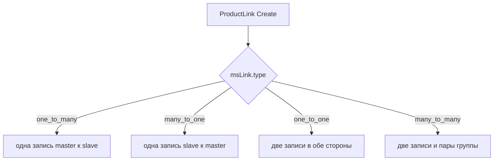

# API товара

Товар состоит из двух моделей:

- **msProduct**: расширяет `modResource`, хранит поля ресурса (pagetitle, content, parent и др.)
- **msProductData**: расширяет `xPDOSimpleObject`, хранит торговые поля (price, article, stock и др.) в таблице `ms3_products`

Связь: один к одному по `id`.

## Вызов процессоров

Процессоры MiniShop3: классы в namespace `MiniShop3\Processors\`. Вызывайте **полным именем класса**. То же имя передают в параметре `action` connector и запросы Vue-админки. Короткое имя вроде `Gallery\Upload` не работает.

```php
// Правильно — полное имя класса
$response = $modx->runProcessor('MiniShop3\\Processors\\Gallery\\Upload', [
    'id' => $productId,
    'file' => '/path/to/image.jpg',
]);

// Неверно — короткий путь без namespace
$response = $modx->runProcessor('Gallery\\Upload', [...], [
    'processors_path' => $modx->getOption('core_path') . 'components/minishop3/src/Processors/',
]);
```

Рядом с полным именем иногда передают и `processors_path` — так делает `RunsMs3Processors`. Это дополнение к полному имени, а не замена: короткое имя не заработает даже с указанным путём.

В таблицах ниже имена сокращены до части после `MiniShop3\Processors\`: `Product\Create` означает `MiniShop3\Processors\Product\Create`.

## Создание товара

### Через процессор

Рекомендуемый способ: процессор `MiniShop3\Processors\Product\Create`. Он создаёт обе модели сразу и вызывает системные события.

```php
$response = $modx->runProcessor('MiniShop3\\Processors\\Product\\Create', [
    'pagetitle' => 'Новый товар',
    'parent' => 5,          // ID категории (msCategory)
    'price' => 1500,
    'article' => 'ART-001',
    'published' => true,
    'stock' => 100,
    'weight' => 500,

    // Опции передаются с префиксом options-
    'options-color' => ['Red', 'Blue'],
    'options-size' => ['L', 'XL'],
]);

if ($response->isError()) {
    $modx->log(1, $response->getMessage());
} else {
    $productId = $response->getObject()['id'];
}
```

Процессор автоматически:

- Устанавливает `class_key = msProduct`, `show_in_tree`, `template` из системных настроек
- Создаёт связанный объект `msProductData`
- Если включена настройка `ms3_product_id_as_alias`, устанавливает alias равным ID товара
- Сохраняет опции (поля с префиксом `options-`)

### Через модель

```php
use MiniShop3\Model\msProduct;

$product = $modx->newObject(msProduct::class);
$product->set('pagetitle', 'Новый товар');
$product->set('parent', 5);
$product->set('published', true);
$product->set('template', $modx->getOption('ms3_template_product_default'));

if ($product->save()) {
    // msProductData создаётся автоматически при сохранении msProduct
    $productData = $product->getOne('Data');
    $productData->set('price', 1500);
    $productData->set('article', 'ART-001');
    $productData->set('stock', 100);
    $productData->save();
}
```

::: warning Разница между подходами
Создание через модель не вызывает системные события (`OnBeforeDocFormSave`, `OnDocFormSave`), не устанавливает значения по умолчанию и не обновляет кэш ресурсов. Для полноценного создания товаров используйте процессор.
:::

## Получение и обновление

### Чтение данных товара

```php
use MiniShop3\Model\msProduct;
use MiniShop3\Model\msProductData;

// Через msProduct → связь Data
$product = $modx->getObject(msProduct::class, $productId);
$productData = $product->getOne('Data');
$price = $productData->get('price');
$article = $productData->get('article');

// Напрямую через msProductData
$productData = $modx->getObject(msProductData::class, $productId);
$price = $productData->get('price');
```

### Виртуальные поля msProductData

Метод `get()` у `msProductData` поддерживает виртуальные ключи и подгружает связанные данные из БД:

| Ключ | Тип | Описание |
| --- | --- | --- |
| `categories` | `array` | Массив ID дополнительных категорий |
| `options` | `array` | Опции: `['color' => ['Red'], 'size' => ['L']]` |
| `links` | `array` | Связи: `['master' => [...], 'slave' => [...]]` |

```php
$categories = $productData->get('categories');  // [5, 12, 18]
$options = $productData->get('options');          // ['color' => ['Red', 'Blue']]
$links = $productData->get('links');             // ['master' => [...], 'slave' => [...]]
```

### Обновление через процессор

```php
$response = $modx->runProcessor('MiniShop3\\Processors\\Product\\Update', [
    'id' => $productId,
    'price' => 2000,
    'old_price' => 2500,
    'popular' => true,
    'options-color' => ['Red', 'Green'],
]);
```

### Обновление через модель

```php
$productData = $modx->getObject(msProductData::class, $productId);
$productData->set('price', 2000);
$productData->set('old_price', 2500);
$productData->set('popular', true);
$productData->save();
```

### Обновление через сервис

`ProductDataService` читает и обновляет товар:

```php
$service = $modx->services->get('ms3_product_data_service');

// Получение всех данных (msProduct + msProductData в одном массиве)
$data = $service->getProductData($productId);

// Обновление
$updated = $service->updateProductData($productId, [
    'price' => 2000,
    'old_price' => 2500,
]);
```

### Поля msProductData

| Поле | Тип в БД | PHP-тип | По умолчанию | Описание |
| --- | --- | --- | --- | --- |
| `article` | varchar(50) | string | null | Артикул |
| `price` | decimal(12,2) | float | 0.0 | Цена |
| `old_price` | decimal(12,2) | float | 0.0 | Старая цена |
| `stock` | decimal(13,3) | float | 0.0 | Остаток на складе |
| `weight` | decimal(13,3) | float | 0.0 | Вес |
| `image` | varchar(255) | string | null | Путь к главному изображению |
| `thumb` | varchar(255) | string | null | Путь к миниатюре |
| `preview_file_id` | int unsigned | integer | null | ID файла превью, см. врезку ниже |
| `vendor_id` | int unsigned | integer | 0 | ID производителя |
| `made_in` | varchar(100) | string | '' | Страна производства |
| `new` | tinyint(1) | boolean | false | Флаг «Новинка» |
| `popular` | tinyint(1) | boolean | false | Флаг «Популярный» |
| `favorite` | tinyint(1) | boolean | false | Флаг «Избранный» |
| `tags` | text | json | null | Теги (массив строк) |
| `color` | text | json | null | Цвета (массив строк) |
| `size` | text | json | null | Размеры (массив строк) |
| `source_id` | int unsigned | integer | 1 | ID медиа-источника |

::: info JSON-поля и опции
Поля `tags`, `color`, `size` хранятся в `msProductData` как JSON, но при сохранении дублируются в таблицу опций `ms3_product_options`. По этим полям можно фильтровать через EAV-систему опций.
:::

::: warning `preview_file_id` напрямую не записывается
Поле исключено из разрешённых к записи: процессоры сохранения товара убирают его из входных данных (`getAllowedProductDataFieldNames()`), поэтому `PUT /api/mgr/product-data/{id}` и сохранение карточки его не меняют.

Записать значение можно только через `Gallery\SetPreview` — процессор отдаёт работу `ProductImageService::setProductPreview()`, а тот сначала проверяет, что файл действительно принадлежит галерее этого товара.

Сбрасывает поле `ProductImageService::updateProductImage()` — в двух случаях: назначенный файл пропал из галереи или галерея опустела. Тогда `preview_file_id` становится `null`, а главным изображением снова становится первое по позиции.
:::

### Модификация цены и веса через события

Методы `getPrice()` и `getWeight()` вызывают события. Плагин может изменить значение:

```php
// Получение цены с учётом плагинов
$price = $productData->getPrice();

// Получение веса с учётом плагинов
$weight = $productData->getWeight();

// Все поля с учётом плагинов
$fields = $productData->modifyFields();
```

Используемые события: `msOnGetProductPrice`, `msOnGetProductWeight`, `msOnGetProductFields`.

## Опции товара

Опции товара лежат в таблице `ms3_product_options` (EAV: `product_id`, `key`, `value`). Пишите их через `OptionService`. Полный справочник: [API опций](options).

```php
$optionService = $modx->services->get('ms3_option_service');

$optionService->saveProductOptions($productId, [
    'color' => ['Red', 'Blue'],
    'size' => ['L', 'XL'],
    'material' => ['Cotton'],
]);

// По умолчанию removeOther=true — опции, не указанные в массиве, будут удалены.
// Чтобы добавить опции без удаления существующих:
$optionService->saveProductOptions($productId, [
    'brand' => ['Nike'],
], false);  // removeOther = false

$options = $optionService->getProductOptionValues($productId);
$keys = $optionService->getAvailableOptionKeys($productId);
```

::: warning Не используйте модель msProductOption напрямую
Для работы с опциями всегда используйте `OptionService`. Прямое создание и сохранение объектов `msProductOption` обходит логику синхронизации с JSON-полями и категориями.
:::

## Изображения (галерея)

Изображения товара: объекты `msProductFile` в таблице `ms3_product_files`. Сами файлы лежат в медиа-источнике товара.

### Загрузка через процессор

Основной способ: процессор `MiniShop3\Processors\Gallery\Upload`.

```php
// Загрузка из URL
$response = $modx->runProcessor('MiniShop3\\Processors\\Gallery\\Upload', [
    'id' => $productId,
    'file' => 'https://example.com/image.jpg',
    'description' => 'Фото товара',
]);

// Загрузка из локального файла
$response = $modx->runProcessor('MiniShop3\\Processors\\Gallery\\Upload', [
    'id' => $productId,
    'file' => '/path/to/image.jpg',
]);
```

Файл из `$_FILES` (multipart/form-data) передавайте штатным механизмом PHP. Процессор обнаружит его сам.

Процессор автоматически:

- Проверяет расширение файла по списку разрешённых в медиа-источнике
- Вычисляет хеш для предотвращения дубликатов
- Генерирует миниатюры
- Обновляет поля `image` и `thumb` в `msProductData` (если загруженное изображение первое)

### ProductImageService

```php
$imageService = $modx->services->get('ms3_product_image');

// Обновить главное изображение товара (из первого файла галереи)
$imageService->updateProductImage($productData);

// Сгенерировать миниатюры для всех изображений
$imageService->generateAllThumbnails($productData);

// Изменить порядок изображений
$imageService->rankProductImages($productData, [
    $fileId1 => 0,  // первое
    $fileId2 => 1,  // второе
    $fileId3 => 2,  // третье
]);

// Удалить папку товара из медиа-источника
$imageService->removeProductCatalog($productData);
```

### Процессоры галереи

| Процессор | Право | Описание |
| --- | --- | --- |
| `Gallery\Upload` | `msproductfile_save` | Загрузка изображения (файл, URL, путь) |
| `Gallery\GetList` | `msproductfile_list` | Список изображений товара |
| `Gallery\Update` | `msproductfile_save` | Обновление описания изображения |
| `Gallery\Remove` | `msproductfile_save` | Удаление одного изображения |
| `Gallery\RemoveAll` | `msproductfile_save` | Удаление всех изображений товара |
| `Gallery\Sort` | `msproductfile_save` | Сортировка изображений |
| `Gallery\SortByName` | `msproductfile_save` | Сортировка по имени файла (естественный порядок), после пакетной загрузки |
| `Gallery\Multiple` | `msproductfile_save` | Массовые операции (удаление нескольких) |
| `Gallery\Generate` | `msproductfile_generate` | Генерация миниатюр для одного изображения |
| `Gallery\GenerateAll` | `msproductfile_generate` | Генерация миниатюр для всех изображений товара |
| `Gallery\SetPreview` | `msproductfile_save` | Назначение главного изображения (`preview_file_id` в `msProductData`) |

## Дополнительные категории

Основная категория: поле `parent` в `msProduct`. Дополнительные лежат в таблице `ms3_product_categories` (модель `msCategoryMember`).

Карточка, дерево категорий и связи — вся группа `/api/mgr/product-data` закрыта сессией mgr и правом `msproduct_save`:

| Метод | Путь | Описание |
| --- | --- | --- |
| `GET` | `/api/mgr/product-data/{id}` | Карточка данных товара |
| `PUT` | `/api/mgr/product-data/{id}` | Обновление данных товара |
| `GET` | `/api/mgr/product-data/{id}/categories/tree` | Дерево категорий товара (`getCategoriesTree()`) |
| `GET` | `/api/mgr/product-data/{id}/links` | Связи товара |
| `POST` | `/api/mgr/product-data/{id}/links` | Создать связь |
| `DELETE` | `/api/mgr/product-data/{id}/links` | Удалить связи |

### Программное управление

```php
use MiniShop3\Model\msCategoryMember;

// Добавить товар в дополнительную категорию
$member = $modx->newObject(msCategoryMember::class);
$member->set('product_id', $productId);
$member->set('category_id', $categoryId);
$member->save();

// Получить дополнительные категории товара
$categories = $modx->getIterator(msCategoryMember::class, [
    'product_id' => $productId,
]);
foreach ($categories as $member) {
    echo $member->get('category_id');
}

// Удалить из дополнительной категории
$member = $modx->getObject(msCategoryMember::class, [
    'product_id' => $productId,
    'category_id' => $categoryId,
]);
if ($member) {
    $member->remove();
}
```

### Через msProductData

Передайте массив категорий при сохранении `msProductData`. Таблица синхронизируется сама:

```php
$productData = $modx->getObject(msProductData::class, $productId);

// Метод fromArray + save заменит все дополнительные категории
$productData->fromArray(['categories' => [5, 12, 18]]);
$productData->save();
// В save() вызывается saveCategories(), который удалит старые и создаст новые записи
```

::: info Составной первичный ключ
`msCategoryMember` использует составной PK из `product_id` + `category_id`. Для получения объекта передавайте оба поля в критерии.
:::

## Связи товаров

Связи объединяют товары: «Похожие», «С этим покупают». Две модели:

- **msLink**: тип связи (id, type, name)
- **msProductLink**: конкретная связь между товарами (link, master, slave)



### Типы связей (msLink)

```php
use MiniShop3\Model\msLink;

// Получить все типы связей
$links = $modx->getIterator(msLink::class);
foreach ($links as $link) {
    echo $link->get('name');  // "Похожие товары"
    echo $link->get('type');  // "similar"
}
```

Типами связей управляют процессоры `MiniShop3\Processors\Settings\Link\*` и админка.

### Программное управление связями

::: warning Создавайте связи через процессор, а не через `newObject`
Одна связь в админке не обязательно одна запись `msProductLink`. Сколько записей появится, решает `ProductLinkService` по типу связи:

| `msLink.type` | Что создаётся |
| --- | --- |
| `one_to_many` | одна запись `master` → `slave` |
| `many_to_one` | одна запись, но перевёрнутая: `slave` → `master` |
| `one_to_one` | две записи, в обе стороны |
| `many_to_many` | две записи в обе стороны, плюс сервис связывает попарно всех участников группы |

Тип вне этого списка даёт ошибку `ms3_err_no_link`. Связь товара с самим собой и ссылку на несуществующий тип сервис тоже отклоняет.

Поэтому записывайте через процессор `MiniShop3\Processors\Product\ProductLink\Create`: он отдаёт работу `ProductLinkService`, а сервис сам создаёт нужный набор записей (вызовы — в разделе [Через процессоры](#link-processors)). Прямой `newObject` оставьте для чтения и для случаев, когда все пары собираете сами.
:::

Прямая работа с моделью:

```php
use MiniShop3\Model\msProductLink;

// Создать одну запись связи
$productLink = $modx->newObject(msProductLink::class);
$productLink->set('link', $linkTypeId);   // ID типа связи (msLink)
$productLink->set('master', $productId);  // ID основного товара
$productLink->set('slave', $relatedId);   // ID связанного товара
$productLink->save();

// Получить связанные товары
$related = $modx->getIterator(msProductLink::class, [
    'master' => $productId,
    'link' => $linkTypeId,
]);
foreach ($related as $rel) {
    echo $rel->get('slave');  // ID связанного товара
}

// Удалить связь
$link = $modx->getObject(msProductLink::class, [
    'link' => $linkTypeId,
    'master' => $productId,
    'slave' => $relatedId,
]);
if ($link) {
    $link->remove();
}
```

### Через процессоры {#link-processors}

```php
// Создание связи — сервис сам решит, сколько записей нужно по типу связи
$response = $modx->runProcessor('MiniShop3\\Processors\\Product\\ProductLink\\Create', [
    'link' => $linkTypeId,
    'master' => $productId,
    'slave' => $relatedId,
]);

// Удаление связи
$response = $modx->runProcessor('MiniShop3\\Processors\\Product\\ProductLink\\Remove', [
    'link' => $linkTypeId,
    'master' => $productId,
    'slave' => $relatedId,
]);
```

Оба процессора требуют право `msproduct_save`.

::: info Составной первичный ключ
`msProductLink` использует составной PK из `link` + `master` + `slave`. Для получения или удаления объекта передавайте все три поля.
:::

### Через msProductData

Виртуальное поле `links` возвращает связи с обеих сторон:

```php
$links = $productData->get('links');
// [
//     'master' => [linkTypeId => [slaveId1, slaveId2, ...]],
//     'slave' => [linkTypeId => [masterId1, ...]],
// ]
```

## Производители

Производители: модель `msVendor` (таблица `ms3_vendors`). Привязка к товару: поле `vendor_id` в `msProductData`.

### Поля msVendor

| Поле | Тип | Описание |
| --- | --- | --- |
| `name` | varchar(100) | Название |
| `resource_id` | int | ID связанного ресурса (страница производителя) |
| `country` | varchar(100) | Страна |
| `logo` | varchar(255) | Путь к логотипу |
| `address` | text | Адрес |
| `phone` | varchar(20) | Телефон |
| `email` | varchar(255) | Email |
| `description` | text | Описание |
| `position` | int | Позиция сортировки |
| `properties` | json | Дополнительные свойства |

### Привязка производителя к товару

```php
use MiniShop3\Model\msVendor;
use MiniShop3\Model\msProductData;

// Создать производителя
$vendor = $modx->newObject(msVendor::class);
$vendor->set('name', 'Samsung');
$vendor->set('country', 'Южная Корея');
$vendor->save();

// Привязать к товару
$productData = $modx->getObject(msProductData::class, $productId);
$productData->set('vendor_id', $vendor->get('id'));
$productData->save();

// Получить производителя товара
$vendor = $productData->getOne('Vendor');
echo $vendor->get('name');  // "Samsung"
```

### Процессоры производителей

Производителями управляют процессоры `MiniShop3\Processors\Settings\Vendor\*`:

| Процессор | Описание |
| --- | --- |
| `Settings\Vendor\Create` | Создание |
| `Settings\Vendor\Get` | Получение |
| `Settings\Vendor\GetList` | Список |
| `Settings\Vendor\Update` | Обновление |
| `Settings\Vendor\Remove` | Удаление |
| `Settings\Vendor\Multiple` | Массовые операции |

## Процессоры товара {#processors}

Все процессоры товара лежат в `core/components/minishop3/src/Processors/Product/`:

| Процессор | Право | Описание |
| --- | --- | --- |
| `Product\Create` | `msproduct_save` | Создание товара |
| `Product\Update` | `msproduct_save` | Обновление товара |
| `Product\UpdateFromGrid` | `msproduct_save` | Обновление из таблицы (inline-редактирование). Право наследуется от `Product\Update` |
| `Product\Delete` | `msproduct_delete` | Пометка на удаление |
| `Product\Undelete` | `msproduct_delete` | Снятие пометки удаления |
| `Product\Get` | не задано | Получение товара |
| `Product\GetList` | не задано | Список товаров |
| `Product\GetOptions` | не задано | Получение опций товара |
| `Product\Publish` | `msproduct_publish` | Публикация |
| `Product\Unpublish` | `msproduct_publish` | Снятие с публикации |
| `Product\Show` | `msproduct_save` | Показать в дереве. Право наследуется от `Product\Update` |
| `Product\Hide` | `msproduct_save` | Скрыть из дерева. Право наследуется от `Product\Update` |
| `Product\Sort` | `msproduct_save` | Сортировка |
| `Product\Multiple` | `msproduct_save` | Массовые операции |
| `Product\Category` | `msproduct_save` | Работа с категориями товара |
| `Product\UpdateSource` | `msproduct_save` | Смена медиа-источника товара |

Автодополнение (поиск товаров) не процессор, а метод Manager API: `GET /api/mgr/references/products`. См. [Справочники](../routing#references).

### Пример вызова из PHP

```php
$response = $modx->runProcessor('MiniShop3\\Processors\\Product\\GetList', [
    'parent' => 5,
    'limit' => 20,
    'sort' => 'price',
    'dir' => 'ASC',
]);

if (!$response->isError()) {
    $products = json_decode($response->getResponse(), true);
}
```
