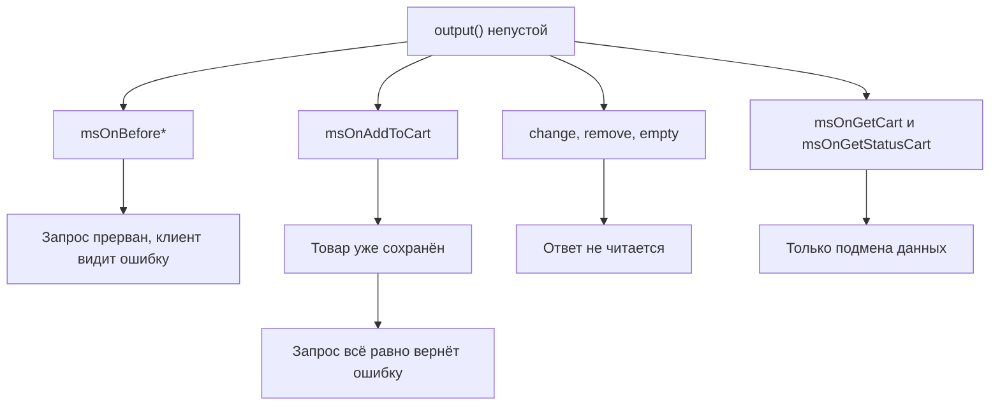
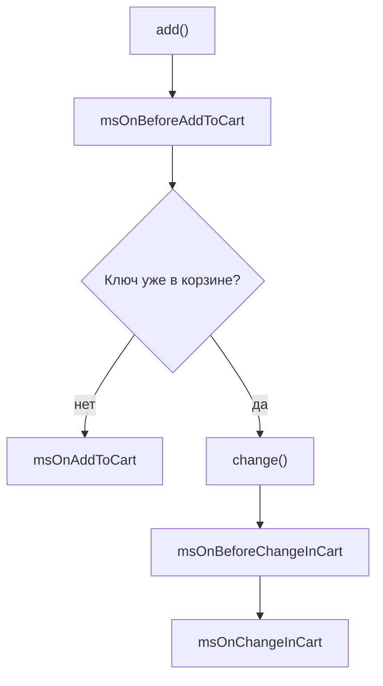

# События корзины

Добавление, изменение и удаление товаров в корзине.

Помимо перечисленных параметров, во все события страницы приходит `controller`. Его подставляет обёртка вызова.

## Какие события могут прервать операцию



`$modx->event->output(...)` останавливает работу не везде: ядро читает ответ плагина только у части событий.

| Событие | Реакция на `output()` |
| --- | --- |
| Все `msOnBefore*` | Операция прерывается, клиент получает ошибку |
| `msOnAddToCart` | Товар уже сохранён, но запрос всё равно вернёт ошибку |
| `msOnChangeInCart`, `msOnChangeOptionInCart`, `msOnRemoveFromCart`, `msOnEmptyCart` | Игнорируется: операция уже завершена успешно |
| `msOnGetCart`, `msOnGetStatusCart` | Только подмена данных, не прерывание |

Вернуть ошибку из этих четырёх after-событий нельзя: ядро вызывает их, не читая ответ. Проверки размещайте в парных `msOnBefore*`.

## msOnBeforeGetCart

Вызывается **перед** получением содержимого корзины.

### Параметры

| Параметр | Тип | Описание |
| --- | --- | --- |
| `controller` | `\MiniShop3\Controllers\Cart\Cart` | Контроллер корзины |
| `draft` | `msOrder` | Черновик заказа (корзина) |

### Прерывание операции

```php
<?php
switch ($modx->event->name) {
    case 'msOnBeforeGetCart':
        /** @var \MiniShop3\Controllers\Cart\Cart $controller */
        $controller = $scriptProperties['controller'];
        $draft = $scriptProperties['draft'];

        // Запретить получение корзины для выбранного пользователя
        if ($modx->user->get('id') == 123) {
            $modx->event->output('Доступ запрещён');
            return;
        }
        break;
}
```

---

## msOnGetCart

Вызывается **после** получения содержимого корзины.

### Параметры

| Параметр | Тип | Описание |
| --- | --- | --- |
| `controller` | `\MiniShop3\Controllers\Cart\Cart` | Контроллер корзины |
| `draft` | `msOrder` | Черновик заказа (корзина) |
| `data` | `array` | Массив товаров корзины |

### Модификация данных

```php
<?php
switch ($modx->event->name) {
    case 'msOnGetCart':
        $controller = $scriptProperties['controller'];
        $data = $scriptProperties['data'];

        // Дополнительные поля к каждой строке корзины
        foreach ($data as $key => &$item) {
            $product = $modx->getObject(\MiniShop3\Model\msProduct::class, $item['product_id']);
            if ($product) {
                $item['sku'] = $product->get('article');
                $item['thumb'] = $product->get('thumb');
            }
        }

        // Вернуть изменённый список через returnedValues
        $values = &$modx->event->returnedValues;
        $values['data'] = $data;
        break;
}
```

---

## msOnBeforeAddToCart

Вызывается **перед** добавлением товара в корзину.

### Параметры

| Параметр | Тип | Описание |
| --- | --- | --- |
| `controller` | `\MiniShop3\Controllers\Cart\Cart` | Контроллер корзины |
| `msProduct` | `msProduct` | Объект товара |
| `count` | `int` | Количество |
| `options` | `array` | Опции товара |

### Прерывание операции

```php
<?php
switch ($modx->event->name) {
    case 'msOnBeforeAddToCart':
        /** @var \MiniShop3\Model\msProduct $product */
        $product = $scriptProperties['msProduct'];
        $count = $scriptProperties['count'];

        // Запретить добавление товаров с нулевой ценой
        if ($product->get('price') <= 0) {
            $modx->event->output('Товар недоступен для заказа');
            return;
        }

        // Запретить добавление более 10 единиц
        if ($count > 10) {
            $modx->event->output('Максимум 10 единиц товара');
            return;
        }
        break;
}
```

### Модификация данных

```php
<?php
switch ($modx->event->name) {
    case 'msOnBeforeAddToCart':
        $product = $scriptProperties['msProduct'];
        $count = $scriptProperties['count'];
        $options = $scriptProperties['options'] ?? [];

        $values = &$modx->event->returnedValues;

        // Минимальное количество: 2 штуки
        if ($count < 2) {
            $values['count'] = 2;
        }

        // Метка источника в опциях
        $options['source'] = 'promo_landing';
        $values['options'] = $options;
        break;
}
```

---

## msOnAddToCart



Вызывается **после** успешного добавления товара в корзину. Товар уже сохранён и черновик пересчитан.

::: warning Может провалить уже выполненный запрос
Товар к этому моменту сохранён, но плагин всё ещё может вызвать `$modx->event->output(...)`. Тогда `add()` вернёт клиенту ошибку, хотя корзина уже изменена.
:::

::: tip Не срабатывает повторное событие добавления
Если ключ товар+опции уже есть в корзине, `msOnBeforeAddToCart` всё равно вызывается. `output()` на нём запрещает и увеличение количества. Дальше `add()` передаёт работу `change()`, срабатывают `msOnBeforeChangeInCart` и `msOnChangeInCart`, а `msOnAddToCart` нет. Количество суммируется: 2 единицы к имеющимся 3 дадут `count = 5`.
:::

### Параметры

| Параметр | Тип | Описание |
| --- | --- | --- |
| `controller` | `\MiniShop3\Controllers\Cart\Cart` | Контроллер корзины |
| `msProduct` | `msProduct` | Объект товара |
| `count` | `int` | Добавленное количество |
| `options` | `array` | Опции товара |
| `product_key` | `string` | Уникальный ключ товара в корзине |

### Пример использования

```php
<?php
switch ($modx->event->name) {
    case 'msOnAddToCart':
        $product = $scriptProperties['msProduct'];
        $count = $scriptProperties['count'];
        $productKey = $scriptProperties['product_key'];

        // Лог добавления
        $modx->log(modX::LOG_LEVEL_INFO, sprintf(
            '[Cart] Товар добавлен: %s (ID: %d), кол-во: %d, ключ: %s',
            $product->get('pagetitle'),
            $product->get('id'),
            $count,
            $productKey
        ));
        break;
}
```

---

## msOnBeforeChangeInCart

Вызывается **перед** изменением количества товара в корзине.

### Параметры

| Параметр | Тип | Описание |
| --- | --- | --- |
| `controller` | `\MiniShop3\Controllers\Cart\Cart` | Контроллер корзины |
| `product_key` | `string` | Уникальный ключ товара в корзине |
| `count` | `int` | Новое количество |

### Прерывание операции

```php
<?php
switch ($modx->event->name) {
    case 'msOnBeforeChangeInCart':
        $productKey = $scriptProperties['product_key'];
        $count = $scriptProperties['count'];

        // Запретить изменение количества у промо-товара
        if (strpos($productKey, 'promo') !== false) {
            $modx->event->output('Количество промо-товаров нельзя изменить');
            return;
        }
        break;
}
```

### Модификация данных

```php
<?php
switch ($modx->event->name) {
    case 'msOnBeforeChangeInCart':
        $count = $scriptProperties['count'];

        $values = &$modx->event->returnedValues;
        // Ограничение максимума
        if ($count > 50) {
            $values['count'] = 50;
        }
        break;
}
```

---

## msOnChangeInCart

Вызывается **после** изменения количества товара в корзине.

### Параметры

| Параметр | Тип | Описание |
| --- | --- | --- |
| `controller` | `\MiniShop3\Controllers\Cart\Cart` | Контроллер корзины |
| `product_key` | `string` | Уникальный ключ товара |
| `count` | `int` | Новое количество |

### Пример использования

```php
<?php
switch ($modx->event->name) {
    case 'msOnChangeInCart':
        $productKey = $scriptProperties['product_key'];
        $count = $scriptProperties['count'];

        $modx->log(modX::LOG_LEVEL_INFO,
            "Количество изменено: {$productKey} => {$count}"
        );
        break;
}
```

---

## msOnBeforeChangeOptionsInCart

Вызывается **перед** изменением опций товара в корзине.

### Параметры

| Параметр | Тип | Описание |
| --- | --- | --- |
| `controller` | `\MiniShop3\Controllers\Cart\Cart` | Контроллер корзины |
| `product_key` | `string` | Уникальный ключ товара |
| `options` | `array` | Новые опции |

### Прерывание операции

```php
<?php
switch ($modx->event->name) {
    case 'msOnBeforeChangeOptionsInCart':
        $options = $scriptProperties['options'];

        // Запретить цвет gold
        if (isset($options['color']) && $options['color'] === 'gold') {
            $modx->event->output('Цвет Gold недоступен');
            return;
        }
        break;
}
```

### Модификация данных

Опции можно подменить. Ядро прочитает их из ответа, если это массив:

```php
<?php
switch ($modx->event->name) {
    case 'msOnBeforeChangeOptionsInCart':
        $options = $scriptProperties['options'];

        // Нормализовать регистр значений
        $options = array_map('mb_strtolower', $options);

        $values = &$modx->event->returnedValues;
        $values['options'] = $options;
        break;
}
```

Подменённые опции участвуют в расчёте `product_key`, поэтому ключ строки корзины изменится вместе с ними.

---

## msOnChangeOptionInCart

Вызывается **после** изменения опций товара в корзине.

::: tip Не срабатывает при совпадении ключей
Если новая комбинация опций совпадает с уже существующей строкой корзины, ядро удаляет текущую строку и передаёт работу `change()`. Сработают `msOnBeforeChangeInCart`/`msOnChangeInCart`, а не это событие. Количества двух строк складываются.
:::

### Параметры

| Параметр | Тип | Описание |
| --- | --- | --- |
| `controller` | `\MiniShop3\Controllers\Cart\Cart` | Контроллер корзины |
| `old_product_key` | `string` | Старый ключ товара |
| `product_key` | `string` | Новый ключ товара (может измениться) |
| `options` | `array` | Новые опции |

### Пример использования

```php
<?php
switch ($modx->event->name) {
    case 'msOnChangeOptionInCart':
        $oldKey = $scriptProperties['old_product_key'];
        $newKey = $scriptProperties['product_key'];
        $options = $scriptProperties['options'];

        if ($oldKey !== $newKey) {
            $modx->log(modX::LOG_LEVEL_INFO,
                "Ключ товара изменён: {$oldKey} => {$newKey}"
            );
        }
        break;
}
```

---

## msOnBeforeRemoveFromCart

Вызывается **перед** удалением товара из корзины.

### Параметры

| Параметр | Тип | Описание |
| --- | --- | --- |
| `controller` | `\MiniShop3\Controllers\Cart\Cart` | Контроллер корзины |
| `product_key` | `string` | Уникальный ключ товара |

### Прерывание операции

```php
<?php
switch ($modx->event->name) {
    case 'msOnBeforeRemoveFromCart':
        $productKey = $scriptProperties['product_key'];

        // Запретить удаление служебной позиции, которую добавило дополнение
        if ($productKey === 'ms_delivery_service') {
            $modx->event->output('Этот товар нельзя удалить');
            return;
        }
        break;
}
```

---

## msOnRemoveFromCart

Вызывается **после** удаления товара из корзины.

### Параметры

| Параметр | Тип | Описание |
| --- | --- | --- |
| `controller` | `\MiniShop3\Controllers\Cart\Cart` | Контроллер корзины |
| `product_key` | `string` | Ключ удалённого товара |

### Пример использования

```php
<?php
switch ($modx->event->name) {
    case 'msOnRemoveFromCart':
        $productKey = $scriptProperties['product_key'];

        $modx->log(modX::LOG_LEVEL_INFO,
            "Товар удалён из корзины: {$productKey}"
        );
        break;
}
```

---

## msOnBeforeEmptyCart

Вызывается **перед** полной очисткой корзины.

### Параметры

| Параметр | Тип | Описание |
| --- | --- | --- |
| `controller` | `\MiniShop3\Controllers\Cart\Cart` | Контроллер корзины |

### Прерывание операции

```php
<?php
switch ($modx->event->name) {
    case 'msOnBeforeEmptyCart':
        // Запретить очистку корзины ночью
        $hour = (int)date('G');
        if ($hour >= 23 || $hour < 6) {
            $modx->event->output('Очистка корзины недоступна в ночное время');
            return;
        }
        break;
}
```

---

## msOnEmptyCart

Вызывается **после** полной очистки корзины.

### Параметры

| Параметр | Тип | Описание |
| --- | --- | --- |
| `controller` | `\MiniShop3\Controllers\Cart\Cart` | Контроллер корзины |

### Пример использования

```php
<?php
switch ($modx->event->name) {
    case 'msOnEmptyCart':
        $modx->log(modX::LOG_LEVEL_INFO, 'Корзина очищена');

        // Своих ключей вроде промокода в ядре MiniShop3 нет. Их приносят
        // дополнения, например ms3PromoCode.
        unset($_SESSION['myshop']['promo']);
        break;
}
```

---

## msOnGetStatusCart

Вызывается при расчёте статуса (итогов) корзины.

### Параметры

| Параметр | Тип | Описание |
| --- | --- | --- |
| `controller` | `\MiniShop3\Controllers\Cart\Cart` | Контроллер корзины |
| `status` | `array` | Массив итогов корзины |

### Структура status

```php
$status = [
    'total_count' => 5,        // Суммарное количество единиц товара
    'total_cost' => 15000,     // Общая стоимость
    'total_weight' => 12.5,    // Общий вес в единицах ms3_weight_unit (по умолчанию кг)
    'total_discount' => 1500,  // Общая скидка
    'total_positions' => 3,    // Количество позиций (строк корзины)
];
```

Других ключей в `status` нет. Массив целиком собирает `CartItemManager::calculateStatus()`. `total_count` суммирует количество по всем строкам, `total_positions` считает число самих строк.

### Модификация данных

```php
<?php
switch ($modx->event->name) {
    case 'msOnGetStatusCart':
        $status = $scriptProperties['status'];

        // Бонусные баллы
        $status['bonus_points'] = floor($status['total_cost'] / 100);

        // Порог бесплатной доставки
        $status['free_delivery'] = $status['total_cost'] >= 5000;
        $status['free_delivery_diff'] = max(0, 5000 - $status['total_cost']);

        $values = &$modx->event->returnedValues;
        $values['status'] = $status;
        break;
}
```

### Вывод дополнительной информации

После модификации статуса ключи доступны в чанке. Классы разметки задаёт сайт.

```fenom
{if $status.free_delivery}
    <div class="free-delivery">Бесплатная доставка!</div>
{else}
    <div class="delivery-info">
        До бесплатной доставки: {$status.free_delivery_diff | number_format : 0 : '' : ' '} ₽
    </div>
{/if}

{if $status.bonus_points > 0}
    <div class="bonus">Вы получите {$status.bonus_points} бонусных баллов</div>
{/if}
```
