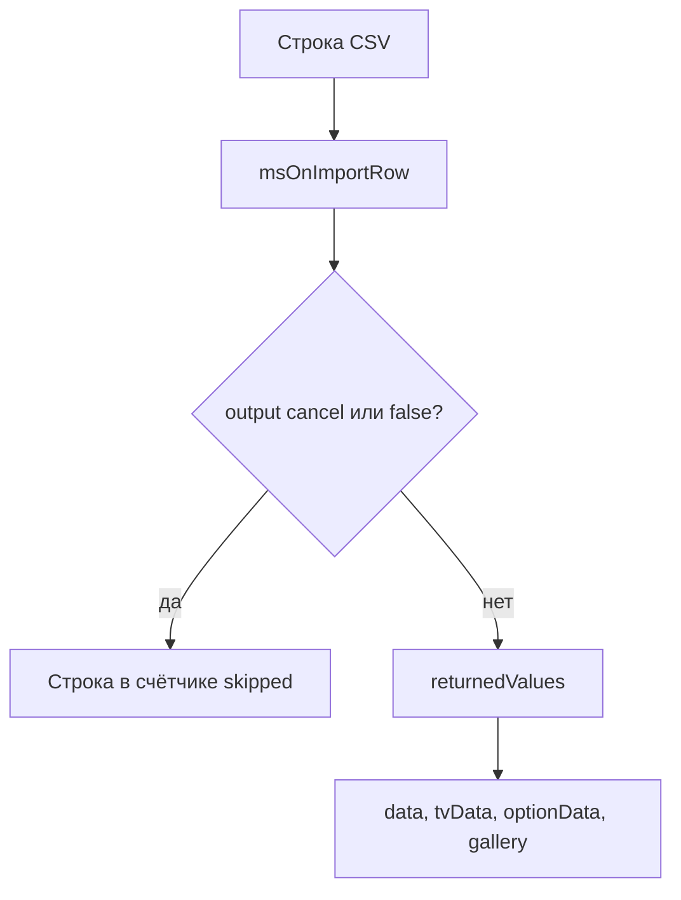

# События импорта

События импорта товаров из CSV через утилиту импорта в админке.

## msOnBeforeImport

Вызывается **перед** началом импорта файла.

### Параметры

| Параметр | Тип | Описание |
| --- | --- | --- |
| `file` | `string` | Путь к файлу импорта |
| `params` | `array` | Параметры импорта. Менять массив в `$scriptProperties` бесполезно, пишите `returnedValues['params']` |

**Структура params:**

```php
[
    'file' => 'путь/к/файлу.csv',
    'fields' => 'pagetitle,price,parent', // или mapping
    'mapping' => [0 => 'pagetitle', 1 => 'price', ...],
    'update' => true,           // разрешить обновление
    'key' => 'article',         // поле для поиска дубликатов
    'skip_header' => true,      // пропустить заголовок
    'is_debug' => false,        // режим отладки
    'delimiter' => ';',         // разделитель
    'keys' => ['pagetitle', 'price', ...], // финальный список полей
    'tv_enabled' => false,      // есть TV поля
    'option_enabled' => false,  // есть опции
]
```

### Прерывание операции

Отмена всегда возвращает лексикон `ms3_utilities_import_cancelled`. Текст из `output()` в сообщение не попадает. Нужны `output('cancel')` или `output(false)`.

```php
<?php
switch ($modx->event->name) {
    case 'msOnBeforeImport':
        $file = $scriptProperties['file'];

        // Проверка размера файла
        if (filesize($file) > 10 * 1024 * 1024) { // 10MB
            $modx->event->output('cancel');
            return;
        }

        // Проверка рабочего времени
        $hour = (int)date('G');
        if ($hour >= 10 && $hour < 18) {
            $modx->event->output('cancel');
            return;
        }
        break;
}
```

### Модификация параметров

Assoc в `returnedValues['params']` патчит через `array_replace`, list заменяет массив целиком.

```php
<?php
switch ($modx->event->name) {
    case 'msOnBeforeImport':
        $params = $scriptProperties['params'];

        // Дефолт для поля, которого нет в CSV
        $params['default_vendor'] = 1;

        // Ключ поиска дубликатов
        if (empty($params['key'])) {
            $params['key'] = 'article';
        }

        $modx->event->returnedValues['params'] = $params;
        break;
}
```

Краткий patch:

```php
<?php
switch ($modx->event->name) {
    case 'msOnBeforeImport':
        $modx->event->returnedValues = [
            'params' => ['key' => 'article', 'delimiter' => ';'],
        ];
        break;
}
```

---

## msOnAfterImport

Вызывается **после** завершения импорта.

### Параметры

| Параметр | Тип | Описание |
| --- | --- | --- |
| `stats` | `array` | Статистика импорта |

**Структура stats:**

```php
[
    'total' => 150,    // всего строк
    'created' => 120,  // создано товаров
    'updated' => 25,   // обновлено товаров
    'errors' => 3,     // ошибок
    'skipped' => 2,    // пропущено
]
```

### Пример использования

```php
<?php
switch ($modx->event->name) {
    case 'msOnAfterImport':
        $stats = $scriptProperties['stats'];

        // Лог итогов
        $modx->log(modX::LOG_LEVEL_INFO, sprintf(
            '[Import] Завершено: всего %d, создано %d, обновлено %d, ошибок %d',
            $stats['total'],
            $stats['created'],
            $stats['updated'],
            $stats['errors']
        ));

        // Сброс кэша MODX
        $modx->cacheManager->refresh();

        if ($stats['errors'] > 0) {
            $message = "Импорт завершён с ошибками!\n\n";
            $message .= "Создано: {$stats['created']}\n";
            $message .= "Обновлено: {$stats['updated']}\n";
            $message .= "Ошибок: {$stats['errors']}\n";

            // Письмо администратору. В пакете своей очереди писем нет.
            // mail($adminEmail, 'Отчёт импорта', $message);
        }
        break;
}
```

---

## msOnImportRow



Вызывается при обработке **каждой строки** CSV-файла.

### Параметры

| Параметр | Тип | Описание |
| --- | --- | --- |
| `row` | `int` | Номер текущей строки |
| `csv` | `array` | Сырые данные строки CSV |
| `data` | `array` | Данные для создания/обновления ресурса |
| `tvData` | `array` | Данные для TV-полей |
| `optionData` | `array` | Данные для опций товара |
| `gallery` | `array` | Пути к изображениям галереи |

Ядро после события применяет `EventGate::applyReturnedArray()` для ключей `data`, `tvData`, `optionData`, `gallery`. List-массив в `returnedValues` заменяет канал целиком, assoc патчит поля.

::: warning Мутация `$scriptProperties` по ссылке не работает
`modX::invokeEvent()` собирает параметры через `array_merge()`, и ссылка до импорта не доходит. Изменённый массив нужно записать в `$modx->event->returnedValues`.
:::

### Прерывание строки (пропуск)

```php
<?php
switch ($modx->event->name) {
    case 'msOnImportRow':
        $data = $scriptProperties['data'];
        $row = $scriptProperties['row'];

        // Пропуск строки без цены
        if (empty($data['price']) || $data['price'] <= 0) {
            $modx->log(modX::LOG_LEVEL_WARN, sprintf(
                '[Import] Строка %d пропущена: нет цены',
                $row
            ));
            $modx->event->output('cancel');
            return;
        }

        // Пропуск строк из исключённых категорий
        $excludedParents = [10, 15, 20];
        if (in_array($data['parent'], $excludedParents)) {
            $modx->event->output('cancel');
            return;
        }
        break;
}
```

### Модификация данных

```php
<?php
switch ($modx->event->name) {
    case 'msOnImportRow':
        $data = $scriptProperties['data'];
        $csv = $scriptProperties['csv'];
        $tvData = $scriptProperties['tvData'];
        $optionData = $scriptProperties['optionData'];

        // Alias из названия
        if (empty($data['alias'])) {
            $data['alias'] = $modx->filterPathSegment($data['pagetitle']);
        }

        // Шаблон по умолчанию
        if (empty($data['template'])) {
            $data['template'] = 5;
        }

        // Старая цена, если колонки нет
        if (!empty($data['price']) && empty($data['old_price'])) {
            $data['old_price'] = round($data['price'] * 1.2, 2);
        }

        // Бренд уходит в TV, из полей ресурса его убираем
        if (!empty($data['brand'])) {
            $tvData['product_brand'] = $data['brand'];
            unset($data['brand']);
        }

        // Опция из 10-й колонки CSV
        if (!empty($csv[10])) {
            $optionData['color'] = $csv[10];
        }

        $modx->event->returnedValues['data'] = $data;
        $modx->event->returnedValues['tvData'] = $tvData;
        $modx->event->returnedValues['optionData'] = $optionData;
        break;
}
```

Краткий patch (list в `gallery` заменяет всю галерею):

```php
<?php
switch ($modx->event->name) {
    case 'msOnImportRow':
        $modx->event->returnedValues = [
            'data' => [
                'vendor_id' => 1,
                'template' => 5,
            ],
            'optionData' => [
                'color' => $scriptProperties['csv'][10] ?? '',
            ],
            // list в gallery заменяет галерею целиком
            // 'gallery' => ['assets/gallery/sku-001.jpg'],
        ];
        break;
}
```

### Обработка галереи

```php
<?php
switch ($modx->event->name) {
    case 'msOnImportRow':
        $data = $scriptProperties['data'];
        $gallery = $scriptProperties['gallery'];

        // Локальные пути из колонки external_images
        if (!empty($data['external_images'])) {
            $images = explode(',', $data['external_images']);
            foreach ($images as $imageUrl) {
                $localPath = ltrim(trim($imageUrl), '/');
                if ($localPath !== '' && file_exists(MODX_BASE_PATH . $localPath)) {
                    $gallery[] = $localPath;
                }
            }
            unset($data['external_images']);
        }

        // Главное фото по артикулу, если галерея пустая
        if (!empty($data['article']) && empty($gallery)) {
            $imagePath = "assets/images/products/{$data['article']}.jpg";
            if (file_exists(MODX_BASE_PATH . $imagePath)) {
                $gallery[] = $imagePath;
            }
        }

        $modx->event->returnedValues['data'] = $data;
        $modx->event->returnedValues['gallery'] = $gallery;
        break;
}
```

### Валидация и очистка данных

```php
<?php
switch ($modx->event->name) {
    case 'msOnImportRow':
        $data = $scriptProperties['data'];
        $row = $scriptProperties['row'];

        // Цена: убрать пробелы, запятую заменить на точку
        if (!empty($data['price'])) {
            $data['price'] = preg_replace('/[^\d.,]/', '', $data['price']);
            $data['price'] = str_replace(',', '.', $data['price']);
            $data['price'] = (float)$data['price'];
        }

        // Артикул в верхнем регистре и проверка формата
        if (!empty($data['article'])) {
            $data['article'] = mb_strtoupper(trim($data['article']));

            if (!preg_match('/^[A-Z0-9\-]+$/', $data['article'])) {
                $modx->log(modX::LOG_LEVEL_ERROR, sprintf(
                    '[Import] Строка %d: некорректный артикул "%s"',
                    $row,
                    $data['article']
                ));
                $modx->event->output('cancel');
                return;
            }
        }

        // HTML из названия
        $data['pagetitle'] = strip_tags($data['pagetitle']);
        $data['pagetitle'] = html_entity_decode($data['pagetitle'], ENT_QUOTES, 'UTF-8');

        // Описание не длиннее 500 символов
        if (!empty($data['description']) && mb_strlen($data['description']) > 500) {
            $data['description'] = mb_substr($data['description'], 0, 497) . '...';
        }

        $modx->event->returnedValues['data'] = $data;
        break;
}
```
