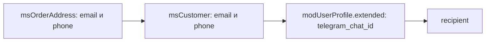

# События уведомлений

События системы уведомлений: отправка, модификация, регистрация каналов.

## Встроенные каналы

| Канал | Класс | Описание |
| --- | --- | --- |
| `email` | `EmailChannel` | Отправка через MODX modMail. Шаблоны задаются чанками |
| `telegram` | `TelegramChannel` | Отправка через Telegram Bot API |

### Telegram канал

- `ms3_telegram_bot_token`: токен бота
- `ms3_telegram_manager`: Chat ID менеджеров (через запятую)

::: warning Ограничение Telegram
Telegram-бот не может инициировать диалог с пользователем. Клиент должен сам написать боту первое сообщение. Поэтому Telegram-уведомления работают только для менеджеров, которые заранее настроили Chat ID.
:::

### Реализация уведомлений клиентам через Telegram

1. Получить согласие клиента на получение уведомлений
2. Привязать Telegram-аккаунт клиента к его профилю в магазине
3. Сохранить Chat ID клиента

#### Шаг 1: Chat ID в профиле пользователя

Рабочий источник: `modUserProfile.extended` с ключом `telegram_chat_id` у пользователя, чей id записан в `msOrder.user_id`.

Поля `extended` у `msCustomer` нет. Отдельная колонка у покупателя кодом не читается. Это [баг #900](https://github.com/modx-pro/MiniShop3/issues/900).

#### Шаг 2: Создать бота с Deep Linking

[Telegram Deep Linking](https://core.telegram.org/bots/features#deep-linking) для привязки аккаунта:

```php
<?php
// Ссылка привязки: id покупателя и короткий токен в параметре start
$customerId = $msCustomer->get('id');
$token = hash('sha256', $customerId . $modx->getOption('ms3_snippet_token_secret'));
$linkCode = base64_encode($customerId . ':' . substr($token, 0, 16));

$botUsername = 'YourShopBot'; // username бота без @
$telegramLink = "https://t.me/{$botUsername}?start={$linkCode}";
```

#### Шаг 3: Обработка команды /start на стороне бота

Бот обрабатывает параметр `start` и пишет Chat ID в `extended` профиля связанного пользователя:

```php
<?php
$update = json_decode(file_get_contents('php://input'), true);
$message = $update['message'] ?? null;

if ($message && str_starts_with($message['text'], '/start ')) {
    $linkCode = substr($message['text'], 7);
    $decoded = base64_decode($linkCode);
    [$customerId, $tokenPart] = explode(':', $decoded);

    $expectedToken = hash('sha256', $customerId . $modx->getOption('ms3_snippet_token_secret'));
    // Сверяем хвост токена из ссылки
    if (substr($expectedToken, 0, 16) === $tokenPart) {
        $customer = $modx->getObject(\MiniShop3\Model\msCustomer::class, $customerId);
        $userId = $customer ? (int) $customer->get('user_id') : 0;
        $profile = $userId
            ? $modx->getObject(\MODX\Revolution\modUserProfile::class, ['internalKey' => $userId])
            : null;
        if ($profile) {
            $extended = $profile->get('extended');
            if (!is_array($extended)) {
                $extended = [];
            }
            // Chat ID пишется в extended профиля, не в msCustomer
            $extended['telegram_chat_id'] = (string) $message['chat']['id'];
            $profile->set('extended', $extended);
            $profile->save();
        }
    }
}
```

#### Шаг 4: Плагин для отправки уведомлений клиенту

```php
<?php
/**
 * Плагин: Telegram уведомления клиентам
 * События: msOnChangeOrderStatus
 */

switch ($modx->event->name) {
    case 'msOnChangeOrderStatus':
        $order = $scriptProperties['msOrder'];
        $statusId = (int) $scriptProperties['status'];

        // Покупатель заказа
        $customer = $order->getOne('Customer');
        if (!$customer) {
            return;
        }

        // Chat ID только из extended профиля связанного пользователя
        $userId = (int) $order->get('user_id');
        $profile = $userId
            ? $modx->getObject(\MODX\Revolution\modUserProfile::class, ['internalKey' => $userId])
            : null;
        $extended = $profile ? $profile->get('extended') : [];
        $chatId = is_array($extended) ? ($extended['telegram_chat_id'] ?? '') : '';
        if ($chatId === '') {
            return;
        }

        $status = $modx->getObject(\MiniShop3\Model\msOrderStatus::class, $statusId);
        $statusName = $status ? $status->get('name') : (string) $statusId;
        $orderNum = $order->get('num');

        // Текст сообщения
        $message = "📦 Заказ #{$orderNum}\n";
        $message .= "Статус изменён на: {$statusName}";

        // Отправка через Bot API
        $botToken = $modx->getOption('ms3_telegram_bot_token');
        $url = "https://api.telegram.org/bot{$botToken}/sendMessage";

        $ch = curl_init($url);
        curl_setopt_array($ch, [
            CURLOPT_POST => true,
            CURLOPT_POSTFIELDS => [
                'chat_id' => $chatId,
                'text' => $message,
                'parse_mode' => 'HTML',
            ],
            CURLOPT_RETURNTRANSFER => true,
        ]);
        curl_exec($ch);
        curl_close($ch);
        break;
}
```

#### Шаг 5: Кнопка привязки в личном кабинете

Ссылку из шага 2 выводите в кабинете. Признак «уже привязан» берите из `extended` профиля пользователя, не из поля покупателя.

```fenom
{if $telegramLinked}
    <p>Telegram-уведомления подключены</p>
{else}
    <a href="{$telegramLink}" target="_blank">Подключить Telegram-уведомления</a>
{/if}
```

::: tip Альтернативный подход
Вместо собственного бота можно интегрироваться с существующими сервисами рассылок (SendPulse, Unisender и др.), которые предоставляют API для Telegram и берут на себя работу с подписками.
:::

## msOnBeforeSendNotification



Вызывается **перед** отправкой уведомления. Можно изменить получателя, подменить список каналов или отменить отправку.

### Параметры

| Параметр | Тип | Описание |
| --- | --- | --- |
| `notification` | `Notification` | Объект уведомления (абстрактный класс, конкретный подкласс, например `StatusChangedNotification`) |
| `recipient` | `array` | Данные получателя, см. структуру ниже |
| `recipientType` | `string` | Тип получателя: `customer` или `manager` |
| `channels` | `string[]` | Список каналов отправки (например, `['email', 'telegram']`) |

### Структура `recipient`

Для **customer** (начиная с MiniShop3 1.12.0) `recipient` собирается в `OrderStatusService::getCustomerRecipient()` со следующим приоритетом источников:

1. **`msOrderAddress`** заказа: email/phone из формы оформления **именно этого** заказа.
2. **`msCustomer`**: запасной вариант по email и phone, плюс массив `customer` в данных получателя.
3. **`modUserProfile`**: последний запасной вариант для email и phone. Единственный рабочий источник `telegram_chat_id`: ключ `extended` профиля, если у заказа задан `user_id`. Смотрите [баг #900](https://github.com/modx-pro/MiniShop3/issues/900).

Итоговые `email`/`phone` дополнительно зеркалятся в `recipient['customer']['email']`/`['phone']` для плагинов, читающих контакт оттуда.

| Ключ | Тип | Источник | Описание |
| --- | --- | --- | --- |
| `type` | `string` | нет | `customer` или `manager` (дублирует `recipientType`) |
| `email` | `string \| null` | address → customer → profile | Итоговый email получателя |
| `phone` | `string \| null` | address → customer → profile | Итоговый телефон |
| `telegram_chat_id` | `string \| null` | `modUserProfile.extended` | ID чата Telegram. Читается только из профиля связанного пользователя |
| `address` | `array` | `msOrderAddress->toArray()` | Полный адрес заказа (доступен только для customer-получателя) |
| `customer` | `array` | `msCustomer->toArray()` | Объект клиента (доступен только для customer-получателя). Поля `email`/`phone` уже синхронизированы с итоговыми значениями |

::: tip Зачем разделять адрес и клиента
До 1.12.0 уведомления слались по контактам из `msCustomer`, которые могли отличаться от контактов конкретного заказа. Если в одной сессии оформили два заказа с разными email, оба уходили на email из msCustomer.
:::

### Прерывание операции

Отмена отправки: `$modx->event->output('cancel')` или `output(false)`. Любой другой текст и `return` отмену не делают. Событие идёт через `EventGate::invokeRaw()`, не через `Utils::invokeEvent`.

```php
<?php
switch ($modx->event->name) {
    case 'msOnBeforeSendNotification':
        $recipient = $scriptProperties['recipient'];

        // Ночью не отправлять
        $hour = (int) date('G');
        if ($hour >= 23 || $hour < 8) {
            $modx->event->output(false);
            return;
        }

        if (!empty($recipient['email'])) {
            $domain = substr($recipient['email'], strpos($recipient['email'], '@') + 1);
            if (in_array($domain, ['tempmail.com', 'throwaway.com'], true)) {
                $modx->event->output('cancel');
                return;
            }
        }
        break;
}
```

### Модификация через returnedValues

Контракт: ключи в `returnedValues`. Запись в `$scriptProperties['recipient']` до отправки не доходит.

```php
<?php
switch ($modx->event->name) {
    case 'msOnBeforeSendNotification':
        $values = &$modx->event->returnedValues;

        $values['recipient'] = array_replace(
            $scriptProperties['recipient'],
            ['email' => 'ops@example.com']
        );

        // list заменяет список каналов целиком
        $values['channels'] = ['email'];
        break;
}
```

---

## msOnAfterSendNotification

Вызывается **после** обработки уведомления, суммарно по всем выбранным каналам.

### Параметры

| Параметр | Тип | Описание |
| --- | --- | --- |
| `notification` | `Notification` | Объект уведомления (абстрактный класс, конкретный подкласс, например `StatusChangedNotification`) |
| `recipient` | `array` | Данные получателя, см. [структуру recipient](#структура-recipient) выше |
| `recipientType` | `string` | Тип получателя: `customer` или `manager` |
| `results` | `array<string,bool>` | Результат отправки по каналам, например `['email' => true, 'telegram' => false]` |

### Пример использования

```php
<?php
switch ($modx->event->name) {
    case 'msOnAfterSendNotification':
        $notification = $scriptProperties['notification'];
        $recipient = $scriptProperties['recipient'];
        $results = $scriptProperties['results']; // ['email' => true, 'telegram' => false]

        foreach ($results as $channelName => $success) {
            $contact = $recipient['email'] ?? $recipient['phone'] ?? 'unknown';
            $level = $success ? modX::LOG_LEVEL_INFO : modX::LOG_LEVEL_ERROR;
            $modx->log($level, sprintf(
                '[Notification] %s → %s (%s): %s',
                $notification::class,
                $contact,
                $channelName,
                $success ? 'ok' : 'fail'
            ));
        }
        break;
}
```

### Повторная отправка при ошибке

```php
<?php
switch ($modx->event->name) {
    case 'msOnAfterSendNotification':
        $results = $scriptProperties['results'];

        if (in_array(false, $results, true)) {
            // Ваша очередь повторов: в пакете нет msNotificationQueue
            $modx->log(modX::LOG_LEVEL_WARN, '[Notification] Partial failure: ' . json_encode($results));
        }
        break;
}
```

---

## msOnRegisterNotificationChannels

Вызывается при регистрации каналов уведомлений. Сюда добавляют свои каналы.

### Параметры

| Параметр | Тип | Описание |
| --- | --- | --- |
| `manager` | `NotificationManager` | Менеджер уведомлений |

### Регистрация своего канала

`NotificationManager::registerChannel()` принимает объект `ChannelInterface`, не callback.

```php
<?php
switch ($modx->event->name) {
    case 'msOnRegisterNotificationChannels':
        /** @var \MiniShop3\Notifications\NotificationManager $manager */
        $manager = $scriptProperties['manager'];

        $manager->registerChannel(new MyComponent\Notifications\SmsChannel($modx));
        break;
}
```

### Пример своего канала

```php
<?php
namespace MyComponent\Notifications;

use MiniShop3\Model\msOrder;
use MiniShop3\Notifications\ChannelInterface;
use MiniShop3\Notifications\Notification;
use MODX\Revolution\modX;

class SmsChannel implements ChannelInterface
{
    public function __construct(protected modX $modx) {}

    public function getName(): string
    {
        return 'sms';
    }

    public function isAvailable(): bool
    {
        return (bool) $this->modx->getOption('my_sms_api_key');
    }

    public function getRequirements(): array
    {
        return ['my_sms_api_key'];
    }

    public function send(Notification $notification, array $recipient, msOrder $order): bool
    {
        $phone = $recipient['phone'] ?? null;
        if (!$phone) {
            return false;
        }

        // Вызов вашего SMS API
        return true;
    }
}
```
