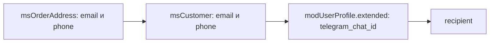

# События уведомлений

События системы уведомлений: отправка, модификация, регистрация каналов.

## Встроенные каналы

| Канал | Класс | Описание |
| --- | --- | --- |
| `email` | `EmailChannel` | Отправка через MODX modMail. Шаблоны задаются чанками |
| `telegram` | `TelegramChannel` | Отправка через Telegram Bot API |

### Telegram-канал

Каналу нужны две системные настройки:

- `ms3_telegram_bot_token` — токен бота;
- `ms3_telegram_manager` — Chat ID менеджеров через запятую.

::: warning Ограничение Telegram
Telegram-бот не может инициировать диалог. Покупатель должен сам написать боту первое сообщение. Поэтому Telegram-уведомления работают только для менеджеров, которые заранее настроили Chat ID.
:::

### Уведомления покупателям через Telegram

Встроенный канал покупателей не уведомляет, этот сценарий собирают сами. Понадобятся согласие покупателя на уведомления, привязка его Telegram-аккаунта и сохранённый Chat ID.

#### Шаг 1: Где канал берёт Chat ID

Канал ищет Chat ID в двух местах, по порядку:

1. **`modUserProfile.extended`** — ключ `telegram_chat_id` у пользователя MODX, чей id записан в `msOrder.user_id`. Работает, если покупатель связан с учётной записью.
2. **Своё поле `telegram_chat_id` у `msCustomer`** — попадает в данные получателя через `CustomerPublicDto`, который добавляет к публичному набору ключи активных полей из утилиты [«Свои поля»](/components/minishop3/interface/utilities/extra-fields). Работает и для покупателя без учётной записи MODX.

::: warning Колонка, добавленная руками, не сработает
`ALTER TABLE modx_ms3_customers ADD COLUMN telegram_chat_id …` выглядит коротким путём, но в данные получателя попадают только ключи **активных полей**, зарегистрированных утилитой. Колонки, созданной в обход неё, в `{$customer}` не окажется — утилита заводит колонку сама.

Есть и третий путь, но он не работает: `OrderStatusService` читает `extended` у самого `msCustomer`, а такого поля в схеме покупателя нет — [баг #900](https://github.com/modx-pro/MiniShop3/issues/900). На два источника выше он не влияет.
:::

#### Шаг 2: Бот с Deep Linking

Telegram-аккаунт привязывают через [Deep Linking](https://core.telegram.org/bots/features#deep-linking):

```php
<?php
// Ссылка привязки: id покупателя и короткий токен в параметре start
$customerId = $msCustomer->get('id');
$token = hash('sha256', $customerId . $modx->getOption('ms3_snippet_token_secret'));
$linkCode = base64_encode($customerId . ':' . substr($token, 0, 16));

$botUsername = 'YourShopBot'; // username бота без @
$telegramLink = "https://t.me/{$botUsername}?start={$linkCode}";
```

#### Шаг 3: Обработка команды /start на стороне бота

Бот обрабатывает параметр `start` и пишет Chat ID в `extended` профиля связанного пользователя:

```php
<?php
$update = json_decode(file_get_contents('php://input'), true);
$message = $update['message'] ?? null;

if ($message && str_starts_with($message['text'], '/start ')) {
    $linkCode = substr($message['text'], 7);
    $decoded = base64_decode($linkCode);
    [$customerId, $tokenPart] = explode(':', $decoded);

    $expectedToken = hash('sha256', $customerId . $modx->getOption('ms3_snippet_token_secret'));
    // Сверяем хвост токена из ссылки
    if (substr($expectedToken, 0, 16) === $tokenPart) {
        // Сохраняем Chat ID в профиле покупателя
        $customer = $modx->getObject(\MiniShop3\Model\msCustomer::class, $customerId);
        $userId = $customer ? (int) $customer->get('user_id') : 0;
        $profile = $userId
            ? $modx->getObject(\MODX\Revolution\modUserProfile::class, ['internalKey' => $userId])
            : null;
        if ($profile) {
            $extended = $profile->get('extended');
            if (!is_array($extended)) {
                $extended = [];
            }
            // Chat ID пишется в extended профиля, не в msCustomer
            $extended['telegram_chat_id'] = (string) $message['chat']['id'];
            $profile->set('extended', $extended);
            $profile->save();
        }
    }
}
```

#### Шаг 4: Плагин для отправки уведомлений покупателю

```php
<?php
/**
 * Плагин: Telegram-уведомления покупателям
 * События: msOnChangeOrderStatus
 */

switch ($modx->event->name) {
    case 'msOnChangeOrderStatus':
        $order = $scriptProperties['msOrder'];
        $statusId = (int) $scriptProperties['status'];

        // Покупатель заказа
        $customer = $order->getOne('Customer');
        if (!$customer) {
            return;
        }

        // Тот же порядок, что у встроенного канала: сначала профиль
        // связанного пользователя, затем своё поле покупателя
        $userId = (int) $order->get('user_id');
        $profile = $userId
            ? $modx->getObject(\MODX\Revolution\modUserProfile::class, ['internalKey' => $userId])
            : null;
        $extended = $profile ? $profile->get('extended') : [];
        $chatId = is_array($extended) ? ($extended['telegram_chat_id'] ?? '') : '';
        if ($chatId === '') {
            $chatId = (string) $customer->get('telegram_chat_id');
        }
        if ($chatId === '') {
            return; // Покупатель не привязал Telegram
        }

        $status = $modx->getObject(\MiniShop3\Model\msOrderStatus::class, $statusId);
        $statusName = $status ? $status->get('name') : (string) $statusId;
        $orderNum = $order->get('num');

        // Текст сообщения
        $message = "📦 Заказ #{$orderNum}\n";
        $message .= "Статус изменён на: {$statusName}";

        // Отправка через Bot API
        $botToken = $modx->getOption('ms3_telegram_bot_token');
        $url = "https://api.telegram.org/bot{$botToken}/sendMessage";

        $ch = curl_init($url);
        curl_setopt_array($ch, [
            CURLOPT_POST => true,
            CURLOPT_POSTFIELDS => [
                'chat_id' => $chatId,
                'text' => $message,
                'parse_mode' => 'HTML',
            ],
            CURLOPT_RETURNTRANSFER => true,
        ]);
        curl_exec($ch);
        curl_close($ch);
        break;
}
```

#### Шаг 5: Кнопка привязки в личном кабинете

Ссылку из шага 2 выводите в кабинете, а признак «уже привязан» берите из тех же двух источников, что и канал (шаг 1).

Добавьте в шаблон профиля покупателя:

```fenom
{if $telegramLinked}
    <p>Telegram-уведомления подключены</p>
{else}
    <a href="{$telegramLink}" target="_blank">Подключить Telegram-уведомления</a>
{/if}
```

::: tip Альтернативный подход
Вместо своего бота можно подключить сервис рассылок (SendPulse, Unisender и другие): у них есть API для Telegram, а работу с подписками они берут на себя.
:::

## msOnBeforeSendNotification



Вызывается **перед** отправкой уведомления. Можно изменить получателя, подменить список каналов или отменить отправку.

### Параметры

| Параметр | Тип | Описание |
| --- | --- | --- |
| `notification` | `Notification` | Конкретный подкласс абстрактного `Notification`, например `StatusChangedNotification` |
| `recipient` | `array` | Данные получателя, см. структуру ниже |
| `recipientType` | `string` | Тип получателя: `customer` или `manager` |
| `channels` | `string[]` | Список каналов отправки, например `['email', 'telegram']` |

### Структура `recipient` {#recipient}

Для получателя типа `customer` (начиная с 1.12.0) `recipient` собирает `OrderStatusService::getCustomerRecipient()`. Приоритет источников:

1. **`msOrderAddress`** заказа — email и телефон из формы оформления **именно этого** заказа.
2. **`msCustomer`** — запасной вариант для email и телефона, а также источник массива `customer`: вместе с ним приходит своё поле `telegram_chat_id`, если оно заведено.
3. **`modUserProfile`** — последний запасной вариант для email и телефона. Для `telegram_chat_id` это основной источник: ключ `extended` в профиле пользователя, чей id записан в `msOrder.user_id`.

| Ключ | Тип | Источник | Описание |
| --- | --- | --- | --- |
| `type` | `string` | — | Тип получателя: `customer` или `manager`, дублирует `recipientType` |
| `email` | `string \| null` | адрес → покупатель → профиль | Итоговый email получателя |
| `phone` | `string \| null` | адрес → покупатель → профиль | Итоговый телефон |
| `telegram_chat_id` | `string \| null` | `modUserProfile.extended` | Chat ID пользователя, связанного с заказом. Своё поле покупателя приходит отдельно, внутри `customer` |
| `address` | `array` | `msOrderAddress->toArray()` | Полный адрес заказа (только у получателя `customer`) |
| `customer` | `array` | `CustomerPublicDto::fromCustomer()` | Публичные поля покупателя (только у получателя `customer`); `email` и `phone` в нём уже совпадают с итоговыми значениями |

::: warning Секретов покупателя в `customer` нет
С 1.14.2-beta1 массив собирает `CustomerPublicDto`, а не сырой `toArray()`. В него не попадают `password`, `token`, `user_id`, `customer_group_id`, счётчики попыток входа и IP-адрес, с которого принята политика. Публичный набор: `id`, `first_name`, `last_name`, `email`, `phone`, `email_verified_at`, `is_active`, `created_at`, `updated_at`, `last_login_at`, `orders_count`, `total_spent`, `last_order_at`, `privacy_accepted_at` плюс активные поля из утилиты «Свои поля».
:::

::: tip Зачем разделять адрес и покупателя
До 1.12.0 уведомления слались по контактам из `msCustomer`, которые могли отличаться от контактов конкретного заказа: если в одной сессии оформляли два заказа с разными email, оба уведомления уходили на email из `msCustomer`.
:::

### Прерывание операции

Отправку отменяет `$modx->event->output('cancel')` или `output(false)`. Любой другой текст и обычный `return` отмены не делают: `EventGate::isCancelled()` проверяет только то, что плагин отдал через `output()`. Событие вызывается через `EventGate::invokeRaw()`, а не через `Utils::invokeEvent()`.

```php
<?php
switch ($modx->event->name) {
    case 'msOnBeforeSendNotification':
        $recipient = $scriptProperties['recipient'];

        // Ночью не отправлять
        $hour = (int) date('G');
        if ($hour >= 23 || $hour < 8) {
            $modx->event->output(false);
            return;
        }

        if (!empty($recipient['email'])) {
            $domain = substr($recipient['email'], strpos($recipient['email'], '@') + 1);
            if (in_array($domain, ['tempmail.com', 'throwaway.com'], true)) {
                $modx->event->output('cancel');
                return;
            }
        }
        break;
}
```

### Модификация через returnedValues

Получателя и список каналов меняйте ключами `recipient` и `channels` в `returnedValues`. Правка `$recipient` и `$channels` по ссылке тоже работает, но этот способ явнее:

::: tip Почему здесь ссылка работает, а на других страницах нет
`NotificationManager` передаёт эти два параметра явными ссылками (`'recipient' => &$recipient`), поэтому изменение доходит до вызывающего кода. Это исключение: события, которые идут через `Utils::invokeEvent`, собирают параметры через `array_merge()`, и там ссылка теряется — см. [руководство для плагинов](./plugins-guide).
:::

```php
<?php
switch ($modx->event->name) {
    case 'msOnBeforeSendNotification':
        $values = &$modx->event->returnedValues;

        $values['recipient'] = array_replace(
            $scriptProperties['recipient'],
            ['email' => 'ops@example.com']
        );

        // список заменяет набор каналов целиком
        $values['channels'] = ['email'];
        break;
}
```

---

## msOnAfterSendNotification

Вызывается **после** обработки уведомления, суммарно по всем выбранным каналам.

### Параметры

| Параметр | Тип | Описание |
| --- | --- | --- |
| `notification` | `Notification` | Конкретный подкласс абстрактного `Notification`, например `StatusChangedNotification` |
| `recipient` | `array` | Данные получателя, см. [структуру `recipient`](#recipient) выше |
| `recipientType` | `string` | Тип получателя: `customer` или `manager` |
| `results` | `array<string,bool>` | Результат отправки по каналам, например `['email' => true, 'telegram' => false]` |

::: warning Событие приходит не всегда
`msOnAfterSendNotification` вызывается только тогда, когда дело дошло до перебора каналов. Если отправку отменил `msOnBeforeSendNotification` или список каналов оказался пуст, `NotificationManager::send()` выходит раньше, и события не будет вовсе. Для аналитики это разные случаи: «события не было» и «все каналы вернули `false`».
:::

::: warning `false` в `results` — не обязательно неудачная отправка
Это же значение попадает в массив, когда канал не зарегистрирован или его `isAvailable()` вернул `false`: попытки отправки в таких случаях не было. Отличить одно от другого внутри события нельзя — если нужна точная причина, проверяйте регистрацию и доступность канала сами.
:::

### Пример использования

```php
<?php
switch ($modx->event->name) {
    case 'msOnAfterSendNotification':
        $notification = $scriptProperties['notification'];
        $recipient = $scriptProperties['recipient'];
        $results = $scriptProperties['results']; // ['email' => true, 'telegram' => false]

        foreach ($results as $channelName => $success) {
            $contact = $recipient['email'] ?? $recipient['phone'] ?? 'unknown';
            $level = $success ? modX::LOG_LEVEL_INFO : modX::LOG_LEVEL_ERROR;
            $modx->log($level, sprintf(
                '[Notification] %s → %s (%s): %s',
                $notification::class,
                $contact,
                $channelName,
                $success ? 'ok' : 'fail'
            ));
        }
        break;
}
```

### Повторная отправка при ошибке

```php
<?php
switch ($modx->event->name) {
    case 'msOnAfterSendNotification':
        $results = $scriptProperties['results'];

        if (in_array(false, $results, true)) {
            // Ваша очередь повторов: в пакете нет msNotificationQueue
            $modx->log(modX::LOG_LEVEL_WARN, '[Notification] Partial failure: ' . json_encode($results));
        }
        break;
}
```

---

## msOnRegisterNotificationChannels

Вызывается при регистрации каналов уведомлений.

### Параметры

| Параметр | Тип | Описание |
| --- | --- | --- |
| `manager` | `NotificationManager` | Объект, через который регистрируются каналы |

### Регистрация своего канала

`NotificationManager::registerChannel()` принимает объект, реализующий `ChannelInterface`, а не функцию.

::: tip Для SMS есть готовая основа
В поставке есть абстрактный `MiniShop3\Notifications\Channels\SmsChannel`: он уже отдаёт имя канала `sms`, достаёт телефон из получателя, покупателя или адреса и нормализует его. По умолчанию канал не зарегистрирован — унаследуйте его и реализуйте под своего оператора один метод `sendSms(string $phone, SmsMessage $message): bool`.
:::

```php
<?php
switch ($modx->event->name) {
    case 'msOnRegisterNotificationChannels':
        /** @var \MiniShop3\Notifications\NotificationManager $manager */
        $manager = $scriptProperties['manager'];

        $manager->registerChannel(new MyComponent\Notifications\SmsChannel($modx));
        break;
}
```

### Пример своего канала

```php
<?php
namespace MyComponent\Notifications;

use MiniShop3\Model\msOrder;
use MiniShop3\Notifications\ChannelInterface;
use MiniShop3\Notifications\Notification;
use MODX\Revolution\modX;

class SmsChannel implements ChannelInterface
{
    public function __construct(protected modX $modx) {}

    public function getName(): string
    {
        return 'sms';
    }

    public function isAvailable(): bool
    {
        return (bool) $this->modx->getOption('my_sms_api_key');
    }

    public function getRequirements(): array
    {
        return ['my_sms_api_key'];
    }

    public function send(Notification $notification, array $recipient, msOrder $order): bool
    {
        $phone = $recipient['phone'] ?? null;
        if (!$phone) {
            return false;
        }

        // Вызов вашего SMS API
        return true;
    }
}
```
