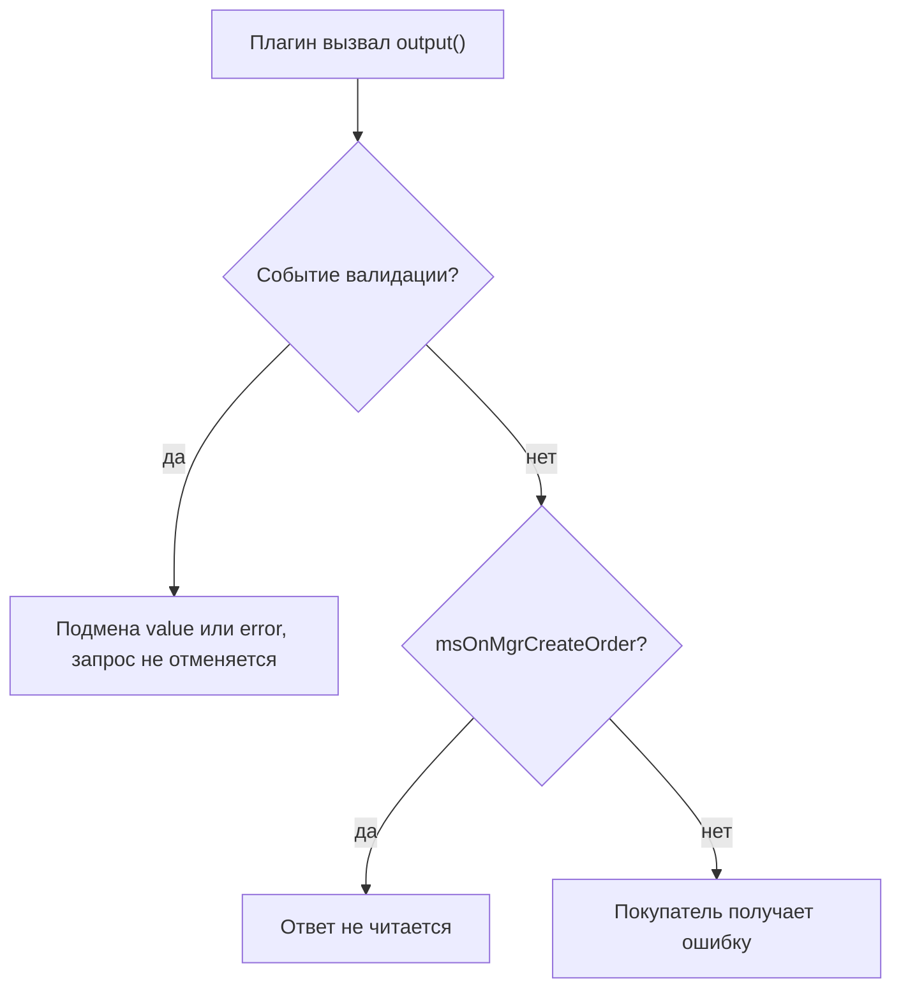
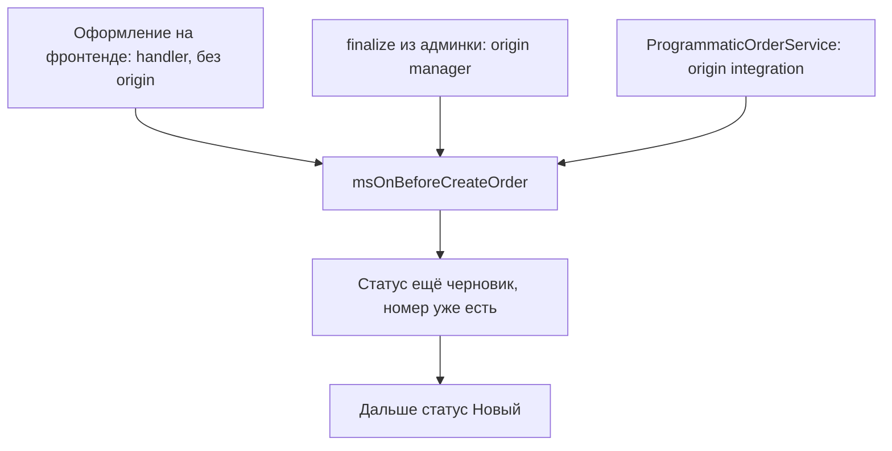

# События заказа

Добавление, валидация и удаление полей заказа, а также его оформление.

## Какие события могут прервать операцию



В отличие от [событий корзины](cart), здесь ядро читает ответ плагина почти всюду, в том числе у after-событий. Вернуть ошибку через `$modx->event->output(...)` можно у любого события этой страницы, кроме `msOnMgrCreateOrder` и трёх событий валидации.

Поэтому `msOnRemoveFromOrder`, `msOnEmptyOrder` и `msOnCreateOrder` способны провалить уже выполненную операцию: поле удалено или заказ создан, но покупатель получит ошибку.

У событий валидации ответ не прерывает операцию, а подменяет значение: `msOnBeforeValidateOrderValue` и `msOnValidateOrderValue` возвращают `value`, `msOnErrorValidateOrderValue` — `error`.

## msOnBeforeAddToOrder

Вызывается **перед** добавлением или изменением поля заказа.

::: warning Для служебных полей событие не придёт
С 1.14.2-beta1 `OrderFieldManager` отклоняет служебные колонки черновика до вызова события. Плагин, который перехватывал запись в `customer_id`, `status_id`, `cost` или `properties`, больше не сработает. Проверка одна для всех четырёх событий поля: `msOnBeforeAddToOrder`, `msOnAddToOrder`, `msOnBeforeRemoveFromOrder`, `msOnRemoveFromOrder`. Перечень закрытых колонок — в разделе [какие поля фронтенд менять не вправе](/components/minishop3/development/web-api/checkout#protected-fields).
:::

### Параметры

| Параметр | Тип | Описание |
| --- | --- | --- |
| `key` | `string` | Ключ поля |
| `value` | `mixed` | Значение поля |
| `draft` | `msOrder` \| `null` | Текущий черновик заказа (на первом шаге может отсутствовать) |

### Прерывание операции

```php
<?php
switch ($modx->event->name) {
    case 'msOnBeforeAddToOrder':
        $key = $scriptProperties['key'];
        $value = $scriptProperties['value'];

        // Запретить выбранный способ доставки
        if ($key === 'delivery_id' && $value == 5) {
            $modx->event->output('Доставка временно недоступна');
            return;
        }
        break;
}
```

### Модификация данных

```php
<?php
switch ($modx->event->name) {
    case 'msOnBeforeAddToOrder':
        $key = $scriptProperties['key'];
        $value = $scriptProperties['value'];

        $values = &$modx->event->returnedValues;

        // Телефон: оставить только цифры
        if ($key === 'phone') {
            $values['value'] = preg_replace('/\D/', '', $value);
        }

        // Email в нижнем регистре
        if ($key === 'email') {
            $values['value'] = strtolower(trim($value));
        }
        break;
}
```

---

## msOnAddToOrder

Вызывается после успешной валидации и до записи черновика. `output()` отменяет сохранение; если отмены не было, в черновик попадает значение из `returnedValues['value']`.

### Параметры

| Параметр | Тип | Описание |
| --- | --- | --- |
| `key` | `string` | Ключ поля |
| `value` | `mixed` | Валидированное значение |
| `draft` | `msOrder` \| `null` | Текущий черновик заказа |

### Пример использования

```php
<?php
switch ($modx->event->name) {
    case 'msOnAddToOrder':
        $key = $scriptProperties['key'];
        $value = $scriptProperties['value'];
        /** @var \MiniShop3\Model\msOrder|null $draft */
        $draft = $scriptProperties['draft'];

        // Лог изменения поля
        $modx->log(modX::LOG_LEVEL_INFO,
            "[Order] Поле {$key} установлено: {$value}"
        );

        if ($key === 'delivery_id' && !empty($value) && $draft) {
            // ... через сервисы MS3 при необходимости
        }
        break;
}
```

---

## msOnBeforeValidateOrderValue

Вызывается **перед** валидацией значения поля.

### Параметры

| Параметр | Тип | Описание |
| --- | --- | --- |
| `key` | `string` | Ключ поля |
| `value` | `mixed` | Значение для валидации |
| `orderData` | `array` | Снимок текущих полей заказа (доступ к смежным значениям, например к `delivery_id` при валидации `payment_id`) |

### Модификация данных

```php
<?php
switch ($modx->event->name) {
    case 'msOnBeforeValidateOrderValue':
        $key = $scriptProperties['key'];
        $value = $scriptProperties['value'];

        $values = &$modx->event->returnedValues;

        // Пробелы из индекса
        if ($key === 'index') {
            $values['value'] = str_replace(' ', '', $value);
        }
        break;
}
```

---

## msOnValidateOrderValue

Вызывается **после** успешной валидации значения поля.

### Параметры

| Параметр | Тип | Описание |
| --- | --- | --- |
| `key` | `string` | Ключ поля |
| `value` | `mixed` | Валидированное значение |

### Модификация данных

```php
<?php
switch ($modx->event->name) {
    case 'msOnValidateOrderValue':
        $key = $scriptProperties['key'];
        $value = $scriptProperties['value'];

        $values = &$modx->event->returnedValues;

        // Дописать регион к городу
        if ($key === 'city') {
            $values['value'] = $value . ', Московская область';
        }
        break;
}
```

---

## msOnErrorValidateOrderValue

Вызывается при **ошибке** валидации поля.

### Параметры

| Параметр | Тип | Описание |
| --- | --- | --- |
| `key` | `string` | Ключ поля |
| `value` | `mixed` | Невалидное значение |
| `error` | `array` | Массив ошибок `['field' => 'сообщение']` |

### Модификация сообщения об ошибке

```php
<?php
switch ($modx->event->name) {
    case 'msOnErrorValidateOrderValue':
        $key = $scriptProperties['key'];
        $error = $scriptProperties['error'];

        $values = &$modx->event->returnedValues;

        // Свой текст ошибки email
        if ($key === 'email') {
            $values['error'] = [$key => 'Введите корректный email для получения чека'];
        }

        if ($key === 'phone') {
            $values['error'] = [$key => 'Телефон нужен для связи курьера'];
        }
        break;
}
```

### Отмена ошибки

```php
<?php
switch ($modx->event->name) {
    case 'msOnErrorValidateOrderValue':
        $key = $scriptProperties['key'];
        $value = $scriptProperties['value'];

        if ($key === 'comment') {
            $values = &$modx->event->returnedValues;
            $values['error'] = []; // Пустой массив = нет ошибки
        }
        break;
}
```

---

## msOnBeforeRemoveFromOrder

Вызывается **перед** удалением поля из заказа.

### Параметры

| Параметр | Тип | Описание |
| --- | --- | --- |
| `key` | `string` | Ключ удаляемого поля |
| `draft` | `msOrder` | Текущий черновик заказа |

### Прерывание операции

```php
<?php
switch ($modx->event->name) {
    case 'msOnBeforeRemoveFromOrder':
        $key = $scriptProperties['key'];

        // Обязательные поля черновика
        $required = ['delivery_id', 'payment_id', 'email'];
        if (in_array($key, $required)) {
            $modx->event->output('Это поле нельзя удалить');
            return;
        }
        break;
}
```

---

## msOnRemoveFromOrder

Вызывается **после** удаления поля из заказа.

### Параметры

| Параметр | Тип | Описание |
| --- | --- | --- |
| `key` | `string` | Ключ удалённого поля |
| `draft` | `msOrder` | Текущий черновик заказа |

### Пример использования

```php
<?php
switch ($modx->event->name) {
    case 'msOnRemoveFromOrder':
        $key = $scriptProperties['key'];
        /** @var \MiniShop3\Model\msOrder $draft */
        $draft = $scriptProperties['draft'];

        if ($key === 'delivery_id') {
            // ... через сервисы MS3 при необходимости
        }
        break;
}
```

---

## msOnBeforeEmptyOrder

Вызывается **перед** очисткой черновика заказа (`OrderDraftManager::clean`, API/контроллер `order/clean`). Плагин может прервать очистку через `$modx->event->output(...)`.

### Параметры

| Параметр | Тип | Описание |
| --- | --- | --- |
| `draft` | `msOrder` | Черновик, который сейчас очищают |

### Что остаётся после очистки

Ядро обнуляет поля адреса и заказа, кроме служебных. У адреса остаются `id`, `order_id`, `user_id`, `createdon`. У заказа остаются `id`, `user_id`, `token`, `status_id`, `createdon`.

```php
<?php
switch ($modx->event->name) {
    case 'msOnBeforeEmptyOrder':
        /** @var \MiniShop3\Model\msOrder $draft */
        $draft = $scriptProperties['draft'];

        if ($draft->get('delivery_id') && /* ваш флаг «заказ в логистике» */) {
            $modx->event->output('Черновик нельзя очистить: доставка уже зарезервирована');
            return;
        }
        break;
}
```

---

## msOnEmptyOrder

Вызывается **после** очистки полей черновика. Поля адреса и заказа к этому моменту уже обнулены и сохранены. Ошибка плагина (`output`) возвращает вызывающему коду неуспешный ответ, но **не откатывает** сохранённое: черновик остаётся очищенным.

### Параметры

| Параметр | Тип | Описание |
| --- | --- | --- |
| `draft` | `msOrder` | Черновик уже с обнулёнными полями |

---

## msOnSubmitOrder

Вызывается при **отправке** заказа (нажатие кнопки «Оформить»).

### Параметры

| Параметр | Тип | Описание |
| --- | --- | --- |
| `handler` | `\MiniShop3\Services\Order\OrderSubmitHandler` | Обработчик оформления заказа |
| `draft` | `msOrder` | Черновик заказа на момент отправки |
| `orderData` | `array` | Снимок текущих полей заказа (включая адресные) |
| `data` | `array` | Дополнительные данные, переданные в запрос оформления |

### Прерывание операции

```php
<?php
switch ($modx->event->name) {
    case 'msOnSubmitOrder':
        /** @var \MiniShop3\Model\msOrder $draft */
        $draft = $scriptProperties['draft'];
        $orderData = $scriptProperties['orderData'];

        // Минимальная сумма
        if (($draft->get('cart_cost') ?? 0) < 1000) {
            $modx->event->output('Минимальная сумма заказа: 1000 ₽');
            return;
        }

        // Часы приёма заказов
        $hour = (int)date('G');
        if ($hour < 9 || $hour > 21) {
            $modx->event->output('Заказы принимаются с 9:00 до 21:00');
            return;
        }
        break;
}
```

### Модификация данных

Дополнительные поля заказа возвращайте в ключе `data`: ядро применит их к черновику через `add()` ещё до создания заказа.

```php
<?php
switch ($modx->event->name) {
    case 'msOnSubmitOrder':
        $data = $scriptProperties['data'];

        $values = &$modx->event->returnedValues;

        // UTM из сессии в properties заказа
        if (!empty($_SESSION['utm'])) {
            $data['properties']['utm'] = $_SESSION['utm'];
            $values['data'] = $data;
        }

        // Источник перехода
        $data['properties']['source'] = $_SERVER['HTTP_REFERER'] ?? 'direct';
        $values['data'] = $data;
        break;
}
```

---

## msOnBeforeCreateOrder



Вызывается, когда номер заказа уже выделен, а статус всё ещё черновик. Статус «Новый» ставится позже. Если событие вернёт ошибку, номер обнуляется только на фронтенде и только при включённом учёте остатков (`OrderSubmitHandler::revertAllocatedNumber()`). На пути админки и программного создания заказа номер не сбрасывается никогда: выделенный номер остаётся за черновиком.

Событие приходит в трёх сценариях, и набор параметров у них разный:

1. Оформление на фронтенде — `OrderSubmitHandler`.
2. Финализация в админке — `OrderFinalizeService`.
3. Программное создание — `ProgrammaticOrderService` → `finalize`.

### Параметры

| Параметр | Тип | Описание |
| --- | --- | --- |
| `msOrder` | `msOrder` | Объект заказа (всегда) |
| `handler` | `\MiniShop3\Services\Order\OrderSubmitHandler` | Только оформление с фронтенда |
| `service` | `\MiniShop3\Services\Order\OrderFinalizeService` | Только finalize-пути (админка / integration) |
| `origin` | `string` | Только finalize-пути: `manager` у вызова из админки, `integration` у программного создания. Константа `OrderOrigin::STOREFRONT` объявлена, но ни один путь её не выставляет: при оформлении с фронтенда ключа `origin` нет вовсе |
| `from_manager` | `bool` | Только finalize-пути: `true` при `origin=manager`, `false` при `origin=integration` |
| `customFields` | `array` | Только оформление с фронтенда: поля из `properties._validated` |


::: tip Различение сценариев

```php
$origin = $scriptProperties['origin'] ?? null;
$fromManager = !empty($scriptProperties['from_manager']);

if ($fromManager) {
    // карточка заказа в админке
} elseif ($origin === \MiniShop3\Services\Order\OrderOrigin::INTEGRATION) {
    // ProgrammaticOrderService / cron
} elseif (!empty($scriptProperties['handler'])) {
    // фронтенд
}
```

:::

### Прерывание операции

```php
<?php
switch ($modx->event->name) {
    case 'msOnBeforeCreateOrder':
        /** @var \MiniShop3\Model\msOrder $order */
        $order = $scriptProperties['msOrder'];

        // Поле msProductData.stock, доступно через msProduct::get
        foreach ($order->getMany('Products') as $product) {
            $msProduct = $product->getOne('Product');
            if (!$msProduct) {
                continue;
            }
            $stock = (float) ($msProduct->get('stock') ?? 0);
            if ($product->get('count') > $stock) {
                $modx->event->output(sprintf(
                    'Товар "%s" недоступен в нужном количестве',
                    $msProduct->get('pagetitle')
                ));
                return;
            }
        }
        break;
}
```

### Модификация заказа

```php
<?php
switch ($modx->event->name) {
    case 'msOnBeforeCreateOrder':
        $order = $scriptProperties['msOrder'];

        // Заметка менеджеру в properties
        $properties = $order->get('properties') ?? [];
        $properties['manager_note'] = 'Заказ создан ' . date('d.m.Y H:i');
        $order->set('properties', $properties);
        break;
}
```

---

## msOnCreateOrder

Вызывается сразу после `msOnBeforeCreateOrder`, пока статус ещё черновик: те же три сценария и тот же набор параметров. `msOnMgrCreateOrder` приходит уже после смены статуса.

### Параметры

| Параметр | Тип | Описание |
| --- | --- | --- |
| `msOrder` | `msOrder` | Созданный заказ (всегда) |
| `handler` | `\MiniShop3\Services\Order\OrderSubmitHandler` | Только оформление с фронтенда |
| `service` | `\MiniShop3\Services\Order\OrderFinalizeService` | Только finalize-пути (админка / integration) |
| `origin` | `string` | Только finalize-пути |
| `from_manager` | `bool` | Только finalize-пути: `true` в админке, `false` при программном создании |
| `customFields` | `array` | Только оформление с фронтенда |

### Пример использования

Остаток здесь не меняйте. При `ms3_inventory_enabled=1` его двигает сервис `ms3_inventory`: резерв на статусе `ms3_status_new`, фиксация на `ms3_status_paid`, возврат на `ms3_status_canceled`. Поля `bonus` у покупателя нет.

```php
<?php
switch ($modx->event->name) {
    case 'msOnCreateOrder':
        /** @var \MiniShop3\Model\msOrder $order */
        $order = $scriptProperties['msOrder'];

        $modx->log(modX::LOG_LEVEL_INFO, sprintf(
            '[Order] Создан заказ #%s, сумма: %s',
            $order->get('num'),
            $order->get('cost')
        ));
        break;
}
```

---

## msOnBeforeMgrCreateOrder

Вызывается **перед** финализацией заказа из админки, когда менеджер превращает черновик в заказ кнопкой «Оформить» в карточке. Это аналог `msOnSubmitOrder` для админки.

::: tip Связка с msOnBeforeCreateOrder
После `msOnBeforeMgrCreateOrder` всё равно срабатывает универсальное `msOnBeforeCreateOrder` с теми же параметрами. Берите `msOnBeforeMgrCreateOrder`, если нужна логика только для админки, и `msOnBeforeCreateOrder`, если одна и та же логика нужна и на фронтенде, и в админке.
:::

### Параметры

| Параметр | Тип | Описание |
| --- | --- | --- |
| `service` | `\MiniShop3\Services\Order\OrderFinalizeService` | Сервис финализации заказа |
| `msOrder` | `msOrder` | Финализируемый заказ |
| `origin` | `string` | `manager` |
| `from_manager` | `bool` | Всегда `true` |

---

## msOnMgrCreateOrder

Вызывается **после** успешной финализации заказа из админки. Парный к `msOnBeforeMgrCreateOrder`.

### Параметры

| Параметр | Тип | Описание |
| --- | --- | --- |
| `service` | `\MiniShop3\Services\Order\OrderFinalizeService` | Сервис финализации заказа |
| `msOrder` | `msOrder` | Финализированный заказ (статус уже изменён на «Новый») |
| `origin` | `string` | `manager` |
| `from_manager` | `bool` | Всегда `true` |
