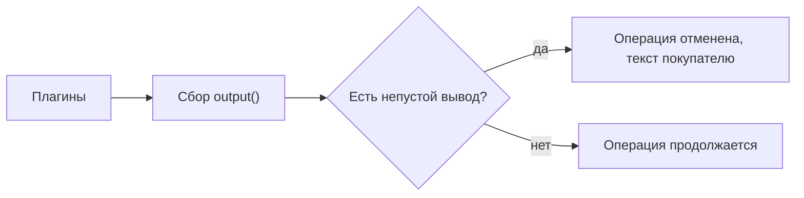
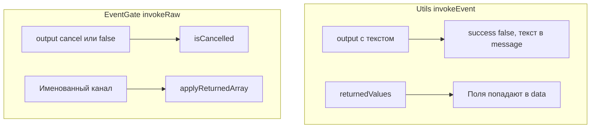

# Работа с плагинами

Плагин на событиях MiniShop3: как получить параметры, вернуть данные, прервать операцию и передать данные другому плагину.

## Плагин компонента (MODX-события)

Пакет ставит системный плагин `minishop3.php` на события ядра MODX (не путать с `msOn*`):

| MODX-событие | Назначение |
| --- | --- |
| `OnMODXInit` | Сервис `ms3` уже зарегистрирован: плагин вызывает `loadMap()`, а в контексте `mgr` планирует сброс ACL-кэша каталога |
| `OnManagerPageBeforeRender` | Подключение лексикона и `ms3.manager.js`. Если версия файлов на диске отстаёт от установленного пакета, показывает баннер |
| `OnLoadWebDocument` | Инициализация и подключение файлов фронтенда через `initialize()` и `registerFrontend()`; ключ контекста уходит в `ms3Config.ctx`. На странице товара поля `msProductData` подмешиваются в метаданные ресурса, поэтому в шаблоне они доступны как `[[*article]]`, `[[*price]]` и остальные |
| `OnDocFormSave` | Конвертация ресурса в товар через `ProductService::handleConversion()` |
| `OnBeforeUserFormSave` / `OnUserSave` | Синхронизация `msCustomer` ↔ `modUser` при `ms3_customer_sync_enabled` |
| `OnUserRemove` | Если включены `ms3_customer_sync_enabled` и `ms3_customer_sync_delete_with_user`, обнуляет `msCustomer.user_id`. Покупателя не удаляет. Без второго флага обработчик ничего не делает |
| `OnResourceGroupSave`, `OnResourceGroupRemove`, `OnResourceAddToResourceGroup`, `OnResourceRemoveFromResourceGroup`, `OnUserGroupRemove` | Сброс ACL-кэша каталога |

Для бизнес-логики корзины и заказов подписывайтесь на события из раздела [События](../events).

## Базовая структура плагина

```php
<?php
/**
 * Плагин MiniShop3
 * События: msOnBeforeAddToCart, msOnAddToCart
 */

switch ($modx->event->name) {
    case 'msOnBeforeAddToCart':
        // До добавления в корзину
        break;

    case 'msOnAddToCart':
        // После добавления в корзину
        break;
}
```

## Получение входящих параметров

### Способ 1: Массив $scriptProperties

```php
<?php
switch ($modx->event->name) {
    case 'msOnBeforeAddToCart':
        $product = $scriptProperties['msProduct'];
        $count = $scriptProperties['count'];
        $options = $scriptProperties['options'];
        $controller = $scriptProperties['controller'];
        break;
}
```

### Способ 2: Функция extract()

```php
<?php
switch ($modx->event->name) {
    case 'msOnBeforeAddToCart':
        extract($scriptProperties);
        // Доступны: $msProduct, $count, $options, $controller
        break;
}
```

### Отладка: вывод всех параметров

```php
<?php
$modx->log(modX::LOG_LEVEL_ERROR, '[' . $modx->event->name . '] Параметры: ' . print_r(array_keys($scriptProperties), true));

$modx->log(modX::LOG_LEVEL_ERROR, '[' . $modx->event->name . '] ' . print_r($scriptProperties, true));
```

## Параметр controller

::: info Приходит не во все события
Параметр `controller` — экземпляр контроллера — подмешивают `Cart::invokeEvent()` и `CartMutationHandler::invokeEvent()`, поэтому он есть во всех событиях корзины. Кроме них его передаёт только пара `msOnBeforeGetOrderCustomer` / `msOnGetOrderCustomer`.

В остальных группах контроллер приходит под другим именем или не приходит вовсе: у событий покупателя это `customer`, у событий стоимости — `cart` либо `cartController`, у событий полей заказа контроллера нет. Точный состав параметров смотрите в таблице нужной страницы.
:::

Через контроллер доступны MiniShop3 и MODX:

```php
<?php
switch ($modx->event->name) {
    case 'msOnBeforeAddToCart':
        /** @var \MiniShop3\Controllers\Cart\Cart $controller */
        $controller = $scriptProperties['controller'];

        $ms3 = $controller->ms3;
        $modx = $controller->modx;

        // Внутренние данные корзины: только публичные методы контроллера
        break;
}
```

## Прерывание операции

Прерывание работает только там, где вызывающий код читает ответ: префикс `Before` сам по себе ничего не гарантирует. `msOnBeforeSaveOrder` и `msOnBeforeRemoveOrder` ответ плагина не читают, а у `msOnBeforeValidateOrderValue` из него берётся только `value`.

### Метод $modx->event->output()

```php
<?php
switch ($modx->event->name) {
    case 'msOnBeforeAddToCart':
        $product = $scriptProperties['msProduct'];

        // Запретить товар с нулевой ценой
        if ($product->get('price') <= 0) {
            $modx->event->output('Товар недоступен для заказа');
            return; // выйти из switch, иначе код ниже выполнится
        }

        // Не больше 10 единиц
        if ($scriptProperties['count'] > 10) {
            $modx->event->output('Максимум 10 единиц товара');
            return;
        }
        break;
}
```

### Как это работает



1. Метод `invokeEvent()` MiniShop3 собирает все выводы плагинов.
2. Если есть хотя бы один непустой вывод, операция прерывается.
3. Сообщение возвращается пользователю: на фронтенде или в ответе API.

::: warning `return` из плагина операцию не отменяет
В результат события попадает только то, что плагин отдал через `output()`: `modX::invokeEvent()` кладёт в массив результатов `$this->event->_output`, а возвращённое плагином значение использует иначе. Строку оно запишет в `error.log` как ошибку события, а `false` — как «Plugin … failed!».

То есть `return 'cancel'` не просто не сработает: он ещё и засорит журнал записью об ошибке. Отменяйте через `output()`, а `return` используйте только чтобы выйти из `switch`.

И ещё одно свойство `output()`: при повторном вызове он **дописывает** текст к уже накопленному, а не заменяет его. Два вызова в одном плагине склеятся в одно сообщение.
:::

### События, поддерживающие прерывание

- `msOnBeforeGetCart`
- `msOnBeforeAddToCart`
- `msOnBeforeChangeInCart`
- `msOnBeforeChangeOptionsInCart`
- `msOnBeforeRemoveFromCart`
- `msOnBeforeEmptyCart`
- `msOnBeforeAddToOrder`
- `msOnAddToOrder`
- `msOnBeforeRemoveFromOrder`
- `msOnBeforeEmptyOrder`
- `msOnEmptyOrder`
- `msOnSubmitOrder`
- `msOnBeforeCreateOrder`
- `msOnBeforeChangeOrderStatus`

Список не исчерпывающий — это события корзины, заказа и статуса. Ответ плагина читают ещё около тридцати событий: все события стоимости, покупателя, остатков и отгрузки, события позиций заказа в админке, импорта и производителя. Для них смотрите таблицу «Реакция на `output()`» на странице нужного раздела.

## Модификация данных

### Через returnedValues

Чтобы изменить параметры, с которыми ядро продолжит работу:

```php
<?php
switch ($modx->event->name) {
    case 'msOnBeforeAddToCart':
        $values = &$modx->event->returnedValues;

        // Минимум 2 штуки
        if ($scriptProperties['count'] < 2) {
            $values['count'] = 2;
        }

        // Метка источника в опциях
        $options = $scriptProperties['options'] ?? [];
        $options['source'] = 'promo_landing';
        $values['options'] = $options;
        break;
}
```

Менять `$scriptProperties` по ссылке бесполезно: `modX::invokeEvent()` собирает параметры через `array_merge()`, и ссылка до вызывающего кода не доходит. Единственный канал — `returnedValues`: после слияния вызывающий код читает `$response['data']['count']`.

### Берите returnedValues по ссылке (&)

```php
// Правильно: изменения применятся
$values = &$modx->event->returnedValues;
$values['count'] = 5;

// Неправильно: изменения потеряются
$values = $modx->event->returnedValues;
$values['count'] = 5;
```

## Utils::invokeEvent и EventGate



Большинство событий корзины, заказа, стоимости и покупателя идут через `MiniShop3\Utils\Utils::invokeEvent()`, а не напрямую через `$modx->invokeEvent()`. Перед вызовом ядро очищает `returnedValues`, после собирает ответ:

| Поле ответа | Смысл |
| --- | --- |
| `success` | `true`, если ни один плагин не вернул непустой `output` |
| `message` | Тексты из `output`, склеенные через `<br/>` |
| `data` | Исходные `$scriptProperties`, поверх них ключи из `returnedValues` (поверхностное слияние) |
| `values` | Сырой массив `returnedValues` — **только последнего отработавшего плагина**, см. предупреждение ниже |

Слияние поверхностное: если два плагина вернули `returnedValues['count']`, победит значение плагина с **большим** priority. MODX вызывает плагины по возрастанию priority.

::: warning Между плагинами returnedValues не накапливается
Побеждает не «последний по ключу», а последний плагин целиком: `modX::invokeEvent()` вызывает `resetEventObject()` перед каждым плагином, и тот обнуляет `returnedValues`. До вызывающего кода доходит набор только последнего отработавшего плагина.

Для одного ключа результат совпадает с ожидаемым — выигрывает больший priority. А вот разные ключи от разных плагинов **не складываются**: если плагин с priority 0 записал `count`, а плагин с priority 10 — `options`, то `count` пропадёт молча.

Чтобы плагины дополняли друг друга, пользуйтесь `$modx->eventData` — см. [Передача данных между плагинами](#passing-data).
:::

### Прерывание: output, false и cancel

| Сигнал | Где работает | Эффект |
| --- | --- | --- |
| `$modx->event->output('cancel')` или `output(false)` | import, notifications | `EventGate::isCancelled()` → `true` |
| `$modx->event->output('текст')` | `Utils::invokeEvent` | `success = false`, текст в `message`. Срабатывает любой непустой вывод |

`return false` и `return 'cancel'` отмены не делают — ядро читает только `output()`. Для `isCancelled()` равнозначны `false` и строка `cancel`, а что означает сама отмена, решает вызывающий код:

| Событие | Что делает ядро при отмене |
| --- | --- |
| `msOnBeforeImport` | Весь импорт прерывается с ошибкой `ms3_utilities_import_cancelled` |
| `msOnImportRow` | Текущая строка идёт в счётчик `skipped`, импорт продолжается |
| `msOnBeforeSendNotification` | Уведомление не отправляется, ошибки нет |

```php
<?php
// Импорт: пропустить строку без ошибки
case 'msOnImportRow':
    if (empty($scriptProperties['data']['price'])) {
        $modx->event->output('cancel');
    }
    break;
```

::: warning After-события в админке заказов
`msOnCreateOrderProduct`, `msOnUpdateOrderProduct`, `msOnRemoveOrderProduct` вызываются **после** `save()` / `remove()`. В Manager API ошибка плагина пишется в лог, HTTP-ответ остаётся успешным. `OrderDraftManager::addProductFromSnapshot()` ответ after-события не читает и в лог не пишет. Прервать операцию можно только в парных `msOnBefore*`. Подробнее: [События товаров в заказе](order-product).
:::

### Именованные каналы returnedValues (import, msProducts, notifications)

Для части событий ядро применяет не общее слияние, а канал по ключу через `EventGate::applyReturnedArray()`:

| Событие | Ключ в `returnedValues` | Поведение |
| --- | --- | --- |
| `msOnBeforeImport` | `params` | Список заменяет канал целиком, ассоциативный массив накладывается через `array_replace` |
| `msOnImportRow` | `data`, `tvData`, `optionData`, `gallery` | То же |
| `msOnProductsLoad` | `rows` | То же |
| `msOnProductPrepare` | `row` | То же |
| `msOnBeforeSendNotification` | `recipient` | То же |
| `msOnBeforeSendNotification` | `channels` | Канала `applyReturnedArray()` здесь нет: любой массив заменяет набор каналов целиком, ассоциативный в том числе |

```php
<?php
case 'msOnImportRow':
    $modx->event->returnedValues = [
        'data' => ['vendor_id' => 1],           // правка отдельных полей ресурса
        // 'gallery' => ['/path/a.jpg', '/path/b.jpg'], // список: полная замена галереи
    ];
    break;
```

Эти события вызываются через `EventGate::invokeRaw()`, а не через `Utils::invokeEvent()`.

## Передача данных между плагинами {#passing-data}

`$modx->eventData` передаёт данные между плагинами одного события или между разными событиями одного запроса.

### Пример: модификация цены

```php
<?php
switch ($modx->event->name) {
    case 'msOnGetProductPrice':
        $price = $modx->eventData['msOnGetProductPrice']['price']
            ?? $scriptProperties['price'];

        $data = $scriptProperties['data'];

        if ($data['parent'] == 5) {
            $price = $price * 0.85;
        }

        $modx->eventData['msOnGetProductPrice']['price'] = $price;
        break;
}
```

### Пример: передача данных между событиями

```php
<?php
switch ($modx->event->name) {
    case 'msOnBeforeAddToCart':
        $modx->eventData['myPlugin']['original_count'] = $scriptProperties['count'];
        $modx->eventData['myPlugin']['added_at'] = time();
        break;

    case 'msOnAddToCart':
        $originalCount = $modx->eventData['myPlugin']['original_count'] ?? null;
        $addedAt = $modx->eventData['myPlugin']['added_at'] ?? null;

        if ($originalCount) {
            $modx->log(modX::LOG_LEVEL_INFO,
                "Товар добавлен. Исходное количество: {$originalCount}, время: {$addedAt}"
            );
        }
        break;
}
```

### Структура eventData

```php
$modx->eventData = [
    'msOnGetProductPrice' => [
        'price' => 1500.00,
    ],
    'msOnGetProductFields' => [
        'data' => [...],
    ],
    'myPlugin' => [
        'custom_key' => 'custom_value',
    ],
];
```

::: warning Данные живут один запрос
`$modx->eventData` очищается после завершения запроса. Для сохранения данных между запросами используйте `$_SESSION` или базу данных.
:::

## Показ сообщений в админке

### JavaScript alert через addHtml

```php
<?php
switch ($modx->event->name) {
    case 'msOnManagerCustomCssJs':
        $page = $scriptProperties['page'];

        if ($page === 'product_update') {
            $controller = $scriptProperties['controller'];

            $controller->addHtml('<script>
                Ext.onReady(function() {
                    MODx.msg.alert("Внимание", "Не забудьте проверить цены!");
                });
            </script>');
        }
        break;
}
```

### Всплывающее уведомление

```php
<?php
switch ($modx->event->name) {
    case 'msOnManagerCustomCssJs':
        $page = $scriptProperties['page'];
        $controller = $scriptProperties['controller'];

        if ($page === 'orders') {
            $controller->addHtml('<script>
                Ext.onReady(function() {
                    Ext.Msg.notify("MiniShop3", "Есть новые заказы!");
                });
            </script>');
        }
        break;
}
```

## Приоритет плагинов

Порядок задаёт поле **priority** в настройках плагина: чем меньше значение, тем раньше плагин выполняется. По умолчанию 0, допустимо любое целое число.

### Когда важен приоритет

- **Модификация цены:** плагины применяют скидки последовательно.
- **Валидация:** один плагин может зависеть от результата другого.
- **Передача данных:** плагин-источник должен выполниться раньше плагина-получателя.

## Отладка плагинов

### Логирование

```php
<?php
$modx->log(modX::LOG_LEVEL_ERROR, 'Ошибка');     // Всегда видно
$modx->log(modX::LOG_LEVEL_WARN, 'Внимание');   // Важные предупреждения
$modx->log(modX::LOG_LEVEL_INFO, 'Информация'); // Информационные сообщения
$modx->log(modX::LOG_LEVEL_DEBUG, 'Отладка');   // Детальная отладка

$modx->log(modX::LOG_LEVEL_ERROR,
    '[MyPlugin::' . $modx->event->name . '] ' . $message
);
```

### Проверка, вызывается ли плагин

```php
<?php
$modx->log(modX::LOG_LEVEL_ERROR, '=== PLUGIN START: ' . $modx->event->name . ' ===');

switch ($modx->event->name) {
    case 'msOnBeforeAddToCart':
        $modx->log(modX::LOG_LEVEL_ERROR, 'msOnBeforeAddToCart triggered');
        break;
}

$modx->log(modX::LOG_LEVEL_ERROR, '=== PLUGIN END ===');
```

В `core/cache/logs/error.log` после добавления товара:

```text
[2026-10-15 18:00:01] (ERROR) === PLUGIN START: msOnBeforeAddToCart ===
[2026-10-15 18:00:01] (ERROR) msOnBeforeAddToCart triggered
[2026-10-15 18:00:01] (ERROR) === PLUGIN END ===
```

### Проверка наличия события

```php
<?php
$plugins = $modx->getCollection('modPluginEvent', [
    'event' => 'msOnBeforeAddToCart'
]);

foreach ($plugins as $pluginEvent) {
    $plugin = $pluginEvent->getOne('Plugin');
    $modx->log(modX::LOG_LEVEL_INFO,
        'Plugin: ' . $plugin->get('name') . ', priority: ' . $pluginEvent->get('priority')
    );
}
```

## Типичные ошибки

### 1. Забыли return после output()

```php
// Неправильно: код продолжит выполняться
if ($error) {
    $modx->event->output('Ошибка');
}
doSomething();

// Правильно
if ($error) {
    $modx->event->output('Ошибка');
    return;
}
```

### 2. Проверка в after-событии вместо before

```php
// msOnAddToCart: событие ПОСЛЕ добавления.
// Товар уже в корзине, и output() его оттуда не уберёт. Но ответ всё равно
// станет ошибочным: покупатель увидит сообщение при изменившейся корзине
case 'msOnAddToCart':
    $modx->event->output('Ошибка');
    break;

// msOnBeforeAddToCart: событие ДО добавления
case 'msOnBeforeAddToCart':
    $modx->event->output('Ошибка'); // Остановит добавление
    break;
```

Расхождение между корзиной и ответом хуже, чем честный отказ: фронтенд покажет ошибку, а счётчик товаров уже вырос. Проверки размещайте в `msOnBefore*`.

### 3. Забыли break в switch

```php
switch ($modx->event->name) {
    case 'msOnBeforeAddToCart':
        // код
        // Забыли break: выполнится следующий case!

    case 'msOnAddToCart':
        // Этот код тоже выполнится для msOnBeforeAddToCart
        break;
}
```
