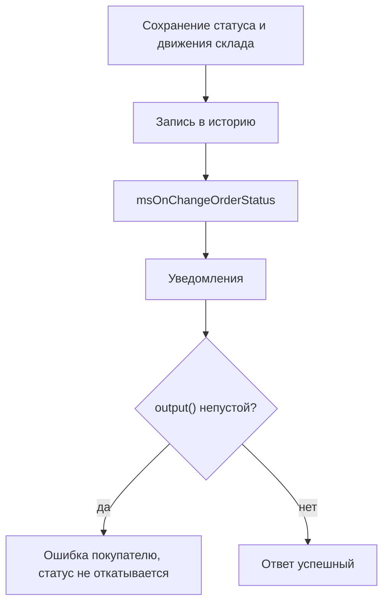

# События статуса заказа

Как запретить переход, подменить целевой статус и выполнить свои действия после смены.

## msOnBeforeChangeOrderStatus

Вызывается **перед** сменой статуса заказа.

### Параметры

| Параметр | Тип | Описание |
| --- | --- | --- |
| `msOrder` | `msOrder` | Объект заказа |
| `old_status` | `int` \| `null` | ID текущего статуса. `null`, если у заказа пустой `status_id` |
| `status` | `int` | ID нового статуса |

### Прерывание операции

```php
<?php
switch ($modx->event->name) {
    case 'msOnBeforeChangeOrderStatus':
        /** @var \MiniShop3\Model\msOrder $order */
        $order = $scriptProperties['msOrder'];
        $oldStatus = $scriptProperties['old_status'];
        $newStatus = $scriptProperties['status'];

        // 5 — ms3_status_canceled. Поля payment_status у заказа нет.
        if ($newStatus == 5) {
            $modx->event->output('Отмена заказа запрещена');
            return;
        }

        // Смена статуса только в рабочие часы
        $hour = (int)date('G');
        if ($hour < 9 || $hour > 18) {
            $modx->event->output('Смена статуса доступна с 9:00 до 18:00');
            return;
        }
        break;
}
```

### Подмена целевого статуса

Кроме прерывания через `output()`, плагин может **перенаправить** смену на другой статус. Ядро повторно валидирует переход и применяет возвращённый статус вместо запрошенного.

```php
<?php
switch ($modx->event->name) {
    case 'msOnBeforeChangeOrderStatus':
        $newStatus = $scriptProperties['status'];

        if ($newStatus === 3) { // ms3_status_paid
            $modx->event->returnedValues = ['status' => 4]; // ms3_status_sent
        }
        break;
}
```

Подменённый статус ядро проверяет теми же правилами, что и запрошенный. Учтите, что статус 4 финальный: заказ, переведённый в него, дальше никуда не перейдёт. Если после подмены заказ должен жить дальше, заводите свой нефинальный статус.

### Проверка допустимости перехода

::: warning Часть переходов ядро отбивает до события
`OrderStatusService::validateStatusTransition()` выполняется **раньше** `msOnBeforeChangeOrderStatus`, поэтому запрещённый им переход до плагина не доходит. Правила такие:

- из статуса с флагом `final` уйти нельзя вообще — ответ `ms3_err_status_final`. В поставке `final` стоит у статусов 4 (отправлен) и 5 (отменён);
- из статуса с флагом `fixed` нельзя перейти на статус с меньшим или равным `position` — ответ `ms3_err_status_fixed`;
- если задана настройка `ms3_order_status_transitions`, переход должен быть в ней перечислен.

Не пишите в плагине проверок, которые ядро уже сделало: они не выполнятся. Например, запрет отмены отправленного заказа писать не нужно — статус 4 финальный, и переход 4 → 5 отклоняется раньше.
:::

```php
<?php
switch ($modx->event->name) {
    case 'msOnBeforeChangeOrderStatus':
        $order = $scriptProperties['msOrder'];
        $oldStatus = $scriptProperties['old_status'];
        $newStatus = $scriptProperties['status'];

        switch ($newStatus) {
            case 4: // ms3_status_sent
                $properties = $order->get('properties') ?? [];
                if (empty($properties['tracking_number'])) {
                    $modx->event->output('Укажите трек-номер');
                    return;
                }
                break;

            case 5: // ms3_status_canceled
                if ($oldStatus == 3) { // ms3_status_paid
                    $modx->event->output('Оплаченный заказ отменяйте через возврат');
                    return;
                }
                break;
        }
        break;
}
```

---

## msOnChangeOrderStatus



Вызывается **после** успешной смены статуса заказа.

::: warning Ошибка плагина не отменяет смену статуса
К моменту вызова статус уже сохранён вместе с движениями по складу, а переход записан в историю заказа. Запись делается до события намеренно, чтобы ошибка плагина не стёрла историю.

Если плагин вызовет `output()`, вызывающий код получит сообщение об ошибке, но статус останется новым: откат не делается. Уведомления о смене статуса тоже уйдут. Ядро сначала рассылает их и только потом возвращает ошибку.

Проверки, которые должны прервать переход, размещайте в `msOnBeforeChangeOrderStatus`.
:::

Остаток в этом событии не трогайте. `OrderStatusService` до вызова плагина уже выполнил `applyStatusChange()`: `ms3_status_new` резервирует, `ms3_status_paid` списывает резерв, `ms3_status_canceled` возвращает. Повторная запись `stock` в плагине уменьшит или увеличит остаток второй раз.

### Параметры

| Параметр | Тип | Описание |
| --- | --- | --- |
| `msOrder` | `msOrder` | Объект заказа |
| `old_status` | `int` \| `null` | ID предыдущего статуса. `null`, если у заказа пустой `status_id` |
| `status` | `int` | ID нового статуса |

### Пример использования

```php
<?php
switch ($modx->event->name) {
    case 'msOnChangeOrderStatus':
        /** @var \MiniShop3\Model\msOrder $order */
        $order = $scriptProperties['msOrder'];
        $oldStatus = $scriptProperties['old_status'];
        $newStatus = $scriptProperties['status'];

        // Лог смены статуса
        $modx->log(modX::LOG_LEVEL_INFO, sprintf(
            '[Status] Заказ #%s: статус %d → %d',
            $order->get('num'),
            $oldStatus,
            $newStatus
        ));
        break;
}
```

### После оплаты

```php
<?php
switch ($modx->event->name) {
    case 'msOnChangeOrderStatus':
        $order = $scriptProperties['msOrder'];
        $newStatus = $scriptProperties['status'];

        if ($newStatus == 3) { // ms3_status_paid
            $modx->log(modX::LOG_LEVEL_INFO, sprintf(
                '[Status] Заказ #%s оплачен, сумма %s',
                $order->get('num'),
                $order->get('cost')
            ));
        }
        break;
}
```

### SMS с трек-номером

```php
<?php
switch ($modx->event->name) {
    case 'msOnChangeOrderStatus':
        $order = $scriptProperties['msOrder'];
        $newStatus = $scriptProperties['status'];

        if ($newStatus == 4) { // ms3_status_sent
            $address = $order->getOne('Address');
            $phone = $address->get('phone');
            $trackingNumber = $order->get('properties')['tracking_number'] ?? '';

            if ($phone && $trackingNumber) {
                $message = sprintf(
                    'Ваш заказ #%s отправлен. Трек-номер: %s',
                    $order->get('num'),
                    $trackingNumber
                );

                // $smsService->send($phone, $message);
            }
        }
        break;
}
```
