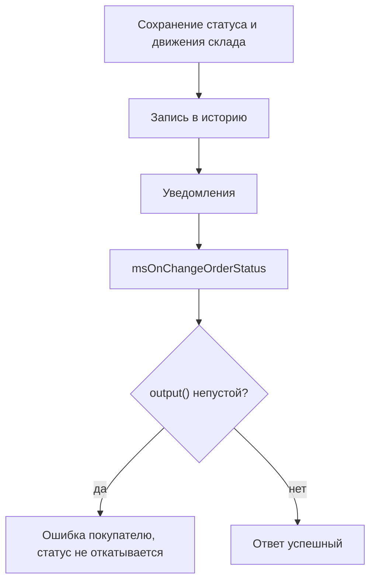

# События статуса заказа

Как запретить переход, подменить целевой статус и выполнить свои действия после смены.

## msOnBeforeChangeOrderStatus

Вызывается **перед** сменой статуса заказа.

### Параметры

| Параметр | Тип | Описание |
| --- | --- | --- |
| `msOrder` | `msOrder` | Объект заказа |
| `old_status` | `int` \| `null` | ID текущего статуса (`null`, если активная запись статуса не найдена) |
| `status` | `int` | ID нового статуса |

### Прерывание операции

```php
<?php
switch ($modx->event->name) {
    case 'msOnBeforeChangeOrderStatus':
        /** @var \MiniShop3\Model\msOrder $order */
        $order = $scriptProperties['msOrder'];
        $oldStatus = $scriptProperties['old_status'];
        $newStatus = $scriptProperties['status'];

        // Статус 6 в стандартном наборе: отмена. Поля payment_status у заказа нет.
        if ($newStatus == 6) {
            $modx->event->output('Отмена заказа запрещена');
            return;
        }

        // Смена статуса только в рабочие часы
        $hour = (int)date('G');
        if ($hour < 9 || $hour > 18) {
            $modx->event->output('Смена статуса доступна с 9:00 до 18:00');
            return;
        }
        break;
}
```

### Подмена целевого статуса

Кроме прерывания через `output()`, плагин может **перенаправить** смену на другой статус. Ядро повторно валидирует переход и применяет возвращённый статус вместо запрошенного.

```php
<?php
switch ($modx->event->name) {
    case 'msOnBeforeChangeOrderStatus':
        $newStatus = $scriptProperties['status'];

        if ($newStatus === 3) { // 3 = "оплачен"
            $modx->event->returnedValues = ['status' => 7]; // 7 = "требует подтверждения"
        }
        break;
}
```

### Проверка допустимости перехода

```php
<?php
switch ($modx->event->name) {
    case 'msOnBeforeChangeOrderStatus':
        $order = $scriptProperties['msOrder'];
        $oldStatus = $scriptProperties['old_status'];
        $newStatus = $scriptProperties['status'];

        switch ($newStatus) {
            case 3: // Отправлен
                $properties = $order->get('properties') ?? [];
                if (empty($properties['tracking_number'])) {
                    $modx->event->output('Укажите трек-номер');
                    return;
                }
                break;

            case 4: // Выполнен
                if ($oldStatus != 3) {
                    $modx->event->output('Заказ должен быть сначала отправлен');
                    return;
                }
                break;

            case 6: // Отменён
                if ($oldStatus == 4) {
                    $modx->event->output('Нельзя отменить выполненный заказ');
                    return;
                }
                break;
        }
        break;
}
```

---

## msOnChangeOrderStatus



Вызывается **после** успешной смены статуса заказа.

::: warning Ошибка плагина не отменяет смену статуса
К моменту вызова статус уже сохранён вместе с движениями по складу, а переход записан в историю заказа. Запись делается до события намеренно, чтобы ошибка плагина не стёрла историю.

Если плагин вызовет `output()`, вызывающий код получит сообщение об ошибке, но статус останется новым: откат не делается. Уведомления о смене статуса тоже уйдут. Ядро сначала рассылает их и только потом возвращает ошибку.

Проверки, которые должны прервать переход, размещайте в `msOnBeforeChangeOrderStatus`.
:::

Остаток в этом событии не трогайте: `OrderStatusService` до вызова плагина уже выполнил `applyStatusChange()` — `ms3_status_new` резервирует, `ms3_status_paid` списывает резерв, `ms3_status_canceled` возвращает. Повторная запись `stock` в плагине уменьшит или увеличит остаток второй раз.

### Параметры

| Параметр | Тип | Описание |
| --- | --- | --- |
| `msOrder` | `msOrder` | Объект заказа |
| `old_status` | `int` | ID предыдущего статуса |
| `status` | `int` | ID нового статуса |

### Пример использования

```php
<?php
switch ($modx->event->name) {
    case 'msOnChangeOrderStatus':
        /** @var \MiniShop3\Model\msOrder $order */
        $order = $scriptProperties['msOrder'];
        $oldStatus = $scriptProperties['old_status'];
        $newStatus = $scriptProperties['status'];

        // Лог смены статуса
        $modx->log(modX::LOG_LEVEL_INFO, sprintf(
            '[Status] Заказ #%s: статус %d → %d',
            $order->get('num'),
            $oldStatus,
            $newStatus
        ));
        break;
}
```

### Начисление бонусов при выполнении заказа

```php
<?php
switch ($modx->event->name) {
    case 'msOnChangeOrderStatus':
        $order = $scriptProperties['msOrder'];
        $newStatus = $scriptProperties['status'];

        if ($newStatus == 4) { // "Выполнен"
            $customer = $order->getOne('Customer');
            if ($customer) {
                $bonus = floor($order->get('cost') * 0.05);
                $currentBonus = $customer->get('bonus') ?? 0;
                $customer->set('bonus', $currentBonus + $bonus);
                $customer->save();

                $modx->log(modX::LOG_LEVEL_INFO, sprintf(
                    '[Bonus] Начислено %d бонусов покупателю #%d за заказ #%s',
                    $bonus,
                    $customer->get('id'),
                    $order->get('num')
                ));
            }
        }
        break;
}
```

### SMS с трек-номером

```php
<?php
switch ($modx->event->name) {
    case 'msOnChangeOrderStatus':
        $order = $scriptProperties['msOrder'];
        $newStatus = $scriptProperties['status'];

        if ($newStatus == 3) { // "Отправлен"
            $address = $order->getOne('Address');
            $phone = $address->get('phone');
            $trackingNumber = $order->get('properties')['tracking_number'] ?? '';

            if ($phone && $trackingNumber) {
                $message = sprintf(
                    'Ваш заказ #%s отправлен. Трек-номер: %s',
                    $order->get('num'),
                    $trackingNumber
                );

                // $smsService->send($phone, $message);
            }
        }
        break;
}
```
