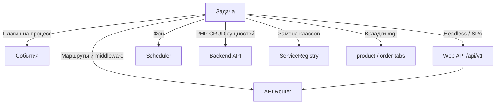

# Разработка

## Содержание

- [События](events) — точки подключения плагинов
- [Web API](api) — фронтенд и Nuxt, [карта эндпоинтов](web-api/endpoints)
- [API Router](routing) — маршрутизация, middleware, свои роуты
- [Scheduler](scheduler) — фоновые задачи
- [Модели и схема БД](models) — модели xPDO
- [Сервисный слой](services) — DI-контейнер, расширение и замена сервисов
- [JavaScript API](javascript) — Headless API для SPA (Vue, React, Vanilla JS)
- [Frontend JavaScript](frontend-js) — модули на стороне сайта, включая UI-слой
- [Интеграция вкладок товара](product-tabs-integration)
- [Интеграция вкладок заказа](order-tabs-integration)
- [Backend API](backend-api/) — товары, заказы, опции и покупатели из PHP-кода

## Manager API и процессоры

С **1.10+** экраны заказов, покупателей, настроек и утилит работают через **Manager REST API** (`Controllers\Api\Manager\*` на FastRoute). Карточка товара и категории — исключение: это обычный экран ресурса MODX, Vue там живёт только во вкладках. Старые **процессоры** (`MiniShop3\Processors\*`) остаются только для:

- прежнего коннектора и вызова `runProcessor()` из PHP;
- утилит, где контроллер вызывает процессор явно: `ImportController` (импорт товаров) и `UtilitiesGalleryController` (массовые операции с галереей), оба через трейт `RunsMs3Processors`.

Остальные восемнадцать контроллеров процессоры не вызывают — они работают через сервисный слой. События при этом теряются не всегда: заказы, их статусы и позиции идут через сервисы, которые поднимают события сами, поэтому плагин на `msOnChangeOrderStatus` из админки сработает. А вот Vue-CRUD справочников пишет в базу напрямую, минуя `Processors/Settings/*` — плагины на события производителей, доставок, оплат и типов связей из админки не сработают. См. [События производителей](events/vendor).

Headless-фронтенд тоже обходится без процессоров: он работает через Web API (`/api/v1/*`).
