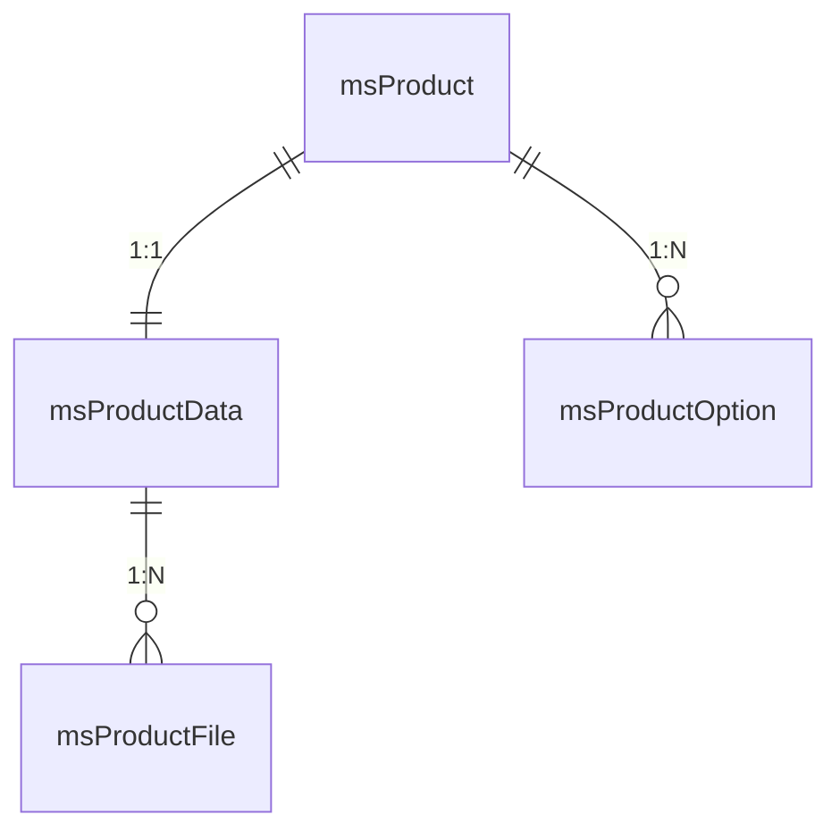
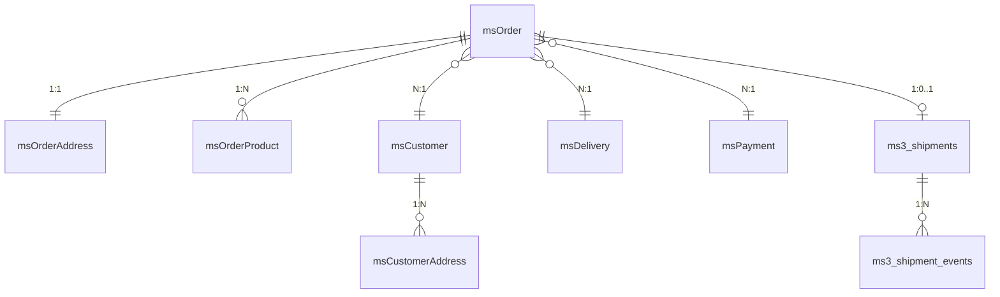

# Модели и схема базы данных

Модели MiniShop3 — классы xPDO в namespace `MiniShop3\Model`.

## Основные классы

```php
use MiniShop3\Model\msProduct;
use MiniShop3\Model\msProductData;
use MiniShop3\Model\msOrder;
use MiniShop3\Model\msCustomer;

// Получение товара
$product = $modx->getObject(msProduct::class, $id);

// Получение данных товара
$data = $product->getOne('Data');

// Получение заказа с адресом
$order = $modx->getObject(msOrder::class, $id);
$address = $order->getOne('Address');

// Получение покупателя
$customer = $modx->getObject(msCustomer::class, ['email' => $email]);
```

## Связи между моделями

`getOne()` — для 1:1 и N:1, `getMany()` — для 1:N.

| Модель | Алиас | Тип | Возвращает |
| --- | --- | --- | --- |
| `msProduct` | `Data` | 1:1 | данные товара (`msProductData`) |
| `msProduct` | `Options` | 1:N | значения опций |
| `msProductData` | `Files` | 1:N | файлы галереи |
| `msOrder` | `Address` | 1:1 | адрес заказа (`msOrderAddress`) |
| `msOrder` | `Products` | 1:N | товары в заказе |
| `msOrder` | `Customer` | N:1 | покупателя (`msCustomer`) |
| `msCustomer` | `Tokens` | 1:N | токены авторизации |
| `msCustomerAddress` | `Customer` | N:1 | покупателя — обратная связь от адреса |
| `msCustomerToken` | `Customer` | N:1 | покупателя — обратная связь от токена |

Связи `Addresses` у `msCustomer` нет. Адреса читают прямым запросом к `msCustomerAddress` по `customer_id`. См. [Работа с покупателем](#customer-example).

## Файл схемы

XML-схема описывает модели для генератора xPDO:

```
core/components/minishop3/schema/minishop3.mysql.schema.xml
```

| Атрибут | Значение |
| --- | --- |
| `package` | `MiniShop3\Model` |
| `baseClass` | `xPDO\Om\xPDOObject` |
| `platform` | `mysql` |
| `version` | `3.0` |

::: warning Таблицы создаёт не XML
Структуру таблиц задают карты моделей в `src/Model/mysql/` и миграции Phinx. XML нужен только генератору моделей, в установке он не участвует и местами уже разошёлся с картой — например по уникальности индекса на фамилию покупателя ([разбор](https://github.com/modx-pro/MiniShop3/issues/905)). Сверяйте поля по карте модели.
:::

## Таблицы базы данных

### Товары

| Модель | Таблица | Описание |
| --- | --- | --- |
| `msProduct` | `site_content` | Товар (расширяет modResource) |
| `msProductData` | `ms3_products` | Данные товара (цена, артикул, вес) |
| `msProductFile` | `ms3_product_files` | Файлы галереи товара |
| `msProductOption` | `ms3_product_options` | Значения опций товара |
| `msLink` | `ms3_links` | Типы связей товаров |
| `msProductLink` | `ms3_product_links` | Связи между товарами |

#### msProductData — основные поля

| Поле | Тип | Описание |
| --- | --- | --- |
| `id` | int | ID (совпадает с ID ресурса) |
| `article` | varchar(50) | Артикул |
| `price` | decimal(12,2) | Цена |
| `old_price` | decimal(12,2) | Старая цена |
| `stock` | decimal(13,3) | Остаток на складе |
| `weight` | decimal(13,3) | Вес |
| `image` | varchar(255) | Основное изображение |
| `thumb` | varchar(255) | Превью изображения |
| `preview_file_id` | int | ID файла галереи для главного превью (без смены порядка галереи) |
| `vendor_id` | int | ID производителя |
| `made_in` | varchar(100) | Страна производства |
| `new` | tinyint(1) | Флаг «Новинка» |
| `popular` | tinyint(1) | Флаг «Популярный» |
| `favorite` | tinyint(1) | Флаг «Избранное» |
| `tags` | json | Теги |
| `color` | json | Цвета |
| `size` | json | Размеры |

### Категории

| Модель | Таблица | Описание |
| --- | --- | --- |
| `msCategory` | `site_content` | Категория (расширяет modResource) |
| `msCategoryMember` | `ms3_product_categories` | Связь товар-категория |
| `msCategoryOption` | `ms3_category_options` | Опции категории |

### Заказы

| Модель | Таблица | Описание |
| --- | --- | --- |
| `msOrder` | `ms3_orders` | Заказ |
| `msOrderAddress` | `ms3_order_addresses` | Адрес доставки заказа |
| `msOrderProduct` | `ms3_order_products` | Товары в заказе |
| `msOrderLog` | `ms3_order_logs` | История изменений заказа |
| `msOrderStatus` | `ms3_order_statuses` | Статусы заказов |

#### msOrder — основные поля

| Поле | Тип | Описание |
| --- | --- | --- |
| `id` | int | ID заказа |
| `user_id` | int | ID пользователя MODX |
| `customer_id` | int | ID покупателя (`msCustomer`) |
| `token` | varchar(128) | Токен сессии |
| `uuid` | char(36) | UUID заказа |
| `num` | varchar(20) | Номер заказа |
| `cost` | decimal(12,2) | Общая стоимость |
| `cart_cost` | decimal(12,2) | Стоимость товаров |
| `delivery_cost` | decimal(12,2) | Стоимость доставки |
| `weight` | decimal(13,3) | Общий вес |
| `status_id` | int | ID статуса |
| `delivery_id` | int | ID способа доставки |
| `payment_id` | int | ID способа оплаты |
| `context` | varchar(100) | Контекст MODX |
| `order_comment` | text | Комментарий к заказу |
| `idempotency_key` | varchar(128) | Ключ идемпотентности (программные заказы) |
| `createdon` | datetime | Дата создания |
| `updatedon` | datetime | Дата обновления |

### Покупатели

| Модель | Таблица | Описание |
| --- | --- | --- |
| `msCustomer` | `ms3_customers` | Покупатель магазина |
| `msCustomerGroup` | `ms3_customer_groups` | Группы покупателей (сегментация, ACL каталога) |
| `msCustomerAddress` | `ms3_customer_addresses` | Сохранённые адреса покупателя |
| `msCustomerToken` | `ms3_customer_tokens` | Токены авторизации |

#### msCustomerGroup — основные поля

| Поле | Тип | Описание |
| --- | --- | --- |
| `id` | int | ID группы |
| `name` | varchar(255) | Название группы |
| `user_group_id` | int | ID группы пользователей MODX (принципал для modAccessResourceGroup) |
| `active` | tinyint(1) | Активна |
| `created_at` | timestamp | Дата создания |
| `updated_at` | timestamp | Дата обновления |

#### msCustomer — основные поля

| Поле | Тип | Описание |
| --- | --- | --- |
| `id` | int | ID покупателя |
| `user_id` | int | ID связанного modUser (опционально) |
| `first_name` | varchar(191) | Имя |
| `last_name` | varchar(191) | Фамилия. В XML-схеме индекс по этому полю помечен уникальным, но таблицу создаёт миграция из карты модели, где уникальности нет, — в базе индекс обычный ([разбор](https://github.com/modx-pro/MiniShop3/issues/905)) |
| `phone` | varchar(50) | Телефон |
| `email` | varchar(191) | Email |
| `password` | varchar(255) | Хеш пароля |
| `is_active` | tinyint(1) | Активен |
| `is_blocked` | tinyint(1) | Заблокирован |
| `email_verified_at` | datetime | Дата подтверждения email |
| `orders_count` | int | Количество заказов |
| `total_spent` | decimal(12,2) | Сумма всех заказов |
| `last_order_at` | datetime | Дата последнего заказа |
| `privacy_accepted_at` | datetime | Дата принятия политики |

::: tip Отличие от miniShop2
В miniShop2 покупатель — это `modUser`. В MiniShop3 покупатель — отдельная сущность `msCustomer`, связь с `modUser` необязательна.
:::

### Доставка и оплата

| Модель | Таблица | Описание |
| --- | --- | --- |
| `msDelivery` | `ms3_deliveries` | Способы доставки |
| `msPayment` | `ms3_payments` | Способы оплаты |
| `msDeliveryMember` | `ms3_delivery_payments` | Связь доставка-оплата |

### Отгрузки

Таблицы без xPDO-моделей: доступ через `PdoShipmentStore` и DI-ключ `ms3_shipment_lifecycle` (`ShipmentLifecycleService`). Миграции Phinx: `create_shipments`, `create_shipment_events`.

| Таблица | Описание |
| --- | --- |
| `ms3_shipments` | Одна отгрузка на заказ (`uniq_shipment_order`) |
| `ms3_shipment_events` | Идемпотентность webhook: `provider_event_id` на отгрузку |

#### ms3_shipments — поля

| Поле | Тип | Описание |
| --- | --- | --- |
| `id` | int | ID отгрузки |
| `order_id` | int unsigned | ID заказа (unique) |
| `delivery_id` | int unsigned | ID способа доставки |
| `status` | varchar(32) | `preparing`, `shipped`, `in_transit`, `delivered`, `cancelled`, `returned`, `failed` |
| `tracking_number` | varchar(191) | Трек-номер |
| `external_id` | varchar(191) | ID у провайдера |
| `provider` | varchar(191) | Класс/имя провайдера |
| `carrier` | varchar(191) | Перевозчик |
| `shipped_at` | int unsigned | Unix-время отправки |
| `delivered_at` | int unsigned | Unix-время доставки |
| `last_event_id` | varchar(191) | Последний `provider_event_id` |
| `meta` | text | JSON-метаданные |
| `createdon` / `updatedon` | int unsigned | Unix-время |

При `ms3_shipment_enabled=1` статус отгрузки переносит в заказ `ShipmentLifecycleService`: `shipped` → `ms3_status_sent`, `cancelled`/`failed` → `ms3_status_canceled`. Для `delivered` / `in_transit` смотрите настройки `ms3_shipment_on_*_status`. Сам статус заказа применяет `OrderStatusService`, но соответствие статусов живёт в сервисе отгрузок: чтобы задать своё, подмените `ms3_shipment_lifecycle`.

### Попытки оплаты

Таблицы без xPDO-моделей. Доступ через `PdoPaymentAttemptStore` и DI-ключ `ms3_payment_lifecycle` (`PaymentLifecycleService`). Миграция Phinx: `create_payment_attempts`.

| Таблица | Описание |
| --- | --- |
| `ms3_payment_attempts` | Попытка оплаты заказа |
| `ms3_payment_attempt_events` | Идемпотентность webhook: `provider_event_id` на попытку и тип события |

#### ms3_payment_attempts — поля

| Поле | Тип | Описание |
| --- | --- | --- |
| `id` | int | ID попытки |
| `order_id` | int unsigned | ID заказа |
| `payment_method_id` | int unsigned | ID способа оплаты |
| `provider` | varchar(191) | Класс или имя провайдера |
| `external_id` | varchar(191) | ID у провайдера |
| `status` | varchar(32) | `pending`, `authorized`, `paid`, `failed`, `cancelled`, `refunded`, `partially_refunded`. По умолчанию `pending` |
| `amount` | decimal(13,3) | Сумма |
| `currency` | varchar(8) | Валюта, по умолчанию `RUB` |
| `payload` | text | Данные провайдера |
| `refunded_amount` | decimal(13,3) | Сумма возврата |
| `refund_external_id` | varchar(191) | ID возврата у провайдера |
| `refundedon` | int unsigned | Unix-время возврата |
| `createdon` / `updatedon` | int unsigned | Unix-время |

Уникальный ключ: `payment_method_id`, `provider`, `external_id`.

#### ms3_payment_attempt_events — поля

| Поле | Тип | Описание |
| --- | --- | --- |
| `id` | int | ID события |
| `attempt_id` | int unsigned | ID попытки |
| `event_type` | varchar(32) | Тип события |
| `provider_event_id` | varchar(191) | ID события у провайдера |
| `createdon` | int unsigned | Unix-время |

Уникальный ключ: `attempt_id`, `event_type`, `provider_event_id`.

### Производители

| Модель | Таблица | Описание |
| --- | --- | --- |
| `msVendor` | `ms3_vendors` | Производители товаров |

### Опции

| Модель | Таблица | Описание |
| --- | --- | --- |
| `msOption` | `ms3_options` | Справочник опций |
| `msOptionGroup` | `ms3_option_groups` | Группы опций (заменили использование `modCategory` для группировки, начиная с 1.11.0) |

### Конфигурация полей

| Модель | Таблица | Описание |
| --- | --- | --- |
| `msModelField` | `ms3_model_fields` | Настройки полей моделей |
| `msModelFieldSection` | `ms3_model_field_sections` | Секции полей |
| `msGridField` | `ms3_grid_fields` | Конфигурация колонок гридов: `customers`, `orders`, `order_products`, `vendors`, `category-products`, `deliveries` |
| `msProductField` | `ms3_product_fields` | Поля товара. Строку создаёт `ExtraFieldsService` вместе со своим полем, читают `ConfigService` и `FieldConfigManager` |
| `msPageSection` | `ms3_page_sections` | Секции страниц. Обслуживает `/api/mgr/config/page-fields/{page_key}` |
| `msExtraField` | `ms3_extra_fields` | Дополнительные поля |

### Уведомления

| Модель | Таблица | Описание |
| --- | --- | --- |
| `msNotificationConfig` | `ms3_notification_configs` | Конфигурация уведомлений |

## Примеры работы с моделями

### Создание заказа

::: warning Так заказ создавать не стоит
Пример ниже показывает, как устроены записи заказа в базе, и только. Собранный так заказ не прошёл валидацию, не получил расчёт стоимости и доставки, не поднял события и не отправил уведомления.

Для создания заказов из кода есть сервис `ms3_programmatic_order` (`ProgrammaticOrderService`). Он строит черновик и проводит его через обычное оформление. По `idempotency_key` не создаёт дубль при повторном вызове.

```php
$result = $modx->services->get('ms3_programmatic_order')->create([
    'idempotency_key' => 'crm-order-15', // обязателен
    'products' => [
        ['product_id' => $productId, 'count' => 2],
    ],
    'delivery_id' => $deliveryId,
    'payment_id' => $paymentId,
]);
```

:::

```php
use MiniShop3\Model\msOrder;
use MiniShop3\Model\msOrderProduct;

// Создание заказа
$order = $modx->newObject(msOrder::class);
$order->fromArray([
    'customer_id' => $customerId,
    'user_id' => $modx->user->get('id') ?: 0,
    'status_id' => $modx->getOption('ms3_status_new'),
    'delivery_id' => $deliveryId,
    'payment_id' => $paymentId,
    'context' => $modx->context->key,
]);
$order->save();

// Добавление товара в заказ
$orderProduct = $modx->newObject(msOrderProduct::class);
$orderProduct->fromArray([
    'order_id' => $order->get('id'),
    'product_id' => $productId,
    'name' => $productName,
    'price' => $price,
    'count' => $count,
    'cost' => $price * $count,
    'options' => $options,
]);
$orderProduct->save();
```

### Работа с покупателем {#customer-example}

```php
use MiniShop3\Model\msCustomer;
use MiniShop3\Model\msCustomerAddress;

// Поиск или создание покупателя
$customer = $modx->getObject(msCustomer::class, ['email' => $email]);
if (!$customer) {
    $customer = $modx->newObject(msCustomer::class);
    $customer->fromArray([
        'email' => $email,
        'first_name' => $firstName,
        'phone' => $phone,
    ]);
    $customer->save();
}

// Добавление адреса
$address = $modx->newObject(msCustomerAddress::class);
$address->fromArray([
    'customer_id' => $customer->get('id'),
    'city' => $city,
    'street' => $street,
    'building' => $building,
]);
$address->save();

// Получение всех адресов покупателя — прямым запросом:
// связи Addresses у msCustomer нет
$addresses = $modx->getIterator(msCustomerAddress::class, [
    'customer_id' => $customer->get('id'),
]);
```

### Итерация по записям

`getIterator()` достаёт записи по одной и не держит всю выборку в памяти. На больших наборах это предпочтительнее `getCollection()`:

```php
use MiniShop3\Model\msOrder;

foreach ($modx->getIterator(msOrder::class, ['status_id' => 2]) as $order) {
    // Обработка заказа
}
```

::: danger getIterator() и классы без своей таблицы
`getCollection()` и `getObject()` сами добавляют в условие фильтр по `class_key`. Это делает `addDerivativeCriteria()`. Более того, `msProduct` и `msCategory` дублируют эту защиту в своих `loadCollection()` и `load()`. **`getIterator()` не проходит ни через один из этих методов: он создаёт итератор напрямую, и фильтра не будет.**

Для `msProduct` и `msCategory` это критично: своей таблицы у них нет, они живут в `site_content` вместе со всеми ресурсами MODX. Без фильтра выборка захватит чужие записи. Первая же из них даст ошибку вида «Instantiated a derived class msProduct that is not a subclass of the requested class msCategory».

Поэтому при `getIterator()` для таких классов `class_key` задавайте вручную:

```php
$criteria = [
    'class_key' => msProduct::class, // обязательно
    'parent' => $categoryId,
];

foreach ($modx->getIterator(msProduct::class, $criteria) as $product) {
    // …
}
```

Это не касается моделей со своей таблицей: `msOrder`, `msCustomer`, `msProductData` и остальных из таблиц выше.
:::

## Архитектура моделей

Модель отвечает за таблицу и связи. Бизнес-логика живёт в сервисах. См. [Сервисный слой](/components/minishop3/development/services).

Полностью «тонкими» модели не стали: `msProduct` и `msCategory` расширяют `modResource`, а MODX держит бизнес-логику в моделях. Поэтому модель вправе вызвать сервис:

```php
// src/Model/msProductData.php
class msProductData extends xPDOSimpleObject
{
    public function getPrice($data = [])
    {
        if (empty($data)) {
            $data = $this->toArray();
        }

        return $this->getProductDataService()->getModifiedPrice($this, $data);
    }
}
```

## Регенерация моделей

::: warning Модели создаются вручную
В MiniShop3 модели не генерируются автоматически из XML-схемы через `buildModel()`. Они создаются и поддерживаются вручную в директории `src/Model/`.

Это позволяет:

- добавлять свои методы в модели;
- использовать полную типизацию PHP 8;
- иметь полный контроль над кодом моделей.

Не запускайте `buildModel()`: это перезапишет методы, добавленные вручную.
:::

### Структура файлов модели

```
src/Model/
├── msProduct.php           # Основной класс модели
├── mysql/
│   └── msProduct.php       # MySQL-специфичный маппинг
```

### Пример модели

```php
<?php
namespace MiniShop3\Model;

use MODX\Revolution\modResource;

class msProduct extends modResource
{
    // Свои методы модели. Не переопределяйте getPrice(): он уже есть
    // у msProduct с другой подписью и прогоняет цену через модификаторы
    public function getRawPrice(): float
    {
        $data = $this->getOne('Data');
        return $data ? (float) $data->get('price') : 0.0;
    }
}
```

### Пример маппинга

```php
<?php
namespace MiniShop3\Model\mysql;

class msProduct extends \MiniShop3\Model\msProduct
{
    public static $metaMap = [
        'package' => 'MiniShop3\\Model',
        'version' => '3.0',
        'extends' => 'MODX\\Revolution\\modResource',
        'fields' => [
            'class_key' => 'MiniShop3\\Model\\msProduct',
        ],
        // ... остальные метаданные
    ];
}
```

## Миграции Phinx

Схему базы данных меняют миграции Phinx:

```
core/components/minishop3/migrations/
├── 20251020000000_initial_schema.php
├── 20251021000000_seed_page_sections.php
├── 20251022000000_seed_product_fields.php
├── 20251023000000_seed_order_statuses.php
└── ...
```

### Запуск миграций

Руками запускать их обычно не нужно. При установке и обновлении пакета миграции применяет резолвер `resolver_02_migrations`. При работе с дополнительными полями их применяет `ExtraFieldsService`. Оба используют окружение `production` — оно же стоит в `phinx.php` по умолчанию.

Для разработки миграции прогоняют из CLI:

```bash
cd /path/to/modx
php core/components/minishop3/vendor/bin/phinx migrate -c core/components/minishop3/phinx.php
```

### Пример миграции

```php
<?php
use Phinx\Migration\AbstractMigration;

class CreateCustomersTable extends AbstractMigration
{
    public function change()
    {
        $table = $this->table('ms3_customers', [
            'engine' => 'InnoDB',
            'collation' => 'utf8mb4_unicode_ci',
        ]);

        $table
            ->addColumn('email', 'string', ['limit' => 191])
            ->addColumn('first_name', 'string', ['limit' => 191, 'null' => true])
            ->addColumn('phone', 'string', ['limit' => 50, 'null' => true])
            ->addIndex(['email'], ['unique' => true])
            ->create();
    }
}
```

## Диаграмма связей

### Товар



### Заказ



`ms3_shipments` / `ms3_shipment_events` — PDO-таблицы (не классы `MiniShop3\Model\*`).

Линия `msCustomer → msCustomerAddress` — это связь в базе через `customer_id`, а не алиас схемы: пройти её можно только в обратную сторону, `$address->getOne('Customer')`.
