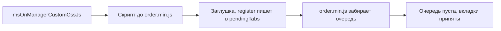

# Интеграция вкладок заказа

Свою вкладку на страницу заказа в админке добавляет плагин MODX: он регистрирует Vue-компонент или панель ExtJS в `window.MS3OrderTabsRegistry`.

::: info Аналогичный API
Для вкладок товара используйте [`MS3ProductTabsRegistry`](/components/minishop3/development/product-tabs-integration).
:::

## Архитектура

Страница заказа — полностью Vue-приложение (в отличие от товара, где Vue встроен в ExtJS):

```
Vue OrderView (корневой компонент)
├── Информация (position: 0)
├── Товары (position: 1, скрыта при создании)
├── Адрес (position: 2)
├── Отгрузка (position: 3, скрыта при создании)
├── История (position: 4, скрыта при создании)
└── [Ваши вкладки] (position: 100 по умолчанию)
```

## Регистрация вкладки

Метод `window.MS3OrderTabsRegistry.register(tabConfig)` принимает:

| Параметр | Тип | Обязательный | Описание |
| --- | --- | --- | --- |
| `key` | string | Да | Уникальный идентификатор вкладки |
| `title` | string | Да | Заголовок вкладки |
| `type` | string | Нет | `'vue'` (по умолчанию) или `'extjs'` |
| `component` | object/string | Для Vue | Объект компонента (например, импортированный SFC) или имя, **уже зарегистрированное** в приложении через `app.component()`. Произвольные имена от плагинов ядро не регистрирует |
| `xtype` | string | Для ExtJS | xtype ExtJS компонента |
| `extConfig` | object | Нет | Дополнительная конфигурация для ExtJS |
| `props` | object | Нет | Дополнительные props для Vue-компонента |
| `position` | number | Нет | Позиция вкладки среди остальных (по умолчанию `100`) |
| `hideOnCreate` | boolean | Нет | Скрыть при создании нового заказа |

**Возвращает:** `boolean` — успешность регистрации.

**Зарезервированные ключи:** `info`, `products`, `address`, `ms3_shipment`, `history` — использовать нельзя.

## Что получает компонент

Эти данные вкладка получает автоматически:

| Параметр | Тип | Описание |
| --- | --- | --- |
| `orderId` | number \| string | ID заказа. На странице создания приходит строка `'new'` |
| `order` | object \| null | Данные заказа. `null` при создании и пока не пришёл ответ API — отсюда `order?.num` в примерах |
| `config` | object | Конфигурация ms3 (`ms3.config`) |
| `isCreateMode` | boolean | Режим создания нового заказа |

Эти четыре значения подставляются **последними**, поэтому одноимённые ключи из `props` (у Vue) и `extConfig` (у ExtJS) будут перекрыты.

## Подключение через MODX плагин

Плагин подключает скрипт с регистрацией на событии `msOnManagerCustomCssJs`, проверив `page === 'order'`:

```php
<?php
/**
 * Событие: msOnManagerCustomCssJs
 */

$page = $scriptProperties['page'] ?? '';
if ($page !== 'order') {
    return;
}

/** @var msManagerController $controller */
$controller = $scriptProperties['controller'];

$controller->addHtml('
<script>
// регистрация вкладки
</script>
');
```

::: warning Порядок загрузки
Скрипт из `msOnManagerCustomCssJs` выполняется **до** загрузки Vue-модуля (`order.min.js`).
В этот момент `MS3OrderTabsRegistry` ещё не существует, поэтому создайте заглушку с очередью: Vue-модуль при загрузке подхватит из неё `pendingTabs`.
:::



### Заглушка с очередью {#registry-stub}

```javascript
if (!window.MS3OrderTabsRegistry) {
    window.MS3OrderTabsRegistry = {
        pendingTabs: [],
        register: function(c) { this.pendingTabs.push(c); return true; }
    };
}
```

В примерах ниже она обозначена комментарием.

## Интеграция Vue-компонента

### Inline-компонент

Подходит для простых вкладок без сборки:

```php
<?php
// Плагин MODX — событие: msOnManagerCustomCssJs

$page = $scriptProperties['page'] ?? '';
if ($page !== 'order') {
    return;
}

$controller = $scriptProperties['controller'];

$controller->addHtml('
<script>
(function() {
    // Заглушка с очередью — код выше

    window.MS3OrderTabsRegistry.register({
        key: "delivery-tracking",
        title: "Отслеживание",
        type: "vue",
        component: {
            props: ["orderId", "order", "config", "isCreateMode"],
            template: "<div style=\"padding: 20px\">"
                + "<h3>Отслеживание доставки</h3>"
                + "<p>Заказ #{{ order?.num }}, ID: {{ orderId }}</p>"
                + "</div>"
        },
        position: 5,
        hideOnCreate: true
    });
})();
</script>
');
```

### SFC-компонент (рекомендуемый вариант)

Для полноценных компонентов со сборкой через Vite/Webpack:

**1. Создайте Vue-компонент:**

```vue
<!-- my-addon/src/OrderTrackingTab.vue -->
<template>
  <div class="tracking-tab">
    <h3>Отслеживание доставки</h3>
    <p>Заказ #{{ order?.num }}</p>
    <p>Статус: {{ trackingStatus }}</p>
    <button @click="refreshTracking">Обновить</button>
  </div>
</template>

<script setup>
import { ref, onMounted } from 'vue'

const props = defineProps({
  orderId: { type: [Number, String], required: true },  // На создании это 'new'
  order: { type: Object, default: null },
  config: { type: Object, default: () => ({}) },
  isCreateMode: { type: Boolean, default: false }
})

const trackingStatus = ref('Загрузка...')

async function refreshTracking() {
  // Ваша логика получения данных
  const response = await fetch(`/api/tracking/${props.orderId}`)
  const data = await response.json()
  trackingStatus.value = data.status
}

onMounted(() => {
  if (props.orderId) {
    refreshTracking()
  }
})
</script>
```

**2. Создайте точку входа:**

```javascript
// my-addon/src/entries/order-tab.js
import OrderTrackingTab from '../components/OrderTrackingTab.vue'

;(function() {
  // Заглушка с очередью — код выше

  window.MS3OrderTabsRegistry.register({
    key: 'tracking',
    title: 'Отслеживание',
    type: 'vue',
    component: OrderTrackingTab, // объект SFC, не строка
    position: 5,
    hideOnCreate: true
  })
})()
```

**3. Подключите в MODX плагине:**

```php
<?php
// Событие: msOnManagerCustomCssJs

$page = $scriptProperties['page'] ?? '';
if ($page !== 'order') {
    return;
}

$controller = $scriptProperties['controller'];
$assetsUrl = MODX_ASSETS_URL . 'components/myaddon/';

// ES-модуль со сборкой
$controller->addHtml(
    '<script type="module" src="' . $assetsUrl . 'js/order-tab.min.js"></script>'
);
```

::: tip Реактивность
Vue-вкладки получают **реактивные** props: при загрузке заказа, сохранении и редактировании они обновляются автоматически.
:::

Компонент вкладки монтируется только тогда, когда вкладка открыта, и размонтируется при переходе на другую. Отсюда два следствия:

- `mounted` срабатывает при первом открытии вкладки, а не при загрузке страницы заказа;
- состояние внутри компонента между переключениями не сохраняется — то, что нужно сохранить, держите снаружи компонента или запрашивайте заново.

## Интеграция ExtJS-компонента

### 1. Создайте панель ExtJS

```javascript
// assets/components/myaddon/js/mgr/delivery-panel.js
Ext.define('MyAddon.panel.DeliveryInfo', {
  extend: 'Ext.Panel',
  xtype: 'myaddon-delivery-panel',

  initComponent: function() {
    // this.orderId, this.order, this.config, this.isCreateMode
    // доступны из конфигурации
    Ext.apply(this, {
      border: false,
      bodyStyle: 'padding: 15px',
      html: '<h3>Информация о доставке</h3>'
          + '<p>Заказ ID: ' + this.orderId + '</p>'
    })

    MyAddon.panel.DeliveryInfo.superclass.initComponent.call(this)
  }
})
```

### 2. Зарегистрируйте вкладку и подключите скрипты

```php
<?php
// Плагин — событие: msOnManagerCustomCssJs

$page = $scriptProperties['page'] ?? '';
if ($page !== 'order') {
    return;
}

$controller = $scriptProperties['controller'];
$assetsUrl = MODX_ASSETS_URL . 'components/myaddon/';

// Сначала панель
$controller->addJavascript($assetsUrl . 'js/mgr/delivery-panel.js');

// Затем регистрация
$controller->addHtml('
<script>
(function() {
    // Заглушка с очередью — код выше

    window.MS3OrderTabsRegistry.register({
        key: "delivery-info",
        title: "Доставка",
        type: "extjs",
        xtype: "myaddon-delivery-panel",
        extConfig: {
            customParam: "value"
        },
        position: 6,
        hideOnCreate: true
    });
})();
</script>
');
```

::: warning Снимок данных
ExtJS-вкладка создаётся **один раз** при первом переключении на неё и живёт до закрытия страницы заказа: при переходе на другие вкладки панель не уничтожается и состояние в ней сохраняется. Значения `order`, `orderId`, `config`, `isCreateMode` — это снимок на момент создания. После сохранения или правки заказа панель обновлённых данных **не получит**. Обновляйте их сами: опросом сервера или подпиской на события.
:::

## Позиционирование вкладок

Встроенные вкладки имеют фиксированные позиции:

| Вкладка | Ключ | Позиция | Скрыта при создании |
| --- | --- | --- | --- |
| Информация | `info` | 0 | Нет |
| Товары | `products` | 1 | Да |
| Адрес | `address` | 2 | Нет |
| Отгрузка | `ms3_shipment` | 3 | Да |
| История | `history` | 4 | Да |

Своя вкладка без указанного `position` получает `100`. Значение из диапазона **5–99** поставит её после встроенных, но раньше вкладок с позицией по умолчанию.

Между встроенными вкладками целым числом не встать, но сортировка идёт по числу: `2.5` поставит вкладку между «Адресом» и «Отгрузкой».

Вкладки с одинаковой позицией сортируются в порядке регистрации. Встроенные попадают в список первыми, поэтому `position: 0` поставит вашу вкладку сразу за «Информацией», а не перед ней — чтобы встать первой, нужно отрицательное число.

::: tip Здесь `position: 0` работает, у вкладок товара — нет
Вкладка заказа читает значение как `position ?? 100`, то есть ноль сохраняется. У [вкладок товара](product-tabs-integration.md#tab-positioning) ядро читает `position || 100` и подменяет ноль на `100`.
:::

## Если вкладка не появилась

Вкладка отклоняется, когда:

- не задан `key` или `title`;
- `key` совпадает с зарезервированным (`info`, `products`, `address`, `ms3_shipment`, `history`);
- `type` не `vue` и не `extjs`;
- при `type: 'vue'` не задан `component`, при `type: 'extjs'` — `xtype`;
- `key` уже зарегистрирован.

Первые четыре случая пишут причину в `console.error`, повторный ключ — в `console.warn`. Отклонённая вкладка просто не появляется, страница заказа при этом работает.

::: warning Заглушка ничего не проверяет
`register()` заглушки складывает конфигурацию в `pendingTabs` и всегда возвращает `true`. Проверка происходит позже, когда загрузившийся Vue-модуль разбирает очередь, — поэтому в сценарии с плагином вы не увидите `false` в своём коде, а причина появится в консоли при загрузке страницы.

По префиксу сообщения видно, на каком этапе отказ: `[OrderTabsRegistry]` — при разборе очереди, `[OrderView]` — при вызове `register()` на уже открытой странице.
:::

Что смотреть в консоли браузера:

```javascript
// Состояние MS3OrderTabsRegistry целиком
console.log(window.MS3OrderTabsRegistry)

// Очередь до монтирования Vue — после загрузки страницы должна быть пуста
console.log(window.MS3OrderTabsRegistry.pendingTabs)
```

Разбор очереди из заглушки пишет так:

```text
console.error [OrderTabsRegistry] Tab must have key and title {…}
console.error [OrderTabsRegistry] Tab key "info" is reserved {key: "info", …}
console.error [OrderTabsRegistry] Unsupported tab type "custom" (use vue or extjs) {type: "custom", …}
console.error [OrderTabsRegistry] Vue tab requires component (component name or definition) {type: "vue", …}
console.error [OrderTabsRegistry] ExtJS tab requires xtype {type: "extjs", …}
console.warn [OrderTabsRegistry] Tab "tracking" already registered
```

На уже открытой странице те же отказы идут с префиксом `[OrderView]`. После загрузки с одной принятой вкладкой `pendingTabs` равен `[]`.
