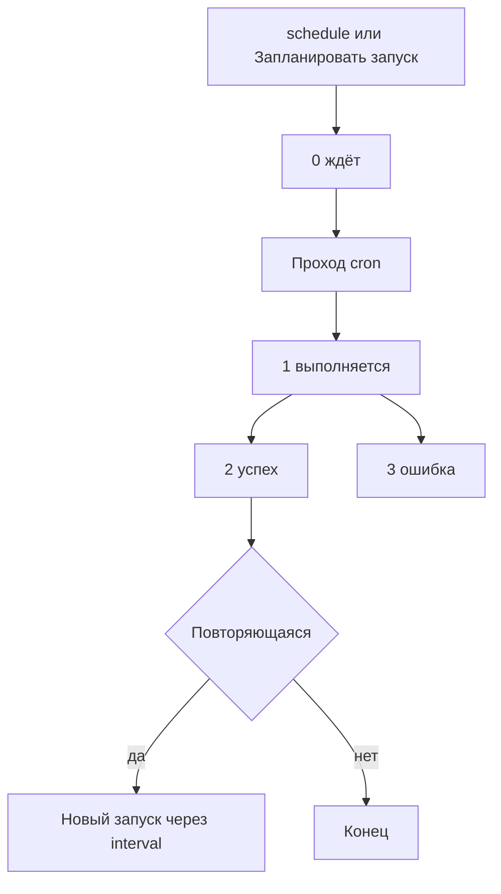

# Интеграция с Scheduler

MiniShop3 выполняет фоновые задачи через компонент [Scheduler](https://modstore.pro/packages/utilities/scheduler).

## Требования

Scheduler 1.8.0 или выше. На более ранних версиях задачи работают, но повторяющиеся не перезапускаются автоматически.

## Включение интеграции

1. Установите компонент Scheduler и настройте для него cron. См. [Установка и настройка запуска](../../scheduler/installation#cron).
2. Включите настройку `ms3_use_scheduler`: **Система → Системные настройки → minishop3**.

::: warning Настройка управляет только уведомлениями
`ms3_use_scheduler` читается в единственном месте: при решении, отправить уведомление сразу или поставить в очередь. На остальные задачи она не влияет:

- **уведомления** уходят в фон только при включённой настройке и установленном Scheduler;
- **импорт** уходит в фон по переключателю в форме импорта, независимо от настройки;
- **очистка токенов и черновиков** выполняется по расписанию, настройка её не включает и не выключает. Задачи регистрирует установщик MiniShop3, и только если Scheduler к этому моменту уже стоит: иначе резолвер молча выходит, и расписание не появляется. Поставили Scheduler вторым — обновите MiniShop3 заново или создайте задачи вручную.
:::

Программно настройку меняют через объект `modSystemSetting`:


```php
$setting = $modx->getObject(\MODX\Revolution\modSystemSetting::class, 'ms3_use_scheduler');
$setting->set('value', 1);
$setting->save();
```

::: warning setOption() настройку не сохраняет
`$modx->setOption('ms3_use_scheduler', true)` меняет значение только в памяти текущего запроса. В базу не попадает ничего. Задачи Scheduler выполняются отдельным процессом по cron и такого значения не увидят.
:::

## Встроенные задачи

MiniShop3 регистрирует при установке четыре задачи:

| Задача | Тип | Интервал | Файл |
| --- | --- | --- | --- |
| `ms3_cleanup_tokens` | повторяющаяся | `+1 week` | `elements/tasks/cleanupTokens.php` |
| `ms3_cleanup_drafts` | повторяющаяся | `+1 day` | `elements/tasks/cleanupDrafts.php` |
| `ms3_csv_import` | одноразовая | — | `elements/tasks/csvImport.php` |
| `ms3_send_notification` | одноразовая | — | `elements/tasks/sendNotification.php` |

Интервал задаётся строкой для PHP `strtotime()` и хранится в поле `interval` как есть. После успешного запуска Scheduler передаёт её в `strtotime()` и планирует следующий запуск. Если строка не разбирается или даёт время в прошлом, в MODX Error Log попадает `Invalid interval`. Повторяющаяся задача больше не планируется.

### ms3_cleanup_tokens

Удаляет из `ms3_customer_tokens` токены покупателей с истёкшим сроком действия.

### ms3_cleanup_drafts

Удаляет заказы со статусом «Черновик», созданные раньше периода из настройки `ms3_delete_drafts_after`.

Период задаётся любой строкой, понятной функции PHP `strtotime()`: `-1 day`, `-2 weeks`, `-1 month`, `-1 year`. Пустое значение (так поставляется по умолчанию) отключает автоудаление.

```php
$setting = $modx->getObject(\MODX\Revolution\modSystemSetting::class, 'ms3_delete_drafts_after');
$setting->set('value', '-2 weeks');
$setting->save();
```

### ms3_csv_import

Импортирует товары из CSV. Режим выбирает человек: в форме импорта есть переключатель «синхронно или в фоне». Фоновый режим ставит задачу в очередь Scheduler.

Установщик регистрирует задачу с namespace `minishop3` и путём `elements/tasks/csvImport.php`, а процессор импорта ищет её как `getTask('MiniShop3', 'ms3_csv_import')` — с другим регистром. На обычной базе MySQL строки сравниваются без учёта регистра, поэтому задача находится и дубля нет. Вторая задача появляется в другом случае: Scheduler поставили после MiniShop3, задачи от установщика нет вовсе, и процессор создаёт свою — уже с namespace `MiniShop3`. Расхождение разбирается в [известной ошибке](https://github.com/modx-pro/MiniShop3/issues/904).

Настройка `ms3_import_sync_limit` (по умолчанию 300 строк) задаёт порог: когда строк в файле больше, форма показывает переключатель режима, а без установленного Scheduler — предупреждение, что файл велик для синхронного прохода. Сама настройка режим не выбирает: пока переключатель не выставлен, импорт в очередь не уходит.

**Передаваемые параметры:**

```php
$scriptProperties = [
    'file' => 'path/to/file.csv',  // Путь к файлу относительно MODX_BASE_PATH
    'mapping' => [...],            // Соответствие колонок полям товара
    'fields' => [...],             // Прежний формат соответствия, для совместимости
    'update' => false,             // Обновлять существующие товары
    'key' => 'article',            // Поле, по которому ищется существующий товар
    'delimiter' => ';',            // Разделитель колонок
    'skip_header' => false,        // Пропустить первую строку
    'debug' => false,              // Подробный лог вместо записи в базу
    'import_id' => 'import_...',   // Идентификатор прогона, ставится процессором
];
```

### ms3_send_notification

Отправляет уведомления, не блокируя основной запрос. Это нужно для медленных каналов, например Telegram.

Уведомление уходит в очередь, когда выполнены оба условия: настройка `ms3_use_scheduler` включена и сервис `scheduler` зарегистрирован. Иначе уведомление отправляется сразу, в том же запросе. Задержка берётся из настроек самого уведомления (поле «Задержка» для статуса и типа получателя). При нулевой задержке запуск ставится на `+1 second`.

**Передаваемые параметры:**

```php
$scriptProperties = [
    'notification_class' => 'MiniShop3\Notifications\Order\StatusChangedNotification',
    'order_id' => 123,
    'channel' => 'telegram',         // имя канала: email или telegram
    'recipient_type' => 'manager',   // customer или manager
    'recipient' => [...],            // данные получателя для канала
    'notification_data' => [...],    // снимок данных уведомления
];
```

Задача восстанавливает уведомление по имени класса. Для `StatusChangedNotification` она берёт идентификаторы статусов из `notification_data` (`new_status.id`, `old_status.id`) и заново загружает объекты статусов. Если нового статуса в базе нет, задача пишет строку в журнал ошибок MODX и возвращает `false` — но запуск Scheduler всё равно помечается успешным: статус запуска зависит только от того, добавляла ли задача ошибку через `addError()`. Ищите такие случаи в журнале MODX, а не в списке запусков. Так же ведёт себя очистка черновиков.

**Каналы.** В поставке зарегистрированы два: `email` и `telegram`. Есть ещё `SmsChannel`, но это абстрактная заготовка: зарегистрировать её как есть нельзя — унаследуйте класс и реализуйте `sendSms()` под своего провайдера. Свой канал регистрируют плагином на событие `msOnRegisterNotificationChannels`, которому приходит параметр `manager`:

```php
$manager = $modx->getOption('manager', $scriptProperties);
$manager->registerChannel(new \MyPackage\Notifications\SmsChannel($modx));
```

## Мониторинг задач

### Через админку

**Дополнения → Scheduler**: три вкладки «Задания» (зарегистрированные задачи), «Запланированные запуски» и «Прошедшие запуски».

### Через API

У задачи нет метода, отдающего последний запуск, — доставайте его запросом к `sTaskRun`:

```php
/** @var \Scheduler $scheduler */
$scheduler = $modx->services->get('scheduler');

$task = $scheduler->getTask('minishop3', 'ms3_cleanup_tokens');

$c = $modx->newQuery('sTaskRun');
$c->where(['task' => $task->get('id')]);
$c->sortby('executedon', 'DESC');
$c->limit(1);

/** @var \sTaskRun|null $lastRun */
$lastRun = $modx->getObject('sTaskRun', $c);

if ($lastRun) {
    echo $lastRun->get('status');          // 0 ждёт, 1 выполняется, 2 успех, 3 ошибка
    echo $lastRun->get('executedon');      // метка времени запуска
    echo $lastRun->get('processing_time'); // длительность в секундах
    echo $lastRun->get('message');         // сообщение задачи

    if ($lastRun->hasErrors()) {
        print_r($lastRun->get('errors'));
    }
}
```

Коды `0`–`3` — это `sTaskRun::STATUS_SCHEDULED`, `STATUS_EXECUTING`, `STATUS_SUCCESS` и `STATUS_FAILURE`. Статус 3 ставится, если у запуска есть ошибки (`hasErrors()`), в том числе после исключения. Возврат из файла задачи пишется в `message` и сам статус не меняет.



## Ручной запуск задач

### Через админку

1. Откройте **Дополнения → Scheduler → Задания**.
2. Найдите задачу (namespace: minishop3).
3. В контекстном меню выберите **Запланировать запуск**.

Запуск встанет в очередь. Один проход cron берёт `scheduler.tasks_per_run` запусков — по умолчанию один, поэтому при непустой очереди ваш запуск подождёт несколько проходов.


### Через PHP

```php
/** @var \Scheduler $scheduler */
$scheduler = $modx->services->get('scheduler');

// Получить задачу
$task = $scheduler->getTask('minishop3', 'ms3_cleanup_tokens');

// Поставить в очередь — задачу подхватит ближайший запуск cron
$task->schedule('+1 minute');

// Для задач с параметрами они передаются вторым аргументом
$task->schedule('+1 minute', ['import_id' => 'import_123']);
```

Синхронного запуска у задачи нет: `schedule()` только ставит запуск в очередь, а выполняет его cron-скрипт Scheduler.

## Создание собственных задач

Типы задач, передача данных и правила возврата результата описаны в документации Scheduler: [Создание задания](../../scheduler/create-a-task) и [Разработка заданий](../../scheduler/task-development).

### Регистрация задачи

```php
/** @var \Scheduler $scheduler */
$scheduler = $modx->services->get('scheduler');

// Создать задачу
$task = $modx->newObject('sTask');
$task->fromArray([
    'class_key' => 'sFileTask',
    'namespace' => 'mypackage',
    'reference' => 'my_custom_task',
    'content' => 'elements/tasks/myTask.php',  // Относительно core-пути namespace
    'description' => 'My custom MiniShop3 task',
    'recurring' => true,
    'interval' => '+1 hour',
]);
$task->save();

// Запланировать первый запуск
$task->schedule('+1 minute');
```

### Файл задачи

Scheduler подключает файл через `include` и даёт в нём четыре переменные: `$modx`, `$task`, `$run` и `$scriptProperties` (данные из второго аргумента `schedule()`). Возвращённое значение попадает в результат запуска.

```php
<?php
/**
 * @var modX $modx
 * @var sFileTask $task
 * @var sTaskRun $run
 * @var array $scriptProperties
 */

// Получение сервиса MiniShop3
$ms3 = $modx->services->get('ms3');

// Ваша логика
try {
    // ... выполнение задачи ...

    $modx->log(modX::LOG_LEVEL_INFO, "[myTask] Completed successfully");
    return true;
} catch (\Exception $e) {
    $run->addError($e->getMessage());
    return false;
}
```

`addError($type, array $details = [])` в Scheduler: первый аргумент становится полем `type`, второй по умолчанию пустой. `csvImport.php` передаёт одну строку сообщения, она и записывается как `type`.

## Связанные настройки

| Настройка | По умолчанию | Описание |
| --- | --- | --- |
| `ms3_use_scheduler` | `false` | Отправлять уведомления через очередь Scheduler |
| `ms3_delete_drafts_after` | пусто | Период хранения черновиков, формат `strtotime()` |
| `ms3_import_sync_limit` | `300` | Число строк, после которого форма импорта предлагает фоновый режим |
| `ms3_status_draft` | `1` | Статус, по которому задача очистки отбирает черновики |

Со стороны Scheduler на поведение задач влияют `scheduler.tasks_per_run`, `scheduler.recurring_on_failure` и настройки писем о сбоях.

## Устранение проблем

### Задачи не выполняются

Проверьте:

- настроен ли cron для Scheduler. [Как его настроить](../../scheduler/installation#cron);
- читает ли веб-сервер файлы задач;
- что пишет Scheduler в MODX Error Log.

Если очередь длинная, запуск ждёт своего прохода: по умолчанию cron берёт один запуск за проход (`scheduler.tasks_per_run`).

### Повторяющиеся задачи не перезапускаются

Чаще всего причина в том, что прошлый запуск завершился с ошибкой: следующий запуск после неудачи не планируется, а в журнал попадает `stopped due to failure`. Чтобы цикл продолжался и после ошибок, включите настройку Scheduler `scheduler.recurring_on_failure`. По умолчанию она выключена.

Остальное, что стоит проверить:

- версию Scheduler: нужна 1.8.0 или выше;
- поле `recurring` в настройках задачи;
- значение `interval`. Строка, которую не разбирает `strtotime()`, даёт `Invalid interval` и останавливает цикл.

### Ошибки в задачах

Логи задач:

- MODX Error Log (`core/cache/logs/error.log`);
- вкладка «Прошедшие запуски» в Scheduler: у каждого запуска видны сообщение и список ошибок.

Записи об ошибках хранятся в поле `errors` запуска: это массив, где у каждой записи есть `type` (первый аргумент `addError()`), `timestamp` и переданные подробности.
