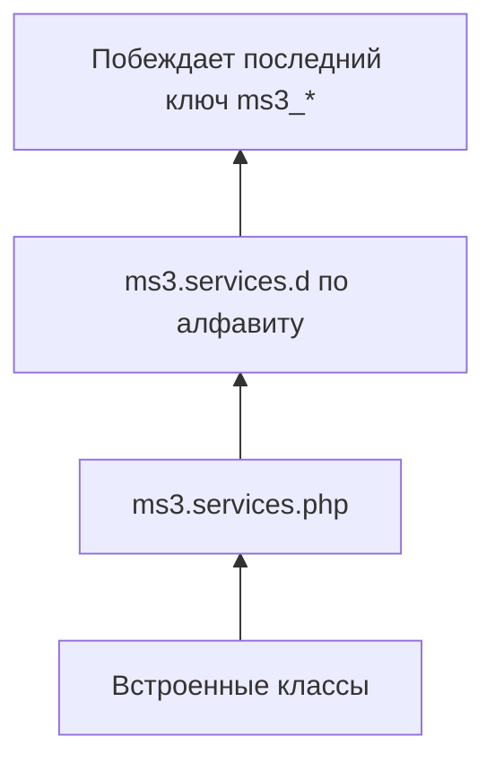

# Сервисный слой

Бизнес-логика MiniShop3 живёт в сервисах, а не в моделях xPDO.

## Архитектурный паттерн

### Принцип разделения

В MiniShop3 часть логики уходит в сервисы. Дублирование товара остаётся методом модели.

```php
class msProduct extends modResource
{
    public function duplicate(array $options = []) { /* копия товара */ }
}

class ProductService
{
    public function processForDisplay(\MiniShop3\Model\msProduct $product): void { /* подготовка к выводу */ }
}
```

В miniShop2 логика лежала в моделях:

```php
// miniShop2 - "толстые" модели
class msProduct extends modResource
{
    public function duplicate($options = []) { /* 200+ строк логики */ }
    public function getPrice() { /* логика расчёта цены */ }
    public function updateImages() { /* работа с изображениями */ }
}
```

### Преимущества

| Аспект | Толстые модели | Сервисный слой |
| --- | --- | --- |
| Тестирование | Связано с ORM | Изолированные тесты |
| Переиспользование | Привязано к ORM | Независимые сервисы |
| Расширение | Наследование | Замена через DI |
| Размер файлов | 1000+ строк | 100-300 строк |

::: info Компромисс с архитектурой MODX
Архитектура MODX держит бизнес-логику в моделях (`modResource`, `modUser` и др.). Часть моделей MiniShop3 расширяет классы MODX (`msProduct extends modResource`) и следует тому же шаблону.

Поэтому модели MiniShop3 содержат ссылки на сервисы и вызывают через них бизнес-логику. Это компромисс ради совместимости с MODX.
:::

## DI-контейнер

Сервисы регистрируются и получаются через `$modx->services`.

### Регистрация сервисов

Регистрация идёт в два шага:

1. `bootstrap.php` компонента добавляет в контейнер единственный ключ: `ms3`.
2. Конструктор `MiniShop3` вызывает `ServiceRegistry::register()`, и тогда появляются остальные ключи.

Второй шаг происходит сам: плагин компонента на событии `OnMODXInit` получает `ms3` в начале каждого запроса. К моменту работы сниппета, плагина или контроллера ключи уже на месте. Получать `ms3` ради них не нужно.

```php
// bootstrap.php — только точка входа
$modx->services->add('ms3', function ($c) use ($modx) {
    return new MiniShop3\MiniShop3($modx);
});
```

### Получение сервисов

```php
// Через DI контейнер (рекомендуется)
$orderService = $modx->services->get('ms3_order_service');
$authManager = $modx->services->get('ms3_auth_manager');
$cart = $modx->services->get('ms3_cart');

// Через главный класс MiniShop3
$ms3 = $modx->services->get('ms3');
$ms3->cart->add($productId, 1);
$ms3->order->submit();
```

### Ленивая загрузка

Сервис создаётся при первом `get()`. Повторный вызов отдаёт тот же объект:

```php
// Сервис ещё не создан
$modx->services->add('ms3_order_service', function() use ($modx) {
    // Эта функция выполнится только при первом get()
    return new \MiniShop3\Services\Order\OrderService($modx);
});

// Первое обращение - создание объекта
$service1 = $modx->services->get('ms3_order_service');

// Повторное обращение - тот же объект (singleton)
$service2 = $modx->services->get('ms3_order_service');
// $service1 === $service2
```

### Соглашение об именовании

Ключи сервисов MiniShop3 начинаются с `ms3_`:

```php
'ms3_order_service'      // OrderService
'ms3_auth_manager'       // AuthManager
'ms3_cart'               // Cart controller
'ms3_product_image'      // ProductImageService
```

Префикс отделяет их от сервисов других компонентов.

## Карта сервисов

### Контроллеры (Controllers)

| Ключ | Класс | Назначение |
| --- | --- | --- |
| `ms3_cart` | `Controllers\Cart\Cart` | Управление корзиной |
| `ms3_order` | `Controllers\Order\Order` | Оформление заказа |
| `ms3_customer` | `Controllers\Customer\Customer` | Работа с покупателем |

```php
// Пример использования
$ms3 = $modx->services->get('ms3');

// Добавление в корзину
$result = $ms3->cart->add($productId, 2, ['color' => 'red']);

// Оформление заказа
$result = $ms3->order->submit();

// Получение данных покупателя
$customer = $ms3->customer->getFields();
```

### Сервисы товаров (Product)

| Ключ | Класс | Назначение |
| --- | --- | --- |
| `ms3_product_service` | `Services\Product\ProductService` | Конвертация ресурса в товар, соседние товары, подготовка к выводу |
| `ms3_product_data_service` | `Services\Product\ProductDataService` | Работа с данными товара |
| `ms3_product_image` | `Services\Product\ProductImageService` | Изображения, превью (`preview_file_id`) |
| `ms3_product_catalog` | `Services\Product\ProductCatalogService` | Каталог Web API (список разрешённых полей) |
| `ms3_product_import` | `Services\Product\Import\ProductImportService` | Импорт CSV |
| `ms3_product_category_tree` | `Services\Product\ProductCategoryTreeService` | Дерево категорий товара в админке |
| `ms3_product_link_service` | `Services\Product\ProductLinkService` | Связи товара (mgr Vue-вкладка) |
| `ms3_product_facets` | `Services\Product\ProductFacetService` | Фасеты каталога |
| `ms3_product_gallery_public` | `Services\Product\ProductGalleryPublicService` | Публичная галерея (get/list/images) |

```php
$productService = $modx->services->get('ms3_product_data_service');
$imageService = $modx->services->get('ms3_product_image');
```

### Сервисы покупателя (Customer)

| Ключ | Класс | Назначение |
| --- | --- | --- |
| `ms3_auth_manager` | `Services\Customer\AuthManager` | Аутентификация |
| `ms3_register_service` | `Services\Customer\RegisterService` | Регистрация |
| `ms3_email_verification_service` | `Services\Customer\EmailVerificationService` | Верификация email |
| `ms3_sms_verification_service` | `Services\Customer\SmsVerificationService` | Заглушка SMS (метод всегда возвращает ошибку до реализации провайдера) |
| `ms3_rate_limiter` | `Services\Customer\RateLimiter` | Ограничение частоты запросов |
| `ms3_customer_address_manager` | `Services\Customer\CustomerAddressManager` | Управление адресами покупателя |
| `ms3_customer_field_manager` | `Services\Customer\CustomerFieldManager` | Поля профиля покупателя |
| `ms3_customer_order` | `Services\Customer\CustomerOrderService` | Заказы покупателя на фронтенде |
| `ms3_customer_order_resolver` | `Services\Customer\CustomerOrderResolver` | Привязка заказа к покупателю при оформлении |
| `ms3_customer_duplicate_checker` | `Services\CustomerDuplicateChecker` | Проверка дубликатов |
| `ms3_customer_factory` | `Services\CustomerFactory` | Фабрика покупателей |

```php
// Аутентификация
$authManager = $modx->services->get('ms3_auth_manager');
$customer = $authManager->authenticate([
    'email' => 'user@example.com',
    'password' => 'secret123'
]);

// Создание токена
$token = $authManager->createToken($customer, 'api', 86400);

// Регистрация своего провайдера. Готового класса для SMS в пакете нет.
$authManager->registerProvider(new CodeAuthProvider($modx));
```

```php
use MiniShop3\Controllers\Auth\AuthProviderInterface;
use MiniShop3\Model\msCustomer;
use MODX\Revolution\modX;

class CodeAuthProvider implements AuthProviderInterface
{
    public function __construct(private modX $modx)
    {
    }

    public function authenticate(array $credentials): ?msCustomer
    {
        // Здесь своя проверка кода. Класса SMS в пакете нет.
        return null;
    }

    public function getName(): string
    {
        return 'code';
    }

    public function supports(array $credentials): bool
    {
        return isset($credentials['phone'], $credentials['code']);
    }
}
```

### Сервисы заказа (Order)

::: info Архитектура фасада
Контроллер `Order.php` служит **фасадом**. Он сохраняет все публичные методы для обратной совместимости и делегирует логику в специализированные сервисы. Отдельную часть логики можно заменить, не трогая весь контроллер.
:::

| Ключ | Класс | Назначение |
| --- | --- | --- |
| `ms3_order_service` | `Services\Order\OrderService` | Общая бизнес-логика заказов |
| `ms3_order_draft_manager` | `Services\Order\OrderDraftManager` | CRUD черновиков заказов |
| `ms3_order_cost_calculator` | `Services\Order\OrderCostCalculator` | Расчёт стоимости |
| `ms3_order_field_manager` | `Services\Order\OrderFieldManager` | CRUD полей + валидация |
| `ms3_order_address_manager` | `Services\Order\OrderAddressManager` | Работа с адресами клиентов |
| `ms3_order_user_resolver` | `Services\Order\OrderUserResolver` | Определение пользователей MODX |
| `ms3_order_submit_handler` | `Services\Order\OrderSubmitHandler` | Оформление заказа |
| `ms3_order_log` | `Services\Order\OrderLogService` | Логирование изменений заказа |
| `ms3_order_status` | `Services\Order\OrderStatusService` | Смена статуса + уведомления |
| `ms3_order_finalize` | `Services\Order\OrderFinalizeService` | Финализация заказа (валидация, создание клиента) |
| `ms3_programmatic_order` | `Services\Order\ProgrammaticOrderService` | Создание заказа без сессии на фронтенде — для компонентов и cron (`idempotency_key`) |
| `ms3_order_number_generator` | `Services\Order\OrderNumberGenerator` | Нумерация заказов |
| `ms3_manager_order_cost_recalculator` | `Services\Order\ManagerOrderCostRecalculator` | Пересчёт в карточке заказа (mgr) |
| `ms3_manager_order_list` | `Services\Order\ManagerOrderListService` | Список заказов в админке |
| `ms3_manager_order_mutation` | `Services\Order\ManagerOrderMutationService` | Мутации заказа в mgr |
| `ms3_manager_order_presenter` | `Services\Order\ManagerOrderPresenter` | Презентация карточки заказа |
| `ms3_manager_order_products` | `Services\Order\ManagerOrderProductsService` | Позиции заказа в mgr |
| `ms3_order_lifecycle_ports` | `Services\Order\NullOrderLifecyclePorts` | Порты жизненного цикла заказа (по умолчанию null-реализация) |

```php
// Получение сервисов напрямую
$draftManager = $modx->services->get('ms3_order_draft_manager');
$costCalculator = $modx->services->get('ms3_order_cost_calculator');
$submitHandler = $modx->services->get('ms3_order_submit_handler');

// Работа с черновиком
$draft = $draftManager->getOrCreateDraft($token, 'web');
$draftManager->attachCustomer($draft, $customerId);

// Расчёт стоимости (нужны orderData из toArray и token)
$orderData = $draftManager->toArray($draft);
$total = $costCalculator->getTotalCost($draft, $orderData, $token);
// ['success' => true, 'message' => …, 'data' => ['cost' => …, 'cart_cost' => …,
//   'delivery_cost' => …, 'payment_cost' => … и итоги корзины]]
$cost = $total['data']['cost'];

// Логирование
$logService = $modx->services->get('ms3_order_log');
$logService->addEntry(
    (int) $draft->get('id'),
    \MiniShop3\Model\msOrderLog::ACTION_STATUS,
    ['old' => 1, 'new' => 2]
);
```

### Сервисы корзины (Cart)

::: info Архитектура фасада
Контроллер `Cart.php` тоже служит **фасадом**. Он использует `OrderDraftManager` для общих операций с черновиками. Корзина и заказ используют одну модель `msOrder`.
:::

| Ключ | Класс | Назначение |
| --- | --- | --- |
| `ms3_cart_item_manager` | `Services\Cart\CartItemManager` | CRUD позиций, расчёт итогов |
| `ms3_cart_mutation_handler` | `Services\Cart\CartMutationHandler` | Web API корзины: add/change/remove/change-option + события `msOn*Cart` |
| `ms3_cart_response_normalizer` | `Services\Cart\CartResponseNormalizer` | Нормализация ответа корзины для API/JS |

```php
$itemManager = $modx->services->get('ms3_cart_item_manager');

// Добавление товара: объект msProduct и уже посчитанный productKey
$product = $modx->getObject(\MiniShop3\Model\msProduct::class, $productId);
$result = $itemManager->addItem($draft, $product, $count, $options, $productKey);

// Изменение количества
$itemManager->updateItemCount($draft, $key, $newCount);

// Расчёт итогов корзины (на вход — массив позиций, не draft)
$items = $itemManager->loadItems($draft);
$status = $itemManager->calculateStatus($items);
// total_count, total_cost, total_weight, total_discount, total_positions
```

**Разделение ответственности Cart и Order:**

```text
OrderDraftManager    — жизненный цикл черновика (общий для Cart и Order)
CartItemManager      — операции с позициями корзины (Cart-specific)
OrderCostCalculator  — расчёт стоимости заказа (Order-specific)
OrderFieldManager    — поля заказа (Order-specific)
```

### Сервисы доставки и оплаты

| Ключ | Класс | Назначение |
| --- | --- | --- |
| `ms3_delivery_service` | `Services\Delivery\DeliveryService` | Способы доставки |
| `ms3_delivery_catalog` | `Services\Delivery\DeliveryCatalogService` | Публичный каталог доставок (Web API) |
| `ms3_payment_service` | `Services\Payment\PaymentService` | Способы оплаты |
| `ms3_payment_catalog` | `Services\Payment\PaymentCatalogService` | Публичный каталог оплат (Web API) |
| `ms3_payment_link_resolver` | `Services\Payment\PaymentLinkResolver` | URL оплаты: в письмах по `ms3_payment_link_statuses` (настройки в поставке нет, создаёте сами), в `msGetOrder` по параметру `payStatus` |
| `ms3_payment_lifecycle` | `Services\Payment\PaymentLifecycleService` | Жизненный цикл оплаты → статусы заказа |
| `ms3_shipment_lifecycle` | `Services\Shipment\ShipmentLifecycleService` | Отгрузки и трекинг (`ms3_shipments` через `PdoShipmentStore`) |

### Остатки, SEO, валидация, domain events

| Ключ | Класс | Назначение |
| --- | --- | --- |
| `ms3_inventory` | `Services\Inventory\ProductStockInventory` | Резерв/списание `stock` при `ms3_inventory_enabled` (`InventoryServiceInterface`) |
| `ms3_public_seo` | `Services\Seo\PublicSeoService` | Публичные SEO-поля + `msOnGetPublicSeo` |
| `ms3_validation_service` | `Services\Validation\ValidationService` | Конвейерная валидация (заменяет rakit) |
| `ms3_domain_events` | `Services\Events\DomainEventBridge` | Мост событий домена |
| `ms3_webhook_dispatcher` | `Services\Events\NullWebhookDispatcher` | Диспетчер outbound webhooks (по умолчанию null-реализация) |

### Свои поля и поля моделей

| Ключ | Класс | Назначение |
| --- | --- | --- |
| `ms3_extra_fields` | `Services\ExtraFieldsService` | CRUD дополнительных полей |
| `ms3_repeater_field` | `Services\ExtraFields\RepeaterFieldService` | `xtype` repeater |
| `ms3_key_value_field` | `Services\ExtraFields\KeyValueFieldService` | `xtype` key-value |
| `ms3_model_field_service` | `Services\ModelField\ModelFieldService` | Поля моделей |
| `ms3_model_field_section_service` | `Services\ModelField\ModelFieldSectionService` | Секции полей моделей |

### Сервисы категорий (Category)

| Ключ | Класс | Назначение |
| --- | --- | --- |
| `ms3_category_service` | `Services\Category\CategoryService` | Работа с категориями |
| `ms3_category_catalog` | `Services\Category\CategoryCatalogService` | Публичный каталог категорий (Web API) |
| `ms3_category_tree` | `Services\Category\CategoryTreeService` | Дерево для Web API / админки |
| `ms3_category_option_service` | `Services\Category\CategoryOptionService` | Опции категорий |
| `ms3_category_product_scope` | `Services\Category\CategoryProductScopeService` | Доп. категории товара для msProducts |
| `ms3_category_products_list` | `Services\Category\CategoryProductsListService` | Грид товаров категории |
| `ms3_customer_resource_group_resolver` | `Services\Catalog\CustomerResourceGroupResolver` | ACL каталога для покупателя |
| `ms3_catalog_acl_cache` | `Services\Catalog\CatalogAclCacheInvalidator` | Сброс ACL-кэша каталога |

### Сервисы опций (Option)

| Ключ | Класс | Назначение |
| --- | --- | --- |
| `ms3_option_service` | `Services\Option\OptionService` | EAV система опций |
| `ms3_option_loader` | `Services\Option\OptionLoaderService` | Загрузка опций с `CaptionOverlayResolver` |
| `ms3_option_sync` | `Services\Option\OptionSyncService` | Синхронизация значений опций |
| `ms3_option_category_service` | `Services\Option\OptionCategoryService` | Привязка опций к категориям |

### Сервисы конфигурации

| Ключ | Класс | Назначение |
| --- | --- | --- |
| `ms3_config_service` | `Services\ConfigService` | Фасад конфигурации |
| `ms3_field_config_manager` | `Services\FieldConfigManager` | Конфигурация полей |
| `ms3_grid_config` | `Services\GridConfigService` | Конфигурация гридов |
| `ms3_filter_config` | `Services\FilterConfigManager` | Фильтры гридов |
| `ms3_settings_combo_list` | `Services\Settings\SettingsComboListService` | Справочники для combo-полей настроек |

### Сервисы уведомлений

| Ключ | Класс | Назначение |
| --- | --- | --- |
| `ms3_notifications` | `Notifications\NotificationManager` | Центр уведомлений |
| `ms3_notification_config` | `Services\Notification\NotificationConfigService` | Конфигурация уведомлений |

### Утилиты

| Ключ | Класс | Назначение |
| --- | --- | --- |
| `ms3_token_service` | `Services\TokenService` | Операции с токенами |
| `ms3_image` | `Services\ImageService` | Обработка изображений (Intervention Image) |
| `ms3_vendor_service` | `Services\Vendor\VendorService` | Работа с производителями |

## Замена сервисов



Штатный сервис заменяют файлом конфигурации.

### Приоритет загрузки

1. **Встроенные классы**: базовые реализации компонента
2. **Основной конфиг**: `core/config/ms3.services.php`
3. **Конфиги компонентов**: `core/config/ms3.services.d/*.php` (в алфавитном порядке)

Каждый следующий уровень переопределяет предыдущий.

### Создание конфигурации

Скопируйте пример конфигурации:

```bash
cp core/components/minishop3/config/ms3.services.example.php \
   core/config/ms3.services.php
```

### Пример переопределения

```php
<?php
// core/config/ms3.services.php

return [
    // Кастомная корзина с промокодами
    'ms3_cart' => [
        'class' => \MyProject\Controllers\PromoCart::class,
        'interface' => null,
    ],

    // Кастомный обработчик оформления заказа (интеграция с CRM)
    'ms3_order_submit_handler' => [
        'class' => \MyProject\Services\CRMOrderSubmitHandler::class,
        'interface' => null,
    ],

    // Кастомный сервис доставки (СДЭК)
    'ms3_delivery_service' => [
        'class' => \MyProject\Services\CdekDeliveryService::class,
        'interface' => null,
    ],
];
```

**Пример собственного OrderSubmitHandler с интеграцией CRM:**

```php
<?php
namespace MyProject\Services;

use MiniShop3\Model\msOrder;
use MiniShop3\Services\Order\OrderSubmitHandler;

class CRMOrderSubmitHandler extends OrderSubmitHandler
{
    public function submit(
        msOrder $draft,
        array $orderData,
        string $token,
        string $ctx = 'web',
        array $submitData = []
    ): array {
        $this->validateWithCRM($orderData);

        $result = parent::submit($draft, $orderData, $token, $ctx, $submitData);

        if ($result['success']) {
            $this->syncOrderToCRM((int) $result['data']['order_id']);
        }

        return $result;
    }

    protected function syncOrderToCRM(int $orderId): void
    {
        // Отправка в CRM
    }
}
```

**Пример программного заказа из cron или компонента:**

```php
use MiniShop3\Services\Order\OrderOrigin;

$orders = $modx->services->get('ms3_programmatic_order');

$result = $orders->create([
    'idempotency_key' => 'crm-invoice-10042',
    'products' => [
        ['product_id' => 15, 'count' => 2],
    ],
    'delivery_id' => 1,
    'payment_id' => 1,
    'address' => [
        'first_name' => 'Иван',
        'email' => 'user@example.com',
        'phone' => '+79991234567',
    ],
    'origin' => OrderOrigin::INTEGRATION,
]);

if (!$result['success']) {
    $modx->log(modX::LOG_LEVEL_ERROR, '[CRM] ' . $result['message']);
}
```

### Требования к пользовательским классам

Пользовательский класс **должен**:

1. **Существовать** и быть доступным через автозагрузчик
2. **Наследовать** базовый класс MiniShop3 — но только у сервисов без объявленного интерфейса

У сервисов, для которых в конфигурации указан `interface` (`ms3_inventory`, `ms3_order_lifecycle_ports`, `ms3_webhook_dispatcher`), наследование не нужно: достаточно реализовать интерфейс с нуля. Проверка идёт по `is_a()`, и ветка с наследованием в этом случае не выполняется. Своя реализация склада от `ProductStockInventory` не наследуется — так и сделано в примере поставки.

::: warning Указывайте `interface` в своём конфиге
Слияние конфигураций заменяет значение целиком. Если в `ms3.services.php` оставить у такого сервиса `'interface' => null`, валидатор потребует наследовать стандартный класс и отвергнет честную реализацию интерфейса. Переносите строку `interface` в свой конфиг вместе с `class`.
:::

```php
<?php
namespace MyProject\Controllers;

use MiniShop3\Controllers\Cart\Cart;

class PromoCart extends Cart
{
    public function add(int $id, int $count = 1, array $options = []): array
    {
        // Проверка промокода
        $promoCode = $_SESSION['promo_code'] ?? null;
        if ($promoCode) {
            $options['promo_code'] = $promoCode;
        }

        // Вызов родительского метода
        return parent::add($id, $count, $options);
    }

    public function applyPromoCode(string $code): array
    {
        // Кастомная логика промокодов
        $_SESSION['promo_code'] = $code;
        return $this->success('Промокод применён');
    }
}
```

### Валидация классов

ServiceRegistry автоматически проверяет:

- **Существование класса**: `class_exists()`
- **Интерфейс**, если он объявлен у сервиса: `is_a($className, $interface, true)`
- **Наследование** — только когда интерфейса нет: `is_subclass_of($className, $baseClass)`

При ошибке валидации реестр подставляет стандартный класс и пишет в лог:

```
[MiniShop3 ServiceRegistry] Class 'MyProject\Cart' must extend MiniShop3\Controllers\Cart\Cart, using fallback
```

## Расширение сторонними компонентами

Если вы разрабатываете компонент, расширяющий MiniShop3, кладите конфиг в `ms3.services.d/`. Тогда файлы не перезаписывают друг друга.

### Структура

```
core/config/ms3.services.d/
├── 01-base.php           # Базовые переопределения (приоритет 01)
├── 50-mypromocode.php    # Компонент промокодов (приоритет 50)
├── 50-cdekdelivery.php   # Компонент доставки СДЭК (приоритет 50)
└── 99-override.php       # Финальные переопределения (приоритет 99)
```

Каждый компонент в своём файле. Порядок задаёт имя файла (алфавит, числовой префикс).

### Пример конфига компонента

```php
<?php
// core/config/ms3.services.d/50-mypromocode.php

return [
    'ms3_cart' => [
        'class' => \MyPromoCode\Controllers\PromoCart::class,
    ],
];
```

### Логирование

ServiceRegistry логирует все загруженные конфиги:

```
[MiniShop3 ServiceRegistry] Loaded 1 service(s) from addon: 50-mypromocode.php
[MiniShop3 ServiceRegistry] Using custom class: MyPromoCode\Controllers\PromoCart
```

## Примеры использования

### Свой расчёт стоимости доставки

```php
<?php
namespace MyProject\Services;

use MiniShop3\Model\msDelivery;
use MiniShop3\Model\msOrder;
use MiniShop3\Controllers\Delivery\DeliveryProviderInterface;
use MiniShop3\Services\Delivery\DeliveryService;

class CustomDeliveryService extends DeliveryService
{
    public function calculateDeliveryCost(
        msDelivery $delivery,
        ?DeliveryProviderInterface $controller,
        msOrder $order,
        float $cost = 0.0
    ): float {
        $baseCost = parent::calculateDeliveryCost($delivery, $controller, $order, $cost);

        // Бесплатная доставка от 5000 руб
        if ($order->get('cart_cost') >= 5000) {
            return 0;
        }

        // Наценка для тяжёлых заказов
        if ($order->get('weight') > 10000) {
            $baseCost *= 1.5;
        }

        return $baseCost;
    }
}
```

### Интеграция с внешней CRM

`OrderService` не перехватывает сохранение заказа. Публичные методы: `paymentCommissionBase`, `clampComputedTotal`, `aggregateProductsTotals`, `updateProducts`, `getOrderStatistics`. Отправку во внешнюю систему вешайте на [смену статуса](events/status).

```php
<?php
namespace MyProject\Services;

use MiniShop3\Model\msOrder;

class CRMSync
{
    public function syncToCRM(msOrder $order): void
    {
        $client = new \GuzzleHttp\Client();
        $client->post('https://crm.example.com/api/orders', [
            'json' => [
                'order_id' => $order->get('id'),
                'status' => $order->get('status_id'),
                'total' => $order->get('cost'),
            ]
        ]);
    }
}
```

### Свой провайдер аутентификации

```php
<?php
namespace MyProject\Auth;

use MiniShop3\Controllers\Auth\AuthProviderInterface;
use MiniShop3\Model\msCustomer;
use MODX\Revolution\modX;

class TelegramAuthProvider implements AuthProviderInterface
{
    protected modX $modx;

    public function __construct(modX $modx)
    {
        $this->modx = $modx;
    }

    public function getName(): string
    {
        return 'telegram';
    }

    public function supports(array $credentials): bool
    {
        return isset($credentials['telegram_hash'])
            && isset($credentials['telegram_id']);
    }

    public function authenticate(array $credentials): ?msCustomer
    {
        // Проверка подписи Telegram
        if (!$this->verifyTelegramHash($credentials)) {
            return null;
        }

        // Поиск покупателя по своему полю. Колонки telegram_id у msCustomer нет:
        // добавьте её через «Свои поля» покупателя или миграцию своего аддона
        return $this->modx->getObject(msCustomer::class, [
            'telegram_id' => $credentials['telegram_id']
        ]);
    }

    protected function verifyTelegramHash(array $data): bool
    {
        // Логика проверки подписи Telegram
        return true;
    }
}
```

Регистрация провайдера:

```php
$authManager = $modx->services->get('ms3_auth_manager');
$authManager->registerProvider(new TelegramAuthProvider($modx));
```

## Системные настройки

В transport этих ключей нет. `ServiceRegistry` берёт путь из опции, а если она пустая, подставляет запасной:

| Опция | Запасной путь | Когда пишется DEBUG |
| --- | --- | --- |
| `ms3_services_config` | `{core_path}config/ms3.services.php` | Опция задана, файла по ней нет |
| `ms3_services_addons_dir` | `{core_path}config/ms3.services.d/` | Опция задана, каталога по ней нет |

Пустой запасной путь на штатной установке в лог не пишется.

Отсутствие файла или каталога по этим путям ошибкой не считается: реестр просто идёт дальше.

## Устранение проблем

### Сервис не найден

Контейнер MODX бросает исключение `MODX\Revolution\Services\NotFoundException`:

```
Dependency not found with key ms3_my_service.
```

**Решения:**

1. Убедитесь, что `ServiceRegistry::register()` вызывается при инициализации
2. Проверьте правильность ключа сервиса (с префиксом `ms3_`)
3. Проверьте, что класс существует и доступен автозагрузчику
4. Посмотрите в журнал MODX: если там строка `No factory registered for service`, ключ не из списка встроенных — такой сервис не регистрируется вовсе

::: warning Новый ключ через конфигурацию не добавить
Регистратор заводит только те ключи, для которых в коде есть фабрика, — те же 83, что перечислены выше. Конфигурацией подменяется **класс существующего** сервиса; незнакомый ключ в `ms3.services.php` или `ms3.services.d/*.php` будет пропущен с записью в журнал. Свой сервис аддон кладёт прямо в контейнер MODX: `$modx->services->add('mypackage_service', …)`.
:::

### Пользовательский класс не применяется

```
[MiniShop3 ServiceRegistry] Class 'MyClass' must extend BaseClass, using fallback
```

**Решения:**

1. Убедитесь, что пользовательский класс наследует базовый класс MiniShop3
2. Проверьте namespace и use-директивы
3. Очистите кэш MODX

### Конфликт компонентов

Если два компонента переопределяют один сервис, применится тот, чей файл загружается последним (по алфавиту).

**Решение:** Используйте числовые префиксы для управления порядком:

- `10-base-component.php` загрузится первым
- `90-override-component.php` загрузится последним и победит
