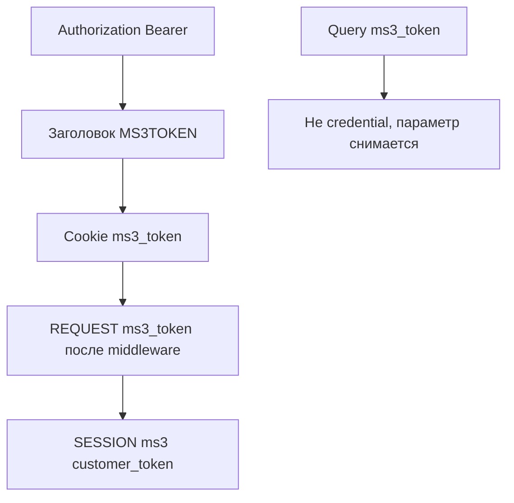
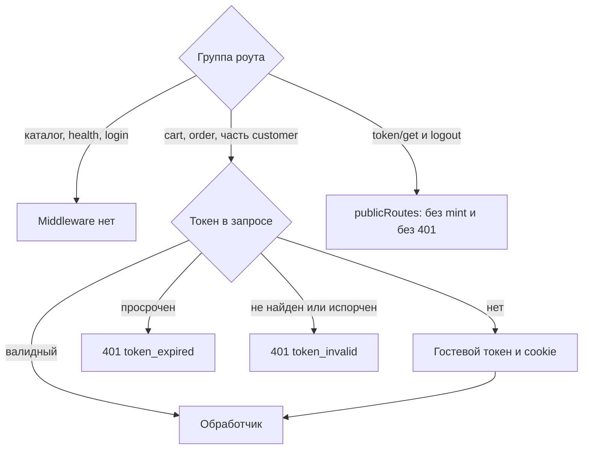

# Авторизация

Web API не использует сессию админки MODX. Клиент передаёт API-токен покупателя: гостевой или авторизованный.

## Где сервер ищет токен



Порядок источников в `TokenService::resolveTokenFromRequest()`:

1. `Authorization: Bearer {token}`
2. Заголовок `MS3TOKEN` (устаревший)
3. httpOnly cookie `ms3_token`
4. `$_REQUEST['ms3_token']` (после middleware, которое подставляет cookie в запрос)
5. `$_SESSION['ms3']['customer_token']`

Query-параметр `ms3_token` сервер не принимает как способ авторизации и удаляет его из запроса. Параметр `token` в query тоже не авторизует, но и не удаляется: им пользуется `GET /customer/email/verify`. Не копируйте старые примеры с `?ms3_token=` в URL.

## Cookie vs Bearer

| Режим | Как передавать | Когда применять |
| --- | --- | --- |
| Same-site фронтенд | cookie `ms3_token` + `credentials: 'include'` | Браузер на том же сайте |
| Nuxt BFF / mobile | `Authorization: Bearer` | Другой origin или серверный прокси |

Не храните API-токен в `localStorage`: для браузера на том же origin основной способ — httpOnly cookie `ms3_token`. Скрипты фронтенда: [Frontend JavaScript](/components/minishop3/development/frontend-js).

Cookie наследует параметры сессии MODX: `session_cookie_domain`, `session_cookie_path`, `session_cookie_secure`, `session_cookie_samesite`.

## Auto-mint



Если на роуте стоит `TokenMiddleware` (корзина, заказ, часть customer), а токена в запросе нет совсем, сервер создаёт гостевой токен и ставит cookie. У каталога и `/health` этого middleware нет.

Гостевой токен выдаётся только при полном отсутствии токена. Просроченный токен даёт 401 `token_expired`, ненайденный в базе или испорченный — 401 `token_invalid`: в обоих случаях сервер снимает cookie и ключи сессии, но нового токена не выдаёт. Если токена нет и создать новый не удалось, приходит 500 `internal_error`.

У `GET /customer/token/get` и `POST /customer/logout` middleware работает в режиме optional: их пути указаны в `publicRoutes`. Без токена сервер не создаёт гостевой токен и не отвечает 401.

## GET /customer/token/get

Публичный эндпоинт: возвращает текущий или новый токен и ставит httpOnly cookie.

```json
{
  "success": true,
  "message": "",
  "data": {
    "token": "…",
    "lifetime": 86400000
  }
}
```

Поле `lifetime` — остаток срока в миллисекундах: секунды из `ms3_customer_token_ttl`, умноженные на 1000. Поле `expires` есть во внутреннем генераторе, но в `data` не попадает.

| Настройка | Значение установщика | Если строки нет в базе |
| --- | --- | --- |
| `ms3_customer_token_ttl` | 86400 секунд (24 часа) | Код подставляет те же 86400 |

::: warning Сайты, обновлённые с версий до 1.14.2-beta1
На сайтах, где настройки в базе нет, код до 1.14.2-beta1 подставлял **604800** (7 дней). После обновления покупатели начнут входить заново через сутки, а не через неделю. Если нужен недельный срок — задайте `ms3_customer_token_ttl` явно.
:::

## Login / register

`POST /customer/login` и `POST /customer/register` работают без `TokenMiddleware`.

| Метод | Тело |
| --- | --- |
| `POST /customer/login` | `email`, `password` |
| `POST /customer/register` | `email`, `password`, `first_name`, `last_name`, `phone`, `privacy_accepted` (bool) |
| `POST /customer/forgot-password` | `email` |
| `POST /customer/reset-password` | `token`, `password`, `password_confirm` |

Успешный ответ обоих эндпоинтов одинаков по составу:

```json
{
  "success": true,
  "message": "",
  "data": {
    "customer": { "id": 12, "email": "ivan@example.com", "first_name": "Иван" },
    "token": "a1b2c3…",
    "expires_at": 1793452800,
    "redirect_url": "https://shop.example.com/cabinet"
  }
}
```

В `customer` приходят публичные поля покупателя — тот же набор, что у [`GET /customer/me`](customer). `redirect_url` берётся из свойства `redirect_page_id` вызова, а если его нет — из настройки `ms3_customer_redirect_after_login`; когда страница не задана, приходит пустая строка.

Лимит попыток входа по IP зашит в процессор: 5 попыток за 300 секунд. Настройки `ms3_customer_max_login_attempts` и `ms3_customer_block_duration` он не читает ([баг #902](https://github.com/modx-pro/MiniShop3/issues/902)). Блокировка учётной записи эти настройки учитывает. Если строки `ms3_customer_block_duration` в базе нет, код берёт длительность блокировки 3600 секунд, а установщик пишет 300 ([баг #898](https://github.com/modx-pro/MiniShop3/issues/898)).

После успешного входа сервер ротирует токен: отзывает старый гостевой и переносит черновик корзины на сессию покупателя. Новый токен уходит в cookie.

Чтобы при headless-входе корзина привязалась к покупателю, отправьте текущий гостевой токен в самом запросе входа — заголовком `Authorization: Bearer` или cookie. Без него переносить нечего: сервер не узнает, какой черновик принадлежит этому посетителю.

## GET /customer/me

Эндпоинт проходит `TokenMiddleware` с auto-mint. Для гостя ответ успешный: `authenticated: false`, `customer: null`. Невалидный токен даёт 401.

## POST /customer/token/refresh

Ротирует валидный токен, в том числе гостевой. При успехе возвращает новый токен и его метаданные: `expires_at`, `customer_id`.

## CORS и credentials

Для cookie с другого origin перечислите origins в `ms3_cors_allowed_origins` и отправляйте запросы с `credentials: 'include'`. Значение `*` с credentials несовместимо: см. [CORS](cors).

## См. также

- [Карта эндпоинтов](endpoints)
- [Примеры](examples)
- [Клиент](customer)
