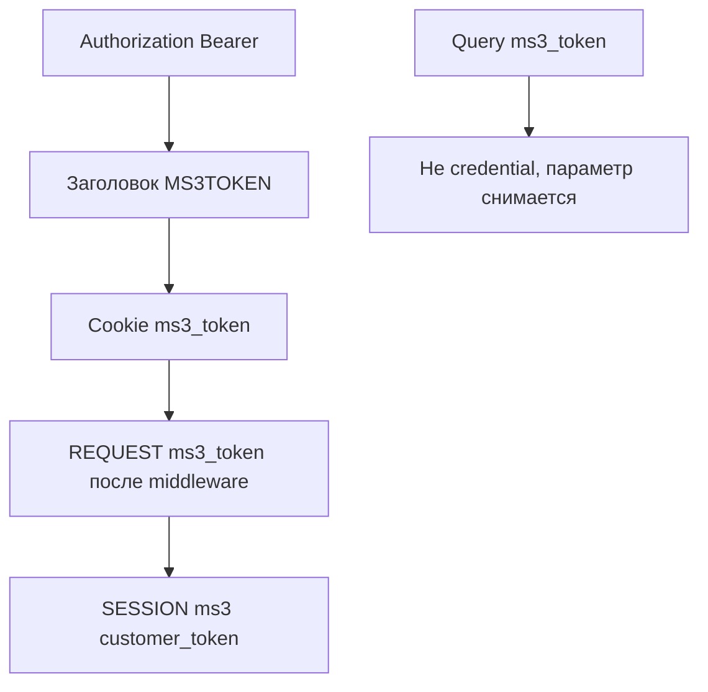
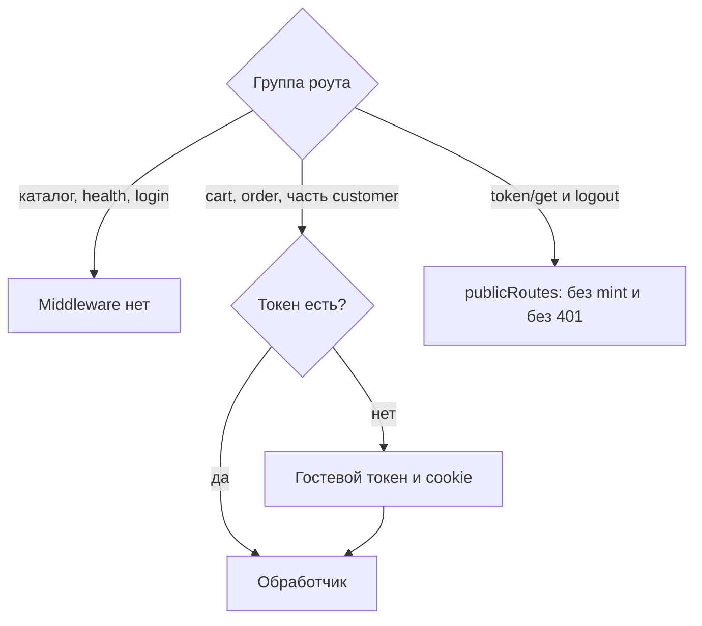

# Авторизация

Web API не использует сессию админки MODX. Клиент передаёт API-токен покупателя: гостевой или авторизованный.

## Где сервер ищет токен



Порядок источников в `TokenService::resolveTokenFromRequest()`:

1. `Authorization: Bearer {token}`
2. Заголовок `MS3TOKEN` (устаревший)
3. httpOnly cookie `ms3_token`
4. `$_REQUEST['ms3_token']` (после middleware, которое подставляет cookie в запрос)
5. `$_SESSION['ms3']['customer_token']`

Query `ms3_token` сервер не принимает как credential и снимает его из query. Параметр `token` в query credentials не является, но и не вычищается: им пользуется `GET /customer/email/verify`. Не копируйте старые примеры с `?ms3_token=` в URL.

## Cookie vs Bearer

| Режим | Как передавать | Когда |
| --- | --- | --- |
| Same-site фронтенд | cookie `ms3_token` + `credentials: 'include'` | Браузер на том же сайте |
| Nuxt BFF / mobile | `Authorization: Bearer` | Другой origin или серверный прокси |

Не храните API-токен в `localStorage`. Для браузера на том же origin основной способ: httpOnly cookie `ms3_token`. Фронтенд: [Frontend JavaScript](/components/minishop3/development/frontend-js).

Cookie наследует параметры сессии MODX: `session_cookie_domain`, `session_cookie_path`, `session_cookie_secure`, `session_cookie_samesite`.

## Auto-mint



На роутах с `TokenMiddleware` (корзина, заказ, часть customer) без валидного токена сервер создаёт гостевой токен и ставит cookie. У каталога и `/health` этого middleware нет.

У `GET /customer/token/get` и `POST /customer/logout` middleware работает в режиме optional: путь указан в `publicRoutes`. Без токена сервер не создаёт гостевой токен и не отвечает 401.

## GET /customer/token/get

| Ключ | Установщик | Если строки нет в базе |
| --- | --- | --- |
| `ms3_customer_token_ttl` | 86400 секунд | fallback кода 604800 |

Публичный. Возвращает текущий или новый токен и ставит httpOnly cookie.

```json
{
  "success": true,
  "message": "",
  "data": {
    "token": "…",
    "lifetime": 86400000
  }
}
```

`lifetime` в миллисекундах до истечения срока: секунды из `ms3_customer_token_ttl`, умноженные на 1000. Поле `expires` есть во внутреннем генераторе, но в `data` не отдаётся.

::: warning Два разных значения TTL в поставке
Транспортный пакет создаёт `ms3_customer_token_ttl` со значением **86400** (24 часа). Именно оно действует на установленном сайте, и свежий токен отдаёт `lifetime` около `86400000`.

Настройки нет: код подставляет **604800** (7 дней). Если ориентироваться на это число, ожидаемое время жизни токена завышено в семь раз. Проверяйте фактическое значение настройки в своём проекте ([issue #848](https://github.com/modx-pro/MiniShop3/issues/848)).
:::

## Login / register

`POST /customer/login` и `POST /customer/register` работают без TokenMiddleware.

| Метод | Тело |
| --- | --- |
| `POST /customer/login` | `email`, `password` |
| `POST /customer/register` | `email`, `password`, `first_name`, `last_name`, `phone`, `privacy_accepted` (bool) |
| `POST /customer/forgot-password` | `email` |
| `POST /customer/reset-password` | `token`, `password`, `password_confirm` |

IP-лимит входа зашит в процессор: 5 попыток за 300 секунд. Настройки `ms3_customer_max_login_attempts` и `ms3_customer_block_duration` он не читает ([баг #902](https://github.com/modx-pro/MiniShop3/issues/902)). Блокировка учётки эти настройки читает. Если строки настройки нет в базе, код берёт длительность блокировки 3600 секунд. Установщик пишет 300 ([баг #898](https://github.com/modx-pro/MiniShop3/issues/898)).

После успеха сервер ротирует токен: отзывает старый гостевой и переносит черновик корзины на сессию покупателя. Новый токен уходит в cookie.

Чтобы при headless-входе корзина привязалась к покупателю, передайте текущий гостевой токен (Bearer или cookie) до вызова.

## GET /customer/me

`TokenMiddleware` и auto-mint. Для гостя ответ успешный: `authenticated: false`, `customer: null`. Невалидный токен даёт 401.

## POST /customer/token/refresh

Ротация валидного токена, в том числе гостевого. При успехе возвращает новый токен и метаданные (`expires_at`, `customer_id`).

## CORS и credentials

Для cookie с другого origin перечислите origins в `ms3_cors_allowed_origins` и отправляйте запросы с `credentials: 'include'`. Значение `*` с credentials несовместимо: см. [CORS](cors).

## См. также

- [Карта эндпоинтов](endpoints)
- [Примеры](examples)
- [Клиент](customer)
