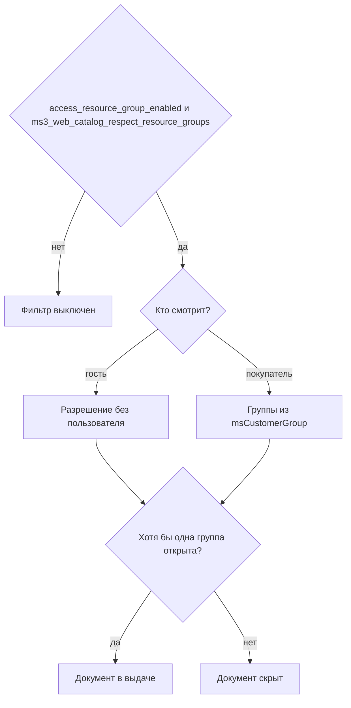

# Каталог

Публичные эндпоинты, API-токен не нужен. Видимость по группам ресурсов общая со сниппетом каталога. Состав JSON задаёт `ProductCatalogService`, а не pdoFetch сниппета.

## Product

| Метод | Путь | Назначение |
| --- | --- | --- |
| `GET` | `/product/get/{id}` | Товар по ID |
| `GET` | `/product/get` | Resolve: параметры `alias` или `uri`, необязательно `context` |
| `GET` | `/product/list` | Список / PLP |
| `GET` | `/product/filters` | Фасеты (те же фильтры, что у `list`) |
| `GET` | `/product/{id}/images` | Галерея |

Параметры `get` и resolve: `context`, `include_images` (0\|1, по умолчанию 0), `include_seo` (по умолчанию 1).

Основные параметры `list`:

| Параметр | Смысл |
| --- | --- |
| `parent` / `category` | ID категории. Игнорируется, если задан `parents`. Оставлен для совместимости |
| `parents` | CSV / массив ID категорий (OR + members) |
| `nested` | 0\|1, раскрыть дерево при `parents` |
| `price_min`, `price_max` | Диапазон цены |
| `in_stock`, `stock_min` | Наличие |
| `vendor_id`, `new`, `popular`, `favorite` | Флаги / производитель |
| `options` | JSON опций |
| `limit`, `offset` / `page` | Пагинация. `limit` по умолчанию 20, максимум 100 |
| `sort`, `dir`, `query`, `context` | Сортировка и поиск |
| `include_options`, `include_content`, `include_images` | Вложения. `include_images` по умолчанию 0. В списке не больше 10 файлов на товар |
| `include_seo` | SEO-блок. У `list` по умолчанию 0, у `get` 1 |

Ответ `list`: `{ items, total, limit, offset }` внутри `data`.

```json
{
  "success": true,
  "message": null,
  "data": {
    "items": [
      { "id": 12, "pagetitle": "Кружка" }
    ],
    "total": 1,
    "limit": 20,
    "offset": 0
  }
}
```

`filters`: те же фильтры, что у `list`, плюс `keys`, `include_price` (по умолчанию 1), `include_vendors` (по умолчанию 0).

`GET /product/{id}/images` и карточка товара отдают до 50 файлов галереи.

## Category

| Метод | Путь | Назначение |
| --- | --- | --- |
| `GET` | `/category/get/{id}` | Категория по ID |
| `GET` | `/category/get` | Resolve по `alias` / `uri` |
| `GET` | `/category/list` | Список |
| `GET` | `/category/tree` | Дерево |

Параметры `get`: `context`, `include_hidden`, `include_content`, `include_breadcrumbs`, `include_children`, `include_seo` (по умолчанию 1).

Параметры `list`: `parent`, `limit`, `offset` или `page`, `sort`, `dir`, `context`, `include_hidden`, `include_content`, `include_seo` (по умолчанию 0).

Параметры `tree`: `parent`, `depth`, `context`, `include_hidden`, `sort`, `dir`, `include_seo` (по умолчанию 0).

## ACL групп ресурсов



Фильтр включён, только если истинны обе настройки: MODX `access_resource_group_enabled` (по умолчанию да) и `ms3_web_catalog_respect_resource_groups` (установщик пишет `true`).

Проверка учитывает гостя и авторизованного покупателя. Гостю ищется разрешение без привязки к пользователю. Покупателю добавляются группы из `msCustomerGroup` через ACL групп пользователей MODX.

Членство считается по принципу «хотя бы одна». Документ виден, если доступ даёт любая из его групп, даже когда другая закрыта.

Выключите `ms3_web_catalog_respect_resource_groups`, чтобы каталог отдавал товары без учёта групп ресурсов.

## Пример

```bash
curl -sS 'https://shop.example/assets/components/minishop3/api.php?route=/api/v1/product/list&parents=10&limit=20'
```

См. также [Примеры](examples), [Frontend: каталог](/components/minishop3/frontend/catalog).
