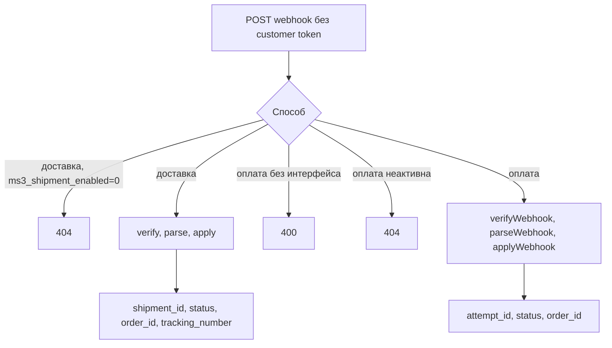
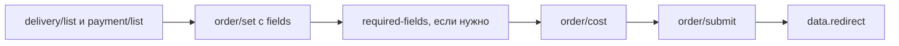

# Checkout

## Публичные списки

Эти эндпоинты доступны без токена покупателя:

| Метод | Путь |
| --- | --- |
| `GET` | `/delivery/list` |
| `GET` | `/delivery/get/{id}` |
| `GET` | `/payment/list` |
| `GET` | `/payment/get/{id}` |

В списки попадают только активные способы (`active = 1`).

| Эндпоинт | Параметры |
| --- | --- |
| `GET /delivery/list` | `include_payments` (по умолчанию 1), `include_required_fields` (по умолчанию 0) |
| `GET /payment/list` | `delivery_id`, `include_delivery_ids` (по умолчанию 0) |

Связку способа доставки и способа оплаты сервер проверяет при оформлении: без допустимой пары `POST /order/submit` вернёт ошибку.

## Вебхуки

Вебхук приходит от платёжного сервиса или службы доставки и авторизуется подписью `handler`, а не токеном покупателя. Префикс путей тот же: `/api/v1`.

| Метод | Путь | Условие |
| --- | --- | --- |
| `POST` | `/delivery/webhook/{delivery_id}` | Нужен handler доставки; при `ms3_shipment_enabled=0` — 404 |
| `POST` | `/payment/webhook/{payment_method_id}` | Нужен `PaymentWebhookHandlerInterface`, иначе 400 |

Для оплаты сервер читает JSON из тела запроса, затем вызывает `verifyWebhook`, `parseWebhook` и `PaymentLifecycleService::applyWebhook`. В успешном ответе приходят `attempt_id`, `status` и `order_id`. Неактивный способ оплаты отвечает на вебхук 404.

Для доставки успешный ответ содержит `shipment_id`, `status`, `order_id` и `tracking_number`. По полю `active` вебхук доставки не фильтрует.

Классические `webhook.php` и `callback.php` у платёжных дополнений остаются рабочими, если класс не реализует интерфейс Web API.

Эти маршруты не проходят `TokenMiddleware`. Строка публичного префикса оплаты в middleware заканчивается слэшем и потому не совпадает с путём `{id}`. Пока middleware не повешен на группу, вебхуков это не затрагивает ([баг #903](https://github.com/modx-pro/MiniShop3/issues/903)).

## Черновик заказа

Все пути `/order/*` проходят `TokenMiddleware` с auto-mint токена.

| Метод | Путь | Назначение |
| --- | --- | --- |
| `GET` | `/order/get` | Черновик |
| `POST` | `/order/add` | Одно поле: тело `key` и `value` |
| `POST` | `/order/set` | Несколько полей: объект `fields`. Плоский JSON без `fields` даёт 400 |
| `POST` | `/order/remove` | Удалить поле: тело `key` |
| `POST` | `/order/clean` | Очистить черновик |
| `POST` | `/order/address/set` | Сохранённый адрес: `address_hash` |
| `POST` | `/order/address/clean` | Сбросить адрес |
| `GET` | `/order/delivery/validation-rules` | Правила полей по доставке |
| `GET` | `/order/delivery/required-fields` | Обязательные поля |
| `GET` | `/order/cost` | Полный расчёт |
| `GET` | `/order/cost/cart` | Только корзина |
| `GET` | `/order/cost/delivery` | Доставка |
| `GET` | `/order/cost/payment` | Комиссия оплаты |
| `POST` | `/order/submit` | Оформить. Необязательный объект `data`. Пустое тело уходит как пустой массив |

В черновике обычно есть `delivery_id`, `payment_id`, `address_*` и контактные поля; точный набор зависит от правил доставки. Скрипт фронтенда для одного поля вызывает `order/add`, а не `order/set`.

### Какие поля фронтенд менять не вправе {#protected-fields}

С 1.14.2-beta1 служебные колонки черновика закрыты для записи с фронтенда. До этого `/order/add` принимал любой ключ с одноимённой колонкой: посетитель с токеном своей корзины мог подставить чужой `customer_id` или обнулить `cost`.

| Объект | Закрытые колонки |
| --- | --- |
| Заказ | `id`, `user_id`, `customer_id`, `token`, `uuid`, `idempotency_key`, `createdon`, `updatedon`, `num`, `cost`, `cart_cost`, `delivery_cost`, `weight`, `status_id`, `context`, `properties` |
| Адрес | `id`, `order_id`, `createdon`, `updatedon`, `properties` |

Писать можно поля формы (`delivery_id`, `payment_id`, `order_comment`), остальные колонки адреса и свои колонки, добавленные через раздел «Свои поля». Ключи, которых нет ни у заказа, ни у адреса, по-прежнему уходят в `properties['_validated']`.

Реакция на закрытый ключ:

| Запрос | Ответ |
| --- | --- |
| `POST /order/add` | `400`, `error_code: business_rule`, лексикон `ms3_err_field_protected` |
| `POST /order/set` | `422`, `error_code: validation_failed`, ключ попадает в `errors` |
| `POST /order/remove` | `404`, лексикон `ms3_err_field_nf` |
| `POST /order/submit` | Ключ в `data` отбрасывается молча, оформление продолжается |

::: tip Запись служебного поля из дополнения
Перечень закрытых колонок задан константами `OrderFieldManager`. Чтобы изменить его, подмените DI-ключ `ms3_order_field_manager` своим подклассом в [`core/config/ms3.services.d/*.php`](/components/minishop3/development/services) — этот каталог лежит вне компонента и переживает обновление. Из PHP служебные поля доступны и без подмены: `OrderDraftManager::updateField()`, `attachCustomer()`, `setDeliveryCost()`.
:::

## POST /order/submit

При успехе URL приходит в JSON — `data.redirect`. Заголовка `Location` у оформления нет: `Response::redirect` применяется при подтверждении email с `html=1`.

Онлайн-оплату выполняет платёжное дополнение. Базовый способ без заданного `class` только фиксирует выбор покупателя.

## Типичный порядок

1. `GET /delivery/list`, `GET /payment/list`
2. `POST /order/set` с объектом `fields`: `delivery_id`, `payment_id`, адрес
3. `GET /order/delivery/required-fields` при необходимости
4. `GET /order/cost`
5. `POST /order/submit`

Фронтенд на Fenom может собирать форму через `msOrder`, а headless-клиент пользуется списками выше. См. [Примеры](examples).
