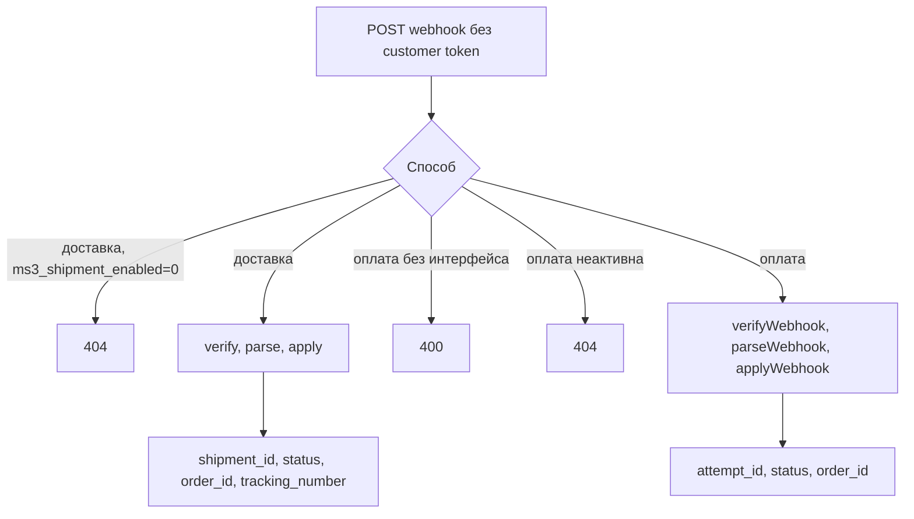
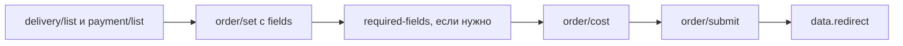

# Checkout

Цепочка headless: каталог → корзина → выбор delivery/payment → поля заказа → cost → submit.

## Публичные списки

Без customer token:

| Метод | Путь |
| --- | --- |
| `GET` | `/delivery/list` |
| `GET` | `/delivery/get/{id}` |
| `GET` | `/payment/list` |
| `GET` | `/payment/get/{id}` |

Список только активных способов (`active = 1`).

У `GET /delivery/list`: `include_payments` по умолчанию 1, `include_required_fields` по умолчанию 0. У `GET /payment/list`: `delivery_id`, `include_delivery_ids` по умолчанию 0.

Связка delivery и payment проверяется при оформлении: без пары submit вернёт ошибку.

## Webhook

Webhook провайдера: подпись `handler`, не customer token. Префикс API: `/api/v1`.

| Метод | Путь | Условие |
| --- | --- | --- |
| `POST` | `/delivery/webhook/{delivery_id}` | Handler доставки + при `ms3_shipment_enabled=0` → 404 |
| `POST` | `/payment/webhook/{payment_method_id}` | Нужен `PaymentWebhookHandlerInterface`, иначе 400 |

Оплата: JSON body, затем `verifyWebhook`, `parseWebhook`, `PaymentLifecycleService::applyWebhook`. Успех: `attempt_id`, `status`, `order_id`. Неактивный способ оплаты на webhook даёт 404.

Доставка в успехе: `shipment_id`, `status`, `order_id`, `tracking_number`. Фильтра по `active` у webhook доставки нет.

Эти маршруты не проходят `TokenMiddleware`. Строка публичного префикса оплаты в middleware заканчивается слэшем. С путём `{id}` она не совпадает. Пока middleware на группу не повешен, webhook это не затрагивает ([баг #903](https://github.com/modx-pro/MiniShop3/issues/903)).

## Черновик заказа

Все `/order/*` с auto-mint токена.

| Метод | Путь | Назначение |
| --- | --- | --- |
| `GET` | `/order/get` | Черновик |
| `POST` | `/order/add` | Одно поле: тело `key` и `value` |
| `POST` | `/order/set` | Несколько полей: объект `fields`. Плоский JSON без `fields` даёт 400 |
| `POST` | `/order/remove` | Удалить поле: тело `key` |
| `POST` | `/order/clean` | Очистить черновик |
| `POST` | `/order/address/set` | Сохранённый адрес: `address_hash` |
| `POST` | `/order/address/clean` | Сбросить адрес |
| `GET` | `/order/delivery/validation-rules` | Правила полей по доставке |
| `GET` | `/order/delivery/required-fields` | Обязательные поля |
| `GET` | `/order/cost` | Полный расчёт |
| `GET` | `/order/cost/cart` | Только корзина |
| `GET` | `/order/cost/delivery` | Доставка |
| `GET` | `/order/cost/payment` | Комиссия оплаты |
| `POST` | `/order/submit` | Оформить. Необязательный объект `data`. Пустое тело уходит как пустой массив |

В черновике типичны `delivery_id`, `payment_id`, `address_*` и контактные поля. Точный набор зависит от правил доставки. Витринный скрипт для одного поля вызывает `order/add`, не `order/set`.

## Submit

Успех кладёт URL в JSON: `data.redirect`. Заголовка `Location` у submit нет. `Response::redirect` используется у подтверждения email при `html=1`.

Онлайн-оплату даёт платёжный extra. Базовый способ без class только фиксирует выбор.

## Типичный порядок

1. `GET /delivery/list`, `GET /payment/list`
2. `POST /order/set` с объектом `fields`: `delivery_id`, `payment_id`, адрес
3. `GET /order/delivery/required-fields` при необходимости
4. `GET /order/cost`
5. `POST /order/submit`

Fenom-витрина может собирать форму через `msOrder`. Headless использует списки выше. См. [Примеры](examples).
