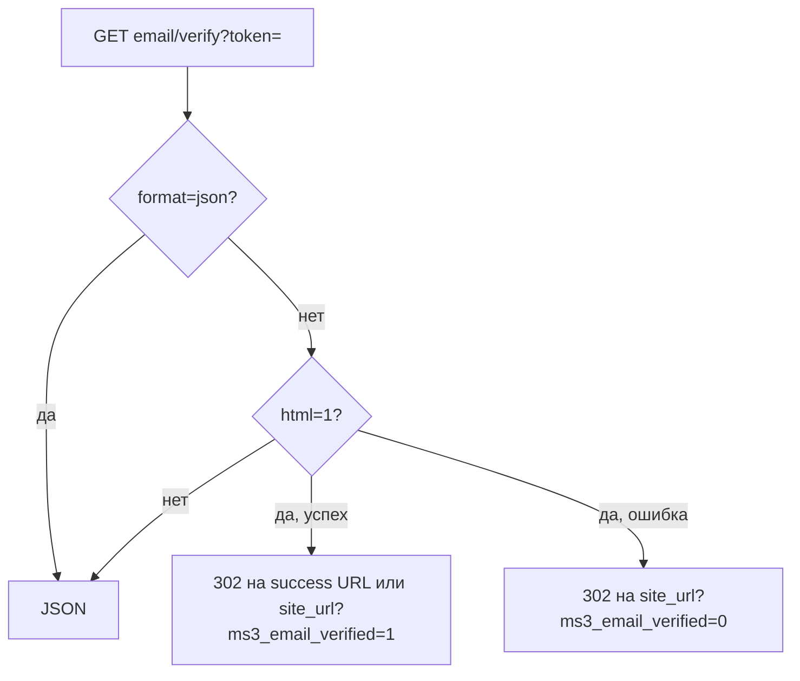

# Клиент

Личный кабинет (ЛК) и профиль покупателя. Вход и регистрация — в [Авторизации](auth).

## Сессия

Ответ `GET /customer/me` для гостя:

```json
{
  "success": true,
  "message": null,
  "data": {
    "authenticated": false,
    "customer": null,
    "token": {
      "expires_at": "2026-10-16 18:00:00",
      "customer_id": 0
    }
  }
}
```

После входа `authenticated` становится `true`, а в `customer` приходят публичные поля: `id`, `first_name`, `last_name`, `email`, `phone`, `email_verified_at`, `is_active`, `created_at`, `updated_at`.

| Метод | Путь | Заметки |
| --- | --- | --- |
| `GET` | `/customer/me` | Для гостя: `authenticated: false`, `customer: null` |
| `POST` | `/customer/token/refresh` | Ротирует и гостевой токен |
| `POST` | `/customer/logout` | Токен необязателен |
| `POST` | `/customer/login` | Без `TokenMiddleware` |
| `POST` | `/customer/register` | Без `TokenMiddleware` |
| `POST` | `/customer/forgot-password` | |
| `POST` | `/customer/reset-password` | |

## Профиль

| Метод | Путь | Заметки |
| --- | --- | --- |
| `PUT` | `/customer/profile` | |
| `POST` | `/customer/add` | Одно поле профиля |
| `POST` | `/customer/changeAddress` | Адрес в черновик заказа |

Сервер принимает только поля профиля из своего списка разрешённых. С гостевым токеном `profile`, `add` и `changeAddress` отвечают ошибкой авторизации; для гостя успешны лишь `me` и `token/refresh`.

В теле `POST /customer/add` — `key` и `value`, в теле `POST /customer/changeAddress` — `address_hash` или `value`.

## Адреса

| Метод | Путь |
| --- | --- |
| `GET` | `/customer/addresses` |
| `GET` | `/customer/addresses/{id}` |
| `POST` | `/customer/addresses` |
| `PUT` | `/customer/addresses/{id}` |
| `DELETE` | `/customer/addresses/{id}` |
| `PUT` | `/customer/addresses/{id}/set-default` |

`POST` отвечает 201. Поля `name`, `city` и `street` обязательны: без них сервер вернёт 422 с `validation_failed`.

## Заказы ЛК

| Метод | Путь |
| --- | --- |
| `GET` | `/customer/orders` |
| `GET` | `/customer/orders/{id}` |
| `POST` | `/customer/orders/{id}/cancel` |

В списке только оформленные заказы покупателя; черновик из `/order/get` в него не входит.

Параметры списка: `limit` (по умолчанию 20, максимум 100), `offset` и `status`. Сам список приходит дважды: под ключом `orders` и под ключом `items`.

Отменить заказ можно в статусах из `ms3_customer_cancel_allowed_statuses`. Если настройка пустая, это статусы new и paid. В успешном ответе приходят `order_id` и `status_id`, а заказ в другом статусе получает 400.

## Email



| Метод | Путь | Заметки |
| --- | --- | --- |
| `GET` | `/customer/email/verify` | Публичный. Query-параметр `token`. С `format=json` всегда JSON, с `html=1` — 302 |
| `POST` | `/customer/email/resend-verification` | Нужен авторизованный токен |

С `html=1` успех ведёт на `ms3_email_verification_success_url` или на `site_url` с `ms3_email_verified=1`, а ошибка — на `site_url?ms3_email_verified=0`.

Свой адрес ссылки в письме задаёт `ms3_email_verification_url`; в шаблоне работают и `[[+token]]`, и `{token}`. Если настройка пустая, ссылка ведёт на `api.php?route=…/email/verify` и уже содержит `html=1`.

## Связанные страницы

- [Frontend: авторизация](/components/minishop3/frontend/customer-auth)
- [Карта эндпоинтов](endpoints)
- [Примеры](examples)
