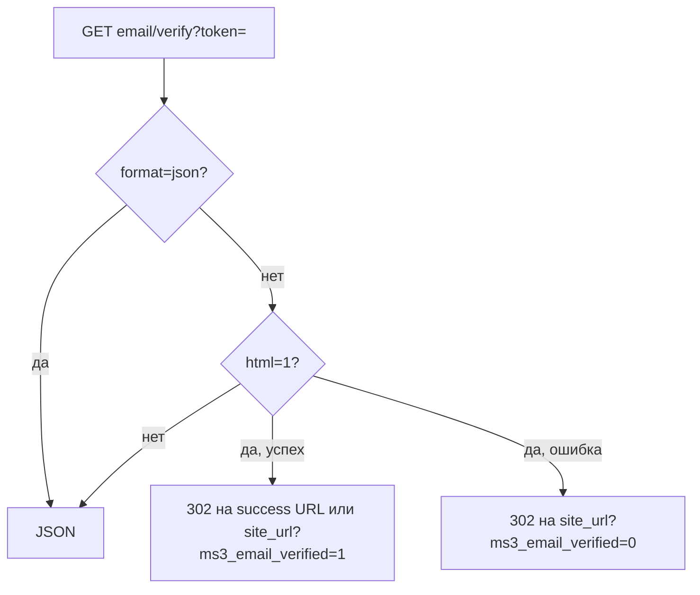

# Клиент

ЛК и профиль покупателя. Вход и регистрация: [Авторизация](auth).

## Сессия

Гость:

```json
{
  "success": true,
  "message": null,
  "data": {
    "authenticated": false,
    "customer": null,
    "token": {
      "expires_at": "2026-10-16 18:00:00",
      "customer_id": 0
    }
  }
}
```

После login в `customer` приходят публичные поля: `id`, `first_name`, `last_name`, `email`, `phone`, `email_verified_at`, `is_active`, `created_at`, `updated_at`. `authenticated` тогда `true`.

| Метод | Путь | Заметки |
| --- | --- | --- |
| `GET` | `/customer/me` | Гость: `authenticated: false`, `customer: null` |
| `POST` | `/customer/token/refresh` | Ротирует и гостевой токен |
| `POST` | `/customer/logout` | токен необязателен |
| `POST` | `/customer/login` | без middleware |
| `POST` | `/customer/register` | без middleware |
| `POST` | `/customer/forgot-password` | |
| `POST` | `/customer/reset-password` | |

## Профиль

| Метод | Путь | Заметки |
| --- | --- | --- |
| `PUT` | `/customer/profile` | |
| `POST` | `/customer/add` | Быстрое одно поле |
| `POST` | `/customer/changeAddress` | Адрес в черновик заказа |

Сервер режет поля профиля по allowlist. Гостевой токен на `profile`, `add` и `changeAddress` получает ошибку авторизации. `me` и `token/refresh` для гостя успешны.

`POST /customer/add`: тело `key` и `value`. `POST /customer/changeAddress`: `address_hash` или `value`.

## Адреса

| Метод | Путь |
| --- | --- |
| `GET` | `/customer/addresses` |
| `GET` | `/customer/addresses/{id}` |
| `POST` | `/customer/addresses` |
| `PUT` | `/customer/addresses/{id}` |
| `DELETE` | `/customer/addresses/{id}` |
| `PUT` | `/customer/addresses/{id}/set-default` |

`POST` отвечает 201. Обязательны `name`, `city`, `street`. Без них 422 `validation_failed`.

## Заказы ЛК

| Метод | Путь |
| --- | --- |
| `GET` | `/customer/orders` |
| `GET` | `/customer/orders/{id}` |
| `POST` | `/customer/orders/{id}/cancel` |

Оформленные заказы покупателя. Черновик `/order/get` в список не входит.

Параметры списка: `limit` (по умолчанию 20, максимум 100), `offset`, `status`. В ответе есть и `orders`, и алиас `items`.

Отмена разрешена для статусов из `ms3_customer_cancel_allowed_statuses`. Если настройка пустая, разрешены статусы new и paid. Успех: `order_id`, `status_id`. Статус вне списка даёт 400.

## Email



| Метод | Путь | Заметки |
| --- | --- | --- |
| `GET` | `/customer/email/verify` | Публичный. Query `token`. `format=json` всегда JSON. `html=1` отвечает 302 |
| `POST` | `/customer/email/resend-verification` | Нужен авторизованный токен |

`html=1` ведёт на `ms3_email_verification_success_url` или на `site_url` с `ms3_email_verified=1`. Ошибка ведёт на `site_url?ms3_email_verified=0`.

Свой URL письма: `ms3_email_verification_url`. В шаблоне принимаются `[[+token]]` и `{token}`. Если настройка пустая, ссылка уже содержит `html=1` и ведёт на `api.php?route=…/email/verify`.

## Связанные страницы

- [Frontend: авторизация](/components/minishop3/frontend/customer-auth)
- [Карта эндпоинтов](endpoints)
- [Примеры](examples)
