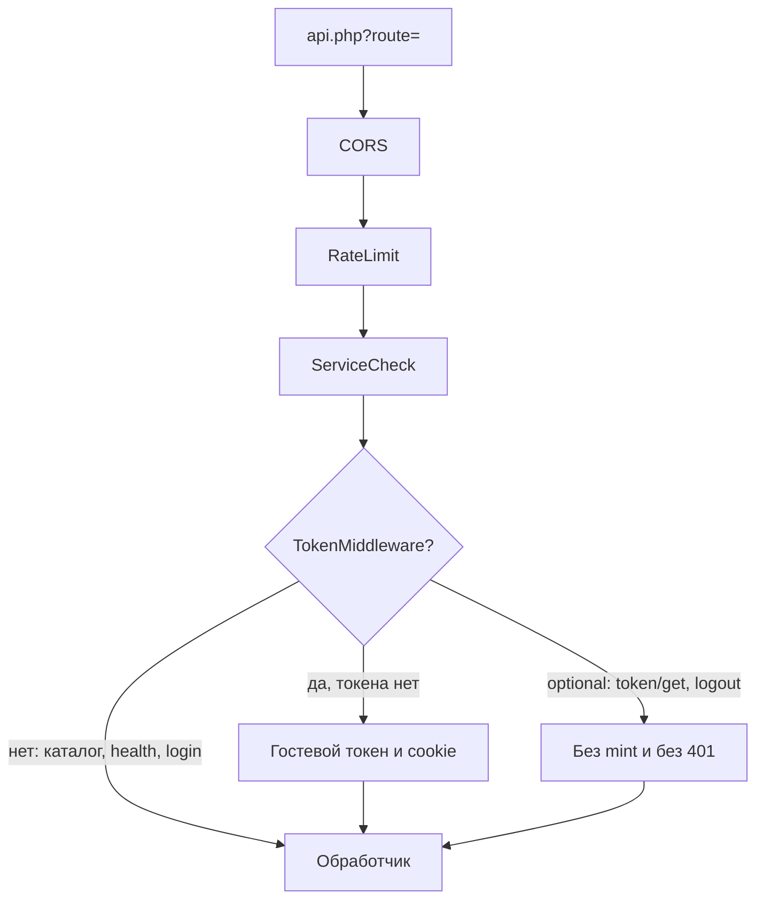

# Web API

Точка входа фронтенда и headless:

```text
/assets/components/minishop3/api.php?route=/api/v1/{path}
```

Параметр `route` обязателен. Группа `/api/v1` всегда проходит три middleware: CORS → RateLimit → ServiceCheck. `TokenMiddleware` стоит только на cart, order и части customer.

Manager API (`connector.php`) на этой странице не описан.

## Формат ответа

Пустой `route` отвечает 400 до роутера:

```json
{
  "success": false,
  "message": "Route parameter is required",
  "code": 400
}
```

Ответ роутера: `success`, `message` и `data`. У ошибки ещё `code`, `errors` и `error_code`.

**Успех.** `message` чаще `null`. Пустая строка бывает, когда вызывающий код передал `''`.

```json
{
  "success": true,
  "message": null,
  "data": {}
}
```

**Ошибка:**

```json
{
  "success": false,
  "message": "…",
  "code": 400,
  "errors": null,
  "error_code": "bad_request"
}
```

В ответе роутера ключи `errors` и `error_code` есть всегда (`errors` часто `null`). До роутера при пустом `route` этих ключей нет. Подробнее: [Ошибки](errors).

## Middleware



| Порядок | Middleware | Назначение |
| --- | --- | --- |
| 1 | `CorsMiddleware` | Origins из `ms3_cors_allowed_origins` |
| 2 | `RateLimitMiddleware` | `ms3_rate_limit_*` |
| 3 | `ServiceCheckMiddleware` | Сервисы MS3 доступны |
| (по роуту) | `TokenMiddleware` | Resolve / auto-mint токена |

Настройки CORS и rate limit: [CORS](cors), [Системные настройки](/components/minishop3/settings#api).

## Разделы

1. [Авторизация](auth)
2. [Карта эндпоинтов](endpoints)
3. [Каталог](catalog)
4. [Корзина](cart)
5. [Checkout](checkout)
6. [Клиент](customer)
7. [Ошибки](errors)
8. [CORS и rate limit](cors)
9. [Примеры](examples)

Свои роуты и детали FastRoute: [API Router](/components/minishop3/development/routing).
