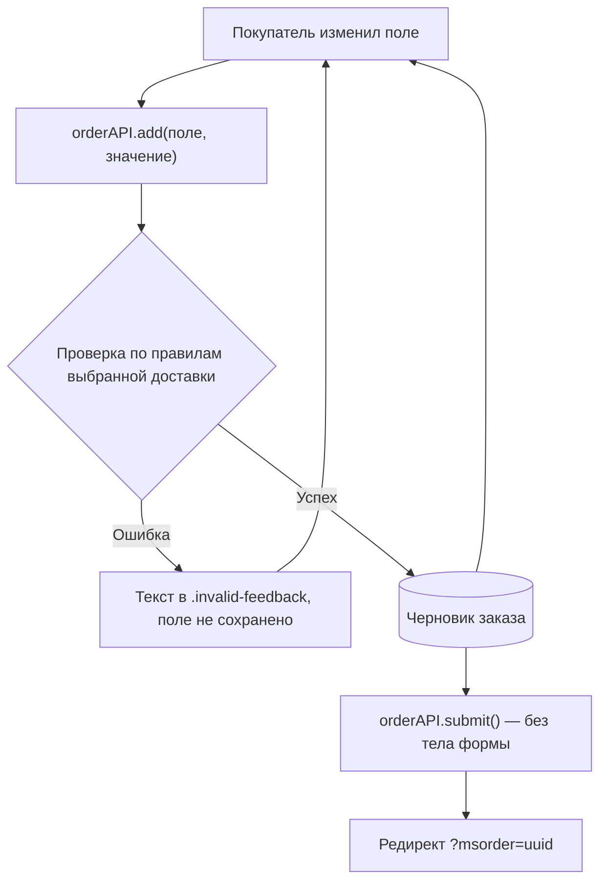

# Оформление заказа

Последний шаг покупки: контакты, доставка, оплата, адрес. Шаблон и чанк формы уже есть в пакете.


## Структура страницы

| Компонент | Файл | Имя чанка в БД | Назначение |
| --- | --- | --- | --- |
| Шаблон страницы | `elements/templates/order.tpl` | — | Разметка страницы, вызов msOrder |
| Чанк формы | `elements/chunks/ms3_order.tpl` | `tpl.msOrder` | Форма оформления заказа |

### Вызов сниппета

```fenom
{'!msOrder' | snippet : [
    'tpl' => 'tpl.msOrder'
]}
```

::: warning Кэширование
Сниппет msOrder должен вызываться **некэшированно** (`!msOrder`), так как работает с сессией пользователя.
:::

Форма не отправляется целиком. Каждое поле уходит на сервер отдельным запросом сразу после изменения и наполняет черновик заказа; кнопка «Оформить» отправляет пустой запрос, а заказ собирается из накопленного черновика.



Две частые ошибки: форма без `data-ms3-form="order"` и поле без обёртки `<div>` не доводят значения до черновика. При отправке покупатель видит ошибку о незаполненных полях, хотя заполнил всё.

## Форма заказа

| Секция | Описание |
| --- | --- |
| Пустая корзина | Сообщение и ссылка на каталог (если корзина пуста) |
| Контактные данные | Имя, фамилия, email, телефон, комментарий |
| Способы оплаты | Радиокнопки с логотипом и описанием |
| Способы доставки | Радиокнопки с логотипом и описанием |
| Адрес доставки | Индекс, регион, город, улица, дом, подъезд, этаж, квартира |
| Сохранённые адреса | Выпадающий список ранее сохранённых адресов (для авторизованных) |
| Итоговая панель | Стоимость товаров, доставки, итого, кнопки отмены и оформления |

### Плейсхолдеры

Доступны в чанке формы:

| Плейсхолдер | Тип | Описание |
| --- | --- | --- |
| `$isCartEmpty` | bool | Корзина пуста |
| `$form` | array | Значения полей формы (`$form.first_name`, `$form.email` и т.д.) |
| `$order` | array | Данные заказа (`$order.cost`, `$order.delivery_cost`, `$order.cart_cost`) |
| `$deliveries` | array | Способы доставки |
| `$payments` | array | Способы оплаты |
| `$addresses` | array | Сохранённые адреса клиента |
| `$isCustomerAuth` | bool | Клиент авторизован |

### Связь доставки и оплаты

У каждой доставки в данных есть массив `payments` с ID допустимых оплат. Связки задают в админке в карточке доставки (`msDeliveryMember`).

Фильтрацию оплат при смене доставки на фронтенде реализуйте сами: пакет проверяет пару только на сервере. Недопустимая пара вернёт ошибку при submit и при финализации в админке.

## Гость и авторизованный покупатель

| Режим | Что происходит |
| --- | --- |
| Гость | Заполняет контакты вручную. Сохранённых адресов нет |
| Авторизован | В форме есть список адресов. Контакты можно подтянуть из профиля |

### Авторегистрация при заказе

Ключи:

- `ms3_customer_auto_register_on_order` (по умолчанию включено)
- `ms3_customer_auto_login_on_order` (по умолчанию включено)

При submit гость с валидным email может получить запись `msCustomer` и сессию без отдельной регистрации. Отключите ключи, если регистрация только через форму ЛК.

Отдельно: `ms3_order_register_user_on_submit` создаёт `modUser` при оформлении (по умолчанию выключено). Это не то же самое, что `msCustomer`.

Вход и регистрация вручную: [Вход и регистрация](/components/minishop3/frontend/customer-auth).

## Валидация

### Как работает валидация полей

Обязательные поля и правила задают **для каждого способа доставки** в админке. Курьеру нужен адрес, самовывозу часто хватает телефона и email.

Настройка правил: [Доставки → Валидация](/components/minishop3/interface/settings/deliveries#validaciya-poley-zakaza).

### Процесс валидации

1. При смене доставки `OrderUI` сохраняет значение в черновик и пересчитывает стоимость.
2. При `ms3.orderAPI.add(key, value)` сервер проверяет поле по правилам текущей доставки.
3. При submit сервер проверяет все обязательные поля.
4. При ошибке submit `OrderUI` ставит атрибут `data-ms3-error` и класс `ms3_field_error` на поле. При ошибке автосохранения отдельного поля он же добавляет `is-invalid` и пишет текст в `.invalid-feedback`.

Пакет не скрывает поля при смене доставки. Методы `GET /api/v1/order/delivery/validation-rules` и `GET /api/v1/order/delivery/required-fields` в Web API есть, но фронтенд их не вызывает. Поведение формы при смене доставки настройте сами.

### Сохранённые адреса

Сниппет `msOrder` подключает `order-addresses.js` (не входит в `ms3_frontend_assets`). В чанке — `<select id="saved_address_id">` с `<option data-address='{"city":"..."}'>`: при выборе поля формы заполняются автоматически.

Два API-пути:

| Сценарий | Метод API |
| --- | --- |
| Checkout: применить адрес к черновику | `POST /api/v1/order/address/set` |
| Выбор адреса из списка (`CustomerUI` / msCustomer) | `POST /api/v1/customer/changeAddress` |

Сброс адресных полей: `POST /api/v1/order/address/clean`.

### Свои поля формы (`_validated`)

Поле, которого нет ни у заказа, ни у адреса (например чекбокс согласия `agreement`), уходит в черновик и хранится в `msOrder.properties['_validated']`. На событиях создания заказа такие поля доступны как `customFields`.

На фронтенде чекбокс должен слать `input.checked` (`1` / `0`), не статичный `value`. Для согласия используйте правило `accepted` в доставке.

::: tip Своё поле с именем колонки заказа не пройдёт
Служебные колонки закрыты с 1.14.2-beta1: на такой ключ сервер ответит ошибкой, в свойства он не попадёт. Перечень — в разделе [какие поля фронтенд менять не вправе](/components/minishop3/development/web-api/checkout#protected-fields).
:::

## JavaScript API

Публичный фасад — `ms3.orderAPI` (не `ms3.order`). Форма вызывает его через `OrderUI`.

```javascript
// Оформить заказ
const response = await ms3.orderAPI.submit()
if (response.success) {
  window.location.href = response.data.redirect
}

// Способ доставки / оплаты
await ms3.orderAPI.add('delivery_id', deliveryId)
await ms3.orderAPI.add('payment_id', paymentId)

// Поля адреса и заказа
await ms3.orderAPI.add('city', 'Москва')
await ms3.orderAPI.add('order_comment', 'Позвонить перед доставкой')
// address.comment (комментарий к адресу): await ms3.orderAPI.add('comment', '…')
```

### Хуки

DOM-событий `ms3:order:*` нет. Используйте hooks:

```javascript
ms3Hooks.addHook('beforeSubmitOrder', async (data) => {
  // Данных о заказе здесь нет — объект пустой.
  // Поля формы доступны в хуке beforeFormSubmit, здесь можно только отменить отправку
  data.cancel = true
})

ms3Hooks.addHook('afterSubmitOrder', async ({ response }) => {
  if (response.success) {
    console.log('order_id:', response.data.order_id)
  }
})

ms3Hooks.addHook('afterAddOrder', async ({ key, value, response }) => {
  if (key === 'delivery_id') {
    console.log('Доставка:', value)
  }
})
```

| Хук | Когда |
| --- | --- |
| `beforeAddOrder` / `afterAddOrder` | Поле черновика через `orderAPI.add` |
| `afterUpdateOrderCosts` | После пересчёта сумм (только `after`) |
| `beforeSubmitOrder` / `afterSubmitOrder` | Оформление заказа |
| `beforeCleanOrder` / `afterCleanOrder` | Очистка черновика |

См. [Frontend JS — хуки](/components/minishop3/development/frontend-js).

## Серверные события

### События полей заказа

| Событие | Когда | Параметры |
| --- | --- | --- |
| `msOnBeforeAddToOrder` | Перед добавлением поля | `key`, `value`, `draft` |
| `msOnAddToOrder` | После добавления поля | `key`, `value`, `draft` |
| `msOnBeforeRemoveFromOrder` | Перед удалением поля | `key`, `draft` |
| `msOnRemoveFromOrder` | После удаления поля | `key`, `draft` |

### События валидации

| Событие | Когда | Параметры |
| --- | --- | --- |
| `msOnBeforeValidateOrderValue` | Перед валидацией значения | `key`, `value`, `orderData` |
| `msOnValidateOrderValue` | Валидация пройдена | `key`, `value` |
| `msOnErrorValidateOrderValue` | Ошибка валидации | `key`, `value`, `error` |

### События оформления

| Событие | Когда | Параметры |
| --- | --- | --- |
| `msOnSubmitOrder` | Перед началом оформления | `handler`, `draft`, `orderData`, `data` |
| `msOnBeforeCreateOrder` | Перед созданием заказа | `handler`, `msOrder` |
| `msOnCreateOrder` | После создания заказа | `handler`, `msOrder` |

Полные списки параметров и примеры плагинов: [События заказа](/components/minishop3/development/events/order).

## Кастомизация

### Изменение формы заказа

1. Создайте свой чанк, например `tpl.myOrder`
2. Укажите его в вызове: `'tpl' => 'tpl.myOrder'`
3. Используйте доступные плейсхолдеры из [документации msOrder](/components/minishop3/snippets/msorder)

### Добавление своих полей

Поле, которого нет ни у заказа, ни у адреса, проходит два шага.

**1. Валидация.** Добавьте правила в [настройках доставки](/components/minishop3/interface/settings/deliveries#validaciya-poley-zakaza):

```json
{
  "first_name": "required",
  "email": "required|email",
  "agree": "accepted"
}
```

**2. Сохранение.** Стандартные поля (`first_name`, `email`, `city` и т.д.) пишутся сами. Чужие ключи (не из `msOrder` / `msOrderAddress`) кладите в `properties` заказа плагином, если они нужны после оформления:

<!-- FACT? выше сказано, что такие ключи сами уходят в `properties['_validated']`, а пример читает их из `properties` адреса -->

```php
switch ($modx->event->name) {
    case 'msOnBeforeCreateOrder':
        // $msOrder доступен из параметров события
        $address = $msOrder->Address;
        if ($address) {
            $properties = $msOrder->get('properties') ?: [];
            $properties['agree'] = $address->get('properties')['agree'] ?? '';
            $msOrder->set('properties', $properties);
        }
        break;
}
```

### Адаптивная вёрстка

Форма использует Bootstrap 5 Grid:

| Экран | Колонки |
| --- | --- |
| < 992px | По одной секции в ряд (100%) |
| ≥ 992px | По две секции в ряд (50% + 50%) |
