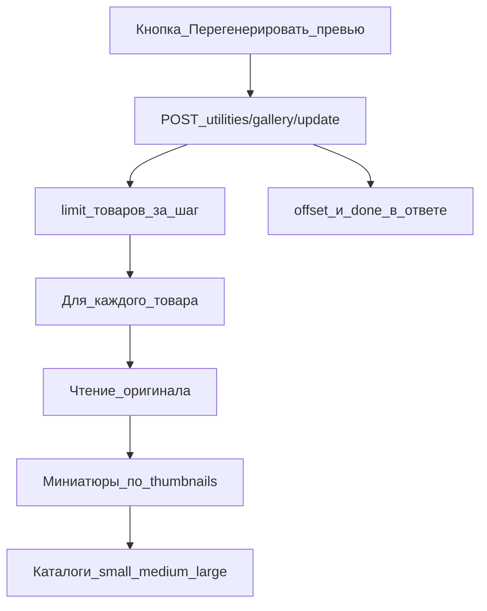

# Утилиты: Галерея

Массовая перегенерация миниатюр всех товаров.

## Назначение

При загрузке в галерею MiniShop3 сразу создаёт миниатюры разных размеров. Утилита нужна, если вы сменили настройки превью или хотите пересобрать все миниатюры.

## Когда использовать

- После изменения JSON `thumbnails` в Media Source
- После миграции сайта на новый сервер
- После массового обновления изображений через FTP
- При повреждении или отсутствии миниатюр
- После обновления MiniShop3 с изменениями в обработке изображений

## Интерфейс

Перегенерация запускается кнопкой и идёт порциями:



### Информационная панель

Текущее состояние галереи:

- **Выбранный источник файлов** — название и ID источника. Берётся из системной настройки `ms3_product_source_default` (по умолчанию 1). Если источник с таким id удалён, панель и блок настроек превью останутся пустыми, хотя товары в каталоге есть
- **Всего товаров** — все товары каталога, наличие галереи не учитывается
- **Изображений** — только оригиналы (`msProductFile` с `parent_id = 0`), превью в счёт не идут

### Настройки превью

Сворачиваемая секция выводит JSON каждого ключа из свойства **`thumbnails`** Media Source товаров (тот же источник, что у галереи). Пример вида: `small: {"width":120,"height":120,"mode":"cover",…}`.

::: tip Ключ превью в карточке
`ms3_product_thumbnail_size` (по умолчанию `small`) — **имя ключа** из `thumbnails`, которое подставляется в поле превью товара в админке. Сами размеры правятся в источнике файлов: **Медиа → Источники файлов → свойство `thumbnails`**. Если JSON пуст, используется запасной вариант `small` 120×120.
:::

### Параметры обработки

| Параметр | Описание | По умолчанию |
| --- | --- | --- |
| Товаров за шаг | Количество товаров, обрабатываемых за одну итерацию. Допустимо от 1 до 100, стрелки меняют значение шагом 5 | 10 |

::: warning Рекомендации

Значения эмпирические, подбираются под сервер — в коде закреплено только значение по умолчанию (10).

- Для слабых серверов уменьшите значение до 5
- Для мощных серверов можно увеличить до 20-30
- Большие значения могут привести к таймауту
:::

## Процесс работы

1. Проверьте настройки превью и место на диске, запускайте в период низкой нагрузки.
2. Нажмите **«Перегенерировать превью»**: утилита обрабатывает товары порциями, на странице видны процент и текущая итерация.
3. Процесс можно прервать, закрыв страницу. После завершения показано число обработанных товаров, кнопка **«Сбросить»** готовит новый запуск.

Кнопка запуска заблокирована, пока «Всего товаров» равно нулю. Итерации идут рекурсивными запросами без пауз: следующая уходит сразу после ответа предыдущей, так что нагрузкой управляет только размер шага.

## Техническая информация

### Процессор

Утилита вызывает `MiniShop3\Processors\Utilities\Gallery\Update` (manager API или `$modx->runProcessor()` с полным именем класса).

### API-эндпоинт

```http
POST /api/mgr/utilities/gallery/update
```

Требуется право `msproductfile_generate`.

**Параметры:**

- `limit` — количество товаров за итерацию
- `offset` — смещение (для пагинации)

**Ответ:**

```json
{
  "success": true,
  "data": {
    "updated": 10,
    "total": 150,
    "offset": 10,
    "done": false,
    "limit": 10
  }
}
```

### Процесс обработки

Для каждого товара утилита сначала **удаляет из базы все дочерние записи превью**, затем читает оригиналы, создаёт миниатюры по ключам свойства `thumbnails` и обновляет поле `thumb` товара.

::: warning Прерванный прогон оставляет товары без превью
Удаление идёт до генерации, поэтому обрыв на середине (закрыли страницу, упал PHP) оставит часть товаров со старыми записями, снесёнными, но не созданными заново. Лечится повторным запуском утилиты для тех же товаров.
:::

### Хранение файлов

Имена директорий — это ключи свойства `thumbnails` вашего Media Source, расширение файла берётся из `format` ключа. В поставке таких ключей четыре: `thumb`, `small`, `medium` (webp) и `large` (jpg). Имя файла совпадает с именем загруженного — это режим `imageNameType: friendly`, заданный по умолчанию. Вид такой:

```text
assets/images/products/
├── {product_id}/
│   ├── smartphone.jpg     # Оригинал (имя загруженного файла)
│   ├── thumb/             # 150×150 webp
│   │   └── smartphone.webp
│   ├── small/             # 300×300 webp
│   │   └── smartphone.webp
│   ├── medium/            # 600×600 webp
│   │   └── smartphone.webp
│   └── large/             # 1200×1200 jpg
│       └── smartphone.jpg
```

## Решение проблем

### Процесс прерывается

**Симптом:** Обработка останавливается на определённом проценте.

**Решения:**

- Уменьшите количество товаров за шаг
- Увеличьте `max_execution_time` в PHP
- Проверьте логи ошибок сервера

### Миниатюры не создаются

**Симптом:** После завершения превью отсутствуют.

**Проверьте:**

- Права на запись в базовый каталог медиа-источника товаров. По умолчанию это `assets/images/products/`, но путь берётся из свойства `basePath` источника и может быть другим
- Наличие драйвера для Intervention Image v3 — расширение `gd` или `imagick`. Какой из них используется, определяется окружением PHP
- Корректность настроек превью в системных настройках

### Ошибка «Нет товаров»

**Симптом:** Нет товаров для обработки.

**Причины:**

- В каталоге нет ни одного товара либо `offset` вышел за пределы выборки

Других причин у этой ошибки нет: наличие изображений и состояние таблицы галереи на неё не влияют, товары без картинок обрабатываются молча.
