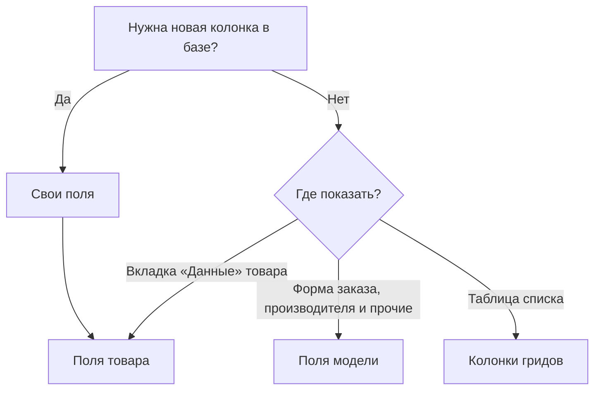

# Cookbook админки

Краткие сценарии для интегратора: поля и колонки в админке MiniShop3 без правки PHP-ядра. Справочники API и xtype смотрите в [Утилитах](/components/minishop3/interface/utilities).

## Требования

MiniShop3 **1.14.x**, MODX 3, Vue-менеджер из пакета.

## Когда что выбирать

| Инструмент | Таблица | Задача |
| --- | --- | --- |
| [Свои поля](/components/minishop3/interface/utilities/extra-fields) | `ms3_extra_fields` | Новая колонка в БД и виджет в форме |
| [Поля модели](/components/minishop3/interface/utilities/model-fields) | `ms3_model_fields` | Формы заказа и vendor: секции, порядок и xtype для **существующих** колонок |
| [Поля товара](/components/minishop3/interface/utilities/product-fields) | `ms3_product_fields` | Раскладка вкладки «Данные» (`page_key=product_data`) |

Колонки списков настраиваются отдельно: [Колонки гридов](/components/minishop3/interface/utilities/grid-columns).

## Права

| Действие | Политика |
| --- | --- |
| GET списка своих полей | сессия менеджера |
| CRUD своих полей, полей модели, полей товара (запись) | `mssetting_save` |
| PUT grid-config (порядок, типы колонок) | `mssetting_save` |
| GET grid-config, списки товаров в категориях | `view_document` |
| GET списков заказов | `msorder_list` |
| Карточка заказа | чтение `msorder_list`, запись `msorder_save` |

## Подробные сценарии

| Страница | Что получите |
| --- | --- |
| [Поле в заказе](/components/minishop3/manager/examples/order-custom-field) | Своё текстовое поле на карточке заказа |
| [Поле у товара](/components/minishop3/manager/examples/product-extra-field) | Своё числовое поле + секция на вкладке «Данные» |
| [Свои поля](/components/minishop3/manager/extra-fields/cookbook) | xtype, repeater, key-value |
| [Поля модели](/components/minishop3/manager/model-fields/cookbook) | Секции, visible list, связь с page-fields |
| [Поля товара](/components/minishop3/manager/product-fields/cookbook) | Секции и visible на вкладке «Данные» |
| [Колонки грида](/components/minishop3/manager/grid-config/cookbook) | Badge, price, inline-edit в категории |
