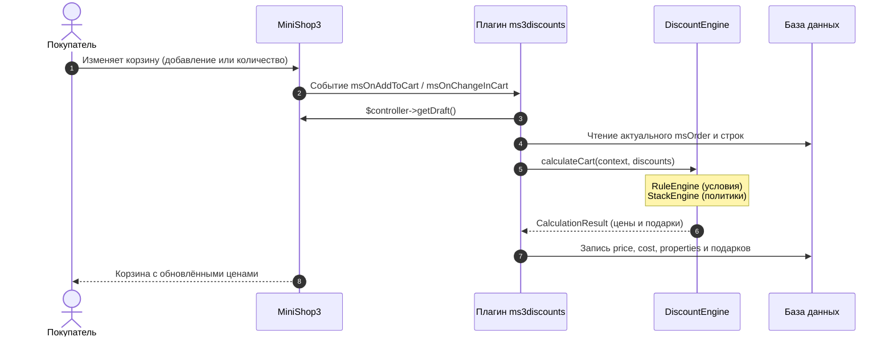
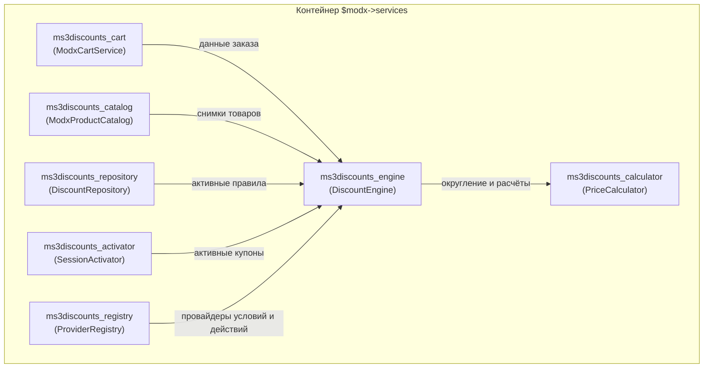

# Интеграция

На обычном магазине корзину не подключают сниппетами ms3Discounts. Плагин записывает скидки в draft-заказ MiniShop3. Сниппеты ставьте только на карточке товара, в каталоге и в блоке «Успей купить».

## Что сделать на сайте

1. Включите настройку `ms3discounts_enabled`.
2. Создайте активное правило в **Компоненты → Скидки**. Флаги `show_in_catalog` и `show_in_product` влияют только на витрину и не отключают действие скидки в корзине.
3. Оставьте стандартные чанки `msCart` MiniShop3. После добавления товара плагин сразу пишет итоговую сумму со скидкой в `price` и `cost`.
4. Для показа зачёркнутой цены или суммы скидки выводите значения из `properties` позиции. Отдельного JS для корзины в пакете нет.
5. После сохранения правил очистите кэш. Затем измените количество, добавьте товар или перейдите к оформлению заказа. Простое открытие страницы корзины пересчёт не запускает.

Доставку и оплату пакет не изменяет. В массив `cart['discounts']` данные не записываются.

## Как устроен пересчёт



| Событие | Что делает |
| --- | --- |
| `msOnAddToCart`, `msOnChangeInCart`, `msOnRemoveFromCart`, `msOnBeforeGetOrderCost` | Получает draft-заказ, пересчитывает правила скидок и сохраняет строки заказа. |
| `msOnGetStatusCart` | Суммирует `properties.discount_cost` по строкам заказа в `status.total_discount`. Сами цены заново не пересчитывает. |
| `msOnGetProductPrice` | Считает цену одной позиции вне контекста корзины (`hasCart = false`). Условия, зависящие от состава корзины, возвращают статус `undetermined` и цену не меняют. |

### Последовательность работы плагина

1. В событиях изменения корзины плагин получает контроллер через `$scriptProperties['controller']` и извлекает заказ вызовом `$controller->getDraft()`.
2. Плагин повторно читает заказ из базы и берёт актуальный список позиций.
3. Базой для расчёта служит `properties.original_price`, затем цена из каталога `msProductData.price`, затем текущий `price` строки. Метод `getPrice()` не вызывается.
4. Движок отбирает активные правила по товару, категории и производителю. Правила без include-целей действуют на все товары корзины.
5. Плагин обновляет в позициях поля `price` и `cost` (`price × count`) и сохраняет детализацию в `properties`.
6. Для подарочных акций плагин добавляет отдельную строку заказа либо удаляет её, если условия перестали выполняться.
7. В свойства заказа (`properties`) сохраняется ключ `ms3discounts_hash`. В хеш входят ID пользователя, группы пользователей, контекст, ревизия правил, текущий час (`Y-m-d H`), состав строк (ID, количество, опции) и активные купоны. Если хеш не изменился, повторная перезапись позиций пропускается.

## Поля позиции корзины

<!--  -->

После пересчёта обычная строка корзины содержит:

| Куда | Поле | Смысл |
| --- | --- | --- |
| строка | `price` | Итоговая цена единицы товара со скидкой. |
| строка | `cost` | Общая стоимость позиции (`price × count`). |
| `properties` | `original_price` | Базовая цена единицы товара до скидок. |
| `properties` | `old_price` | Старая цена из каталога либо `original_price`. |
| `properties` | `discount_price` | Размер скидки на одну штуку товара. |
| `properties` | `discount_cost` | Общая сумма скидки на всю позицию. |
| `properties` | `discount_percent` | Итоговый процент скидки. |
| `properties` | `discounts` | Список применённых правил: `id`, `name`, `action_type`, `value`, `discount`. |

Подарочная позиция создаётся с полями `price = 0` и `cost = 0`. В её `properties` записываются `ms3discounts_gift = true` и `discount_id`. Поля `original_price`, `old_price`, `discount_price`, `discount_cost` и `discount_percent` равны `0`. В шаблоне процент будет `0`. Такие строки исключаются из расчёта других скидок.

Пример вывода в чанке строки корзины:

::: code-group

```fenom
{$price}
{$cost}
{$properties.original_price}
{$properties.discount_cost}
```

```modx
[[+price]]
[[+cost]]
[[+properties.original_price]]
[[+properties.discount_cost]]
```

:::

Поле `total_discount` в статусе корзины равно сумме всех `properties.discount_cost` товарных позиций.

## Сервисы контейнера



| Сервис | Класс / Назначение |
| --- | --- |
| `ms3discounts_engine` | `DiscountEngine`: расчёт скидок корзины и единичных товаров. |
| `ms3discounts_repository` | `DiscountRepository`: поиск и фильтрация кандидатов скидок. |
| `ms3discounts_activator` | `DiscountActivatorInterface`: программная активация скидок. |
| `ms3discounts_registry` | `ProviderRegistry`: реестр провайдеров условий и действий. |
| `ms3discounts_calculator` | `PriceCalculator`: математические операции и округление цен. |
| `ms3discounts_catalog` | `ModxProductCatalog`: получение снимков данных товаров каталога. |
| `ms3discounts_cart` | `ModxCartService`: интеграция с заказами и корзиной MiniShop3. |

## Программная активация скидок

Скидки с включённым флагом «Только после активации» применяются только после регистрации их ID через сервис активатора:

```php
$activator = $modx->services->get('ms3discounts_activator');

// Активировать скидку с ID 12
$activator->activateDiscount(12, 'promocode');

// Отключить скидку
$activator->deactivateDiscount(12);

// Получить список активированных ID
$activeIds = $activator->activeDiscountIds();
```

Список активированных скидок сохраняется в сессии пользователя под ключом `ms3discounts_activations`.

## Регистрация собственных условий и действий

Для расширения Rule Builder новыми провайдерами используйте системное событие `ms3discountsOnRegisterProviders`:

```php
/** @var \Ms3Discounts\Services\ProviderRegistry $registry */
$registry = $scriptProperties['registry'];

// Регистрация своего условия
$registry->registerCondition(new MyCustomConditionProvider());

// Регистрация своего действия
$registry->registerAction(new MyCustomActionProvider());
```

Зарегистрированные провайдеры появляются в панели управления и участвуют в расчётах движка.

## REST API панели управления

Маршруты API зарегистрированы с префиксом `/api/mgr/ms3discounts` и требуют авторизации в контексте `mgr`:

| Метод | Путь | Назначение | Требуемое право |
| --- | --- | --- | --- |
| GET | `/api/mgr/ms3discounts/lookup` | Поиск связанных сущностей для выпадающих списков: товары, категории, производители, опции, пользователи, группы, контексты. Тип запроса: `category`, `product`, `vendor`, `user`, `user_group`, `context`, `option_key`, `option_value`. | `ms3discounts_view` |
| GET | `/api/mgr/ms3discounts/list` | Получение списка скидок с пагинацией, сортировкой и фильтрами. | `ms3discounts_view` |
| GET | `/api/mgr/ms3discounts/get` | Загрузка полных данных одной скидки по ID. | `ms3discounts_view` |
| GET | `/api/mgr/ms3discounts/definitions` | Схема метаданных условий, действий и операторов для построения формы. | `ms3discounts_view` |
| POST | `/api/mgr/ms3discounts/save` | Создание или обновление правила скидки. | `ms3discounts_manage` |
| POST | `/api/mgr/ms3discounts/bulk` | Массовые операции: `enable`, `disable`, `delete`, `priority`, `duplicate`. | `ms3discounts_manage` / `ms3discounts_delete` |
| POST | `/api/mgr/ms3discounts/preview` | Расчёт превью и трассировки условий для выбранного товара. | `ms3discounts_view` |

`GET /list` отдаёт `date_start` и `date_end` в виде `YYYY-MM-DD`, без времени. Движок включает и выключает правило по полному `datetime`. Дата из календаря панели хранится как полночь. День начала входит в срок. В день окончания правило включено только в 00:00:00.

### Параметры `GET /list`

| Параметр | По умолчанию | Назначение |
| --- | --- | --- |
| `status` | `all` | `active`, `scheduled`, `finished`, `disabled`. Другое значение, включая `all`, отдаёт все правила |
| `q` | пусто | Поиск по названию и описанию. То же значение читается из `query` |
| `action_type` | пусто | Тип действия. Пустая строка и `all` фильтр не включают |
| `sort` | `priority` | `id`, `name`, `priority`, `date_start`, `date_end`, `action_type`. Чужое имя заменяется на `priority` |
| `dir` | `desc` | `asc` или `desc`. Любое другое значение считается `desc`. При равенстве поля выше строка с меньшим `id` |
| `limit` | `0` | Размер страницы. `0` отдаёт все строки после фильтра |
| `offset` | `0` | Смещение. То же значение читается из `start` |

Успешный ответ лежит в `data`: `items`, `total`, `limit`, `offset`. Панель вызывает `/list` без этих параметров и ищет по названию и описанию уже в браузере.

### Отказы

Нет нужного права: HTTP 403, в теле `message` равно `access_denied`.

| Запрос | HTTP | `message` |
| --- | --- | --- |
| `GET /lookup` с неизвестным `type` | 422 | `invalid lookup type` |
| `GET /get` без такой скидки | 404 | `discount not found` |
| `POST /save` с телом, которое форма не принимает | 422 | текст исключения |
| `POST /bulk` без id или с неизвестным `action` | 422 | `invalid bulk payload` |
| `POST /preview` без `product_id` | 422 | `product_id is required` |
| `POST /preview` с неверным телом скидки | 422 | `invalid discount payload` |
| Необработанное исключение процессора | 400 | `processor_failed` |

`GET /lookup` читает `type`, `query` и `ids`. `ids` передаются через запятую. Товары, категории, производители, пользователи, группы и контексты отдаются не больше чем по 20 строк. `option_key` и `option_value` отдаются не больше чем по 500.

## Таблицы

Правило хранится в `ms3_discounts`. Цели для выборки дублируются в `ms3_discount_targets`. При сохранении строки этой таблицы удаляются и собираются заново из `rules`. В индекс попадают условия типов `product`, `category` и `vendor` с оператором `in` или `=`. У товара учитывается поле `id`.

| Колонка `ms3_discounts` | Смысл |
| --- | --- |
| `name`, `description` | название и текст |
| `active` | включена ли скидка. По умолчанию да |
| `priority` | приоритет. По умолчанию 0 |
| `action_type`, `action_value`, `action_payload` | тип действия, число и дополнительные поля |
| `policy` | политика стека. По умолчанию `stackable` |
| `date_start`, `date_end` | период, `datetime`, можно пусто |
| `time_start`, `time_end` | окно времени, `ЧЧ:ММ` |
| `weekdays`, `contexts`, `rules` | JSON |
| `activation_required` | только после активации. По умолчанию нет |
| `show_in_catalog`, `show_in_product` | флаги витрины. По умолчанию да |
| `show_description` | отдавать описание в список акций. По умолчанию нет |
| `created_at`, `updated_at` | время записи |

| Колонка `ms3_discount_targets` | Смысл |
| --- | --- |
| `discount_id` | id правила |
| `target_type` | `product`, `category` или `vendor` |
| `target_id` | id цели |
| `mode` | `include` или `exclude`. В схеме по умолчанию `include` |

## Расчёт из PHP

Для расчёта скидок корзины вызывайте движок напрямую:

```php
$engine = $modx->services->get('ms3discounts_engine');
$factory = new \Ms3Discounts\Integration\MiniShop3\DiscountContextFactory();

$context = $factory->fromItems($items, $userId, $userGroups, $contextKey, $activations, true);
$discounts = $modx->services->get('ms3discounts_repository')->findCandidates(
    new \Ms3Discounts\Dto\CartTargets($productIds, $categoryIds, $vendorIds)
);

$result = $engine->calculateCart($context, $discounts, ['trace' => true]);
```

Массив ответа `$result` содержит:

- `items`: список строк корзины с полями `key`, `price`, `original_price`, `discount_cost`, `discount_percent` и массивом `applied_discounts`.
- `total_discount`: общая сумма скидки на заказ.
- `discounts`: перечень сработавших акций с полями `id`, `name`, `action_type`, `value`, `discount`. Те же числа лежат в `action_value` и `cost`. У элементов `applied_discounts` набор полей тот же.
- `trace`: пошаговый лог проверки условий (при передаче опции `trace => true`).
