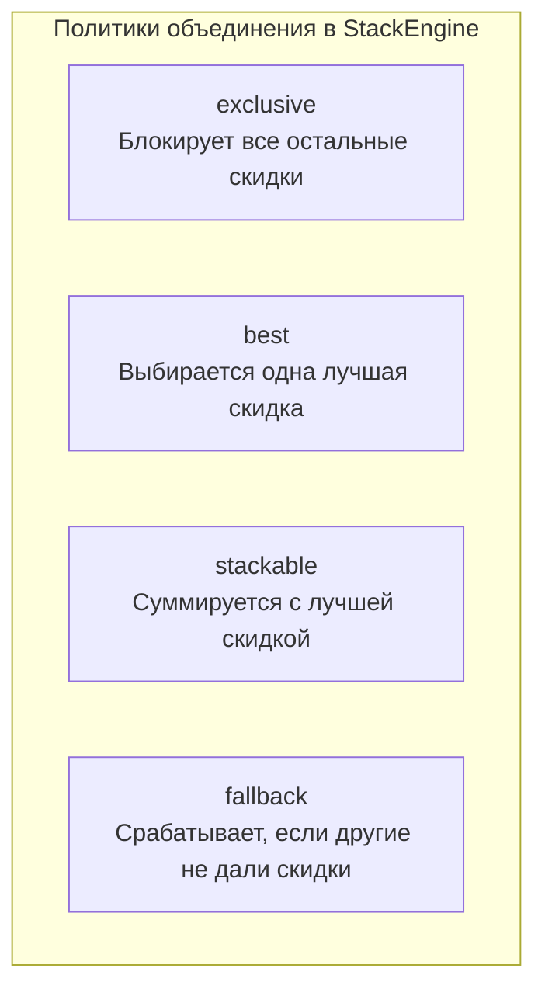
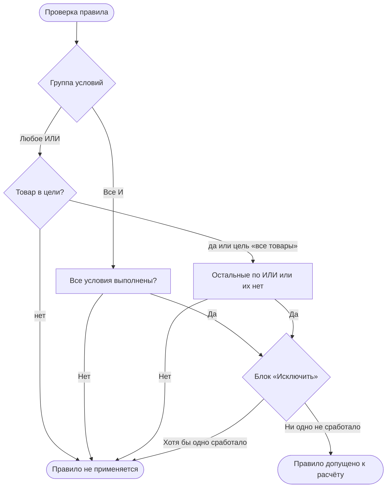

# Панель управления

Раздел **Компоненты → Скидки** (право `ms3discounts_view`) содержит вкладки **Обзор** и **Скидки**.

## Вкладка Обзор

<!--  -->

- **Счётчики статусов**: число активных, запланированных, завершённых, отключённых и всех правил.
- **Распределение по типам**: круговая диаграмма типов действий.
- **Блок «Скоро»**: список пяти ближайших акций с датой старта или завершения.
- **Блок «Прошедшие ещё включены»**: завершившиеся по дате акции, которые остаются активными. Кнопка **Выключить** переводит их в статус выключенных.

Нажатие на карточку статуса открывает вкладку со списком и ставит тот же фильтр.

## Вкладка Скидки

<!--  -->

В верхней панели:

- Быстрые фильтры: **Все**, **Активные**, **Запланированные**, **Завершённые**, **Отключённые**.
- Фильтр по типу действия.
- Поиск по названию и описанию.
- Кнопка **Новая скидка**.
- Кнопка **Проверить**.

В таблице: статус, название, тип действия, размер выгоды, область применения, период и приоритет.

### Массовые операции

Выбор нескольких строк открывает панель:

- **Включить** и **Выключить**: меняют активность выбранных правил.
- **Удалить**: удаляет записи после подтверждения.
- **Приоритет**: ставит числовой приоритет выбранным правилам.
- **Дублировать**: копии выбранных скидок со всеми условиями. К имени через пробел дописывается `copy`.

## Создание правила

<!--  -->

Кнопка **Новая скидка** открывает боковую панель.

- **Название**: обязательное имя скидки.
- **Применяется к**: выбор области include-целей (товары, категории или производители). Если ничего не выбрано, правило действует на весь каталог.
- **Скидка**: выбор типа действия и ввод значения.
- **Период**: даты начала и окончания.

Календарная дата хранится как полночь. День начала входит в срок. В день окончания правило включено ровно в 00:00:00 и выключается со следующей секунды.

### Типы действий

| Тип | Поля | Описание |
| --- | --- | --- |
| Процент | `value` | Процент скидки от базовой цены товара. |
| Фиксированная сумма | `value` | Сумма скидки в валюте на единицу товара. |
| Фиксированная цена | `value` | Итоговая цена единицы товара. |
| N-й товар | `n`, `percent` | Скидка на каждый N-й товар в корзине (порог n ≥ 2). Единицы сортируются от дешёвых к дорогим. По умолчанию percent = 100%. |
| Подарок | `product_id`, `count` | Добавление товара из каталога в подарок. В корзине создаётся отдельная строка с ценой 0. |

## Дополнительные параметры

| Параметр | По умолчанию | Описание |
| --- | --- | --- |
| Политика | `stackable` | Порядок применения: `stackable` (суммируется), `best` (лучшая цена), `exclusive` (перекрывает другие), `fallback` (запасная). |
| Приоритет | `0` | Числовой приоритет. У `exclusive` и `best` сначала сравнивается выгода, затем больший приоритет, затем меньший id. У `stackable` больший приоритет применяется раньше, к ещё не сниженной цене. |
| Описание | пусто | Пояснительный текст акции. |
| Время | пусто | Окно времени действия в формате ЧЧ:ММ (с и по). Пустые поля означают весь день. |
| Дни недели | пусто | Выбор дней недели (1 — понедельник, 7 — воскресенье). Если не выбраны, скидка действует во все дни. |
| Контексты | пусто | Список контекстов сайта. Если не выбраны, скидка действует во всех контекстах. |
| В каталоге | включено | Показывать скидку в списке акций, в подборке `ms3discountsBuyNow` и в бейдже строки каталога через `prepareSnippet`. |
| В товаре | включено | Показывать скидку на карточке и при вызове сниппета с `id` без `pagetitle`. |
| Показывать описание | выключено | Выводить текст описания в сниппете `ms3discounts`. |
| Только после активации | выключено | Правило применяется только после программной активации (промокоды, купоны). |

## Конструктор условий (Rule Builder)

<!--  -->

Условия объединяются в группу с переключателем логики:

- **Все (И)**: правило сработает, если выполнены все добавленные условия.
- **Любое (ИЛИ)**: достаточно одного из добавленных условий. Если в «Применяется к» выбраны товары, категории или производители, попадание в эту цель обязательно и при «ИЛИ». При цели «все товары» отдельной проверки нет.

### Доступные провайдеры

| Провайдер | Поле | Операторы | Назначение |
| --- | --- | --- | --- |
| Корзина | `subtotal`, `count`, `positions`, `weight` | `=`, `!=`, `>`, `>=`, `<`, `<=`, `between` | Сумма, количество штук, число позиций или вес. Область (`scope`): вся корзина (`cart`), подходящие товары (`matching`), текущая строка (`product`). |
| Товар | `product`, `id`, `article`, `price`, `old_price`, `weight`, `stock` | `=`, `!=`, `>`, `>=`, `<`, `<=`, `in`, `not_in`, `between` | Свойства товара: ID, артикул, базовая цена, старая цена, вес, остаток на складе. |
| Категория | `category` | `in`, `not_in` | ID категорий каталога. |
| Производитель | `vendor` | `in`, `not_in`, `=` | ID производителей товаров. |
| Опция | `key`, `value` | `=`, `!=`, `in`, `not_in` | Проверка значений опций товара по ключу опции. |
| Пользователь | `customer` | `=`, `!=`, `in`, `not_in` | ID пользователя либо значения `auth` (авторизован) и `guest` (гость). |
| Группа пользователя | `customer_group` | `in`, `not_in` | ID групп пользователей MODX. |
| Контекст | `context` | `in`, `not_in`, `=` | Ключи контекстов сайта. |
| Дата | `weekday`, `time`, `date` | `in`, `=`, `!=`, `>`, `>=`, `<`, `<=`, `between` | День недели (1–7), время (ЧЧ:ММ) или календарная дата (`YYYY-MM-DD`). |

### Блок «Исключить»

Если хотя бы одно условие из этого блока выполняется, скидка не применяется к заказу или позиции. Блок принимает любые провайдеры из таблицы.

## Панель «Проверить»

<!--  -->

Кнопка **Проверить** считает базовую цену, итоговую цену со скидкой и список правил. Заказ оформлять не нужно.

В форме:

- Товар из каталога.
- Количество товара.
- Пользователь (гость, авторизованный или конкретный ID).
- Контекст выполнения.
- Дополнительные опции товара.

Пользователи с правом `ms3discounts_debug` видят раздел **Почему**: пошаговый журнал оценки условий и выбора политик.
