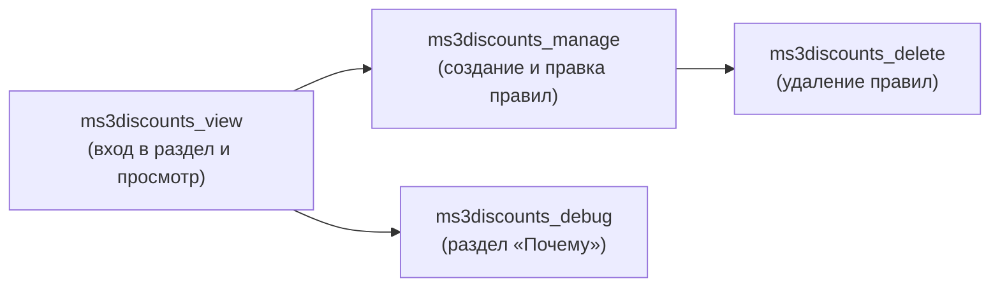

# Системные настройки

Ключи компонента имеют префикс `ms3discounts_`.

## Движок

| Ключ | Тип | По умолчанию | Описание |
| --- | --- | --- | --- |
| `ms3discounts_enabled` | да/нет | да | Включение работы плагина пересчёта цен в draft-корзине MiniShop3. |
| `ms3discounts_debug` | да/нет | нет | Служебный ключ конфигурации. Доступ к разделу **Почему** в панели «Проверить» регулируется правом `ms3discounts_debug`. |
| `ms3discounts_round_precision` | число | `2` | Количество знаков после запятой при округлении цен и скидок. |
| `ms3discounts_log_level` | число | `1` | Потолок журнала компонента. Сообщение не пишется в лог MODX, если его уровень больше этого числа. Значение `0` отсекает уровень 1 и выше. Системный `log_level` MODX ключ не меняет. |

## Витрина

| Ключ | Тип | По умолчанию | Описание |
| --- | --- | --- | --- |
| `ms3discounts_frontend_css` | строка | `[[+assetsUrl]]css/web/default.css` | Путь к CSS бейджа и таймера. Значение `0` или пустая строка отключает подключение стилей. |
| `ms3discounts_frontend_js` | строка | `[[+assetsUrl]]js/web/default.js` | Путь к JS таймера обратного отсчёта `.ms3d_remains`. Значение `0` или пустая строка отключает скрипт. |

| Плейсхолдер | Замена |
| --- | --- |
| `[[+assetsUrl]]` | путь к `assets/components/ms3discounts/` |
| `[[+cssUrl]]` | подкаталог `css/` |
| `[[+jsUrl]]` | подкаталог `js/` |

`ms3discounts` и `ms3discountsBuyNow` читают эти настройки при вызове. У `ms3discountsGetDiscount` свойство элемента уже содержит путь `[[+assetsUrl]]css/web/default.css` и такой же путь к JS. Системная настройка подставляется, только если передать пустую строку. Значение `0` отключает регистрацию.

## Права доступа

<!--  -->

Пакет поставляет шаблон прав `ms3DiscountsPolicyTemplate` и политику `ms3DiscountsManagerPolicy`:

| Право | Назначение |
| --- | --- |
| `ms3discounts_view` | Доступ к разделу меню «Компоненты → Скидки», просмотр списка и деталей акций. |
| `ms3discounts_manage` | Создание, редактирование, копирование и сохранение правил скидок. |
| `ms3discounts_delete` | Удаление правил скидок по отдельности и через массовые операции. |
| `ms3discounts_debug` | Просмотр раздела **Почему** с пошаговым журналом расчёта в панели **Проверить**. |

При установке политика назначается группе `Administrator` для контекста `mgr`. Те же четыре права записываются в политики `Administrator` и `Manager`.
