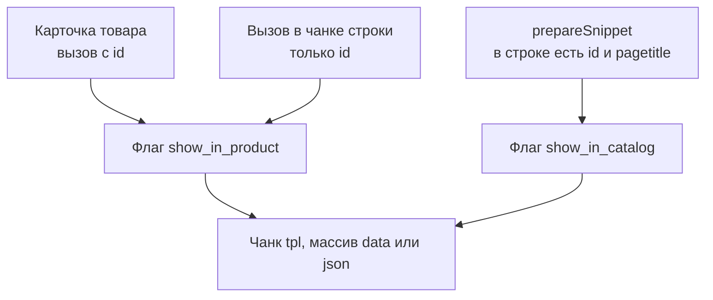

# Сниппет ms3discountsGetDiscount

<!--  -->

Сниппет считает лучшую доступную скидку товара и выводит бейдж через чанк.



Если товару подходит сразу несколько акций, сниппет выбирает правило с наибольшей суммой скидки. При равенстве сумм берёт правило с наибольшим процентом. Расчёт учитывает группы авторизованного пользователя и скидки, активированные в текущей сессии через `ms3discounts_activator`.

## Параметры

| Параметр | По умолчанию | Описание |
| --- | --- | --- |
| `id` | ID текущего ресурса | ID товара MiniShop3. Доступен алиас `product` |
| `sale` | пусто | Список ID акций через запятую. Если не указан, сниппет проверяет плейсхолдер `ms3discounts.sale` (его выставляет `ms3discountsBuyNow`). Если плейсхолдер пуст, проверяются все активные акции |
| `tpl` | `tpl.ms3discounts.get` | Имя чанка для отображения бейджа |
| `return` | `tpl` | Формат возврата: `tpl` (разметка чанка), `data` (массив данных), `json` (строка JSON) |
| `frontend_css` | `[[+assetsUrl]]css/web/default.css` | Путь к CSS. Свойство элемента уже содержит этот путь, поэтому обычный вызов системную настройку не читает. Пустая строка подставляет `ms3discounts_frontend_css`. Значение `0` отключает стили |
| `frontend_js` | `[[+assetsUrl]]js/web/default.js` | Путь к JS. Свойство элемента уже содержит этот путь. Пустая строка подставляет `ms3discounts_frontend_js`. Значение `0` отключает скрипт |
| `old_price` | из снимка | Старая цена. Число больше нуля берётся из вызова. Ноль или пустое значение берётся из `msProductData.old_price` |
| `weight` | из снимка | Вес товара. Число больше нуля берётся из вызова. Ноль или пустое значение берётся из `msProductData.weight` |

Снимок товара запрашивается всегда. Переданные `price`, `category_ids`, `vendor_id` и `article` подменяют поля снимка. Опции из каталога не читаются: без параметра `options` массив пустой. `old_price` и `weight` больше нуля берутся из вызова. Ноль или пустое значение берётся из снимка. `count` без параметра равен 1.

## Плейсхолдеры чанка

| Поле | Смысл |
| --- | --- |
| `sale_discount` | Процент скидки (если больше 0), иначе сумма скидки |
| `remains` | Количество секунд до даты окончания акции `date_end` |
| `price` | Итоговая цена товара с учётом скидки |
| `base_price` | Исходная цена товара до применения скидки |
| `discount` | Сумма скидки в валюте магазина |
| `percent` | Процент скидки |
| `name` | Название применённого правила скидки |
| `id` | ID применённой акции |
| `date_end` | Дата окончания акции в формате `YYYY-MM-DD HH:mm:ss` |
| `potential` | Флаг наличия условий корзины, которые не могут быть проверены на витрине |
| `description` | Текст описания, если включено «Показывать описание». Иначе пустая строка |
| `idx` | Порядковый номер строки начиная с 0 (при выводе через чанк) |

## Примеры вызова

Вывод бейджа на карточке товара:

::: code-group

```fenom
{'!ms3discountsGetDiscount' | snippet : [
  'id' => $_modx->resource.id,
  'tpl' => 'tpl.ms3discounts.get',
]}
```

```modx
[[!ms3discountsGetDiscount?
  &id=`[[*id]]`
  &tpl=`tpl.ms3discounts.get`
]]
```

:::

## Скидки в каталоге msProducts

Цены в списке пересчитывает плагин на событии `msOnGetProductPrice`. В строку он пишет `price` уже со скидкой. Поле `old_price` это колонка данных товара, не TV. Если цена после плагина ниже прежней, `msProducts` подставляет в `old_price` строки цену до этой скидки. Поле `discount` пишет сам `msProducts`. Плагин его не добавляет.

Процент скидки плагин в строку не кладёт:

```fenom
{if $price < $old_price}
  {$old_price}
  {$price}
{/if}
```

Для названия акции, процента и таймера подключите `ms3discountsGetDiscount` как `prepareSnippet`. Сниппет разбирает вложенный ключ `row` и добавляет в строку `name`, `description`, `percent`, `price`, `base_price`, `discount`, `sale_discount`, `remains`, `date_end` и `sale_id`:

```fenom
{'!msProducts' | snippet : [
  'parents' => 0,
  'prepareSnippet' => 'ms3discountsGetDiscount',
  'tpl' => '@FILE chunks/ms3d-row.tpl'
]}
```

::: tip Подготовка строки или вызов в чанке
Режим `prepareSnippet` включается, когда в строке есть `id` и `pagetitle`. Их передаёт `msProducts`. Без этих полей сниппет считает вызов обычным и ждёт `id` в корне. Второй способ: вызвать сниппет в чанке строки:

```fenom
{'!ms3discountsGetDiscount' | snippet : ['id' => $id]}
```

Так сделано в [ms3discountsBuyNow](ms3discountsBuyNow): он подставляет `prepareSnippet=ms3discountsGetDiscount` по умолчанию.

Подготовка строки отбирает правила по флагу «В каталоге». Вызов с `id` без `pagetitle` отбирает по «В товаре». Правило с выключенным «В каталоге» в строке `msProducts` бейджа не даст.
:::
