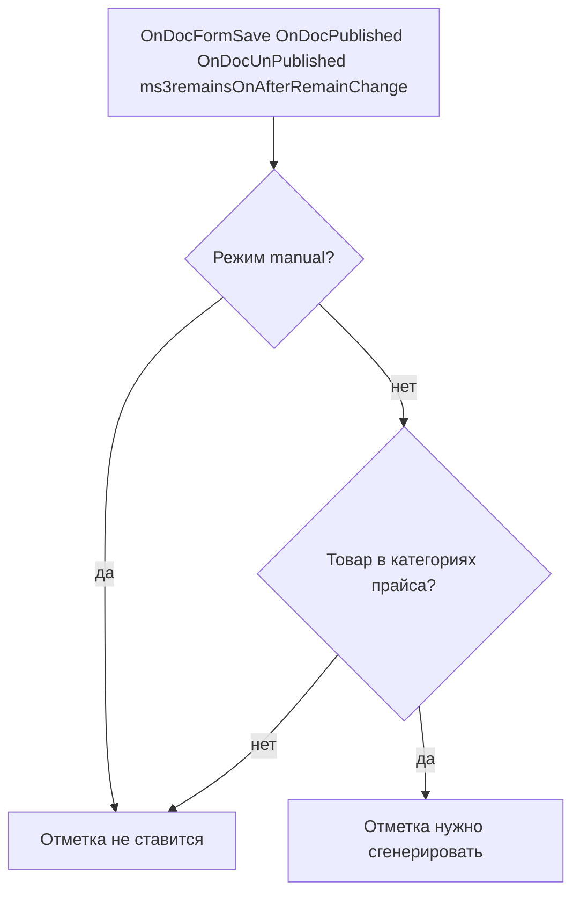
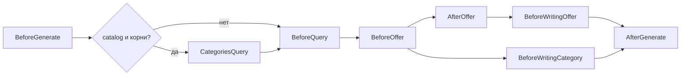

# События

Плагин слушает чужие события. Сервис генерации вызывает свои.

## Входящие

Отметка не ставится прайсу `manual`, прайсу, в чьи категории товар не входит, и никому, если `ms3yandexmarket_enabled` равен `0`. Пустой выбор категорий означает «все категории». Категориями для отметки и для выборки файла считаются родитель ресурса и строки связей.

| Событие | Что делает компонент |
| --- | --- |
| `OnDocFormSave` | Для товара и категории MiniShop3 отмечает подходящие прайсы |
| `OnDocPublished` | То же |
| `OnDocUnPublished` | То же |
| `ms3remainsOnAfterRemainChange` | То же. Идентификатор товара берётся из `product_id`. Если его нет, отмечаются все активные прайсы не в режиме `manual` |

## Исходящие

Все вызовы идут через `$modx->invokeEvent`. В параметрах есть объект прайса и `pricelist_id`, если не сказано иное.

На пути `tree_v2` событие `OnMs3YandexMarketBeforeWrite` не вызывается.

`CategoriesQuery` есть только у назначения `catalog`, когда корни категорий выбраны. Тогда оно идёт сразу после `BeforeGenerate` и до `BeforeQuery`. `AfterOffer` на этом пути вызывается после порога остатка и до записи предложения.

| Событие | Когда | Дополнительно |
| --- | --- | --- |
| `OnMs3YandexMarketBeforeGenerate` | До чтения товаров, после блокировки и старта журнала | |
| `OnMs3YandexMarketBeforeQuery` | До выборки товаров | `context` = `offers` |
| `OnMs3YandexMarketBeforeOffer` | На каждую строку товара или варианта | `row` |
| `OnMs3YandexMarketAfterOffer` | На дереве полей: после проверки id товара и после порога остатка. Строка без id и строка, которую убрал порог, событие не получают. `offer` на этом пути `null`. На пути RSS событие идёт после сборки предложения и вызывается даже если сборка не удалась | `row`, `offer` |
| `OnMs3YandexMarketOffersQuery` | После сборки предложений. При записи YML из дерева полей не вызывается. Вызывается у Google RSS и у записи YML прайса без дерева полей | `offers_count` |
| `OnMs3YandexMarketBeforeWritingOffer` | Перед записью одного предложения из дерева полей | `row` |
| `OnMs3YandexMarketBeforeWritingCategory` | Перед записью категории из дерева полей | `category` |
| `OnMs3YandexMarketCategoriesQuery` | Перед обходом выбранных корней категорий. Если корни не выбраны, событие не вызывается | `root_ids` |
| `OnMs3YandexMarketBeforeWrite` | Перед записью Google RSS и перед записью YML прайса без дерева полей. При записи YML из дерева полей не вызывается | `offers_count` |
| `OnMs3YandexMarketAfterGenerate` | После подмены файла, в том числе если в журнале статус `error` из‑за числа ошибок. В `catch` при исключении не вызывается. Отметка «нужно сгенерировать» снимается только при статусе не `error` | `result` |
