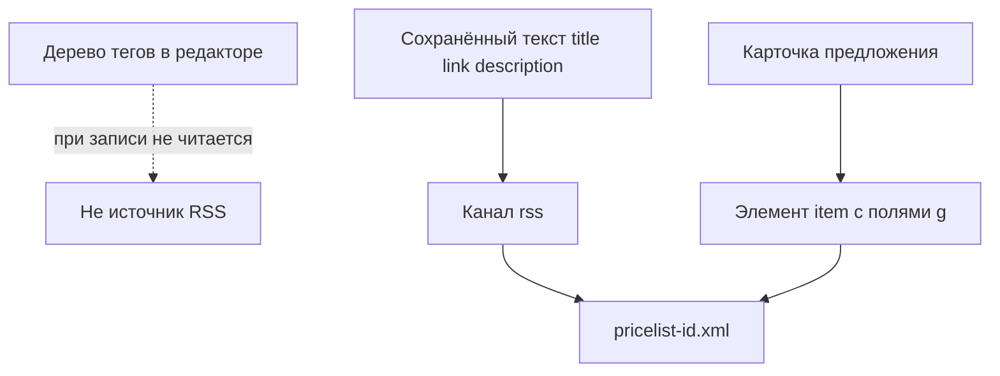

# Состав файла

Один прайс пишет один файл. Площадку и назначение задают в карточке. Маркет и Merchant Center забирают файл по **URL файла**. Компонент в кабинеты сам не ходит.

Корень YML: объявление XML, UTF-8, элемент `yml_catalog` с датой старта генерации. Корень RSS: канал `rss` и элементы `item`.

## Яндекс Маркет, каталог

Назначение `catalog` или `items` создаёт один и тот же набор тегов. Файл пишется из дерева полей, не из JSON-карты полей.

Блок `<categories>` наполняется только у `catalog`. У `items` вкладка **Категории** есть, но выбранные разделы в YML не пишутся. Пустой список тег `categories` пропускает.

Теги магазина при создании:

| Тег | Тип | Источник при создании |
| --- | --- | --- |
| `name`, `company`, `url` | текст | пусто, тег не попадёт в файл, пока не зададите `value:` или `setting:` |
| `categories` | контейнер | выбранные разделы |
| `offers` | контейнер | по товару или варианту |

Теги каждого `offer`:

| Тег | Источник при создании |
| --- | --- |
| `name` | `field:pagetitle` |
| `url` | `pipeline:url` |
| `price` | `data:price` |
| `categoryId` | `field:parent` |
| `picture` | `pipeline:image` |
| `vendor` | `pipeline:vendor` |
| `vendorCode` | `data:article` |
| `description` | `field:introtext`, тип «текст без разметки» |
| `barcode`, `param` | пусто |
| `country_of_origin` | `data:made_in` |

Атрибут `id` у `offer` берётся из [стратегии идентификатора](/components/ms3yandexmarket/pricelist). Отдельного тега `shop-sku` нет. Блоков `currencies`, `currencyId`, `promos` и атрибута `type` профиль не создаёт.

Пустой текст тега в файл не пишется. Предложение без `id` пропускается.

## Яндекс Маркет, размещение

У назначения `placement` вкладки **Категории** нет, контейнера `categories` в наборе нет.

На **Магазине** предупреждение: файл размещения заменяет условия в кабинете Маркета. Список **Управляемые поля** пишется в `managed_fields`: `price`, `oldprice`, `stock`, `available`, `delivery`, `pickup`, `store`, `url`, `categoryId`. Пустой список сохранить нельзя. Форма подставляет все девять ключей и пишет, что нужно хотя бы одно поле. Запрос с пустым списком отвечает 422, код `invalid_managed_fields`. Непустой список оставляет в `offer` только имена из списка. Имя `available` из списка пишется атрибутом. Атрибут `id` пишется всегда.

Теги `offer` при создании:

| Тег | Источник при создании |
| --- | --- |
| `url` | `pipeline:url` |
| `price` | `data:price` |
| `oldprice` | `data:old_price` |
| `categoryId` | `field:parent` |
| `store`, `delivery`, `pickup` | пусто |

У `store`, `delivery` и `pickup` источника нет, поэтому их нет в файле, пока не заполните **Откуда брать текст**.

При `skip` предложение без остатка или с остатком не выше `min_stock` в файл не попадает. Подробнее: [параметры прайса](/components/ms3yandexmarket/pricelist).

## Google RSS 2.0

У площадки `google.rss20` назначение не различается: в файл всегда пишется лента товаров.

Дерево тегов при создании выглядит как канал: `title`, `link`, `description`, контейнер `items` и поля `g:id`, `g:title`, `g:link`, `g:price`, `g:availability`, `g:image_link`, `g:description`. Запись файла это дерево не читает. Компонент собирает RSS из карточки предложения.

Шапка канала копирует сохранённый текст активных тегов `title`, `link` и `description`. Префиксы `value:` и `setting:` здесь не разбираются. Строка `value:Магазин` попадёт в канал как `value:Магазин`. Пустой или выключенный тег шапку не заполняет. В канал пишется `lastBuildDate` со значением `date(DATE_RSS)` (RFC 822). Так в файле и в предпросмотре.

Каждый `item`:

| Тег | Откуда |
| --- | --- |
| `g:id` | стратегия идентификатора |
| `g:title` | `field:pagetitle` из карты полей по умолчанию |
| `g:link` | `pipeline:url` |
| `g:price` | цена и код валюты, вид `199.00 RUB` |
| `g:availability` | `in stock` или `out of stock` |
| `g:image_link` | `pipeline:image` |
| `g:description` | `field:introtext` |

Карта полей по умолчанию ещё содержит `oldprice`, `currencyId`, `categoryId`, `vendorCode`, `country_of_origin`, `vendor`. В RSS-элемент они не выводятся.

## Когда Google пропускает товар

Пустые название, адрес или цена убирают строку из файла и пишут ошибку журнала. Коды: `g:title is required`, `g:link is required`, `g:price is required` или `g:price must be greater than 0`. Статус запуска становится `error`, отметка «нужно сгенерировать» не снимается. На пути YML из дерева этих сообщений нет.

`skip` убирает строку молча: нет числа остатка или остаток не выше `min_stock`. Так у нового прайса и когда ключа поведения нет. `exclude` убирает строку так же. `include` и `out` строку оставляют. Тот же порог действует при записи YML из дерева.

`g:availability` пишется только у оставшейся строки. Нет числа остатка: `in stock`. Число выше `min_stock`: `in stock`. Иначе `out of stock`.

Тип оффера `vendor.model` на пути RSS требует непустые производителя и артикул. Иначе строка пропускается. На пути YML из дерева полей это поле атрибут `type` не ставит.
