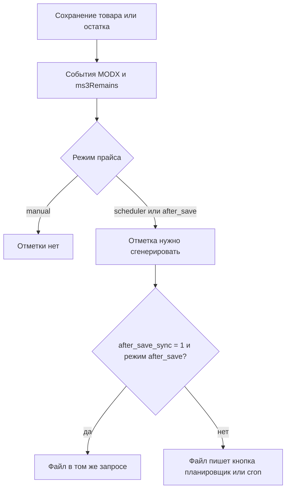

# Генерация

## Режимы

Режим прайса задаётся в поле **Режим генерации**.

| Режим | Когда пишется файл |
| --- | --- |
| `manual` | Только кнопка генерации в менеджере. Сохранение товара и планировщик этот прайс не берут |
| `scheduler` | Задача планировщика или `cron.php`, если прайс активен и его пора обновить |
| `after_save` | При сохранении, публикации или снятии с публикации товара или категории. Только если товар входит в категории прайса |

Интервал для `scheduler` и `after_save` задаётся в минутах. Ноль: только по отметке «нужно сгенерировать». Пустая дата последней генерации при интервале больше нуля считается «пора писать».

Неактивный прайс задачи не берут.

## Планировщик


Если установлен Scheduler и `ms3yandexmarket_scheduler_enabled` не равна `0`, открытие менеджера регистрирует задачу `ms3yandexmarket_generate`. Повтор каждый час.

На вкладке **Диагностика** строки **Планировщик** и **Задача планировщика** должны быть «ОК» и «Зарегистрирована».

Успех в журнале Scheduler:

```text
ms3YandexMarket: no pricelists pending generation
```

или по строке на каждый прайс и итог. Запуск не переписывает прайсы в режиме `manual`.

Без Scheduler тот же отбор делает команда:

```bash
php assets/components/ms3yandexmarket/cron.php
```

Свой планировщик сайта должен вызывать `assets/components/scheduler/run.php`. Компонент сам по расписанию MODX не ходит.

## После сохранения товара

Для `after_save` и `scheduler` плагин ставит отметку «нужно сгенерировать», если товар входит в категории прайса. Режим `manual` не отмечается. При `ms3yandexmarket_enabled` = `0` плагин выходит сразу: отметки нет и файл в том же запросе не пишется.

Плагин слушает `OnDocFormSave`, `OnDocPublished`, `OnDocUnPublished` для товаров и категорий MiniShop3 и событие `ms3remainsOnAfterRemainChange`.



В поставке `ms3yandexmarket_after_save_sync` = `0`. Тогда сохранение товара только ставит отметку. Файл пишут планировщик или кнопка. При `1` прайсы `after_save` пишутся в том же запросе. Ошибка записи не откатывает сохранение товара. Отметка остаётся.

Если строки настройки нет, плагин считает `0`. Прайс только отмечается. Файл в том же запросе не пишется.

## Что происходит с файлом


Имя файла всегда `pricelist-{id}.xml`. Генерация берёт блокировку на прайс, пишет во временный файл и подменяет итоговый только после завершения. Каталог задаёт настройка `ms3yandexmarket_files_path`. Каталог должен быть доступен для записи. Проверяйте его на **Диагностике**. Успешный прогон пишет путь и URL в карточку прайса.

Предпросмотр в менеджере файл на диске не заменяет.

Порцию чтения товаров задаёт `ms3yandexmarket_chunk_size` (500). Файл подменяется целиком после порций, не по одной порции на диске.

## Кнопки на вкладке «Генерация»

| Действие | Файл на диске |
| --- | --- |
| **Сгенерировать** | Пишет. Повтор, пока первый запуск держит блокировку, отвечает HTTP 409, код `generation_locked`. При `ms3yandexmarket_enabled` = `0` отвечает 422, код `domain_error`, строки журнала нет |
| **Предпросмотр YML** | Не пишет. В ответе число предложений, валидных и пропущенных. Выключатель компонента его не останавливает |
| **Показать сгенерированный YML** и **Скачать YML** | Читают уже записанный файл |

Журнал под кнопками пополняется во время **Сгенерировать**.

## Когда строки нет в YML

Запись из дерева полей:

| Условие | Результат |
| --- | --- |
| Прайс неактивен | Планировщик и `cron.php` его не берут. Кнопка в карточке этого прайса файл пишет |
| Нет `id` | `offer` пропускается |
| Пустой текст тега | Тега в файле нет |
| Тег выключен переключателем **Выводить в файл** | Тега в файле нет |
| Цена 0 или пустая при `pipeline:price` | Тега `price` нет. Предложение при этом может остаться |
| Поведение `skip`: нет числа остатка или остаток не выше `min_stock` | Предложение в файл не попадает. Так у нового прайса |

Для Google RSS пустая цена тоже убирает строку. Порог остатка действует и на дереве, и в RSS. См. [состав файла](/components/ms3yandexmarket/feeds).
