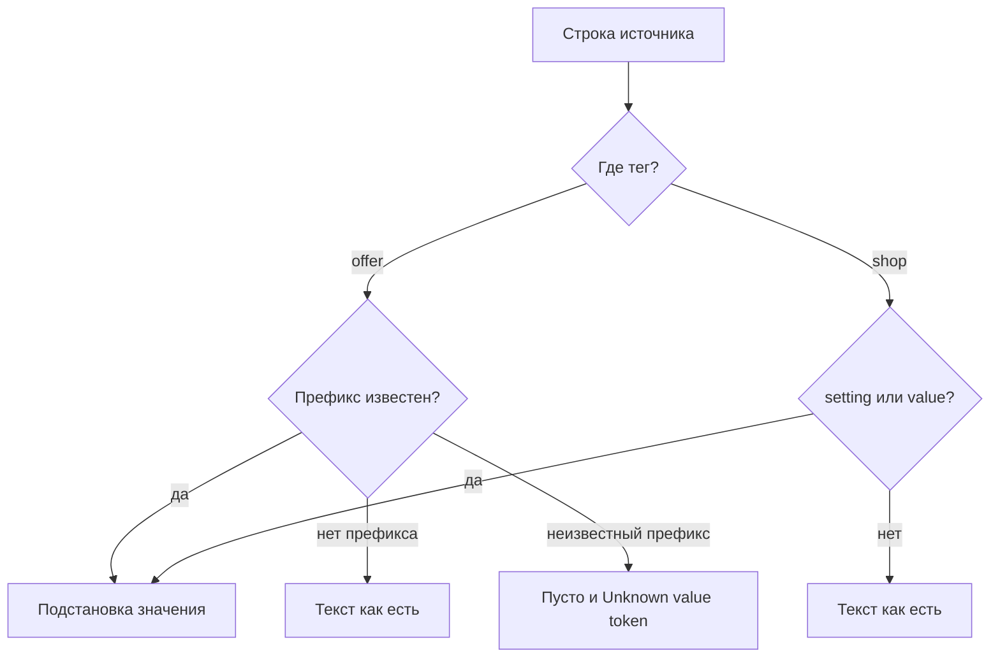

# Источники значений

Значение тега: строка `тип:ключ`. Префикс сравнивается как записан, без смены регистра. Пишите его строчными буквами, как в таблице.

| Префикс | Откуда берётся значение |
| --- | --- |
| `field:` | Колонка ресурса, например `field:pagetitle` |
| `data:` | Колонка данных товара, например `data:article` |
| `tv:` или `tv.` | Дополнительное поле по имени |
| `option:` или `option.` | Опция товара MiniShop3 |
| `setting:` | Системная настройка MODX |
| `value:` | Текст после двоеточия как есть |
| `fenom:` | Шаблон pdoTools. Сохранение требует право `ms3yandexmarket_edit_fenom` |
| `pipeline:price` | Цена с учётом источника предложения |
| `pipeline:old_price` | Старая цена |
| `pipeline:currency_id` | Код валюты |
| `pipeline:image` | Адрес картинки |
| `pipeline:url` | Адрес товара. Для варианта добавляется признак варианта |
| `pipeline:vendor` | Производитель |
| другой `pipeline:` | Пусто, без исключения |

Массив скаляров склеивается через запятую. Вложенный массив кодируется в JSON, чтобы в файл не попало слово `Array`.

Тот же разбор понимает короткие имена без двоеточия: `url`, `picture`, `image`, `vendor`, `price`, `oldprice`, `currencyId`. В редакторе тега храните полную форму с префиксом.

## Тег магазина и тег предложения

| Где тег | Какие префиксы | Если иначе |
| --- | --- | --- |
| внутри `offer` | таблица выше и `resource:`, `gallery:`, `variant:`, `remain:` | строка вида `префикс:ключ` с неизвестным префиксом даёт пусто, тег не пишется. При записи YML из дерева в журнал попадает ошибка `Unknown value token`. Строка без такого префикса остаётся текстом |
| внутри `shop` | только `setting:` и `value:` | остальное, включая `field:`, `data:` и `pipeline:`, пишется в файл как введённая строка |

Пустое значение тега магазина берёт ключ `shop_settings` с тем же именем. Для `name`, `company` и `url` у нового прайса этот ключ пустой.

Обработчик Fenom у тега применяется после подстановки. Плейсхолдер `input` хранит уже полученный текст. В карточке тега поля обработчика нет. Префикс `fenom:` задаётся в **Откуда брать текст**. Сохранение такого значения требует `ms3yandexmarket_edit_fenom`. Без права ответ 403.

## Цена и валюта

`pipeline:price` читает `data.price`. Ноль и пустая цена дают пусто, тег не пишется. Старая цена (`pipeline:old_price`) отбрасывается, если она не больше текущей. Код валюты (`pipeline:currency_id`) берётся из `offer_settings.currency_id`, иначе из `ms3yandexmarket_default_currency` (`RUB`).

Если в `offer_settings` есть ключи, генератор их тоже читает. В форме карточки этих полей нет.

| Ключ | Эффект |
| --- | --- |
| `price_zero_behavior` | `skip` (так и есть без ключа): пустая цена. `zero` или `out`: цена 0 |
| `price_default` | Подставить, если своя цена пустая, а число больше нуля |
| `price_multiplier` | Умножить. 1 ничего не меняет |
| `price_min`, `price_max` | Поджать цену к границам |

## Адрес, картинка и производитель

`pipeline:url` собирает адрес из `uri` ресурса и `site_url`. Уже абсолютный `uri` (`http://` или `https://`) не склеивается, и `url_prefix` к нему не добавляется. Непустой `url_prefix` в настройках прайса вставляется между сайтом и путём только у относительного `uri`. У варианта в конец добавляется `?variant=` и id варианта. Если вопрос в адресе уже есть, пишется `&variant=`.

`pipeline:image` берёт картинку варианта, если она есть, иначе `data.image`. Абсолютный URL возвращается как есть. Иначе путь отдаёт медиаисточник: `image_source_id` в настройках прайса, иначе системная `ms3yandexmarket_image_source`, иначе источник `1`. `image_prefix` дописывается к относительному пути. Этих полей в форме нет.

`pipeline:vendor` ищет в таком порядке:

1. `vendor_name` в настройках прайса
2. `msVendor` по `vendor_id` товара
3. ключ `vendor_fallback` в тех же настройках
4. если ключа `vendor_fallback` нет, берётся системная `ms3yandexmarket_vendor_fallback`

## Неизвестный префикс

Пункт из подсказки перед сохранением меняет первую точку на двоеточие: `data.price` становится `data:price`. Строка, набранная с клавиатуры, сохраняется как есть. У тега предложения `data.price` без двоеточия пишется в файл текстом.

## Группы выпадающего списка

Поле **Откуда брать текст** берёт группы из `/lists/sources`.

| Группа | После сохранения | В XML тега предложения |
| --- | --- | --- |
| `data` | `data:price` | Колонка товара |
| `tv` | `tv:имя` | Дополнительное поле |
| `option` | `option:ключ` | Опция MiniShop3 |
| `setting` | `setting:ключ` | Системная настройка |
| `value` | `value:текст` | Текст как есть |
| `fenom` | `fenom:шаблон` | Шаблон pdoTools |
| `resource` | `field:pagetitle` | Колонка ресурса. В списке значение приходит как `field.pagetitle`, в базе будет `field:`, не `resource:` |
| `gallery` | `gallery:image` | Картинка, как у `pipeline:image`. Остальные ключи в таблице ниже |
| `variant` | `variant:sku` | Поле варианта |
| `remain` | `remain:count` | Поле остатка |

## Группы каталога в теге предложения

Неизвестный ключ внутри известного префикса даёт пусто. Фильтры пишут `resource.поле`, `data.поле`, `tv.имя`, `option.ключ` с точкой.

| Префикс | Ключ | Что попадает в XML |
| --- | --- | --- |
| `resource:` | имя колонки | То же, что `field:` с этим именем |
| `gallery:` | `image`, `gallery` | Картинка, как у `pipeline:image` |
| `gallery:` | `thumb` | `data.thumb` |
| `gallery:` | `images` | `data.images`, иначе `data.image` |
| `variant:` | `id` | Id варианта |
| `variant:` | `sku` | Артикул варианта |
| `variant:` | `price`, `old_price`, `count`, `weight` | `data.price`, `data.old_price`, `data.stock`, `data.weight` |
| `variant:` | `image`, `image_url` | `data.image` |
| `variant:` | `options` | Опции варианта |
| `remain:` | `count` | `data.stock` |
