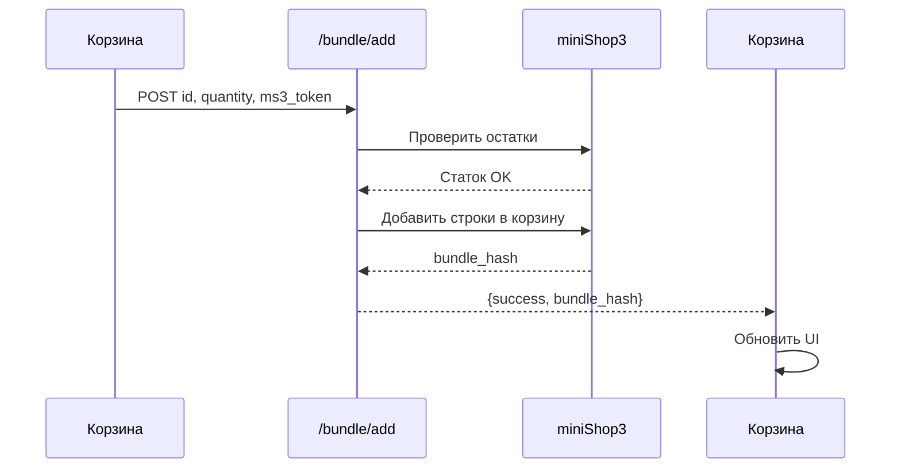

# REST API

Компонент предоставляет четыре маршрута через роутер miniShop3. База: `/api/v1/msbundles`.

```text
/assets/components/minishop3/api.php?route=/api/v1/msbundles/…
```

Требуется `ms3_token` (авторизация в корзине). Штатный JS-фронт ходит в API сам.

## Формат ответа

Успех:

```json
{
  "success": true,
  "message": "",
  "data": {},
  "errors": [],
  "warnings": []
}
```

Ошибка: HTTP 4xx, `success: false`, `data: null`.

---

## GET `/bundle/calculate`

Пересчёт цены и остатков комплекта.

**Query-параметры:**

| Параметр | Обязателен | Описание |
| --- | --- | --- |
| `id` или `bundle_id` | Да | ID комплекта |
| `quantity` | Нет | Число комплектов (по умолчанию `1`) |

**Пример:**

```text
…/api.php?route=/api/v1/msbundles/bundle/calculate&id=5&quantity=2
```

**Ответ:**

```json
{
  "success": true,
  "data": {
    "price": {
      "total": 12500,
      "original_total": 15000,
      "savings": 2500,
      "total_formatted": "12 500 ₽",
      "original_total_formatted": "15 000 ₽",
      "savings_formatted": "2 500 ₽",
      "price_html": "<span class=\"msbundles__price\">…</span>"
    },
    "stock": {
      "available": true,
      "message": "",
      "warnings": []
    },
    "quantity": 2
  }
}
```

**Поля `price`:**

| Поле | Описание |
| --- | --- |
| `total` | Итоговая цена (число) |
| `original_total` | Сумма по оригинальным ценам |
| `savings` | Экономия |
| `*_formatted` | Строки с валютой или «Бесплатно» |
| `price_html` | Готовый HTML для `[data-msbundles="price"]` |

**Поля `stock`:**

| Поле | Описание |
| --- | --- |
| `available` | `true` / `false` — можно заказать |
| `message` | Сообщение об остатке (плейсхолдер `stock_message`) |
| `warnings` | Массив предупреждений для необязательных позиций |

---

## POST `/bundle/add`

Добавить комплект в корзину. Лимит: `msbundles_max_bundle_quantity`.

**Body (JSON):**

```json
{
  "id": 5,
  "quantity": 2
}
```

Алиас: `bundle_id`.

**Ответ:**

```json
{
  "success": true,
  "data": {
    "bundle_hash": "a1b2c3d4e5…",
    "quantity": 2
  }
}
```

**Поведение:**

- Необязательные позиции с нулевым остатком могут уйти в `warnings`. Остальной комплект добавится.
- Триггерит события `msOnBeforeBundleAdd` / `msOnBundleAdded`.

---

## POST `/bundle/remove`

Удалить строки комплекта из корзины по `bundle_hash`.

**Body (JSON):**

```json
{
  "bundle_hash": "a1b2c3d4e5…"
}
```

Алиас: `hash`.

**Ответ:**

```json
{
  "success": true,
  "data": {
    "removed_count": 3,
    "bundle_hash": "a1b2c3d4e5…"
  }
}
```

**Поведение:**

- Удаляет все строки с данным `bundle_hash`.
- Триггерит события `msOnBeforeBundleRemove` / `msOnBundleRemoved`.

---

## GET `/bundle/get`

Получить данные комплекта с ценой и остатками.

**Query-параметры:**

| Параметр | Обязателен | Описание |
| --- | --- | --- |
| `id` или `bundle_id` | Да | ID комплекта |
| `quantity` | Нет | Число комплектов (по умолчанию `1`) |

**Ответ:**

```json
{
  "success": true,
  "data": {
    "bundle": {
      "id": 5,
      "name": "Набор для путешествий",
      "description": "…",
      "image": "…",
      "active": true,
      "context_key": "web"
    },
    "price": { … },
    "stock": { … },
    "quantity": 1
  }
}
```

---

## Сводная таблица маршрутов

| Метод | Путь | Описание |
| --- | --- | --- |
| `GET` | `/bundle/calculate` | Пересчёт цены и остатков |
| `POST` | `/bundle/add` | Добавление в корзину |
| `POST` | `/bundle/remove` | Удаление из корзины |
| `GET` | `/bundle/get` | Данные комплекта |

---

## Обработка ошибок

| Код | Ситуация |
| --- | --- |
| `400` | Неверные параметры (нет `id`, `quantity < 1`) |
| `403` | Нет `ms3_token` или недостаточно прав |
| `404` | Комплект не найден или неактивен |
| `422` | Превышен лимит `msbundles_max_bundle_quantity` |

---

## Поток добавления комплекта в корзину



---

## Примеры на JavaScript

### Пересчёт цены

```js
const res = await fetch('/assets/components/minishop3/api.php?route=/api/v1/msbundles/bundle/calculate&id=5&quantity=2');
const json = await res.json();
if (json.success) {
  console.log(json.data.price.total_formatted);
}
```

### Добавление в корзину

```js
const res = await fetch('/assets/components/minishop3/api.php?route=/api/v1/msbundles/bundle/add', {
  method: 'POST',
  headers: { 'Content-Type': 'application/json' },
  body: JSON.stringify({ id: 5, quantity: 2 })
});
const json = await res.json();
if (json.success) {
  console.log('bundle_hash:', json.data.bundle_hash);
}
```

### Удаление комплекта

```js
const res = await fetch('/assets/components/minishop3/api.php?route=/api/v1/msbundles/bundle/remove', {
  method: 'POST',
  headers: { 'Content-Type': 'application/json' },
  body: JSON.stringify({ bundle_hash: 'a1b2c3d4e5…' })
});
const json = await res.json();
```

---

**События JS:** [Вывод на сайте](frontend#события-js).  
**События MODX:** [События](events).
