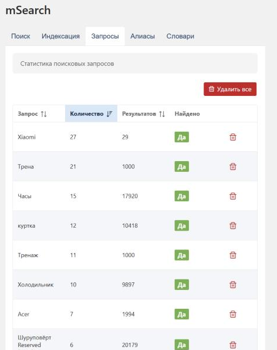

# Запросы

Вкладка со статистикой поисковых запросов.

## Назначение

История поисковых запросов помогает:

- Понять, что ищут посетители
- Оптимизировать индекс и [алиасы](/components/msearch/interface/aliases)
- Выявить запросы с нулевыми результатами
- Формировать контент на основе спроса

::: tip Что попадает в статистику
Записываются **осмысленные запросы** посетителей — отправка формы поиска (Enter или кнопка) и первая страница выдачи. Специально **не логируются**:

- автодополнение — промежуточный ввод (`ай`, `айф`, `айфо`…) статистику не засоряет;
- страницы пагинации (2-я и далее) — считается только первый запрос;
- проверки на вкладке [«Поиск»](/components/msearch/interface/search) в админке (контекст менеджера).

Сниппет `mSearch` можно вовсе исключить из статистики свойством `&log=`0`` — например, для служебного вызова `return=ids`.
:::

::: warning Клики по подсказкам
Поиск, завершённый кликом прямо по подсказке автодополнения (посетитель сразу переходит на ресурс, минуя страницу результатов), в статистику не попадает. Если нужна аналитика автодополнения — её придётся собирать отдельно.
:::

## Интерфейс

### Таблица запросов

| Колонка | Описание |
|---------|----------|
| Запрос | Текст поискового запроса |
| Количество | Сколько раз искали этот запрос |
| Результатов | Сколько результатов было найдено |
| Найдено | Был ли найден хотя бы один результат |

По умолчанию таблица сортируется по количеству запросов (от большего к меньшему). Колонки «Запрос», «Количество» и «Результатов» кликабельны для пересортировки. Записи выводятся постранично, по 20 на страницу.

### Действия

| Кнопка | Описание |
|--------|----------|
| Удалить (корзина) | Удалить отдельный запрос |
| Удалить все | Очистить всю историю запросов |

## Применение

### Оптимизация контента

Анализируйте популярные запросы без результатов:

1. Найдите запросы с `Найдено: Нет`
2. Определите, есть ли на сайте релевантный контент
3. Если контент есть — проверьте индексацию
4. Если контента нет — рассмотрите его создание

### Настройка алиасов

Если пользователи ищут синонимы или опечатки:

1. Найдите запросы с нулевыми результатами
2. Определите правильное написание
3. Создайте [алиас](/components/msearch/interface/aliases) для замены

### Пример анализа

| Запрос | Количество | Результатов | Действие |
|--------|------------|-------------|----------|
| iphone 15 | 150 | 12 | OK |
| айфон 15 | 45 | 0 | Добавить алиас «айфон» → «iphone» |
| iphome 15 | 8 | 0 | Добавить алиас «iphome» → «iphone» (опечатка) |
| доставка | 30 | 0 | Создать страницу о доставке |

## Удаление истории

::: warning Внимание
Удаление запросов необратимо — статистика будет потеряна. Перед удалением (одной записи или всех) выводится запрос подтверждения.
:::

Удалять историю может потребоваться для:

- Очистки устаревших данных
- Сброса статистики после обновления индекса
- Удаления тестовых запросов
