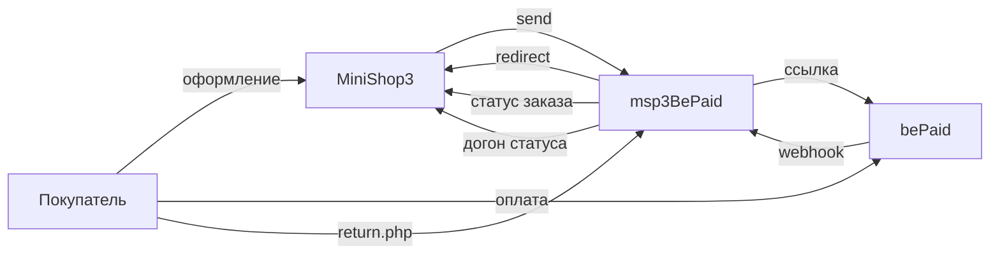

# msp3BePaid

Версия пакета: **2.0.0**.

Поддерживаемые настройки: `msp3bepaid_language`, `msp3bepaid_country`, `msp3bepaid_readonly_fields`, `msp3bepaid_visible_fields`.

**msp3BePaid** подключает [bePaid](https://bepaid.by/) к [MiniShop3](/components/minishop3/) в MODX Revolution 3. Покупатель уходит на страницу оплаты bePaid. MiniShop3 выставляет статус «оплачен» по webhook. Пакет не меняет статус заказа.

В заказе — сумма в валюте магазина. В bePaid пакет отправляет её в мелких единицах (для белорусского рубля — копейки). Нужен PHP-модуль `bcmath`.

Уведомление приходит с логином и паролем магазина. Пакет проверяет подпись в заголовке `Content-Signature`, если сохранён публичный ключ. Пустой ключ проверку пропускает.

- [Документация API](https://docs.bepaid.by/)

Пространство имён настроек: **`msp3bepaid`**. Уведомления: `assets/components/msp3bepaid/webhook.php`. Возврат покупателя: `assets/components/msp3bepaid/return.php`.

Плагин **`msp3bepaid_bootstrap`** на `OnMODXInit` и `msOnManagerCustomCssJs` подключает автозагрузку и вкладку заказа в менеджере.

## Возможности

Один способ оплаты: **Оплата через BePaid**. Карта, ERIP и другие типы задаёт настройка `payment_types`.

- Пакет создаёт токен checkout с `transaction_type: payment`. Холд и `capture` не поддерживаются.
- bePaid шлёт уведомление на один адрес магазина. Пакет пишет `notification_url` на `webhook.php` в токен checkout.
- bePaid возвращает покупателя на `return.php`. Страница сверяет токен и при успехе может догнать оплату в MiniShop3. Источник истины — webhook.
- Во вкладке заказа: попытки, синхронизация статуса ссылки, возврат по номеру транзакции. Кнопка отмены ссылки сообщает об ограничении API.
- Возврат денег недоступен, пока уведомление не подтвердило оплату.
- Отменить токен checkout через API bePaid нельзя.

Валюта по умолчанию — BYN. Тестовый режим после установки включён (`msp3bepaid_test` = Да).

## Системные требования

| Требование | Версия |
| --- | --- |
| MODX Revolution | 3.0+ |
| MiniShop3 | 1.14.0-beta1 и новее |
| PHP | 8.2+ |
| PHP-модуль | `bcmath` |
| Доступ | Shop ID и секретный ключ магазина |
| Сайт | HTTPS на webhook без 301 |

### Зависимости

- [MiniShop3](/components/minishop3/): заказы и способы оплаты.

## Установка

1. Установите **MiniShop3**.
2. Добавьте провайдер **modstore.pro** (**Система → Управление пакетами → Провайдеры**). URL: `https://modstore.pro/extras/`. Email и API-ключ возьмите в личном кабинете modstore.
3. Установите пакет **msp3BePaid** через **Управление пакетами** (в **Show Details** выберите провайдер **modstore.pro**).
4. **Очистите кэш** MODX.

Резолвер создаёт один способ оплаты:

| Название | Класс |
| --- | --- |
| Оплата через BePaid | `Msp3BePaid\Payment\BePaidPayment` |

Ключи хранят в `msPayment.properties`: `store_id`, `secret_key`, `public_key`, `webhook_secret`. Секрет также читается как `secret`. Дополнительно из properties: `checkout_url`, `currency`, `test`. Если properties пусты, пакет читает системные настройки `msp3bepaid_*`.

Способ **настроен**, когда заполнены Shop ID и секрет. Подробнее: [Системные настройки](settings).

Откуда брать Shop ID и секрет: [Быстрый старт](quick-start#откуда-брать-ключи).

## Быстрая настройка уведомлений

В кабинете bePaid укажите адрес уведомлений на магазин:

```text
https://ваш-домен.ru/assets/components/msp3bepaid/webhook.php
```

При создании checkout пакет передаёт тот же URL в `notification_url`. Настройте адрес в кабинете.

Покупатель после оплаты возвращается на `return.php`. Пакет подставляет эти адреса в токен checkout.

Ядро MiniShop3 принимает уведомления по адресу `/api/v1/payment/webhook/{payment_method_id}`. Кабинет bePaid обычно ждёт один URL — используйте `webhook.php`.

Пакет подтверждает неизвестные тела webhook и передаёт их в событие MODX **`msp3BePaidOnProviderEvent`**.

## Архитектура



## Быстрые ссылки

| Нужно | Документ |
| --- | --- |
| Установить и принять первый платёж | [Быстрый старт](quick-start) |
| Ключи `msp3bepaid_*` | [Системные настройки](settings) |
| Уведомление, возврат, вкладка заказа | [Интеграция](integration) |
| Возврат до оплаты и страница return | [FAQ](faq) |
| Оформление заказа MiniShop3 | [MiniShop3: заказ](/components/minishop3/frontend/order) |
