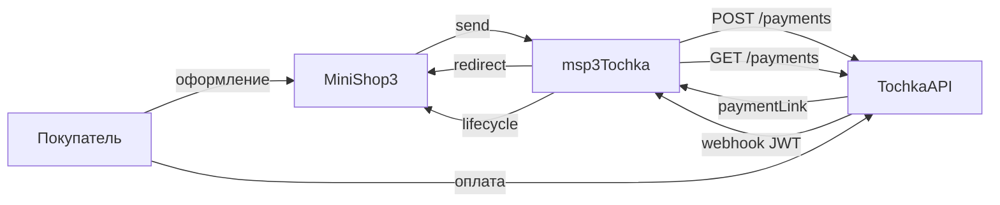

# msp3Tochka

**msp3Tochka** подключает [интернет‑эквайринг Точка Банка](https://developers.tochka.com/docs/tochka-api/opisanie-metodov/platyozhnye-ssylki/) к [MiniShop3](/components/minishop3/) в MODX Revolution 3. Статус «оплачен» устанавливает MiniShop3, а не пакет. Письма покупателю отправляет Центр уведомлений MiniShop3.

Суммы передаются в рублях с двумя знаками. Пакет передаёт токен из кабинета банка и проверяет подпись уведомления о платеже.

- [Документация API](https://developers.tochka.com/docs/tochka-api/)
- [Песочница](https://developers.tochka.com/docs/tochka-api/pesochnica)

Пространство имён настроек: **`msp3tochka`**. Точка входа уведомлений: `assets/components/msp3tochka/webhook.php`.

## Возможности

- Пакет генерирует платёжную ссылку: карта, СБП и другие способы, поддерживаемые банком.
- Одностадийный способ «Оплата через Точка Банк» списывает деньги сразу.
- Двухстадийный способ «Оплата через Точка Банк (двухстадийная)» сначала блокирует сумму, а списание происходит по кнопке во вкладке заказа.
- Банк отправляет уведомление; пакет проверяет подпись и запрашивает статус платежа. Статус берётся из ответа API, а не из текста уведомления.
- Номер операции банка сохраняется у попытки оплаты; без него кнопки «Списать холд», «Возврат» и «Синхронизировать» в банк не работают.
- Запросы `create`, `get`, `capture`, `refund` и загрузка JWK осуществляются через транспортный пакет с файлом `certs/russian_trusted.pem`.

У банка нет отмены холда; блокировка снимается автоматически при истечении срока ссылки. Кнопка «Отменить холд» в вкладке заказа лишь выводит сообщение.

При создании токена банк требует права `MakeAcquiringOperation` и `ReadAcquiringData`. Пакет не проверяет состав токена. Для регистрации webhook через API банка необходимо право `ManageWebhookData`; из админки MODX пакет не регистрирует webhook.

## Системные требования

| Требование | Версия |
| --- | --- |
| MODX Revolution | 3.0+ |
| MiniShop3 | 1.14.0‑beta1 и новее |
| PHP | 8.2+. Требуется расширение `openssl` для проверки подписи уведомления банка |
| pdoTools | 3.0+ (зависимость транспортного пакета) |
| Сайт | HTTPS на webhook; 301 с HTTP часто приводит к потере тела POST |

### Зависимости

- [MiniShop3](/components/minishop3/): заказы и способы оплаты.
- pdoTools 3.0+: менеджер пакетов не установит msp3Tochka без него. В штатной поставке сниппетов нет, пакет нужен только как зависимость установки.

## Установка

1. Установите **MiniShop3**.
2. Добавьте провайдера **modstore.pro** (Система → Управление пакетами → Провайдеры). URL: `https://modstore.pro/extras/`. Укажите Email и API‑ключ из личного кабинета modstore.
3. Установите пакет **msp3Tochka** через **Управление пакетами** (в **Show Details** выберите провайдера **modstore.pro**).
4. Очистите кеш MODX.

Резолвер создаёт два активных способа:

| Название | Класс |
| --- | --- |
| Оплата через Точка Банк | `Msp3Tochka\Payment\TochkaPayment` |
| Оплата через Точка Банк (двухстадийная) | `Msp3Tochka\Payment\TochkaTwoStagePayment` |

Секреты сначала помещайте в `msPayment.properties` (ключи `jwt_token`, `token`, `secret` или `secret_key`, а также `customer_code`). Если свойства пусты, пакет читает системные настройки `msp3tochka_*`, а затем устаревший ключ `msptochka_jwt_token`.

Ключи JWT, `customerCode` и `merchantId` описаны в разделе [Быстрый старт](quick-start#откуда-брать-ключи).

Пакет не отправляет оплату, если сумма заказа меньше 1 копейки. `paymentLinkId` ограничен 45 символами.

После изменения настроек очистите кеш MODX.

## Быстрая настройка webhook

В кабинете банка укажите событие `acquiringInternetPayment`:

```text
https://ваш‑домен.ru/assets/components/msp3tochka/webhook.php
```

HTTPS без Basic Auth и без 301. Тело – компактный JWT, `Content‑Type: text/plain`.

## Архитектура



## Быстрые ссылки

| Нужно | Документ |
| --- | --- |
| Установить и принять первый платёж | [Быстрый старт](quick-start) |
| Все ключи `msp3tochka_*` | [Системные настройки](settings) |
| Webhook, холд, переход с mspTochka | [Интеграция](integration) |
| Ошибки соединения, 403, кеш | [FAQ](faq) |
| Оформление заказа MS3 | [MiniShop3: заказ](/components/minishop3/frontend/order) |
