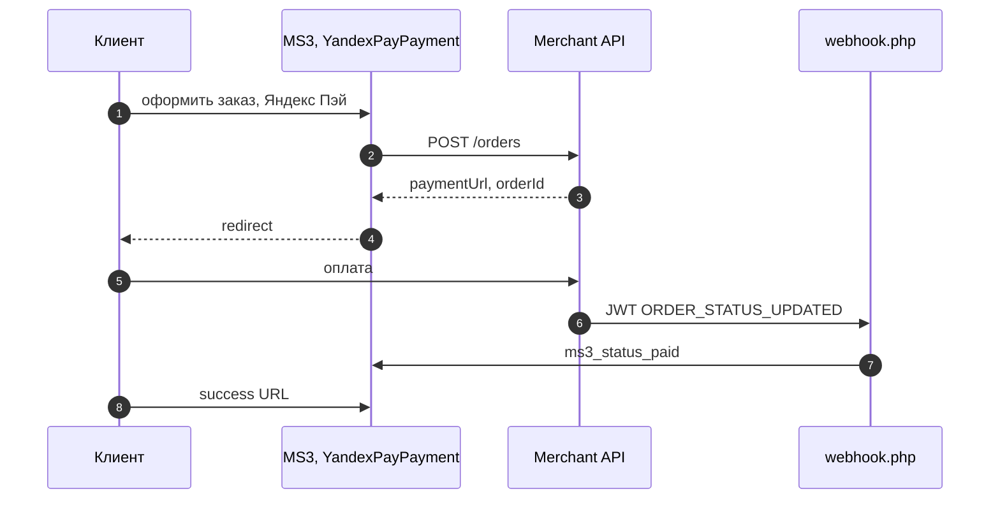
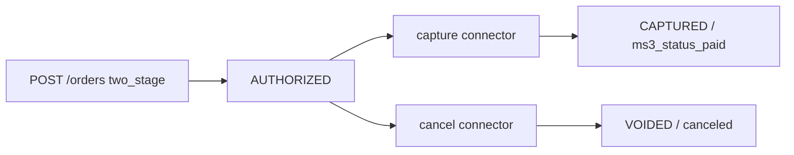

# Интеграция mspYandexPay

Нужны только шаги установки? Откройте [Быстрый старт](quick-start). Ниже сопоставлены методы [Merchant API](https://pay.yandex.ru/docs/ru/custom/backend/merchant-api/) и классы **mspYandexPay** для MiniShop3.

## API ↔ код

| Метод / точка | Класс / файл | Назначение |
| --- | --- | --- |
| `POST /orders` | `YandexPayClient::createOrder()`, `YandexPay*Payment::send()`, `PaymentService` | Создание заказа, получение `paymentUrl` |
| `GET /orders/{id}` | `YandexPayClient::getOrder()` | Статус заказа в API |
| Capture | `YandexPayClient::captureOrder()`, processor `capture` | Списание после `AUTHORIZED` |
| Cancel / VOID | `YandexPayClient::cancelOrder()`, processor `cancel` | Отмена холда |
| Refund (v2) | `YandexPayClient::refundOrder()`, processor `refund` | Полный или частичный возврат |
| Webhook JWT | `webhook.php`, `JwtVerifier`, `WebhookService` | Уведомления, смена статуса MS3 |
| Cash Register / QR | `CashRegisterClient`, `YandexPayQrPayment` | Заказ с `orderSource=QR` |
| Кнопка на сайте | сниппет `mspYandexPayButton`, connector `payment/create` | Создание paymentUrl с витрины |

## Webhook {#webhook}

**URL на сайте:**

```text
https://ваш-домен.ru/assets/components/mspyandexpay/webhook.php
```

Официально: [Webhook Merchant API](https://pay.yandex.ru/docs/ru/custom/backend/merchant-api/webhook).

**Обработка:**

1. Тело запроса — JWT (`Content-Type: application/octet-stream`).
2. `JwtVerifier` проверяет ES256 по JWKS текущей среды и `merchantId` / `exp`.
3. `WebhookService` обрабатывает события и пишет идемпотентность в `msp_yandex_pay_webhook_events` (UNIQUE `event_key`).
4. Повтор того же события → HTTP 200 без повторной смены статуса.

<!-- MEDIA: Лог MODX с успешной верификацией JWT webhook | админка MODX, Журнал ошибок, запись [mspYandexPay] JWT verification passed -->

| Событие | Действие |
| --- | --- |
| `ORDER_STATUS_UPDATED` | маппинг `paymentStatus` → статус MS3 |
| `OPERATION_STATUS_UPDATED` + `SUCCESS` | `CAPTURE` → `CAPTURED`, `REFUND` → `REFUNDED`, `VOID`/`CANCEL` → `VOIDED` |

| Статус Yandex | Действие MS3 |
| --- | --- |
| `CAPTURED`, `CONFIRMED` | `ms3_status_paid` |
| `FAILED`, `VOIDED` | `ms3_status_canceled` |
| `REFUNDED` | `mspyandexpay_refunded_status_id` или `ms3_status_canceled` |
| `PENDING`, `AUTHORIZED`, `PARTIALLY_REFUNDED` | без смены статуса |

Заказ **не** помечается оплаченным при получении `paymentUrl`. `AUTHORIZED` (холд) тоже не paid.

IP whitelist не заменяет проверку JWT.

### WebhookController {#webhook-controller}

Класс `WebhookController` — точка входа HTTP для webhook JWT. Метод `handleRawJwt(string $jwt)`:

1. Вызывает `JwtVerifier::verify($jwt)` → декодирует payload.
2. Передаёт payload в `WebhookService::handle()` → идемпотентная обработка события.
3. Возвращает HTTP-ответ:

| Код | Тело | Когда |
| --- | --- | --- |
| 200 | `{"success": true, "duplicate": false, "message": "..."}` | Успешная обработка |
| 200 | `{"success": true, "duplicate": true, "message": "..."}` | Повтор события (идемпотентность) |
| 401 | `{"success": false, "message": "unauthorized"}` | Ошибка JWT (подпись, merchantId, exp) |
| 400 | `{"success": false, "message": "bad request"}` | Ошибка обработки payload |
| 500 | `{"success": false, "message": "internal error"}` | Неожиданная ошибка |

<!-- MEDIA: Пример ответа webhook 200 OK с duplicate=false | curl-запрос к webhook.php, ответ JSON -->

### JwtVerifier {#jwt-verifier}

Класс `JwtVerifier` проверяет подпись JWT алгоритмом **ES256** по публичным ключам JWKS Яндекс Пэй.

**Процесс верификации:**

1. Извлекает JWKS из URL среды: `https://sandbox.pay.yandex.ru/api/jwks` или `https://pay.yandex.ru/api/jwks`.
2. Кэширует JWKS на 10 минут (`jwksCacheTtl`), чтобы не дергать API на каждый webhook.
3. Проверяет подпись JWT и claims:
   - `merchantId` должен совпадать с `mspyandexpay_merchant_id`
   - `exp` (expiration) не истёк (leeway 60 секунд)
4. Возвращает декодированный payload или бросает `YandexPayAuthenticationException`.

<!-- MEDIA: Настройка ms pyandexpay_debug и лог верификации JWT | админка MODX, Системные настройки → ms pyandexpay_debug = Да; error log MODX → [mspYandexPay] JWT verification passed -->

**Ошибки верификации:**

- `Empty JWT` — пустое тело запроса
- `Invalid JWT signature or claims` — подпись не совпадает, истёк `exp`, неверный `merchantId`
- `Unable to load JWKS` — не удалось получить публичные ключи Яндекс
- `JWT merchantId mismatch` — merchantId в JWT не совпадает с настройкой MODX

**JWKS кэш:** статический `self::$jwksCache` живёт 10 минут. Для отладки можно вызвать `JwtVerifier::clearCache()`.

## Поток одностадийной оплаты

1. Покупатель оформляет заказ и выбирает **Яндекс Пэй**.
2. `YandexPayPayment::send()` собирает сумму из `msOrder` (`OrderBuilder`) и вызывает `POST /orders`.
3. Компонент сохраняет транзакцию в `msp_yandex_pay_transactions` и отдаёт redirect на `paymentUrl`.
4. Покупатель платит в форме Яндекс Пэй.
5. Webhook приносит `CAPTURED` / `CONFIRMED`.
6. `OrderStatusUpdater` выставляет **`ms3_status_paid`**.



## Двухстадийная схема {#двухстадийная}

1. В кабинете Яндекс Пэй включите двухстадийные платежи.
2. Используйте способ **«Яндекс Пэй (двухстадийная)»** (`YandexPayTwoStagePayment`).
3. После оплаты webhook приносит **`AUTHORIZED`**. Заказ в MS3 ещё не paid.
4. Спишите или отмените холд через connector (нужна mgr-сессия):

```text
assets/components/mspyandexpay/connector.php?action=capture&order_id=<id>&ctx=mgr
assets/components/mspyandexpay/connector.php?action=cancel&order_id=<id>&reason=...&ctx=mgr
```

Опционально передайте `amount` для partial capture. Финальный статус также приходит webhook’ом (`CAPTURE` / `VOID`).



## Возврат {#возврат}

После `CAPTURED` / `CONFIRMED` (и при `PARTIALLY_REFUNDED` для следующего частичного):

```text
assets/components/mspyandexpay/connector.php?action=refund&order_id=<id>&ctx=mgr
assets/components/mspyandexpay/connector.php?action=refund&order_id=<id>&amount=10.00&ctx=mgr
```

Частичный возврат собирает `targetCart`. Полный — статус из `mspyandexpay_refunded_status_id`.

## Split

- Глобально: `mspyandexpay_payment_methods=CARD,SPLIT` (или только `SPLIT`) и при необходимости `preferred_payment_method=SPLIT`.
- Или способ **«Яндекс Пэй + Сплит»**: методы `CARD`+`SPLIT`, preferred `SPLIT`.
- `mspyandexpay_is_prepayment=false` типичен для оплаты при получении.

## QR / Cash Register

1. Включите `mspyandexpay_qr_enabled`.
2. Активируйте способ **«Яндекс Пэй QR»** и привяжите к доставкам.
3. `YandexPayQrPayment::send()` создаёт заказ с `orderSource=QR` и channel в metadata.

## Кнопка на витрине

Сниппет **`mspYandexPayButton`** регистрирует `button.js` и кнопку, которая дергает connector `payment/create` и редиректит на `paymentUrl`.

Параметры:

| Параметр | Описание |
| --- | --- |
| `order_id` | ID заказа MS3. Если пусто, берётся `msorder.id` или заказ по `?msorder=<uuid>`. |
| `text` | Текст кнопки (по умолчанию «Оплатить Яндекс Пэй»). |
| `class` | CSS-класс (по умолчанию `ms3yp-button`). |

::: code-group

```fenom
{'!mspYandexPayButton' | snippet : [
    'order_id' => $id,
    'text' => 'Оплатить Яндекс Пэй',
]}
```

```modx
[[!mspYandexPayButton?
  &order_id=`[[+id]]`
  &text=`Оплатить Яндекс Пэй`
]]
```

:::

Показывайте кнопку только для заказов, которые ещё нужно оплатить. Повторный `send` при существующей транзакции переиспользует `payment_url` (idempotency).

## Checkout (MVP) {#checkout}

Endpoints для сценария Yandex Checkout по уже существующему заказу MS3 (`ms3-{id}` / `cart.externalId`):

```text
https://ваш-домен.ru/assets/components/mspyandexpay/checkout/render.php
https://ваш-домен.ru/assets/components/mspyandexpay/checkout/create.php
```

Авторизация: JWT в `Authorization: Bearer …`. Полная доставка Yandex Logistics в пакет не входит.

### checkout/render.php {#checkout-render}

**Назначение:** отдать данные заказа для отображения в форме Checkout Yandex.

**Запрос:**

```http
POST /assets/components/mspyandexpay/checkout/render.php
Content-Type: application/json
Authorization: Bearer <JWT>

{
  "cart": {
    "externalId": "ms3-123"
  }
}
```

**Тело запроса:**

| Поле | Тип | Описание |
| --- | --- | --- |
| `cart.externalId` | string | ID заказа MS3 в формате `ms3-{id}` |

**Ответ 200 OK:**

```json
{
  "success": true,
  "data": {
    "cart": {
      "externalId": "ms3-123",
      "total": "1000.00",
      "currency": "RUB",
      "items": [...]
    }
  }
}
```

**Ошибки:**

| Код | Тело | Когда |
| --- | --- | --- |
| 400 | `{"success": false, "message": "Invalid JSON"}` | Неверный JSON |
| 401 | `{"success": false, "message": "unauthorized"}` | JWT не прошёл верификацию |
| 400 | `{"success": false, "message": "..."}` | Ошибка обработки (заказ не найден) |
| 500 | `{"success": false, "message": "internal error"}` | Неожиданная ошибка |

<!-- MEDIA: Пример ответа render.php 200 OK с данными заказа | curl-запрос к render.php, ответ JSON -->

### checkout/create.php {#checkout-create}

**Назначение:** создать платёж в Yandex для существующего заказа MS3.

**Запрос:**

```http
POST /assets/components/mspyandexpay/checkout/create.php
Content-Type: application/json
Authorization: Bearer <JWT>

{
  "cart": {
    "externalId": "ms3-123"
  },
  "paymentMethod": "CARD"
}
```

**Тело запроса:**

| Поле | Тип | Описание |
| --- | --- | --- |
| `cart.externalId` | string | ID заказа MS3 `ms3-{id}` |
| `paymentMethod` | string | Опционально: `CARD`, `SPLIT` |

**Ответ 200 OK:**

```json
{
  "success": true,
  "paymentUrl": "https://pay.yandex.ru/l/...",
  "orderId": "yandex-order-id"
}
```

**Ошибки:** те же что у `render.php` + ошибки API Yandex (недостаточно средств, недоступен метод оплаты).

<!-- MEDIA: Лог MODX после успешного вызова create.php | админка MODX, Журнал ошибок, запись [mspYandexPay] Checkout create success -->

### Авторизация JWT {#checkout-jwt}

Оба endpoint требуют JWT в заголовке `Authorization: Bearer <JWT>`. JWT должен быть подписан вашим приватным ключом и содержать claims:

- `merchantId` — ваш Merchant ID
- `exp` — время истечения (не больше 1 часа)
- `iat` — время выпуска

Яндекс Пэй проверяет JWT через свой JWKS. Компонент проверяет тот же JWT на входе через `JwtVerifier`.

<!-- MEDIA: Пример JWT payload для Checkout | jwt.io, decoded payload с merchantId, exp, iat -->

## Процессоры (Connector) {#processors}

Компонент предоставляет `connector.php` с действиями **capture**, **cancel**, **refund**. Каждый процессор вызывается через GET/POST запрос к `assets/components/mspyandexpay/connector.php` с параметром `action` и `order_id`. Для `refund` и `capture` может передаваться дополнительный параметр `amount` (частичный capture/refund) и `lines` (JSON‑массив позиций для частичного возврата).

### capture {#processor-capture}

```text
assets/components/mspyandexpay/connector.php?action=capture&order_id=<id>&ctx=mgr
```

- **`order_id`** – ID записи в таблице `{prefix}msp_yandex_pay_transactions`.
- **`ctx=mgr`** – обязательный контекст менеджера, иначе процессор отклонит запрос (требуется сессия менеджера).

**Поведение:**

1. Загружает объект `Order` из `TransactionRepository`.
2. Вызывает `OrderOperationService::capture($order, $payload)`.
3. Если передан `amount`, формирует `orderAmount` в запросе к Yandex API.
4. При успехе возвращает JSON `{ "success": true }`, иначе `{ "success": false, "message": "…" }`.

<!-- MEDIA: Пример запроса capture через браузер или curl | curl -X GET ".../connector.php?action=capture&order_id=123&ctx=mgr" -->

### cancel {#processor-cancel}

```text
assets/components/mspyandexpay/connector.php?action=cancel&order_id=<id>&reason=...&ctx=mgr
```

- **`reason`** – произвольный текст причины отмены (по умолчанию `Merchant cancel`).

**Поведение:**

1. Загружает `Order`.
2. Вызывает `OrderOperationService::cancel($order, $reason)`.
3. Делает запрос `POST /orders/{orderId}/cancel` к Yandex API.
4. Возвращает JSON‑ответ аналогично `capture`.

<!-- MEDIA: Лог отмены cancel в error log MODX | админка MODX, Журнал ошибок, запись [mspYandexPay] Cancel failed -->

### refund {#processor-refund}

```text
assets/components/mspyandexpay/connector.php?action=refund&order_id=<id>&ctx=mgr
# Частичный возврат
assets/components/mspyandexpay/connector.php?action=refund&order_id=<id>&amount=10.00&ctx=mgr
# Возврат по линиям
assets/components/mspyandexpay/connector.php?action=refund&order_id=<id>&lines={"items":[...]}&ctx=mgr
```

- **`amount`** – опциональная сумма для частичного возврата.
- **`lines`** — JSON‑строка или массив позиций, которые нужно вернуть (используется API Yandex `refund` с `lines`).

**Поведение:**

1. Загружает `Order`.
2. Формирует массив `$options` из `amount` и/или `lines`.
3. Вызывает `OrderOperationService::refund($order, $options)` → запрос к Yandex API `POST /orders/{orderId}/refund`.
4. Возвращает JSON‑ответ аналогично `capture`.

<!-- MEDIA: Пример ответа refund с `partial` статусом | curl‑запрос к connector.php?action=refund&order_id=123&amount=10.00&ctx=mgr, ответ JSON -->

## Хранение транзакций

| Таблица | Назначение |
| --- | --- |
| `{prefix}msp_yandex_pay_transactions` | order_id, UNIQUE yandex_order_id, payment_url, статусы, сумма, environment |
| `{prefix}msp_yandex_pay_webhook_events` | идемпотентность webhook (UNIQUE `event_key`) |

В `msOrder.properties` пишутся `yandex_pay_order_id`, `yandex_pay_payment_url`, статусы после webhook / операций.

## Безопасность

- JWT обязателен. IP whitelist не заменяет подпись.
- Сумма заказа берётся с сервера из `msOrder`, не из request покупателя.
- API key не попадает во frontend и маскируется в логах.
- Capture / cancel / refund через connector требуют сессию mgr.
- Default environment — sandbox.

## Ограничения

- Фискализация чеков настраивается в кабинете Yandex или своим ОФД, не в payload компонента.
- Two-stage и часть sandbox-сценариев могут требовать включения у поддержки Yandex.
- Checkout — MVP без логистики Yandex.
- Ядро MiniShop3 пакет не меняет.

## Что дальше

- [Системные настройки](settings)
- [FAQ](faq)
- Официально: [план интеграции](https://pay.yandex.ru/docs/ru/custom/integration-guide), [фискализация](https://pay.yandex.ru/docs/ru/fiscalization)
