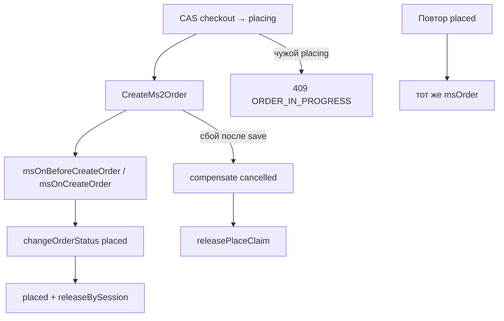

# Checkout и заказ

## Корзина (`basket/check`)

Ответ успеха: `{"items":[…]}`. Успешный item **не** содержит `available`.

| Поле | Значение |
|------|----------|
| `final_price` / `regular_price` | целые рубли (`floor`), не копейки |
| `decimal_final_price` / `decimal_regular_price` | всегда рядом |
| доставка `cost` | рубли |
| `items[].warehouses[].available_quantity` | int |
| `warehouses[].id` | `warehouse_id` |

`ProductMapper::toMinor()` в runtime не вызывается. `price` после `publishCosts` снимается. Доступно = остаток из [stock](stock) минус активные soft-reserve (`status = active`).

1. Пакет нормализует `items` / `products` (`offer_id`, иначе `id`, иначе `product_id` = id ресурса `msProduct`).
2. Берёт цену из `msProduct::getPrice()`, если метод есть. Иначе `msProductData.price` (рубли каталога).

Ошибки: HTTP 422, верхний `error.code` = `BASKET_CHECK_FAILED`.

| Поле | Значение |
|------|----------|
| `error.details.errors[].code` | `PRODUCT_NOT_FOUND` или `INSUFFICIENT_STOCK` |
| `error.details.errors[].id` | не `offer_id` |
| у нехватки | ещё `available` (int) |
| неопубликованный товар | `PRODUCT_NOT_FOUND` |

## Сессия (`POST /api/v1/checkout`)

Ответ: `session_id` и `order_number` (= тот же `session_id`). Soft-reserve пишется в `ms_yandexcommerce_reservations` через `replaceForSession` (строки сессии удаляются и вставляются заново).

- Повтор с тем же ключом идемпотентности резерв не удваивает ([ycp](ycp)).
- Тот же `session_id` без нового ключа резерв тоже не удваивает.
- Чужой `session_id`: другая сессия и другой резерв.

## Размещение (`placed`)

CAS claim: `checkout` → `placing` (`SessionService::claimForPlace`). `409 ORDER_IN_PROGRESS` только когда CAS проигран и чужой запрос всё ещё в `placing`.

| Случай | Результат |
|--------|-----------|
| Своя сессия уже `placing` (обрыв запроса) | claim возвращает сессию, создание продолжается, `409` нет |
| Проигравший CAS при статусе `placed` и непустом `order_id` | тот же заказ, не `409` |

Собирает товары из `payload.items` snapshot. Цена: непустой `decimal_final_price`, иначе `final_price` snapshot, иначе каталог в `CreateMs2Order`. Пустой snapshot: `releasePlaceClaim`, HTTP 422, `EMPTY_CART`. Compensate не вызывается.

`CreateMs2Order::execute()`:

1. xPDO: `msOrder` + `msOrderAddress` (`receiver`, …) + `msOrderProduct`
2. `save` пишет `ms2_status_draft`, если он > 0, иначе `0`
3. события `msOnBeforeCreateOrder` (до `save`) / `msOnCreateOrder` (после)
4. `$miniShop2->changeOrderStatus($id, …)`: `status_placed_id` или `ms2_status_new`, иначе `1`
5. Сбой после save (пустой `msOnCreateOrder` или исключение на статусе): compensate (`status_cancelled_id` или `ms2_status_canceled`, иначе `4`) и `releasePlaceClaim`. Маппинг: [statuses](statuses).

**Не** вызывается `$order->submit()` и `payment->send()`.

Идемпотентность повторного `placed`: заказ из таблицы сессий или `msOrder.properties.ycp_session_id` (поиск `LIKE %session_id%`).

В ответе `order_number` = `session.external_order_id` из тела `order_id`, иначе `external_order_id` (то же в `msOrder.properties.ycp_external_order_id`).

## Soft-reserve и отмена

Учёт в `ms_yandexcommerce_reservations`. Поле `remains` в каталоге пакет не уменьшает.

Резерв снимается:

- при успешном `placed` (`releaseBySession`)
- при `checkout/cancel` / `order/cancel`
- при expire сессии (`expire()` из `applyExpiry`, когда `expires_at` в прошлом)

Если у сессии `order_id > 0`, `cancelCheckout` и `cancelOrder` сначала вызывают `changeOrderStatus` на `getCanceledStatusId()`, затем `cancelLocal` снимает резерв.

Уже `cancelled` или `expired`: ранний ответ без повторной смены статуса.
