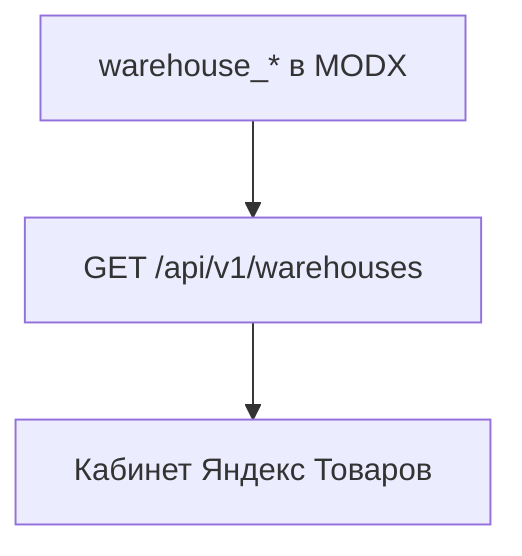

# Конфигурация

Префикс ключей: `msyandexcommerce_`. В менеджере area: `yandexcommerce`.

## Включение и режим


| Ключ | Тип | По умолчанию | Эффект |
|------|-----|--------------|--------|
| `msyandexcommerce_enabled` | bool | `false` | После middleware: при `false` YCP-маршруты (кроме `/health`) → `503`, `error.code=DISABLED`. Раньше: нет HTTPS → `403 HTTPS_REQUIRED`; пустой `api_token` → `503 UNAUTHORIZED`; чужой Bearer → `401 UNAUTHORIZED`. `POST /v1/webhook` при `enabled=false` тоже здесь, тело Pay: `{"reasonCode":"FORBIDDEN"}` при HTTP 503, не YCP `DISABLED` |
| `msyandexcommerce_mode` | list | `sandbox` | `sandbox` \| `production`. Неизвестное значение → `sandbox`. Пакет хост YCP по `mode` не меняет. Для Pay webhook переключает JWKS: `https://sandbox.pay.yandex.ru/api/jwks` / `https://pay.yandex.ru/api/jwks` |
| `msyandexcommerce_debug` | bool | `false` | Деталь исключения пишет только `PackageLogger::debug`. Нужны `debug=true` и `log_level=debug`. При `log_level=error` по умолчанию один `debug` деталь не даёт. `Request failed` (код и путь) всегда |
| `msyandexcommerce_log_level` | list | `error` | `error` \| `warning` \| `info` \| `debug`. Неизвестное → `error`. `sanitize` маскирует ключи с `token` / `authorization` / `password` / `secret` и подстроку `Bearer …` |

## Токены

| Ключ | Тип | По умолчанию | Эффект |
|------|-----|--------------|--------|
| `msyandexcommerce_api_token` | password | пусто; резолвер при install/upgrade, если пусто | Bearer inbound, `hash_equals`. Пустой токен → `503 UNAUTHORIZED` («API token is not configured»), до сравнения. `/health` и `/v1/webhook` Bearer не трогают |
| `msyandexcommerce_ycp_api_token` | password | пусто | `getYcpApiToken()` есть, исходящих вызовов YCP API в runtime нет |

**Сгенерировать API-токен** (CMP **Yandex Commerce (YCP)**, страница **Yandex Commerce: диагностика**) → processor `settings/regenerate_token`. Ответ один раз: `object.api_token`. Перенесите в кабинет YCP (имя поля задаёт Яндекс).

Не храните токен в JS, чанках и git.


## Сессия и лимиты

| Ключ | Тип | По умолчанию | Эффект |
|------|-----|--------------|--------|
| `msyandexcommerce_session_ttl` | number | `3600` | TTL checkout session (сек), минимум 60 |
| `msyandexcommerce_max_request_bytes` | number | `1048576` | Сырое тело любого не-GET (не только JSON). Пол: `max(1024, значение)`. YCP: `413 PAYLOAD_TOO_LARGE`. На `/v1/webhook`: 413 → `Kernel` → HTTP 403, `reasonCode: FORBIDDEN`. GET не лимитируется |
| `msyandexcommerce_https_required` | bool | `true` | Нет HTTPS → `403 HTTPS_REQUIRED` на YCP, кроме `/health`. На `/v1/webhook`: HTTP 403, `{"reasonCode":"FORBIDDEN"}`, не `error.code=HTTPS_REQUIRED` |
| `msyandexcommerce_trust_proxy` | bool | `false` | `true`: HTTPS по `X-Forwarded-Ssl: on` или `X-Forwarded-Proto=https`. `false`: эти заголовки дают `isHttps() === false`, `$_SERVER['HTTPS']` не читается. HTTPS за прокси с заголовками без флага → `403 HTTPS_REQUIRED`. Только за доверенным reverse proxy |

## Склад

| Ключ | Тип | По умолчанию | Эффект |
|------|-----|--------------|--------|
| `msyandexcommerce_warehouse_id` | text | `main` | `id` склада в ответе `/warehouses` (читает и корзина) |
| `msyandexcommerce_warehouse_title` | text | пусто | Заголовок (запасной вариант: `Main warehouse`) |
| `msyandexcommerce_warehouse_address` | textarea | пусто | Адрес строкой |
| `msyandexcommerce_warehouse_phone` | text | пусто | Телефон |

Один склад из настроек MODX. Кабинет: `GET /api/v1/warehouses`.



### Склады в кабинете Яндекса {#где-кнопка-обновить-склады-через-ycp}

В MODX «Обновить склады» нет (в CMP только **Сгенерировать API-токен**). Импорт: [кабинет Яндекс Товаров](https://merchants.yandex.ru/shop?tab=checkout), подключение **YCP протокол (API)**. Меню и подписи: [справка Яндекса](https://yandex.ru/support/merchants/ru/buy-button).

Проверка:

```bash
curl -sS "$BASE/api/v1/warehouses" \
  -H "Authorization: Bearer $TOKEN"
```

В ответе — склад из `warehouse_*` (id, title, address, phone). Прод: [production-go-live](production-go-live).

## Доставка и оплата


| Ключ | Тип | По умолчанию | Эффект |
|------|-----|--------------|--------|
| `msyandexcommerce_delivery_courier_id` | number | `0` | `msDelivery.id` для типа `courier` |
| `msyandexcommerce_delivery_pickup_id` | number | `0` | `msDelivery.id` для типа `pickup` |
| `msyandexcommerce_payment_online_id` | number | `0` | `msPayment.id` для `online` / `card` / `yandex` |
| `msyandexcommerce_payment_cod_id` | number | `0` | `msPayment.id` для `cod` / `cash` / `offline` / `on_delivery` |
| `msyandexcommerce_pickup_points_json` | textarea | `[]` | JSON-массив собственных ПВЗ для `pickup_points`. Битый JSON → `[]` |
| `msyandexcommerce_delivery_offset_days` | number | `0` | Календарные дни до окна доставки. В runtime `max(0, значение)` |
| `msyandexcommerce_delivery_days_min` | number | `1` | Нижняя граница окна. Пол `max(0, значение)` |
| `msyandexcommerce_delivery_days_max` | number | `3` | Верхняя граница. Эффективное значение не ниже `delivery_days_min` |

Оба `delivery_*_id` = `0`: в options все `msDelivery` с `active=1`, тип каждой — `courier`, не `pickup`. Хотя бы один id > 0: запасной список не берётся. Неактивный id пропускается.

Нет `payment_*_id` для метода (или другой метод): `placed` → `422 PAYMENT_NOT_CONFIGURED`. Пустое поле метода в `placed` → по умолчанию `online`.

`delivery/options`: `date_from` / `date_to` = сегодня + offset, + min / + max. Тариф на сайте: `ms2ycpOnDeliveryOptions`. См. [delivery](delivery), [plugins](plugins).

## Статусы YCP → miniShop2


`0` в настройке = miniShop2 по умолчанию (кроме paid). Статус меняет только `Ms2Gateway::changeOrderStatus` (id < 1 — выход).

`GET /api/v1/order`, `StatusMapper::toYcpStatus`: id доставки → `delivered`, отмены → `cancelled`, остальное (placed, paid) → `in_progress`. Четыре id в ответ YCP-строками placed/paid не отдаются.

| Ключ | 0 → | Эффект |
|------|-----|--------|
| `msyandexcommerce_status_placed_id` | `ms2_status_new`, иначе `1` | После `placed` |
| `msyandexcommerce_status_paid_id` | `ms2_status_paid`, иначе `0` (не менять) | `CAPTURED` в Pay webhook `/v1/webhook` |
| `msyandexcommerce_status_cancelled_id` | `ms2_status_canceled`, иначе `4` | `cancel` и compensate |
| `msyandexcommerce_status_delivered_id` | `ms2_status_done`, иначе `2` | `order/delivered` |

`POST /order/status` в YCP нет. Оплата: JWT-вебхук на `POST /v1/webhook` ([payment](payment)).

## Яндекс Пэй webhook


| Ключ | Тип | По умолчанию | Эффект |
|------|-----|--------------|--------|
| `msyandexcommerce_yapay_webhook_enabled` | bool | `false` | Принимать `POST /v1/webhook` |
| `msyandexcommerce_yapay_merchant_id` | text | пусто | UUID мерчанта. Пусто → HTTP 403, `reasonCode: FORBIDDEN`, JWT не проверяется. После подписи: `merchantId` в payload, `hash_equals` |

URL вебхука: `…/assets/components/msyandexcommerce/api.php/v1/webhook`. Callback URL в ЛК Pay: [документация Яндекс Пэй](https://pay.yandex.ru/). См. [payment](payment).

## Кнопка

| Ключ | Тип | По умолчанию | Эффект |
|------|-----|--------------|--------|
| `msyandexcommerce_button_enabled` | bool | `true` | `false` → `BUTTON_DISABLED` (403). Сниппет без `&debug=`1`` — пустая строка. С `&debug=`1`` — HTML-комментарий с текстом исключения |

Подробнее: [button](button).
